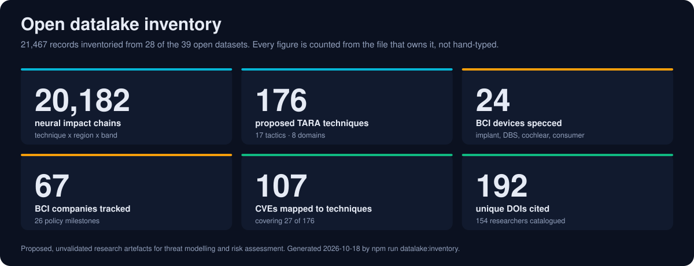
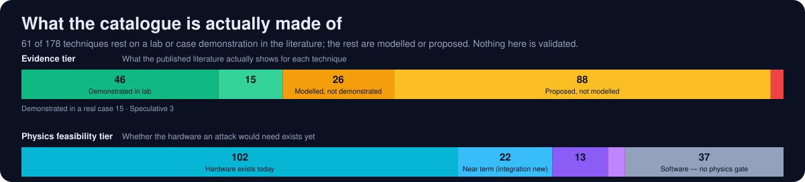

<div align="center">


# Neurosecurity

### Open, machine-readable threat models for brain-computer interfaces

**A proposed threat taxonomy, a proposed scoring extension, and a proposed layered architecture — published as JSON you can query, fork, or contradict.**

[](LICENSE)
[](https://doi.org/10.5281/zenodo.18640105)
[](https://qinnovate.com)
[](osi-of-mind/VALIDATION.md)
[](datalake/)

**[Framework](https://qinnovate.com/framework/)** · **[Threat Atlas](https://qinnovate.com/atlas/tara/)** · **[Scoring](https://qinnovate.com/atlas/scoring/)** · **[Datalake](datalake/)** · **[Governance](governance/)** · **[Working Paper](https://doi.org/10.5281/zenodo.18640105)**

</div>

<!-- BEGIN purpose-and-limits:summary (generated by npm run purpose:sync from src/data/purpose-and-limits.json; do not edit) -->
QIF, TARA and NISS help builders and defenders start a neural-device threat model, rank which protections to build first, and describe potential impact in shared terms. Status: a proposed research framework; unvalidated, not a standard, not clinical guidance or a compliance tool. [Purpose and limits](https://github.com/qinnovates/neurosecurity/blob/main/governance/README.md#purpose-and-limits).
<!-- END purpose-and-limits:summary -->

<!-- BEGIN GENERATED: datalake-inventory -->
<!-- Generated by src/scripts/generate-datalake-inventory.mjs — run `npm run datalake:inventory`. Hand edits are overwritten. -->



**20,927 records inventoried below, from 27 of the 42 datasets in [`datalake/`](datalake/).** 19,658 neural impact chains · 178 proposed techniques · 24 BCI devices specced · 68 companies tracked · 108 CVEs mapped · 266 unique DOIs cited.

Counted from the files themselves on 2026-10-31. Re-run `npm run datalake:inventory` and every figure on this page moves with the data; `npm run datalake:inventory:check` fails the build if it has drifted.

### Threat model

| Inventory | Count | Derived from |
|---|---:|---|
| Neural impact chains <sub>technique x brain region x QIF band permutations</sub> | **19,658** | [`datalake/impact-chains.json`](datalake/impact-chains.json) |
| TARA techniques | **178** | [`datalake/qtara-registrar.json`](datalake/qtara-registrar.json) |
| CVE to technique mappings | **108** | [`datalake/cve-technique-mapping.json`](datalake/cve-technique-mapping.json) |
| QIF hazards | **33** | [`datalake/qif-hazards.json`](datalake/qif-hazards.json) |
| Severity anchors | **25** | [`datalake/severity-anchors.json`](datalake/severity-anchors.json) |
| TARA tactics | **17** | [`datalake/qtara-registrar.json`](datalake/qtara-registrar.json) |
| TARA domains | **8** | [`datalake/qtara-registrar.json`](datalake/qtara-registrar.json) |
| Physics guardrails | **8** | [`datalake/qif-guardrails.json`](datalake/qif-guardrails.json) |
| Composed attack chains | **7** | [`datalake/tara-chains.json`](datalake/tara-chains.json) |

### Neuroanatomy

| Inventory | Count | Derived from |
|---|---:|---|
| Brain-region evidence rows | **58** | [`datalake/qif-anatomy-region-evidence.json`](datalake/qif-anatomy-region-evidence.json) |
| Neurological condition mappings | **50** | [`datalake/qif-neurological-mappings.json`](datalake/qif-neurological-mappings.json) |
| Neural pathways | **45** | [`datalake/qif-neural-pathways.json`](datalake/qif-neural-pathways.json) |
| Brain regions | **38** | [`datalake/qif-brain-bci-atlas.json`](datalake/qif-brain-bci-atlas.json) |
| Anatomy atlas crosswalk rows | **34** | [`datalake/qif-anatomy-crosswalk.json`](datalake/qif-anatomy-crosswalk.json) |
| Device to region mappings | **24** | [`datalake/qif-brain-bci-atlas.json`](datalake/qif-brain-bci-atlas.json) |
| Receptor families | **20** | [`datalake/qif-receptors.json`](datalake/qif-receptors.json) |
| EEG electrode positions | **20** | [`datalake/qif-neurosim.json`](datalake/qif-neurosim.json) |
| Neurotransmitters | **18** | [`datalake/qif-neurotransmitters.json`](datalake/qif-neurotransmitters.json) |
| Anatomy sources vetted | **16** | [`datalake/qif-anatomy-sources.json`](datalake/qif-anatomy-sources.json) |
| Anatomy review verdicts | **16** | [`datalake/qif-anatomy-verdicts.json`](datalake/qif-anatomy-verdicts.json) |
| Cranial nerves | **12** | [`datalake/qif-cranial-nerves.json`](datalake/qif-cranial-nerves.json) |
| QIF bands | **11** | [`datalake/qif-brain-bci-atlas.json`](datalake/qif-brain-bci-atlas.json) |
| White-matter tracts | **10** | [`datalake/qif-neurosim.json`](datalake/qif-neurosim.json) |
| Neuroendocrine axes | **7** | [`datalake/qif-neuroendocrine.json`](datalake/qif-neuroendocrine.json) |
| Glial cell types | **6** | [`datalake/qif-glial-cells.json`](datalake/qif-glial-cells.json) |

### Device & market landscape

| Inventory | Count | Derived from |
|---|---:|---|
| BCI companies tracked | **68** | [`datalake/bci-landscape.json`](datalake/bci-landscape.json) |
| Policy timeline entries | **27** | [`datalake/bci-landscape.json`](datalake/bci-landscape.json) |
| Industry timeline entries | **25** | [`datalake/bci-landscape.json`](datalake/bci-landscape.json) |
| BCI devices with hardware specs <sub>implant, DBS, cochlear and consumer EEG classes</sub> | **24** | [`src/site/bci-hardware-inventory.json`](src/site/bci-hardware-inventory.json) |

### Evidence & provenance

| Inventory | Count | Derived from |
|---|---:|---|
| Researchers catalogued | **156** | [`datalake/research-registry.json`](datalake/research-registry.json) |
| Research organisations | **73** | [`datalake/research-registry.json`](datalake/research-registry.json) |
| Derivation milestones | **31** | [`datalake/derivation-timeline.json`](datalake/derivation-timeline.json) |
| Institutions | **28** | [`datalake/research-registry.json`](datalake/research-registry.json) |
| EEG datasets catalogued | **26** | [`datalake/eeg-samples.json`](datalake/eeg-samples.json) |
| Standards tracked | **14** | [`datalake/research-registry.json`](datalake/research-registry.json) |
| Legislation tracked | **12** | [`datalake/research-registry.json`](datalake/research-registry.json) |
| Validation entries | **9** | [`datalake/validation-registry.json`](datalake/validation-registry.json) |
| Governance frameworks mapped | **7** | [`datalake/qif-ethics-controls.json`](datalake/qif-ethics-controls.json) |

### How strong is the evidence



- **61 of 178 techniques** rest on a lab or case demonstration in the published literature (46 lab, 15 case). The remaining 117 are modelled, proposed or speculative.
- Hardware that exists today would suffice for **102 of them**; 37 are software or network attacks that physics does not constrain at all.
- **108 CVEs** are mapped to 27 of 178 techniques (15.2%). Mapping is ongoing — [contributions welcome](#collaboration).

These splits are published here rather than buried, because anyone can compute them from the JSON in a minute, and a catalogue that hides its theoretical share is not worth scoring against.

<!-- END GENERATED: datalake-inventory -->

---

## Why this exists

BCIs are moving from labs into clinics and consumer headsets faster than the security vocabulary for them is forming. A CVSS vector cannot express "this one causes irreversible tissue damage," and an ATT&CK matrix has no column for a device wired to a thalamus.

This repository is one attempt at that vocabulary. It asks a question the data-centric security models skip: **what happens to a *patient* when their brain-computer interface is compromised?** Not the data. Not the device. The person.

Everything here is **proposed and unvalidated**, built for threat modelling and risk and impact assessment — never as an attack toolkit.

## Mission

**Purpose** — Give BCI builders, clinicians and regulators a shared, testable way to describe neural attack surface before the technology outpaces governance.

**Mission** — Make neurosecurity and neuroengineering more accessible: publish the threat taxonomy, the scoring extension, the anatomy mappings and the citations in the open, in formats a researcher can query and a reviewer can refute.

**Vision** — A neural interface should arrive with the same security assurance a pacemaker or a TLS stack does. Nothing in this repository gets there alone; it is published so that groups with hardware, IRB approval and clinical expertise can test it, extend it, or tear it down.

## Start here

| If you are a... | Start with | What you get |
|---|---|---|
| **Security practitioner** | [Threat Atlas](https://qinnovate.com/atlas/tara/) · [`qtara-registrar.json`](datalake/qtara-registrar.json) | The technique catalogue with tactics, bands, CVSS vectors and proposed NISS metrics |
| **Neuroscience / BCI researcher** | [QIF Model](https://qinnovate.com/framework/) · [`qif-brain-bci-atlas.json`](datalake/qif-brain-bci-atlas.json) | Brain regions, device-to-region mappings, pathways, physics constraints, with citations |
| **Data consumer / agent** | [`datalake/`](datalake/) · [`inventory.json`](datalake/inventory.json) | Every dataset as plain JSON, plus a generated inventory of what is in them |
| **Policy / governance reader** | [Governance](governance/) · [Policy Proposal](governance/policy/NEUROSECURITY_POLICY_PROPOSAL.md) | Neurorights mapping, UNESCO alignment, GRC gap analysis, recommendations |
| **Reviewer or sceptic** | [VALIDATION.md](osi-of-mind/VALIDATION.md) · [Derivation Log](osi-of-mind/QIF-DERIVATION-LOG.md) | What has been tested, what has not, and the decision trail for every claim |

## Query the data in 30 seconds

No SDK, no API key, no account. The datasets are files.

```bash
# What are the highest-severity proposed techniques, and which QIF bands do they touch?
curl -s https://raw.githubusercontent.com/qinnovates/neurosecurity/main/datalake/qtara-registrar.json \
  | jq -r '.techniques[] | select(.severity=="critical" or .severity=="high")
           | [.id, .severity, (.bands|join("/")), .attack] | @tsv' \
  | column -t -s$'\t' | head
```

```bash
# Which BCI devices are mapped to which brain regions?
curl -s https://raw.githubusercontent.com/qinnovates/neurosecurity/main/datalake/qif-brain-bci-atlas.json \
  | jq -r '.device_region_mappings[] | [.device_id, .region_id] | @tsv'
```

Clone it and the whole corpus is local: `git clone https://github.com/qinnovates/neurosecurity && ls neurosecurity/datalake/*.json`

## Scope and limits

The canonical statement is [Purpose and limits](governance/README.md#purpose-and-limits), summarised above and generated from a single source. Two things it is worth repeating here:

- **Nothing here is validated.** QIF, TARA, NISS, NSP, Runemate, Neurowall and the hazard set are proposed frameworks and research tools — not peer-reviewed, not independently replicated, not clinically validated, not adopted by any standards body. [VALIDATION.md](osi-of-mind/VALIDATION.md) lists exactly what was tested and in what tier.
- **By using this repository you consent** to the terms in [CODE_OF_CONDUCT.md](governance/CODE_OF_CONDUCT.md). See also the [Security Policy](governance/SECURITY.md). The human brain is not a test environment.

---

## What is Neurosecurity?

Neuroethics has two hemispheres (Roskies, 2002): the *ethics of neuroscience* governs how brain research is conducted, while the *neuroscience of ethics* asks what the brain reveals about moral reasoning. Neurosecurity follows the same structure:

**Security of Neuroscience** — Defending neural systems. Threat modeling, scoring, encryption, monitoring. Engineering that works today.

**Neuroscience of Security** — What the brain teaches us about security. New threats, new rights, and the boundaries between attack and therapy that need to be drawn before the technology outpaces governance.

| | Security of Neuroscience | Neuroscience of Security |
|---|---|---|
| **Question** | How do we defend neural systems? | What are we defending, and from what? |
| **Method** | Engineering | Research + philosophy |
| **Output** | Tools, protocols, detections | Principles, rights, governance |
| **In this repo** | TARA, NISS, NSP, Neurowall, QIF Model | Governance, neurorights, dual-use insight |

## Repository

```
neurosecurity/
├── datalake/         Machine-readable datasets — the threat catalogue, atlas, landscape, evidence
├── osi-of-mind/      QIF Model — specs, whitepapers, derivation logs, threat catalog
├── research/         Blog posts, academic paper, clinical notes
├── governance/       Policy, ethics, consent, changelog, security policy
├── src/              Website source (Astro) + build scripts
└── _archive/         Historical (ONI framework, old prompts)
```

Each directory has a `CONTEXT.md` with a summary and file map. Start with any directory's `README.md` for full documentation.

**Full transparency:** [Transparency Statement](governance/TRANSPARENCY.md) | [Derivation Log](osi-of-mind/QIF-DERIVATION-LOG.md) | [Decision Log](governance/DECISION-LOG.md) | [Validation Status](osi-of-mind/VALIDATION.md)

---

<details>
<summary><strong>Frameworks, tools and status</strong></summary>

### Frameworks & Specifications

| Component | Description | Status |
|-----------|-------------|--------|
| **[QIF](https://qinnovate.com/framework/)** | 11-band hourglass security architecture for BCIs | Proposed, v6.3 ([v8.0](osi-of-mind/whitepapers/QIF-WHITEPAPER-V8.md)) |
| **[TARA](https://qinnovate.com/atlas/tara/)** | BCI technique pairs, STIX 2.1 registry | Proposed, v1.7 |
| **[NISS](https://qinnovate.com/atlas/scoring/)** | CVSS v4.0 extension proposal for neural interfaces (6 neural metrics) | Proposed, v1.1 |
| **[NSP](https://qinnovate.com/tools/nsp/)** | Post-quantum wire protocol for BCI data links | In development, v0.5 |
| **[Runemate](https://qinnovate.com/tools/runemate/)** | Native DSL compiler (67.8% compression in simulation) | v1.0 Compiler |
| **[Security Guardrails](osi-of-mind/specs/qif-sec-guardrails.md)** | Physics-derived defense architecture for BCIs | Concept |
| **[qtara](https://pypi.org/project/qtara/)** | Python SDK for the TARA registry and STIX export. **Deprecated:** 0.4.0 is the final release; use [`datalake/qtara-registrar.json`](datalake/qtara-registrar.json) | v0.4.0 (deprecated) |

### Tools

| Component | Description | Status |
|-----------|-------------|--------|
| **[Neural Atlas](https://qinnovate.com/neural-atlas/)** | Browser-based neural security monitoring with sample EEG data, threat detection, and NISS scoring | Published (demo) |
| **[Neurowall](./osi-of-mind/tools/neurowall/)** | Neural firewall prototype (differential privacy + NISS + policy engine) | In development, v0.8 |
| **[Quorum](https://github.com/qinnovates/quorum)** | Orchestrate a swarm of AI experts on any question. Structured dissent, fact-checking, multi-agent validation. | `claude install qinnovates/quorum` |
| **[BCI Security Plugin](https://github.com/qinnovates/bci-security-plugin)** | BCI security toolkit for AI coding assistants. Scans code for neural data handling issues. | `claude install qinnovates/bci-security-plugin` |

### Governance

| Component | Description | Status |
|-----------|-------------|--------|
| **[Governance Wiki](https://qinnovate.com/governance/)** | Ethics, consent, regulatory compliance, accessibility | Published |
| **[Neurosecurity Governance](governance/policy/NEUROSECURITY_GOVERNANCE.md)** | Neurorights mapping, UNESCO alignment, GRC gap analysis | Published |
| **[Policy Proposal](governance/policy/NEUROSECURITY_POLICY_PROPOSAL.md)** | 6 recommendations for NIST, MITRE, FIRST, IEEE, FDA, UNESCO | v1.2 |

### Research & Academic

| Component | Description | Status |
|-----------|-------------|--------|
| **[Zenodo](https://doi.org/10.5281/zenodo.18640105)** | Working paper, CC-BY 4.0, LaTeX source included | Published |
| **[Research Sources](osi-of-mind/QIF-RESEARCH-SOURCES.md)** | Verified sources across 9 domains | Active |
| **[CVE-TARA Mapping](datalake/cve-technique-mapping.json)** | NVD-verified CVEs mapped to TARA techniques | Published |
| **[EEG Data Pipeline](datalake/EEG-DATA-PIPELINE.md)** | Curated EEG datasets, synthetic generation, KQL tagging, license verification | Active |
| FIRST.org CVSS SIG | NISS proposed as CVSS v4.0 extension; outreach in progress | In progress |
| Peer review / empirical validation | Requires collaborators, IRB, BCI hardware | Blocked |

</details>

<details>
<summary><strong>Validation summary — what has and has not been tested</strong></summary>

Solo research, tested honestly. Full methodology and limitations at **[VALIDATION.md](osi-of-mind/VALIDATION.md)** | **[Live dashboard](https://qinnovate.com/research/validation/)**

| What | Result | Tier |
|------|--------|------|
| [Neurowall coherence monitor](osi-of-mind/VALIDATION.md#val-001) | 11/14 at 15s, 9/9 at 20s, 50-run stats, 0% FPR | Simulation + Independent |
| [BrainFlow validation](osi-of-mind/VALIDATION.md#val-002) | 16-channel, 100% detection, 0% FPR | Independent |
| [Physics security guardrails](osi-of-mind/VALIDATION.md#val-007) | 12/13 constraints verified, 4-layer architecture | Analytical + Cross-AI |
| [Protocol vulnerability](osi-of-mind/VALIDATION.md#val-006) | Real vulnerability in BCI streaming protocol, responsibly disclosed | Disclosed |
| [NSP transport](osi-of-mind/VALIDATION.md#val-003) | Round-trip simulation PASS, 65-90% compression | Simulation |
| [NISS scoring engine](osi-of-mind/VALIDATION.md#val-004) | 109/109 techniques scored, PINS flags correct | Simulation |
| [Citation verification](osi-of-mind/VALIDATION.md#val-009) | 3 fabricated citations caught and removed from preprint v1.0 | Audit |
| **Not yet tested** | NISS clinical validation, DSM-5-TR mappings, BCI Limits Eq, real EEG, real hardware, real attacks | |

This is early-stage research by a solo researcher. Empirical validation requires BCI hardware, IRB approval, and clinical expertise. Everything is published openly so research groups with those resources can test, validate, refute, or extend it.

</details>

<details>
<summary><strong>The TARA insight — attack and therapy share the mechanism</strong></summary>

TARA started as an attack matrix. BCI techniques catalogued from published literature. Something unexpected emerged: the same mechanisms kept showing up on the therapeutic side.

Signal injection is an attack vector. It is also the basis of neurostimulation therapy for depression, Parkinson's, and chronic pain. The boundary between attack and therapy is not the mechanism. It is consent, dosage, and oversight.

Most of the catalogued techniques map to a therapeutic counterpart today — the exact split is in [`datalake/inventory.json`](datalake/inventory.json) and the registrar's `statistics.tara.dual_use_breakdown`. This means the same framework that scores whether an attack is dangerous can also help bound whether a therapy is safe. TARA is both a threat registry and a safety reference.

[TARA Atlas](https://qinnovate.com/atlas/tara/) | [TARA blog post](https://qinnovate.com/news/2026-02-09-tara-therapeutic-atlas-of-risks-and-applications/)

</details>

<details>
<summary><strong>Why neurosecurity needs three fields</strong></summary>

Three fields converge on BCIs. None covers the full problem alone.

| Field | Contributes | Cannot Do Alone |
|-------|------------|----------------|
| Neuroethics | Policies, rights frameworks, consent models | Detect a P300 interrogation attack in real time |
| Neuroscience | Mechanism knowledge, attack surface understanding | Score severity, map attack chains, build detection systems |
| Cybersecurity | TTPs, scoring, detection, incident response | Understand neural biology or define neurorights |

**Neurosecurity** (Denning, Matsuoka & Kohno, 2009) bridges all three. QIF is one attempt to operationalize that bridge — taking phenomena described by neuroscientists and concerns raised by neuroethicists and putting them into a testable security framework.

[Neurosecurity Governance](governance/policy/NEUROSECURITY_GOVERNANCE.md) | [Origin classification of every technique](datalake/qtara-registrar.json)

</details>

<details>
<summary><strong>Architecture — QIF, TARA, NISS, NSP, Runemate</strong></summary>

### QIF

An 11-band hourglass architecture: 7 neural bands (N7 Neocortex down to N1 Spinal Cord), a physical interface boundary (I0, the electrode-tissue interface), and 3 synthetic bands organized by physics regime and spatial scale (S1 Near-Field/On-Device, S2 Guided-Wave/Host-Local, S3 Far-Field/Wide-Area).

- **Site:** [qinnovate.com/framework](https://qinnovate.com/framework/)
- **Whitepaper:** [qinnovate.com/research/whitepaper](https://qinnovate.com/research/whitepaper/) (v6.3, v8.0 in progress)
- **Working Paper:** [DOI: 10.5281/zenodo.18640105](https://doi.org/10.5281/zenodo.18640105)

### TARA

Techniques spanning 8 domains and 17 tactics, with MITRE-compatible IDs. Current counts — including how many carry CVSS v4.0 base vectors and how many carry proposed NISS extension metrics — are generated into [`datalake/inventory.json`](datalake/inventory.json) and the registrar's own `statistics` block.

[Legacy: requires further updates and refining]
- **Atlas:** [qinnovate.com/atlas/tara](https://qinnovate.com/atlas/tara/)
- **API:** retired 2026-10-17. The dataset stays open in [`datalake/qtara-registrar.json`](datalake/qtara-registrar.json).
- **SDK:** `qtara` is deprecated (0.4.0 is the final release). Use the JSON directly.

### NISS

A proposed CVSS v4.0 extension for neural interfaces. Six metrics that CVSS cannot express:

| Metric | Code | What It Measures |
|--------|------|-----------------|
| Biological Impact | BI | Tissue damage, neural pathway disruption |
| Cognitive Reconnaissance | CR | Thought decoding, neural data inference |
| Cognitive Disruption | CD | Perception manipulation, cognitive coercion |
| Consent Violation | CV | Whether the subject knew and agreed |
| Reversibility | RV | Can the damage be undone? |
| Neuroplasticity | NP | Long-term adaptive/maladaptive neural changes |

NISS measures signal-level disruption corresponding to a threat technique. It does not measure thought harm, and it does not predict a diagnosis.

- **Scoring:** [qinnovate.com/atlas/scoring](https://qinnovate.com/atlas/scoring/)
- **Parser:** [src/lib/niss-parser.ts](src/lib/niss-parser.ts)

### NSP (Neural Sensory Protocol)

Post-quantum wire protocol (v0.5). ML-KEM-768, ML-DSA, AES-256-GCM-SIV at the frame level. Designed for implant-class hardware. Performance claims are from simulation only — hardware validation pending. NSP *specifies*; it does not mandate.

- **Spec:** [qinnovate.com/guardrails/nsp](https://qinnovate.com/guardrails/nsp/)
- **Implementation:** [osi-of-mind/nsp/nsp-core/](osi-of-mind/nsp/nsp-core/) (Rust)

### Runemate

Native DSL compiler (67.8% compression in simulation). Phase 2/3 goal: compile semantic content into electrode stimulation patterns for direct cortical rendering (vision restoration). This is speculative — the compiler exists, the cortical rendering does not.

- **Spec:** [qinnovate.com/guardrails/runemate](https://qinnovate.com/guardrails/runemate/)
- **Compiler:** [osi-of-mind/runemate/forge/](osi-of-mind/runemate/forge/) (Rust)

</details>

<details>
<summary><strong>Terminology</strong></summary>

| Term | Usage |
|------|-------|
| **Neurosecurity** | The research discipline (Denning, Matsuoka & Kohno, 2009). Use when referencing the academic field. |
| **BCI security** | The applied engineering domain. Use when describing what QIF tools do in practice. |
| **Neuroethics** | Foundational scholarship informing QIF's design constraints. QIF is informed by neuroethics; QIF is not a neuroethics project. |
| **Governance** | Policy bridge between security and ethics. Spans the full stack, not just neural. Do not use "neurogovernance." |

</details>

<details>
<summary><strong>Governance &amp; logging architecture</strong></summary>

This project uses a **single-source-of-truth model** for decision tracking. One file captures everything; other documents are generated from it.

```
         ┌──────────────────────────────┐
         │  QIF-DERIVATION-LOG.md       │  ← Single source of truth
         │  (lab notebook)              │     Write here. Everything else derives.
         └──────────┬───────────────────┘
                    │
       ┌────────────┴────────────┐
       ▼                         ▼
┌──────────────────┐   ┌─────────────────────┐
│ DECISION-LOG.md  │   │ TRANSPARENCY.md     │
│ npm run decisions│   │ npm run transparency│
└──────────────────┘   └─────────────────────┘
```

| Document | Purpose | Audience | Maintained |
|----------|---------|----------|------------|
| **[QIF-DERIVATION-LOG.md](osi-of-mind/QIF-DERIVATION-LOG.md)** | Lab notebook — every framework insight, decision, correction. RACI attribution per entry. | Future maintainers, peer reviewers, collaborators | Per session (max 1 entry) |
| **[DECISION-LOG.md](governance/DECISION-LOG.md)** | RACI tables — who decided, who built, who reviewed. | Governance auditors, future collaborators | Auto-generated: `npm run decisions` |
| **[TRANSPARENCY.md](governance/TRANSPARENCY.md)** | Deprecated: the AI-versus-human contribution metrics were retired because they were inaccurate; labels cannot capture the context of how work was produced. Kept so existing links work. | Peer reviewers, venues (arXiv, ACM, IEEE) | Auto-generated: `npm run transparency` |
| **[QIF-FIELD-JOURNAL.md](osi-of-mind/QIF-FIELD-JOURNAL.md)** | Personal/experiential observations. The maintainer's raw voice. AI cannot write this. | Maintainer only | When something surprises them |
| **[CHANGELOG.md](governance/CHANGELOG.md)** | Auto-generated from git commits. What changed, not why. | Developers, contributors | Auto: `npm run changelog` |

</details>

<details>
<summary><strong>Sensitive information controls</strong></summary>

A 3-tier filter prevents sensitive data from reaching the public repo:
- **Tier 1 (auto-redact):** Emails, API keys, subject IDs, IRB numbers, home paths — blocked inline, pre-commit hook catches in staged diffs
- **Tier 2 (warn-before-write):** Unpublished vulns, personal medical details, draft applications — flagged for maintainer review before inclusion
- **Tier 3 (allowed):** Published names, DOIs, technique IDs, architecture decisions, NISS scores

Pre-commit hook: `src/scripts/governance-precommit.sh` (13 regex patterns, whitelist for known-safe)

</details>

<details>
<summary><strong>Developer commands</strong></summary>

All commands run from the repo root.

### Datalake inventory

| Command | What It Does |
|---------|-------------|
| `npm run datalake:inventory` | Recount every published figure from the datasets, regenerate `datalake/inventory.json`, the two README charts, and the README's generated block |
| `npm run datalake:inventory:check` | Exit non-zero if any published figure has drifted from the data |

### Generated content & governance

| Command | What It Does |
|---------|-------------|
| `npm run generated:check` | Verify all generated blocks (registrar statistics, NISS annotations, truth registry) are current |
| `npm run governance` | Regenerate the Decision Log and Transparency Statement from the derivation log |
| `npm run citations:check` | Verify citation sync between the research registry and the sources document |
| `npm run health` | Propagation check across datasets, site data and KQL tables |

### EEG data

| Command | What It Does |
|---------|-------------|
| `npm run eeg:list` | List available EEG datasets and their status |
| `npm run eeg:download` | Download all redistributable EEG datasets |
| `npm run eeg:process` | Run MNE-Python pipeline: EDF/MAT → Parquet |

</details>

<details>
<summary><strong>Contributing</strong></summary>

### Where help is most useful

- **CVE mapping** — the CVE-to-technique coverage ratio is published above and is low. Verified NVD mappings are the single highest-leverage contribution.
- **Clinical and anatomical review** — the condition and DSM/ICD category mappings need someone with clinical training to correct them.
- **Empirical validation** — anything in the "not yet tested" row needs hardware, IRB approval, or both.

### Governance (for AI-assisted contributions)

If AI tools were used in your contribution:
1. The derivation log entry is written by the project maintainer
2. `npm run governance` regenerates the [Decision Log](governance/DECISION-LOG.md) and [Transparency Statement](governance/TRANSPARENCY.md) from the derivation log
3. This runs automatically in `npm run prebuild` — you don't need to do it manually

</details>

<details>
<summary><strong>Browse the full history</strong></summary>

Every decision, revision, and deleted line in this repository is preserved in git.

**Browse the repo at any point in time:** `https://github.com/qinnovates/neurosecurity/tree/<COMMIT_SHA>` — go to [Commits](https://github.com/qinnovates/neurosecurity/commits/main), click any commit, then **Browse files**.

**Permanent link to any file:** press `Y` on any file page in GitHub to convert the URL from a branch reference to a commit SHA permalink. Append `#L10-L20` for specific lines.

**Compare any two points:** `https://github.com/qinnovates/neurosecurity/compare/v1.0...v2.0` — replace with any two tags, branches, or SHAs.

**Permanent archive (survives repo deletion):** archived by [Software Heritage](https://archive.softwareheritage.org/browse/origin/https://github.com/qinnovates/neurosecurity/), which assigns ISO-standard identifiers (SWHID) to every commit, directory, and file.

**Full reference guide:** [`_archive/README.md`](_archive/README.md)

### Why this matters

The same git history that lets you trace how a security framework evolved is the same history bug bounty hunters use to find leaked secrets in force-pushed commits. Tools like [TruffleHog](https://github.com/trufflesecurity/trufflehog) and [Gitleaks](https://github.com/gitleaks/gitleaks) scan git history to surface credentials developers thought they deleted. The mechanism is identical. The difference is consent and intent.

That is the same principle that runs through the entire project. TARA documents BCI techniques where the attack mechanism and the therapeutic mechanism are physically identical. Signal injection is how you compromise a neural interface. It is also how you treat Parkinson's disease. The tool does not determine the use. The boundary is always consent, oversight, and intent.

We publish full history because transparency is the foundation of trust in security research. Every claim in this repo can be traced to the commit where it was introduced, the source that informed it, and the [derivation log entry](osi-of-mind/QIF-DERIVATION-LOG.md) where the decision was made. If something was wrong, you can see when it was corrected and why.

</details>

<details>
<summary><strong>Site revision history</strong></summary>

Each weekly snapshot is tagged in git. Click the tag to browse code at that point, or checkout locally to run the site (`git checkout <tag> && npm ci && npm run dev`).

| Week | Date | Tag | Key Changes |
|------|------|-----|-------------|
| W10 | Mar 5 | [`site-archive-2026-03-05`](https://github.com/qinnovates/neurosecurity/tree/site-archive-2026-03-05) | Academic review response, 5-pillar architecture, 404 redirects, scaffold framing, working paper rename |
| W09 | Mar 2 | [`site-W09-2026-03-02`](https://github.com/qinnovates/neurosecurity/tree/site-W09-2026-03-02) | NISS v1.1 CR/CD split, Zenodo v1.5, guardrails formalization, research landscape expansion |
| W08 | Feb 23 | [`site-W08-2026-02-23`](https://github.com/qinnovates/neurosecurity/tree/site-W08-2026-02-23) | Zenodo v1.4, skills hardening, epistemic integrity rules, CVE disclosure response |
| W07 | Feb 16 | [`site-W07-2026-02-16`](https://github.com/qinnovates/neurosecurity/tree/site-W07-2026-02-16) | NSP v0.5, NISS v1.0, Zenodo v1.0, Neurowall sim, T0079 ear canal case study |
| W06 | Feb 9 | [`site-W06-2026-02-09`](https://github.com/qinnovates/neurosecurity/tree/site-W06-2026-02-09) | 14-layer to hourglass migration, TARA atlas, OG social cards |
| W05 | Feb 2 | [`site-W05-2026-02-02`](https://github.com/qinnovates/neurosecurity/tree/site-W05-2026-02-02) | Initial launch: landing page, 9 blog posts |

</details>

---

## Collaboration

This work needs collaborators. The research base is compiled. The threat taxonomy and scoring system exist. What comes next — empirical validation, clinical mappings, signal integrity formalization — requires domain expertise this project does not have alone.

If you work with neural data, BCI design, neuroethics, health policy, or regulatory compliance, please reach out.

**Contact:** [GitHub Issues](https://github.com/qinnovates/neurosecurity/issues) · **Website:** [qinnovate.com](https://qinnovate.com) · **GitHub:** [github.com/qinnovates](https://github.com/qinnovates)

---

<div align="center">

*Open security research for brain-computer interfaces*

QIF™ · TARA™ · NISS™ · NSP™ · Runemate™ · Neurowall™ — unregistered marks of Qinnovate LLC

Code and content licensed under [Apache 2.0](LICENSE) · Vendor-agnostic · Founded 2026

© 2024–2026 Qinnovate LLC

</div>
