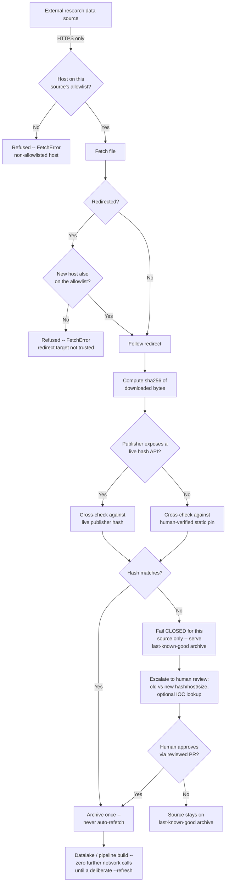

# Security Policy

<!-- BEGIN purpose-and-limits:security (generated by npm run purpose:sync from src/data/purpose-and-limits.json; do not edit) -->
A proposed, unvalidated research framework (QIF, TARA, NISS) for threat modeling, severity scoring and impact assessment of neural devices.

The TARA catalog exists to inform defense. Do not test cataloged techniques on people, or on devices you are not authorized to test. Research involving human participants needs ethics approval and informed consent. Report gaps in the catalog's defensive guidance here too.

See [Purpose and limits](https://github.com/qinnovates/neurosecurity/blob/main/governance/README.md#purpose-and-limits).
<!-- END purpose-and-limits:security -->

## Supported Versions

| Version | Supported |
|---------|-----------|
| Current (main branch) | Yes |

## Reporting a Vulnerability

If you discover a security vulnerability in this project, please report it responsibly.

**Do NOT open a public GitHub issue for security vulnerabilities.**

### How to Report

Use GitHub's private vulnerability reporting: [Report a vulnerability](https://github.com/qinnovates/neurosecurity/security/advisories/new)

### What to Include

- Description of the vulnerability
- Steps to reproduce
- Affected component (website, data pipeline, API endpoint)
- Potential impact assessment
- Suggested fix (if any)

### Response Timeline

This is a single-maintainer project with no on-call rotation. These are internal best-effort
targets, not contractual or legal commitments — actual timelines depend on severity confirmation,
complexity, and maintainer availability, and may be extended without notice. If you haven't heard
back within a target window, that's a signal to follow up, not evidence the report was lost.

Severity is assessed using CVSS v3.1 base score (Critical 9.0-10.0, High 7.0-8.9, Medium 4.0-6.9,
Low 0.1-3.9), adjusted upward by one tier when the report involves exposure of neural/biometric
data or the datalake source-integrity controls above.

| Stage | Target |
|-------|----------|
| Acknowledgment | 48-72 hours |
| Initial assessment / triage | 5 business days |
| Remediation response (critical) | Begins within 7 days of confirmed triage |
| Remediation response (high) | Begins within 30 days of confirmed triage |
| Remediation response (medium/low) | Begins within 90 days of confirmed triage |

### Scope

In scope:
- qinnovate.com website and all subpages
- Client-side JavaScript and WebAssembly components
- Data pipeline scripts and build tools
- API endpoints (if any)
- GitHub Actions workflows

Out of scope:
- Third-party services (CDNs, analytics)
- Social engineering attacks
- Denial of service attacks
- Issues in dependencies (report upstream)

## Datalake Source Integrity

How external research data gets into `datalake/` without the pipeline trusting a third party by
default: every file is checksummed against a pinned sha256 value before being trusted, closing
the supply-chain path where a compromised mirror, CDN, or redirect silently substitutes different
bytes for the ones a human reviewed.

**What this protects against:** network-path tampering, CDN/edge-cache poisoning, and
third-party redirect hijacking. **What it does not claim to protect against:** compromise at
the publisher's own origin — an adversary who controls enough of a publisher's backend likely
controls its metadata API too, so a live-hash match alone is evidence of delivery consistency,
not proof of authenticity. The actual trust root is the git-committed, human-reviewed sha256
pin in `registry/pipeline-inputs.json`, reviewed in a PR before being trusted; a live API hash
is only a bootstrap value a human cross-checks via an independent channel (DOI, mirror,
changelog) before committing it.

### Current controls (implemented, in `src/scripts/atlas-pipeline/atlas_pipeline/`)

- **HTTPS-only** — any non-HTTPS URL is refused outright (`fetch.py`).
- **Per-source host allowlist** — each external source names the exact hosts it may be served
  from; no wildcards.
- **Anti-redirect-hijack** — a redirect is followed only if the *new* host is also on that
  source's allowlist; this is the control that has already caught a real external-infrastructure
  change in production.
- **Per-file sha256 pinning** — downloaded bytes are hashed and checked against a pinned value
  before being trusted (being extended to cover every source; not yet complete for all of them).
- **Download size cap** — a fetch that exceeds the declared byte size (plus a small slack
  margin) is refused mid-stream, not after the fact.
- **Safe archive extraction** — files pulled from an archive are matched against a strict
  filename pattern and never extracted wholesale, closing the path-traversal ("zip-slip") class
  of bug.
- **Deterministic, hash-gated code-integrity check** — a separate `pipeline_code_hash` covers
  the pipeline's own code and config, so a code change and a data-source change are never
  silently conflated.

### Planned (tracked, not yet shipped)

- **Ingest-once, archive-permanently** — stop re-fetching an already-verified source on every
  rebuild; a code-only change (e.g. a dependency bump) should never force an unrelated network
  call to an external data host.
- **Explicit provenance log** — every fetch attempt (host, hash, match/mismatch, timestamp)
  recorded in a committed file separate from the code-integrity inputs above, so a future
  question about "when did this change" doesn't require a multi-day investigation to answer.
- **Human-gated re-verification** — any deliberate re-check of an already-archived source
  produces a reviewed diff (old vs new hash/host/size) for a human to approve, never an
  automatic or scheduled re-trust.
- **IOC hash cross-check as supporting evidence** — on a verification mismatch, a hash lookup
  against public threat-intel sources runs automatically as one more data point; it never
  auto-accepts or auto-rejects a source on its own, since a "no match" result only rules out a
  *previously seen* malicious file, not a novel one.

### Additional hardening under consideration

These aren't committed yet — noted here for transparency about where this is headed:
- **Signed commits for registry changes** (`pipeline-inputs.json` and its provenance sibling)
  so a hash-pin edit itself has a verifiable author, not just a reviewed diff.
- **Dependency and CI action pinning by digest**, not just version tag, for the pipeline's own
  toolchain.
- **Periodic re-verification on a fixed, published cadence** (e.g. quarterly) of already-archived
  sources against their publisher's current hash, surfaced as a routine report rather than
  something that only happens reactively.
- **A documented incident-response process** for this pipeline specifically (standing policy:
  this file documents control design and status, never incident-specific detail such as exact
  hostnames or timestamps).

### Data Handling
- No user data is collected or stored by this site (reflects the site's current design as of
  2026-10-27; any future analytics, forms, or third-party embeds are added in the same PR that
  updates this statement)
- Research datasets ingested into the datalake are public, de-identified releases from their
  original publishers — this pipeline adds no identifying metadata, but de-identification is not
  a guarantee against re-identification, particularly for neural/biometric data classes (see the
  TARA catalog's `QIF-D.HV` Data Harvest techniques for this threat class). This statement relies
  on each publisher's own de-identification methodology; it is not independently audited or
  verified here.
- All research data is publicly available. Third-party anatomy datasets are redistributed under
  their own per-source license, not one blanket license: each source in
  `datalake/qif-anatomy-sources.json` carries a `license_id` checked against a closed list when
  the registry loads (`src/scripts/atlas-pipeline/atlas_pipeline/sources.py`), with the
  publisher's quoted terms, the date read, and the reviewer kind recorded in
  `datalake/qif-anatomy-verdicts.json`. Every reading was AI-drafted; as of 2026-10-27 all 16
  registered sources have been read and confirmed by the repository owner, recorded as
  `licence_confirmation` entries in `datalake/qif-anatomy-review-ledger.json` (each tied to a
  digest of the exact terms confirmed, so an edit to the underlying reading un-confirms it until
  reviewed again). This is an owner's confirmation that the AI-drafted reading looks right, not a
  lawyer's sign-off -- no source here has had a review by outside legal counsel
- External files the atlas pipeline fetches are sha256-pinned per file in the same registry, and
  the pin is enforced before any file is used (`atlas_pipeline/fetch.py`). As of 2026-10-27, the
  pins for three of the five anatomy sources (`cit168_rl`, `neudorfer_hypothalamus`,
  `allen_hra_3d_2020`) have been cross-checked against an independent channel — the publisher's
  own OSF/Zenodo/S3-reported checksum, not a second hash of the same downloaded bytes — and
  matched. The two MNI ICBM152 template pins remain first-download-only and have not yet been
  cross-checked against an independent channel
- No authentication system — static site only
- No cookies, no tracking, no analytics that collect PII

### Infrastructure
- Static site hosted on GitHub Pages / Vercel
- HTTPS enforced via hosting provider
- No server-side code execution
- Content Security Policy headers configured
- Dependencies audited via `npm audit` in CI

### Build Security
- Dependencies pinned via `package-lock.json`
- GitHub Actions workflows use pinned action versions
- No secrets in source code (verified via automated scanning)
- Build uses pinned dependencies and pinned Action versions for reproducibility (full bit-for-bit
  reproducible-build verification has not been independently tested)

## Acknowledgments

We appreciate security researchers who help keep this project safe. Responsible reporters will be acknowledged here (with permission).
