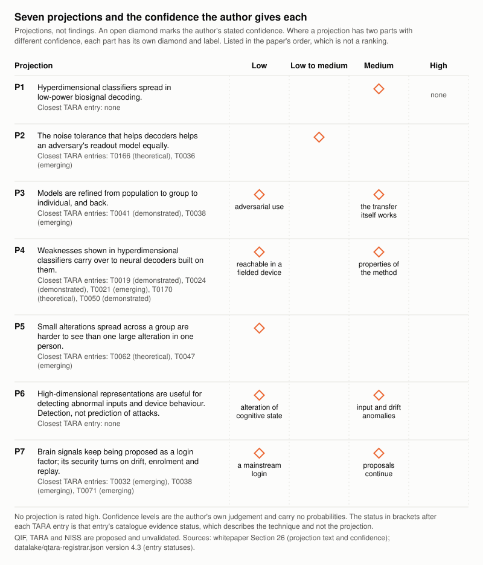

# QIF Whitepaper v9.0: Companion Document

**Version:** 9.0 (draft), 2026-10-07
**Author:** Kevin Qi
**Status:** Working draft. Proposed framework, unvalidated, not adopted by any standards body.

This document holds the reference material that was moved out of the main paper, [QIF-WHITEPAPER-V9.md](QIF-WHITEPAPER-V9.md), to keep that paper short. The material is of two kinds. Sections 21.7, 23.2, 24.1, 24.2 and 26, and the moved parts of The Proposal, are v9.0 text that the main paper gives in shorter form under the same numbers. Sections 12 to 19, 6.8 and 6.9 are carried over from v8.0 with the corrections listed in Appendix E of the main paper, and they may still use v8.0 counts and vocabulary ("band", "layer", "hourglass"). Where this document and Sections 20 to 28 of the main paper differ, the main paper is current. Section numbers are shared with the main paper.

**Contents:** Using QIF on Monday Morning · The Proposal, continued · What Changed in v8.0 · How Everything Connects · Appendices A to C · Sections 12 to 19, with 6.8 and 6.9 · Integration Status · 21.7 The new techniques: full write-ups · Appendix D · The Proposal: sections moved from the main paper · 23.2 Hyperdimensional computing: full explainer · 26 Projections, with full evidence · 24.1 and 24.2: longer versions

---

## Using QIF on Monday Morning

QIF is a proposed framework. It is unvalidated and no standards body has adopted it. This section shows what a device-security engineer can pull from the repository today, and where the data stops. Every figure below came from a command run against the repository on 2026-10-07. Paths are relative to the repository root.

### A subthalamic deep brain stimulator, start to finish

**Step 1. Find the address.** Look up the target in `datalake/qif-brain-bci-atlas.json`.

- The subthalamic nucleus (`stn`) has `qif_band: N4` and the tag `basal_ganglia_circuit`. The atlas is on `addressing_version: 2`.
- N4 is an address. It says where the lead sits, and it carries no depth, severity or traversal meaning.
- Four atlas devices list `stn` as a target. Two are bidirectional and two are write.
- Those device rows carry `qif_bands: ["N5", "N4"]` because each covers three targets (`stn`, `gpi`, `vim`). For an STN lead, take the band from the region record.

**Step 2. Pick the device's bands.** The bands fall into three groups:

| Role | Band | Where it comes from |
|---|---|---|
| Target address | N4 | `brain_regions[stn].qif_band` |
| Interface | I0 | `device_region_mappings[].i0_depth` is `I0-subcortical` |
| Telemetry | S2, S3 | My choice. The atlas tags no device with an S band. The controls file puts its BLE, firmware and telemetry names under S2 and its RF and network names under S3 |

Adding S1 moves the result from 141 techniques to 142.

**Step 3. Run the query.**

```python
import json
from collections import Counter

load = lambda name: json.load(open(f"datalake/{name}.json"))
atlas, registrar = load("qif-brain-bci-atlas"), load("qtara-registrar")
hazards = load("qif-hazards")["hazards"]
cve_rows = load("cve-technique-mapping")["mappings"]

target = next(r for r in atlas["brain_regions"] if r["id"] == "stn")
print("target  ", target["name"], target["qif_band"], target["functional_groups"])
for device in atlas["device_region_mappings"]:
    if "stn" in device["target_regions"]:
        print("device  ", device["device_id"], device["i0_depth"], device["interface_type"])

device_bands = {target["qif_band"], "I0", "S2", "S3"}  # address, interface, telemetry
techniques = registrar["techniques"]
hits = [t for t in techniques if device_bands & set(t["band_ids"])]
print("hits    ", len(hits), "of", len(techniques))
print("per band", {b: sum(b in t["band_ids"] for t in techniques) for b in sorted(device_bands)})
print("state   ", dict(Counter(t["niss"]["scoring_state"] for t in hits)))
print("evidence", dict(Counter(t["status"] for t in hits)))

totals = Counter(t["tactic"] for t in techniques)
names = {tactic["id"]: tactic["name"] for tactic in registrar["tactics"]}
for tactic_id, count in Counter(t["tactic"] for t in hits).most_common():
    print(f"  {tactic_id:9}{names[tactic_id]:39}{count:3} of {totals[tactic_id]}")

register = sorted(
    (t for t in hits if t["niss"]["scoring_state"] == "scored" and t["niss"]["severity"] == "high"),
    key=lambda t: (-t["niss"]["score"], t["id"]))
register_ids = {t["id"] for t in register}
for t in register:
    print(t["id"], t["niss"]["score"], t["status"], t["severity"],
          ",".join(sorted(device_bands & set(t["band_ids"]))), t["attack"], sep=" | ")

hit_ids = {t["id"] for t in hits}
print("hazards linked to a register row:",
      [h["id"] for h in hazards if register_ids & set(h["related_techniques"])])
print("CVEs mapped to a register row:   ",
      [c["cve_id"] for c in cve_rows if register_ids & set(c["tara_techniques"])])
print("hazards linked to any hit:", sum(bool(hit_ids & set(h["related_techniques"])) for h in hazards), "of", len(hazards))
print("CVEs mapped to any hit:   ", sum(bool(hit_ids & set(c["tara_techniques"])) for c in cve_rows), "of", len(cve_rows))

both = [t for t in techniques if "severity" in t["niss"]]
print("severity vs niss.severity: both", len(both),
      "| disagree", sum(t["severity"] != t["niss"]["severity"] for t in both),
      "| niss.severity absent", len(techniques) - len(both))
```

Output, less the fourteen register lines, which the table in Step 4 carries:

```text
target   Subthalamic Nucleus N4 ['basal_ganglia_circuit']
device   medtronic-percept-pc I0-subcortical bidirectional
device   medtronic-percept-rc I0-subcortical bidirectional
device   boston-scientific-vercise I0-subcortical write
device   abbott-infinity-dbs I0-subcortical write
hits     141 of 173
per band {'I0': 63, 'N4': 24, 'S2': 73, 'S3': 54}
state    {'scored': 103, 'unscored': 29, 'provisional': 9}
evidence {'CONFIRMED': 26, 'DEMONSTRATED': 40, 'THEORETICAL': 50, 'EMERGING': 23, 'PLAUSIBLE': 1, 'SPECULATIVE': 1}
  QIF-N.MD Neural Modulation                       20 of 24
  QIF-S.HV Sensor Harvest                          17 of 18
  QIF-P.DS Physiological Disruption                16 of 21
  QIF-M.SV Model Subversion                        13 of 13
  QIF-E.RD Energy Radiation                        12 of 13
  QIF-N.IJ Neural Injection                        10 of 11
  QIF-D.HV Data Harvest                             9 of 14
  QIF-B.IN BCI Intrusion                            7 of 7
  QIF-S.CH Sensor Chaining                          6 of 6
  QIF-C.EX Cognitive Exploitation                   5 of 17
  QIF-B.EV BCI Evasion                              5 of 6
  QIF-S.RP Sensor Repurposing                       5 of 5
  QIF-C.IM Cognitive Imprinting                     4 of 6
  QIF-S.FP Sensor Fingerprinting                    4 of 4
  QIF-N.SC Neural Scan                              3 of 3
  QIF-N.NM Nanoparticle-Mediated Neuromodulation    3 of 3
  QIF-S.SC Sensor Side-Channel                      2 of 2
hazards linked to a register row: []
CVEs mapped to a register row:    []
hazards linked to any hit: 22 of 23
CVEs mapped to any hit:    55 of 55
severity vs niss.severity: both 129 | disagree 99 | niss.severity absent 44
```

The band match returns 141 of 173 techniques. It is a tag match: a hit shares a band with the device. It does not say the technique applies to this device, and it does not say anything reaches a structure in a person. Expect to strike rows. Thirty-four of the hits sit in the five Consumer Sensor Exploitation tactics (`QIF-S.*`), which the registrar describes in terms of consumer device sensors.

**Step 4. Rank, and say what you ranked by.**

Rank by `niss.score`, and rank only the entries whose `niss.scoring_state` is `scored`. The registrar carries two severity fields, and they disagree:

- `severity` (top level) sits on all 173 techniques, including the 44 that have no score. Section 27.3 of the main paper describes it as an older `severity` field that was filed by hand.
- `niss.severity` exists on the 129 scored techniques. It is the `niss.score` read against the scale in `niss_spec.severity_scale` (none 0.0, low 0.1 to 3.9, medium 4.0 to 6.9, high 7.0 to 8.9, critical 9.0 to 10.0). All 129 match that scale.
- The two fields disagree on 99 of those 129 entries.

Use `niss.scoring_state`, then `niss.score` and `niss.severity`. Treat top-level `severity` as a legacy label. The SDK's `qtara list --severity` and `qtara stats` read the legacy field, so do not take a ranking from them.

The ranking has one limit. NISS scores signal-level impact and does not order conventional cyber findings. QIF-T0049 (Wireless authentication bypass) carries nine mapped CVEs and a NISS score of 0.7. Rank that class of row with your existing CVSS process.

The register below is every scored hit in the `high` band. That is 14 rows. Cutting at twelve would split a nine-way tie at 7.4. No hit is `critical`, and the registrar's statistics show none in the catalogue.

| ID | Name | Tactic | Evidence status | Scoring state | NISS score (`niss.severity`) | Legacy `severity` | Matched on |
|---|---|---|---|---|---|---|---|
| QIF-T0014 | Envelope modulation (stealth carrier) | QIF-E.RD | DEMONSTRATED | scored | 8.1 (high) | high | N4, S2 |
| QIF-T0022 | Neurofeedback falsification | QIF-M.SV | EMERGING | scored | 8.1 (high) | high | S2 |
| QIF-T0055 | BCI cognitive warfare | QIF-P.DS | THEORETICAL | scored | 8.1 (high) | critical | N4, S3 |
| QIF-T0065 | Algorithmic psychosis induction (recommendation weaponization) | QIF-C.EX | CONFIRMED | scored | 8.1 (high) | critical | S2, S3 |
| QIF-T0068 | Bifurcation forcing (critical parameter manipulation to trigger neural state transitions) | QIF-N.MD | EMERGING | scored | 8.1 (high) | critical | I0, N4 |
| QIF-T0009 | RF false brainwave injection | QIF-N.MD | EMERGING | scored | 7.4 (high) | high | N4, S2 |
| QIF-T0010 | ELF neural entrainment | QIF-E.RD | THEORETICAL | scored | 7.4 (high) | critical | N4 |
| QIF-T0011 | Intermodulation (BCI signal weaponized) | QIF-E.RD | THEORETICAL | scored | 7.4 (high) | critical | N4, S2 |
| QIF-T0013 | Temporal interference (deep targeting) | QIF-E.RD | DEMONSTRATED | scored | 7.4 (high) | high | N4, S2 |
| QIF-T0023 | Closed-loop perturbation cascade | QIF-M.SV | THEORETICAL | scored | 7.4 (high) | critical | I0, S2 |
| QIF-T0059 | Pattern lock (learned pathway persistence) | QIF-C.IM | THEORETICAL | scored | 7.4 (high) | medium | S2 |
| QIF-T0066 | Slow drift / boiling frog (adiabatic phase space manipulation) | QIF-B.EV | THEORETICAL | scored | 7.4 (high) | high | I0, N4 |
| QIF-T0070 | Integrator/resonator type switching (tonic excitability manipulation) | QIF-N.MD | THEORETICAL | scored | 7.4 (high) | high | I0, N4 |
| QIF-T0071 | Baseline adaptation poisoning (re-enrollment window exploitation) | QIF-C.IM | EMERGING | scored | 7.4 (high) | high | I0, S2 |

How to read it:

- Seven of the 14 rows are THEORETICAL. Four are EMERGING, two DEMONSTRATED, one CONFIRMED. Put the evidence status next to the score in your own register.
- The legacy field differs from `niss.severity` on seven of the 14 rows.
- Three rows match on telemetry bands alone (QIF-T0022, QIF-T0059, QIF-T0065). Review those for applicability before the rest.
- Do not rank the 38 hits that have no score. Nine are provisional, with ranges as wide as 0.4 to 9.4. A range is a bound and not an estimate. Twenty-nine are unscored (`no_metric_supported` 18, `preprint_only` 7, `no_source` 4). List them with their state and leave the severity cell empty.

**Step 5. Pull the controls the data pairs with each row.** The data pairs controls in two places. Both hold names and short descriptions, and nothing in the repository tests them.

Per technique, the registrar field `tara.engineering.detection`, quoted as written:

| ID | `tara.engineering.detection` | `fdora_524b` tags |
|---|---|---|
| QIF-T0014 | Demodulation analysis of all incident signals; envelope frequency extraction | TM, VA, SA, PM |
| QIF-T0022 | Feedback-signal correlation verification, display integrity hashing, outcome trend analysis | TM, VA, SBOM, PM |
| QIF-T0055 | Fleet-wide behavioral anomaly detection, cognitive assessment population baselines, whistleblower channels | TM, VA, SBOM, SA, PM |
| QIF-T0065 | Content safety scoring, user mental health monitoring, recommendation diversity enforcement | TM, VA, SBOM, SA, PM |
| QIF-T0068 | Critical slowing down (autocorrelation + variance trending), parameter boundary monitoring, state transition prediction | TM, VA, SBOM, SA, PM |
| QIF-T0009 | RF spectrum analysis, field strength monitoring, EEG artifact detection | TM, VA, SA, PM |
| QIF-T0010 | EEG phase-locking analysis, spectral power monitoring at stimulation frequency | TM, VA, SA, PM |
| QIF-T0011 | Spectral analysis for unexpected intermodulation products, dual-frequency monitoring | TM, VA, SA, PM |
| QIF-T0013 | Finite element modeling validation, EEG monitoring of entrainment at target frequency | TM, VA, SA, PM |
| QIF-T0023 | Loop gain monitoring, oscillation detection, stimulation parameter trending | TM, VA, SBOM, SA, PM |
| QIF-T0059 | Cross-session performance pattern analysis, pathway stability monitoring, unlearning protocols | TM, VA, SA, PM |
| QIF-T0066 | Phase space trajectory curvature monitoring, Lyapunov exponent trending, cumulative displacement tracking | TM, VA, SA, PM |
| QIF-T0070 | Interspike interval distribution analysis, firing mode classification, tonic current monitoring | TM, VA, SBOM, SA, PM |
| QIF-T0071 | Baseline-free biological TLS (eliminates baseline dependency), historical comparison, multi-session validation | TM, VA, SA, PM |

Per band, `controls_by_band` in `datalake/qif-security-controls.json`:

| Band | `detection` | `prevention` | `response` |
|---|---|---|---|
| N4 | Thalamic relay integrity check; Sleep spindle monitoring; Thalamocortical transmission coherence; Subthalamic beta oscillation pathology detection | Consciousness state protection; Thalamic stimulation limits; Subthalamic (STN) DBS parameter bounds (voltage, frequency, pulse width); Autonomic safeguards | Emergency consciousness preservation; Vital function monitoring escalation; Subthalamic DBS emergency shutoff |
| I0 | Impedance monitoring; Tissue temperature sensing; Signal-to-noise ratio tracking | Charge density limits (30 uC/cm2); Thermal safeguards (<2C rise); Biocompatibility monitoring | Interface shutdown; Electrode deactivation; Surgical team alert |
| S2 | BLE/WiFi anomaly detection; Firmware integrity check; Protocol compliance monitoring | End-to-end encryption (NSP); Firmware signing; Secure boot | Connection termination; Firmware rollback; Telemetry lockdown |
| S3 | RF spectrum monitoring; Network intrusion detection; Cloud API audit logging | PQC/QKD for data in transit; Application firewall; Zero-trust architecture | Network isolation; API key rotation; Incident response activation |

Two things to know before you use the band table:

- Most N4 entries are written for the thalamus. The file no longer uses gating wording: "Sensory gating coherence" is now "Thalamocortical transmission coherence".
- The subthalamic DBS names now sit under N4: "Subthalamic (STN) DBS parameter bounds (voltage, frequency, pulse width)" and "Subthalamic DBS emergency shutoff". The pallidal (GPi) equivalents sit under N5, so pull N5 as well if the lead also covers `gpi`. The tag is no help here, because `basal_ganglia_circuit` is on two atlas records, `stn` (N4) and `substantia_nigra` (N2).

**Step 6. Add the hazards.** Hazards are conditions with no attacker. Keep them in the risk file apart from the adversarial rows.

- Hazards linked to a register row: the query returned nothing.
- Across all 141 hits, 22 of the 23 hazards link to at least one. Five carry N4, S2 or S3:

| ID | Name | Bands | Status | `peer_review_status` |
|---|---|---|---|---|
| QIF-H0001 | Loss of manufacturer or sponsor support for an implanted neural device | S2, S3 | THEORETICAL | peer_reviewed |
| QIF-H0002 | Chronic electrode micromotion (non-adversarial reading of QIF-T0120) | I0, N1, N2, N3, N4, N5, N6, N7 | THEORETICAL | none |
| QIF-H0019 | VNS disynaptic serotonin upregulation (non-adversarial reading of QIF-T0154) | N1, N2, N3, N4 | THEORETICAL | none |
| QIF-H0021 | High-frequency electroacupuncture dorsal raphe serotonin drive (non-adversarial reading of QIF-T0156) | I0, N1, N2, N3, N4, N5 | THEORETICAL | none |
| QIF-H0022 | Acute tryptophan depletion (non-adversarial reading of QIF-T0157) | N4, N5, N6, N7 | THEORETICAL | none |

The last three names are shortened here. By name, QIF-H0001 and QIF-H0002 concern an implanted device. The other three share an address and nothing more. The hazards file says a link "is a pointer, not evidence".

**Step 7. Add the CVEs.**

- CVEs mapped to a register row: the query returned nothing. None of the 14 highest-scoring rows has a disclosed CVE tagged to it.
- Across all 141 hits, 19 techniques carry at least one mapped CVE, and between them they account for all 55 in the file.
- No mapped product is a deep brain stimulator. A search of the product and description fields for DBS, deep brain, Percept, Activa and neurostim returned one row: CVE-2023-25931, Medtronic Pelvic Health neurostimulator programmer.
- In `datalake/bci-landscape.json`, the entries for Medtronic DBS, Abbott Neuromodulation and Boston Scientific Neuromodulation have an empty `cves_known` and an empty `tara_attack_surface`.

### What the catalogue tags in disclosed CVEs

`datalake/cve-technique-mapping.json` maps 55 CVEs to 20 of the 173 techniques. The file's `generated` date is 2026-02-21; its counts, coverage block and thirteen CVSS scores were updated on 2026-10-07. Section 22.2 says a refresh is staged and not integrated.

| CVE | Product (as written in the file) | CVSS in file | Technique tags |
|---|---|---|---|
| CVE-2019-6538 | Medtronic Conexus implant telemetry | 9.3 | QIF-T0004 Man-in-the-middle; QIF-T0049 Wireless authentication bypass; QIF-T0008 Command hijacking |
| CVE-2020-25187 | Medtronic MyCareLink Smart patient gateway | 9.8 | QIF-T0008 Command hijacking; QIF-T0047 Mass BCI compromise (platform attack) |
| CVE-2017-2853 | Natus Xltek EEG software | 9.8 | QIF-T0001 Signal injection; QIF-T0008 Command hijacking |
| CVE-2023-25931 | Medtronic Pelvic Health neurostimulator programmer | 6.8 | QIF-T0049 Wireless authentication bypass; QIF-T0008 Command hijacking |

The three most-tagged techniques are QIF-T0044 Cloud infrastructure attack (11 CVEs), QIF-T0004 Man-in-the-middle (9) and QIF-T0049 Wireless authentication bypass (9).

Limits:

- The mappings are retrospective. Someone read a disclosed CVE and attached a technique label. They say nothing about prevention or detection, and nothing about what the framework would have changed.
- A tag does not make the product a neural device. The file includes a Honda keyless entry system, a Realtek audio driver and a Siemens PLC.
- All 55 entries carry a CVSS score. Thirteen were empty until they were filled from the NVD API on 2026-10-07.
- The file records that ten candidate CVEs were excluded during validation. Check each id against NVD yourself before you cite it.

### Where this fits in what you already file

The registrar carries one regulatory field, `regulatory.fdora_524b`. It is present on 135 of the 173 techniques. The 38 without it are QIF-T0136 to QIF-T0173. Each entry holds:

- `cyber_device`: true on 68, false on 67.
- `prongs`: `software` (true on 74), `network_connectable` (true on 109), `vulnerable` (true on all 135).
- `applicable_requirements`: any of five tags, TM, VA, SA, SBOM, PM.
- `coverage_score`: 0.1 to 0.8, mean 0.39, with 74 below 0.5. The v6 paper defines it as how well existing standards cover the technique. The data gives no estimator for it.
- `gaps`: free-text strings. The most common is "CVSS cannot express neural-specific impacts" (91 entries).

The tags are per technique. Whether your device is a cyber device is a decision for your regulatory team about your device. The field does not make it.

The earlier paper (v6, section 7.2) names the five tags. This table pairs each with the framework output you could bring to that part of a premarket cybersecurity submission. The labels are v6's. This section did not check them against the statute or current FDA guidance.

| Tag | v6 label | Techniques tagged | In the 14-row register | Framework output you can bring |
|---|---|---|---|---|
| TM | Threat modeling | 135 | 14 | The technique list for your device bands, with evidence status |
| VA | Vulnerability assessment | 134 | 14 | NISS vector and score where the state is `scored`; the CVSS 4.0 base vector and `cvss.gap_summary` (103 techniques carry them) |
| SA | Security architecture | 97 | 13 | Control names by band and the per-technique `tara.engineering.detection` text, as a checklist to trace to your own design |
| SBOM | Software Bill of Materials | 61 | 6 | The tag. The framework produces no SBOM |
| PM | Post-market monitoring | 130 | 14 | The tag. The CVE mappings and the hazards carry no regulatory field |

These are inputs to documents you write. They are not submission content.

Crosswalks to IEC 81001-5-1, ISO 14971 and MITRE EMB3D do not exist yet. The registrar contains no occurrence of "81001", "14971" or "EMB3D". ISO 14971 appears once in `datalake/research-registry.json` as a reference entry, with no technique mapping. What the registrar does hold is `tara.governance.regulations`, a set of free-text labels such as "IEC 60601-1" (32 techniques), "IEC 62443" (26) and "IEC 62304" (21). They are labels and carry no clause references.

### Getting the data in ten minutes

**From PyPI.** The SDK README gives:

```bash
pip install qtara
```

PyPI lists 0.3.0, uploaded 2026-10-07, as the latest release. That wheel bundles registrar version 4.0 with 176 techniques, no variants and no `scoring_state` field. It is not the catalogue this paper describes.

**From the repository.** The package source is at `datalake/qtara` (version 0.3.0, registrar 4.3). It needs `pydantic>=2.0.0` and `rich>=13.0.0`. These commands ran from the repository root without installing the package:

```bash
export PYTHONPATH=datalake/qtara/src
python3 -m qtara.cli stats
python3 -m qtara.cli list --band N4
python3 -m qtara.cli info QIF-T0157
python3 -m qtara.cli stix --output threats.json
python3 -m qtara.cli stix --include-pending --output threats-all.json
```

Real output, trimmed:

```text
$ python3 -m qtara.cli stats
TARA Registry: 173 techniques, 1 variants

$ python3 -m qtara.cli list --band N4        # 24 rows
│ QIF-T0009 │ RF false brainwave injection           │ high     │ S1–S2→N4–N7 │ SOM │ M │ 0 │
│ QIF-T0010 │ ELF neural entrainment                 │ critical │ S1→N4–N7    │ COG │ M │ 0 │

$ python3 -m qtara.cli info QIF-T0157
│ NISS Scoring:
│ State: provisional
│ Range: 0.4 to 9.4 (a bound, not an estimate)
│ Supported metrics: CD:L

$ python3 -m qtara.cli stix --output threats.json
Successfully exported 165 techniques and 1 variants to threats.json

$ python3 -m qtara.cli stix --include-pending --output threats-all.json
Successfully exported 173 techniques and 1 variants to threats-all.json
```

The same from Python:

```python
from qtara.core import TaraLoader

loader = TaraLoader()
loader.load()
print(len(loader.list_techniques()), "techniques,", len(loader.list_variants()), "variant")
print(len(loader.list_techniques(band="N4")), "carry N4")
technique = loader.get_technique("QIF-T0157")
print(technique.id, technique.niss.scoring_state, technique.niss.score_min, technique.niss.score_max)
```

```text
173 techniques, 1 variant
24 carry N4
QIF-T0157 provisional 0.4 9.4
```

**With no SDK at all.** `jq` on the registrar:

```bash
jq -r '.techniques[] | select(.band_ids | index("N4"))
       | [.id, .niss.scoring_state, (.niss.score // "-"), .status, .attack] | @tsv' \
   datalake/qtara-registrar.json | head -3
```

```text
QIF-T0009	scored	7.4	EMERGING	RF false brainwave injection
QIF-T0010	scored	7.4	THEORETICAL	ELF neural entrainment
QIF-T0011	scored	7.4	THEORETICAL	Intermodulation (BCI signal weaponized)
```

**The STIX endpoint.** The site serves a STIX 2.1 bundle at `/api/stix.json` (source: `src/pages/api/stix.json.ts`).

```bash
curl -sS -o live-stix.json https://qinnovate.com/api/stix.json
jq -r '[.objects[] | .type] | group_by(.) | map("\(.[0])=\(length)") | join(" ")' live-stix.json
```

```text
attack-pattern=167 identity=1
```

That is the live response on 2026-10-07 (HTTP 200, 193,118 bytes). The same filter on the SDK exports gives `attack-pattern=166 identity=1 relationship=1` for `threats.json` and `attack-pattern=174 identity=1 relationship=1` for `threats-all.json`.

The two STIX sources differ. Pick one and stay with it:

| | Site endpoint (live) | SDK export |
|---|---|---|
| Technique id | `attack-pattern--qift0014` | `attack-pattern--708d88c7-73d5-5f68-b7ce-b08de55496d6` |
| Scoring fields on a technique | `x_qif_severity` (the legacy field) | `x_qif_niss_scoring_state`, `x_qif_niss_score`, `x_qif_niss_vector`, plus `x_qif_severity` |
| Variant and its relationship | Absent from the live bundle | Present |
| `kill_chain_phases` | "exploitation" on every technique | "exploitation" on every technique |

The endpoint's ids are not UUIDs. A strict STIX 2.1 consumer may reject them. This was not tested against one.

**Where the SDK's own documentation was out of date.** Five of the six items below were corrected in the repository on 2026-10-07, after this list was first written.

- `datalake/qtara/README.md` said 161 techniques in two places and now says 173 techniques and 1 variant. PyPI's 0.3.0 holds 176; the repository source, also numbered 0.3.0, holds 173.
- The README's tier table read T1 mid-term, T2 far-term, T3 no physics gate and now matches the data. The registrar and CLI use 0 `feasible_now`, 1 `near_term`, 2 `mid_term`, 3 `far_term`, X `no_physics_gate`. `list --tier 3` returns the 4 far-term entries, and `list --tier X` returns 18.
- The README's development steps said `cd shared/qtara` and now say `cd neurosecurity/datalake/qtara`.
- The README did not mention variants, `--include-pending`, `--enriched-only`, `--domain` or `--mode`. It now documents all five.
- The `Bands` column and `x_qif_bands` in the SDK export print strings with arrows, such as "S1–S2→N4–N7". Under addressing version 2 the bands carry no order. Read `band_ids`.
- `pyproject.toml` listed `stix2>=3.0.0`, which no file under `src` or `tests` imports. The dependency has been removed.

### What this does not tell you

- **Reach in a person.** An address says where a device is. A band match says a technique and a device share a tag. Neither says what a signal reaches in anyone's brain. Routes are for tagging and teaching.
- **Completeness.** The catalogue holds 173 techniques. A missing row is not evidence that a threat is absent. Twenty techniques have a mapped CVE and 153 have none.
- **Anything a regulator will accept.** No output here satisfies a regulator, and nothing here is a compliance claim. The `fdora_524b` field is the author's tagging. The crosswalks named above do not exist.
- **Severity for provisional or unscored techniques.** Forty-four techniques have no NISS score: 10 provisional and 34 unscored. A provisional range is a bound. The legacy `severity` label on those entries (3 critical, 16 high, 24 medium, 1 low) is not source-derived. Do not rank on it.
- **Whether a control works.** Control and detection entries are names. The repository holds no test of any of them.
- **Whether a score is right.** NISS is proposed and unvalidated. Section 28.3 expects the scored count to fall further under the strict evidence rule.

---

## The Proposal, continued

### The Defense Paradox

The paper accepts a constraint on its own design: **every defense you introduce creates a new attack surface.** The architecture responds with a minimum set of purpose-built controls and drift detection against a signed reference state.

**Analysis**

- Add encryption, and key management becomes the target.
- Add authentication, and the auth mechanism becomes the vulnerability.
- Add a firewall, and the firewall's configuration is what the attacker probes.
- Add MFA, and the recovery flow is the bypass.

The author treats this as the nature of security engineering, not a flaw in it, and as inescapable.

**Evidence**

The paper cites the internet's four-decade history:

- SSL was introduced to protect HTTP. Then Heartbleed compromised the SSL implementation itself.
- Firewalls were introduced to segment networks. Internet-facing firewalls and other edge devices then became targets for initial access themselves (MITRE ATT&CK T1190, Exploit Public-Facing Application).
- Password managers were introduced to fix password reuse. Then LastPass was breached in 2022 and attackers copied customers' vault backups, with passwords still encrypted under each master password but website URLs unencrypted.

**The author's analogy: accumulation versus design**

The author calls this pattern defense by accumulation, not by design: the belief that adding more material solves the problem. The paper illustrates it with the history of armor.

- Ancient and medieval armorers stacked more iron plates, added more padding and bolted on more bulk. The soldier was safer, but slower, heavier, and eventually immobilized by the weight of the protection.
- Mixing iron with carbon produced steel, stronger than iron at a fraction of the weight. Not more material: the right material, engineered at the atomic level.
- Stephanie Kwolek at DuPont spun a liquid crystalline polymer solution into aramid fibers and got Kevlar (1965), five times stronger than steel by weight and flexible enough to wear as fabric.
- Kevlar is not steel refined further. It is a synthetic polymer, a different material class. It solved the same problem (stopping a projectile) through a different mechanism (energy absorption across woven aramid fibers instead of rigid deflection). The paper describes the step from steel to Kevlar as rethinking the problem from the molecular level up, not incremental improvement.

Applied to BCIs, the author's argument is:

- The proposal does not bolt better security onto architectures designed for screens and keyboards. It proposes what the author calls a metaphorical polymer: a different material for a different problem.
- AI can be that polymer. It would provide the guardrails that industry experts design, and adapt to novel threat patterns in real time while maintaining the invariants that protect the patient.
- Whether AI does this with more precision or consistency than static rule sets is not assumed. It is a claim requiring independent verification, per Design Principle #9 (AI honesty, not AI obscurity) and the guardrail model in Section 14.4.

**The larger challenge: patient control and drift**

The author's view is that the harder problem is not building the polymer. It is ensuring that the patient remains in full control and that **drift does not occur.**

- **Configuration drift** is the slow, silent divergence of a running system from its intended state. The paper describes it as one of the most common failure modes in software.
- A parameter changes. A threshold adjusts. A default shifts during an update. Each change is small and reasonable. Over time the system is no longer what it was designed to be.
- In enterprise IT, drift causes outages and compliance failures.
- In a neural device, drift could mean that a stimulation parameter that was safe at implantation is no longer safe after eighteen months of incremental adjustments.
- At wide scale, with millions of devices each drifting independently, the author treats this as a catastrophe and not a bug.

**What to do**

The paper states that the hardening measures must be absolute. The model is the **golden image**, a concept from OS hardening: a known-good system state that is cryptographically signed, immutable, and used as the reference against which every running instance is continuously compared. Any deviation is detected, flagged, and corrected or escalated.

QIF applies this at both the software and hardware layers:

| Layer | Golden Image Equivalent | Drift Detection |
|-------|------------------------|-----------------|
| **Hardware (Neurowall kernel)** | Tier 1-2 bounds (amplitude, rate, thermal) are firmware-signed at manufacture. Cannot be modified by software update, patient, or clinician. | Continuous self-check against signed bounds. Any discrepancy triggers hardware-level alert and safe-mode fallback. |
| **Software (NSP + Runemate)** | Cryptographically signed firmware images verified at boot and at runtime. Each update requires multi-party consent (patient + manufacturer signature). | Hash verification of running code against signed image. Drift = integrity violation = alert + rollback to last known-good state. |
| **Configuration (Tier 3-5 parameters)** | Patient's consented configuration is signed and timestamped at each consent event. Every parameter change is logged against the consent baseline. | Continuous comparison of active parameters against consented baseline. Unauthorized changes are blocked. Authorized changes are logged with full audit trail. |
| **Biomarker baseline** | Patient's neural signature calibrated at implantation and periodically recalibrated with clinical oversight. | Baseline drift is expected (aging, medication, neuroplasticity) — but recalibration requires clinical co-signature. Unilateral baseline shift without recalibration triggers soft lock. |

- The golden image is not a backup. It is the definition of "correct", and every running state is measured against it.
- Drift is not tolerated. It is detected, and the system either corrects itself or stops and asks for human intervention.
- The author's view is that this prevents the slow movement from "working as designed" to "working as drifted", which the paper attributes to major infrastructure failures from Therac-25 to the Boeing 737 MAX MCAS. That attribution is the author's characterization.

**Limits**

The paradox still applies to what remains:

- NSP introduces post-quantum encryption. The key encapsulation mechanism (ML-KEM) is itself a new cryptographic primitive whose implementations will contain bugs.
- The Neurowall kernel enforces amplitude ceilings. The bounds-checking logic is code, and code has defects.
- The biomarker MFA uses neural signatures for continuous authentication. The baseline calibration process is a window during which the patient's biometric template could be captured.

**The author's analogy: the right tool**

- The paper compares the problem to a stubborn eyelash, half fallen off and half poking at the eyeball. The first instinct is to pull it out with fingers, which are too blunt. The lash is pushed deeper, and there are now two problems: the original irritant and the inflammation the fix caused.
- The proper move is a different tool, such as a saline flush or a cotton swab, designed for the precision the problem demands. Technique matters more than effort.
- The paper applies this to security. The instinct is to add another firewall rule, another authentication check, another middleware service. Each added layer is another finger at the eye.
- The architecture does not stack defenses for the sake of stacking them. It selects the minimum set of precise tools, each purpose-built for its layer and each intended to do one thing without creating the next vulnerability.

**Impacts**

- The paper names the remaining risks explicitly (see Section 6: Attack Surface Analysis in `QIF-WHITEPAPER.md` v6.3, 165 techniques cataloged).
- The defense paradox does not invalidate the architecture. It disciplines it.
- Where a layer cannot be eliminated, its privilege is minimized, its behavior is audited, and it is designed so that its failure does not cascade into the layers below it.
- Defense in depth, as the paper defines it, is not about stacking walls. It is about ensuring that when one wall falls, and the paper expects that it will, the next wall does not depend on the one that broke.

### Design Principles

Nine principles govern every architectural decision in QIF. Principle #4 follows directly from the Defense Paradox: the fewer the layers, the fewer the places the paradox applies. The principles are the author's positions, not consensus positions.

| # | Principle | Rationale |
|---|-----------|-----------|
| 1 | **Zero technical debt by design** | Every protocol earns its place. No inherited assumptions from screen-based computing. No "we'll fix it later." |
| 2 | **Patient-first equity** | The most vulnerable users (severe motor impairment, blindness) are the primary design constraint, not an afterthought. |
| 3 | **Security at the kernel, not the middleware** | Authentication, encryption, and safety bounds are embedded in the architecture, not bolted on as services. |
| 4 | **Minimum viable layers** | Every layer between patient and experience is an attack surface. Fewer layers = fewer vulnerabilities. No browser. No app store. No middleman. |
| 5 | **Outlast the manufacturer** | Open-source, open-standard, hardware-interoperable. The architecture must survive corporate bankruptcy, pivots, and acquisitions. |
| 6 | **Consent is the design constraint** | AI is the tool, the patient steers. Subvocalization preserves agency. If you are not steering, you are cargo. |
| 7 | **Build with innovation, not against it** | The framework enables new capabilities within safety bounds. Guardrails protect without restricting legitimate therapeutic and research advancement. |
| 8 | **Raise the questions now** | Governance, ethics, and rights questions must be in front of standards bodies, regulators, and ethicists before devices reach scale. The cost of retrofitting policy is as high as retrofitting security. |
| 9 | **AI honesty, not AI obscurity** | AI systems integrated into the BCI stack must be honest about what they know and do not know. Hallucination — generating plausible but false output — is a known failure mode of large language models, not a design feature. A neural device that provides incorrect stimulation parameters "because the model was confident" is not a software bug. It is malpractice. The system must say "I don't know" when it does not know. Trust is built through verifiability, not through vigilance against unreliability. |

### AI Ethics: The Regulatory Landscape

If AI supplies guardrails for the BCI architecture, the AI must itself be governed. This is an active area of federal and international policy, and the frameworks already exist.

**Evidence**

| Instrument | Scope | Date and status | What it covers |
|------------|-------|-----------------|----------------|
| **NIST AI Risk Management Framework (AI RMF 1.0)** | United States | Released January 2023. The Generative AI Profile (NIST AI 600-1) followed in 2024. Voluntary, but increasingly referenced in legislation as a compliance safe harbor. | Governance, mapping, measuring, and managing AI risks. Core principle: organizations must identify, assess, and mitigate risks throughout the AI lifecycle. |
| **Executive Order: "Ensuring a National Policy Framework for AI"** | United States | December 2025 | Executive Order 14365, signed 11 December 2025. Sets a policy of a "minimally burdensome national policy framework for AI" and directs federal action against state AI laws judged inconsistent with it: an AI Litigation Task Force, an evaluation of state laws, restrictions on state funding and a legislative recommendation. It does not set out AI ethics principles. |
| **UNESCO Recommendation on the Ethics of AI** | International | Adopted by UNESCO's 193 member states in November 2021. UNESCO describes it as the first global standard on AI ethics. | Ten principles, including proportionality, safety, fairness, sustainability, privacy, human oversight, transparency, responsibility and accountability, and 11 policy action areas that put them into practice. |
| **UNESCO First Global Framework on Neurotechnology Ethics** | International | Adopted November 12, 2025 | Directly addresses the governance of devices that read and write neural data. The paper describes it as the closest existing international instrument to what QIF proposes at the technical level. |
| **OECD AI Principles** | International | Adopted 2019, updated May 2024. 47 adherents. | Five principles: inclusive growth, human-centered values, transparency, robustness, and accountability. |
| **EU AI Act** | International (European Union) | Entered into force 1 August 2024 and generally applicable from 2 August 2026. After the 2026 Digital Omnibus amendments, the rules for high-risk systems apply from 2 December 2027, and from 2 August 2028 for systems integrated into products. | Classifies AI systems by risk tier. High-risk systems (including medical devices and critical infrastructure) require mandatory risk management, data governance, transparency, and human oversight. Non-compliance: fines up to €35 million or 7% of global annual revenue. |

The author's assessment is that neural interfaces that use AI for stimulation decisions would almost certainly be classified as high-risk under the EU AI Act.

**Analysis**

These frameworks converge on the principles QIF embeds at the technical level:

| Principle | QIF expression |
|-----------|----------------|
| Transparency | The patient can inspect |
| Human oversight | The patient steers |
| Safety | The kernel enforces physics |
| Accountability | The audit trail records everything |
| Fairness | Equity as a design constraint, not an afterthought |

- Existing AI ethics frameworks are policy documents. QIF proposes to operationalize them as access control flags, kernel-level bounds, capability tokens, and cryptographic consent gates.
- The paper's example: policy says "AI should be transparent." QIF says "`runemate log --stream` shows every packet entering the nervous system."

**Impacts**

- The AI integrated into the BCI stack, whether for adaptive guardrails, content compilation, or therapeutic assistance, must comply with these frameworks.
- The paper holds that compliance alone is insufficient. The design goal is to make non-compliance technically impossible where safety is concerned (Tiers 1-2) and auditably detectable where governance is concerned (Tiers 3-5).
- The author's argument: AI ethics principles that exist only as policy can be ignored. Principles enforced by a kernel cannot.

> **Epistemic note:** QIF is a proposed framework, not an adopted standard. It has not been peer-reviewed, independently validated, or endorsed by any standards body, regulatory agency, or clinical institution. The architectural decisions described in this paper are proposals for discussion, not settled engineering. The design principles above are the author's positions — informed by two decades of security operations experience and ongoing neuroethics research — not consensus positions of any community or organization. This paper exists to start the conversation, not to end it.

---

## What Changed in v8.0

v8.0 added governance to the technical base. v6.3 established the threat model, scoring system, and wire protocol. v8.0 addresses the question those tools left open: **who decides what, for whom, and under what authority.**

| v6.3 (What) | v8.0 (Who + How) |
|-------------|-----------------|
| QI equation measures integrity | Five-tier guardrail model defines who sets the thresholds |
| TARA catalogs 165 techniques | Governance RACI maps accountability for every scenario |
| NISS scores severity | Autonomy spectrum classifies when intervention is justified |
| NSP encrypts the wire | Passwordless auth (PQKC + biomarker MFA) defines identity |
| Runemate compresses content | Neural terminal gives patients direct control |
| Hourglass defines architecture | Neural OS maps the full stack to Linux |
| Falsifiability defines science | Governance questions define ethics |

**What was added**

- New sections (12-18) address patient sovereignty, the neural terminal, autonomy guardrails, passwordless security, the Neural OS, vision restoration, and the Open Source Neural Atlas.
- Section 18 closes with IR Playbook v1 (18.5–18.6), the initial incident response playbook within the QIF project, covering OS-update safety and Kernel Core Responsibility RACI.

---

## How Everything Connects

The components form one chain: a framework that defines what to protect, a protocol that enforces protection, an application layer, a patient interface, authentication, guardrails, an operating-system mapping and a governance model. The map below is the v8.0 view.

**Limits**

- Counts in the map and in the cross-reference tables (165 techniques) reflect v8.0. Section 21 gives the current catalogue: 173 techniques and 1 variant.
- The hourglass bands are addresses with no order under addressing version 2 (Section 20).
- Every component shown is a proposal. Compression and other engineering figures are AI-derived estimates that have not been independently validated (see Claims and Disclaimers).

```
THE QIF STORY (v8.0)
═══════════════════

Problem:    BCIs are shipping without security architecture.
            The internet was built this way. We know how that went.

Framework:  QIF Hourglass (11 bands) — defines WHAT to protect
                │
                ├── QI Equation — MEASURES integrity per band
                │
                ├── 5 Attack Mechanisms (A-E) — the mechanism each technique uses
                │
                ├── Locus Taxonomy (8 domains, 17 tactics) — CLASSIFIES threats
                │   └── 165 techniques cataloged
                │
                ├── NISS v1.1 — SCORES severity (neural-specific, not CVSS)
                │
                ├── TARA — BRIDGES security ↔ medicine (dual-use registry)
                │   ├── Security projection (attack technique, severity)
                │   ├── Clinical projection (therapeutic modality, FDA status)
                │   ├── Diagnostic projection (clinical observation use)
                │   └── Governance projection (consent, limits, regulation)
                │
                ├── Case Study: Algorithmic Psychosis — DEMONSTRATES the chain
                │   └── Neural Impact Chain: mechanism → band → clinical outcome (association by shared band)
                │       └── DSM-5-TR mapping (for threat modeling, not diagnosis)
                │
                └── Falsifiability — 5 conditions that would weaken/invalidate

Protocol:   NSP (5 layers) — ENFORCES protection on the wire
                │
                ├── L1: EM Environment Monitoring
                ├── L2: Signal Physics (QI Score)
                ├── L3: Post-Quantum Key Exchange (ML-KEM)
                ├── L4: Post-Quantum Authentication (ML-DSA)
                └── L5: Payload Encryption (AES-256-GCM)

Application: Runemate — MAKES PQ security practical
                │
                ├── Forge (gateway compiler, Rust std)
                ├── Scribe (on-device interpreter, Rust no_std)
                ├── Staves (bytecode format, 67.8% compression)
                └── TARA safety validation at compile time

Interface:  Neural Terminal — GIVES patients control        ← NEW in v8.0
                │
                ├── No browser (eliminates web attack surface)
                ├── No app store (eliminates middleman)
                ├── Autodidactic navigation (patient designs their own UX)
                ├── Right to repair, inspect, customize, disconnect
                └── Subvocalization input (AI as tool, patient steers)

Security:   Passwordless Auth — IDENTIFIES without passwords  ← NEW in v8.0
                │
                ├── PQKC (hardware-bound keypair, ML-KEM + ML-DSA)
                ├── Biomarker MFA (continuous, passive, unique)
                ├── Capability-based access (not root, not sudo)
                └── Neurorights as ACL flags (MP, CL, MI, PC, EA)

Guardrails: Five-Tier Model — BOUNDS autonomy               ← NEW in v8.0
                │
                ├── Tier 1: Hardware safety (physics, immutable)
                ├── Tier 2: Biological safety (clinical, immutable)
                ├── Tier 3: Therapeutic bounds (configurable)
                ├── Tier 4: Behavioral scope (consent-gated)
                └── Tier 5: Enhancement limits (policy, evolving)

Architecture: Neural OS — THE FULL STACK                     ← NEW in v8.0
                │
                ├── Neurowall = Kernel (Tier 1-2 enforcement)
                ├── NSP = Drivers (encrypted wire protocol)
                ├── Runemate = Userspace (content compilation)
                ├── Terminal = Shell (patient CLI)
                ├── Neurorights = Permissions (ACL flags)
                └── Open Source Neural Atlas = interoperable hardware (proposed)

Governance: RACI Matrix — WHO DECIDES                        ← NEW in v8.0
                │
                ├── 30+ scenarios mapped to 6 stakeholder categories
                ├── Neurorights tied to specific governance questions
                ├── Unresolved tensions named (autonomy vs safety, privacy vs research...)
                └── The Steering Argument: if you're not driving, you're cargo
```

### Cross-References to Existing QIF Documents

Twelve companion documents hold the detail behind the whitepaper sections.

| Document | What It Contains | Whitepaper Section |
|----------|-----------------|-------------------|
| `QIF-WHITEPAPER.md` | v6.3 full text (Sections 1-11, 92 refs) | Sections 1-11 (carried forward) |
| `RUNEMATE.md` | Full Runemate spec (2960 lines, 19 sections) | Section 7.6, Section 16, Section 17 |
| `NSP-PROTOCOL-SPEC.md` | Full NSP specification | Section 7 |
| `GUARDRAILS.md` | 8 neuroethics guardrails | Section 14 (expanded) |
| `QIF-NEUROETHICS.md` | 12 open ethical questions | Section 18.4 (expanded) |
| `qif-sec-guardrails.md` | Physics-derived 4-layer security | Section 14.4 (integrated) |
| `QIF-GOVERNANCE-QUESTIONS.md` | 30+ governance questions, RACI | Section 18 |
| `governance/policy/INFORMED_CONSENT_FRAMEWORK.md` | Consent protocols, pediatric | Section 14.5 |
| `governance/policy/NEUROSECURITY_GOVERNANCE.md` | Unified governance framework | Section 18 |
| `governance/TRANSPARENCY.md` | Human-AI collaboration audit | Appendix C |
| `governance/MATURITY.md` | Validation status and roadmap | Section 10 |
| `governance/policy/NEUROETHICS_LEGISLATION_SURVEY.md` | Regulatory landscape | Section 18.4 |

### Cross-References to Site Pages and Visualizations

Twelve site routes present the framework. Technique counts on these pages reflect v8.0.

| Page Route | What It Shows | Whitepaper Section |
|-----------|--------------|-------------------|
| `/` (index) | QIF overview, hourglass hero | Section 4 |
| `/vision/` | BCI Vision toggle, full framework overview | All sections |
| `/guardrails/` | 8 guardrails, interactive | Section 14 |
| `/guardrails/nsp/` | NSP protocol details | Section 7 |
| `/guardrails/runemate/` | Runemate + terminal + Neural OS + security arch | Sections 12-17 |
| `/threat-models/` | TARA overview | Section 6.7 |
| `/threat-models/tara/` | Full TARA technique browser | Section 6.3-6.7 |
| `/threat-models/analysis/` | Neural Impact Chain analysis | Section 6.6 |
| `/threat-models/scoring/` | NISS scoring details | Section 6.5 |
| `/TARA/[id]` | Individual technique pages (165) | Section 6.4 |
| `/whitepaper/` | Whitepaper page | This document |
| `/research/` | Research hub | Appendix C |

### Cross-References to Data Assets

Seven data entries, drawn from six files, back the sections listed. Appendix B gives record counts.

| Data File | Contents | Whitepaper Section |
|-----------|---------|-------------------|
| `datalake/qtara-registrar.json` | 165 techniques, full registry | Section 6.3-6.7 |
| `datalake/qif-dsm-mappings.json` | DSM-5-TR → NISS mappings | Section 6.6 |
| `datalake/qtara-registrar.json` (`.niss` field per technique) | NISS scoring data | Section 6.5 |
| `src/data/qif-timeline.json` | Framework milestone timeline | All sections |
| `src/data/automation-registry.json` | CI/CD and automation inventory | Appendix B |
| `datalake/research-registry.json` | Research citation registry | Section 11 |
| `datalake/qif-guardrails.json` | Guardrails data (source of truth) | Section 14 |

---

## Appendix A: Visualization Index

Thirteen visualizations exist on the site and can be referenced or embedded in the whitepaper.

**Limits**

- The Brain Atlas entry lists the neural bands as N1–N7. Under addressing version 2 these codes are addresses with no order (Section 20).
- The technique browser count (165) reflects v8.0.

| Visualization | Location | Shows |
|--------------|----------|-------|
| 3D Hourglass | `/` hero section, `/vision/` | 11-band architecture, band widths, I0 bottleneck |
| Brain Atlas | `/vision/` BCI section | 7 neural band addresses (N1–N7, no order) mapped to brain anatomy, technique counts per region |
| TARA Technique Browser | `/threat-models/tara/` | Searchable/filterable 165-technique registry |
| Neural Impact Chain | `/threat-models/analysis/` | Technique-to-outcome associations by shared band (not demonstrated neural paths) |
| NISS Scoring | `/threat-models/scoring/` | Severity scoring breakdown |
| Neuroethics Timeline | `/vision/` | Key neuroethics milestones |
| PQ Overhead Chart | `/guardrails/runemate/` | Classical vs PQ+Staves bandwidth |
| Autonomy Spectrum | `/guardrails/runemate/#autonomy` | 5-level lane-keep mapping |
| Five-Tier Guardrails | `/guardrails/runemate/#autonomy` | Hardware→Policy tier table |
| Neural OS Stack | `/guardrails/runemate/#neural-os` | Linux mapping visualization |
| Security Auth Flow | `/guardrails/runemate/#security-arch` | PQKC + Biomarker MFA diagram |
| Biomarker Table | `/guardrails/runemate/#security-arch` | 4 biomarker types for MFA |
| Capability Examples | `/guardrails/runemate/#security-arch` | Patient/Clinician/Firmware sessions |

## Appendix B: Data Assets

Eight data assets are published as JSON. The record counts below are carried over from v8.0.

**Limits**

- Sections 21 and 22 give the current figures where they differ: 173 techniques and 1 variant, 129 fully scored, and an inventory of 68 companies and 71 devices.

| Asset | Format | Records | Location |
|-------|--------|---------|----------|
| TARA Registry | JSON | 165 techniques | `datalake/qtara-registrar.json` |
| DSM-5-TR Mappings | JSON | 45 diagnoses mapped | `datalake/qif-dsm-mappings.json` |
| NISS Scores | JSON | 139 severity records | `datalake/qtara-registrar.json` (`.niss` field per technique) |
| Research Registry | JSON | 97 entities | `datalake/research-registry.json` |
| Guardrails | JSON | 8 guardrails | `datalake/qif-guardrails.json` |
| QIF Timeline | JSON | 50+ milestones | `src/data/qif-timeline.json` |
| BCI Landscape | JSON | 67 companies profiled | `datalake/bci-landscape.json` |
| Automation Registry | JSON | 20+ automations | `src/data/automation-registry.json` |

The DSM-5-TR mappings are diagnostic category references for threat modeling, not diagnostic claims.

## Appendix C: Companion Documents

Seventeen companion documents support the whitepaper. Line counts are given where recorded.

| Document | Lines | Purpose |
|----------|-------|---------|
| `osi-of-mind/specs/RUNEMATE.md` | 2960 | Full Runemate specification |
| `osi-of-mind/specs/NSP-PROTOCOL-SPEC.md` | — | Full NSP protocol spec |
| `osi-of-mind/GUARDRAILS.md` | 200 | 8 neuroethics → neurosecurity guardrails |
| `governance/policy/QIF-NEUROETHICS.md` | 564 | 12 open ethical questions |
| `governance/QIF-GOVERNANCE-QUESTIONS.md` | 631 | 30+ governance questions, RACI matrix |
| `osi-of-mind/specs/qif-sec-guardrails.md` | 425 | Physics-derived security architecture |
| `osi-of-mind/QIF-DERIVATION-LOG.md` | — | Decision and derivation journal |
| `osi-of-mind/QIF-FIELD-JOURNAL.md` | — | Personal/experiential observations |
| `osi-of-mind/QIF-RESEARCH-SOURCES.md` | — | Living research citation catalog |
| `governance/policy/INFORMED_CONSENT_FRAMEWORK.md` | 446 | Consent protocols (incl. pediatric) |
| `governance/policy/NEUROSECURITY_GOVERNANCE.md` | — | Unified governance framework |
| `governance/TRANSPARENCY.md` | 275 | Human-AI collaboration audit trail |
| `governance/MATURITY.md` | 165 | Validation status and roadmap |
| `governance/policy/NEUROETHICS_LEGISLATION_SURVEY.md` | — | Global regulatory landscape |
| `governance/policy/POST_DEPLOYMENT_ETHICS.md` | — | Post-deployment monitoring |
| `governance/policy/ACCESSIBILITY.md` | — | Inclusive design requirements |
| `IR Playbooks/Drafts/QIF-IR-Framework-Draft-2026-07-25.md` | 157 | Incident Response framework draft — OS update/fallback/recovery RACI (Part VI), Kernel Core Responsibility RACI (Part VII) |

> **⚠️ Caution — working draft.** The IR Playbooks entry above is an in-progress working copy, not a finished or reviewed document — proposed and unvalidated, consistent with QIF's overall status, not adopted by any standards body. For the canonical, published whitepaper, see **https://qinnovate.com/research/whitepaper/**.

---

## 12. The Neural Terminal

**Key takeaway.** The paper proposes a terminal, not a browser or an app store, as the primary interface for neural devices. The argument rests on architectural mismatch and attack-surface reduction. It is a design position and has not been validated on a device.

### 12.1 Why Not a Browser

The browser pipeline assumes hardware that a cortical prosthesis does not have. Web browsers are rendering engines built for screens. A browser parses HTML into a Document Object Model (DOM), executes JavaScript in a sandboxed runtime, applies CSS stylesheets through a cascade algorithm, composites visual layers, and rasterizes the result onto a pixel grid. This pipeline evolved from Tim Berners-Lee's original WorldWideWeb (1990) through Mosaic, Netscape, and the modern Chromium/WebKit duopoly. It assumes a rectangular display with fixed pixel density, a pointing device, and a keyboard.

None of these assumptions hold for a cortical visual prosthesis. A cortical implant drives an electrode array on the surface of the primary visual cortex (V1). Its "pixels" are phosphenes, perceived spots of light induced by electrical stimulation of cortical tissue. They are arranged in a retinotopic map that varies between individuals with cortical folding patterns, where a display offers a rectangular grid. With no DOM to parse, no CSS to cascade, and no pixel grid to rasterize onto, the content must be compiled directly into electrode-addressable stimulation patterns. That is a different pipeline from the one a browser implements.

Browsers also carry attack surface that the paper judges unnecessary and dangerous for neural devices.

| Attack Surface | Browser Risk | Neural Consequence |
|---------------|-------------|-------------------|
| **JavaScript engine** (V8/SpiderMonkey) | Memory corruption, type confusion, JIT spray | Arbitrary code execution on a device connected to neural tissue |
| **DOM parsing** | XSS, DOM clobbering, mutation XSS | Injected content could manipulate stimulation patterns |
| **Extension model** | Malicious extensions, permission escalation | Third-party code with access to neural data streams |
| **Network stack** | MITM, certificate spoofing, DNS poisoning | Compromised content delivered directly to the brain |
| **Compositor** | Screen capture, overlay attacks | Irrelevant — no screen exists |
| **Cookie/storage** | Tracking, fingerprinting, session hijacking | Neural usage patterns as surveillance data |

Each layer of the browser stack represents a class of vulnerabilities accumulated over three decades of web development. These vulnerabilities exist because browsers must execute arbitrary code from arbitrary sources. The paper regards that requirement as incompatible with the security needs of an implanted medical device.

The Runemate design removes the browser from the path. Content is compiled from a declarative, non-Turing-complete DSL (Staves) into compact bytecode, validated against TARA safety bounds at compile time, encrypted via NSP, and delivered directly to the on-device interpreter (Scribe). The design has no arbitrary code execution, no third-party extension model, and no DOM.

### 12.2 Why Not an App Store

The paper identifies three categories of app-store risk that it considers unacceptable for neural devices.

The first is centralized control. A patient's perceptual experience would be subject to a platform's content policies, review timelines, and commercial decisions. If the app store operator removes a perceptual application, the patient loses a component of their sensory experience. The paper considers this qualitatively different from losing access to a mobile app, and compares it to confiscating a prosthetic limb.

The second is forced updates. App stores routinely push updates that users cannot decline. For a neural device, an untested update to a stimulation pattern could alter a patient's visual field, auditory processing, or haptic sensation without their informed consent. The paper's position is that the patient must be able to inspect, approve, and roll back every change to the software that drives their sensory experience.

The third is additional attack surface, because the app store itself is a target. Supply chain attacks, in which malicious code is injected into a legitimate application during the distribution pipeline, have compromised npm, PyPI, and the Chrome Web Store. An app store for neural content adds a distribution layer that, in the paper's view, does not need to exist. If the content is compiled locally or on a trusted gateway and delivered via an authenticated protocol (NSP), the paper argues that the distribution problem is addressed without a third-party intermediary.

### 12.3 The Terminal as Interface

The terminal is the proposed primary interface for neural devices. It is intended to provide five properties.

1. **Direct parameter access.** Stimulation parameters (contrast, brightness, refresh rate, spatial resolution, electrode mapping) are exposed as named configuration values. A graphical settings menu would hide them behind a display the patient may not have.

2. **Scriptability.** Patients can automate perceptual adjustments, create macros for common tasks, and build personal workflows. A patient who prefers spatial audio cues for navigation can script that behavior once and invoke it with a single command.

3. **Auditability.** Every packet entering the nervous system is logged and inspectable. `runemate log --stream` provides real-time visibility into what content is being delivered and what stimulation patterns are being generated. The paper describes it as the neural equivalent of `tcpdump`.

4. **Offline operation.** `runemate --offline` is intended to ensure the device functions without a network connection, without a cloud service, and without phoning home. The terminal makes this verifiable, because the patient can confirm that no outbound connections are active.

5. **Troubleshooting.** When something goes wrong (a rendering artifact, a calibration drift, an unexpected stimulation pattern), the patient has the tools to investigate and does not depend on a manufacturer's support queue to diagnose a problem with their own sensory system.

### 12.4 Autodidactic Navigation

Screen-era navigation paradigms do not carry over to a cortical interface. Traditional interfaces impose menus, scrolling, tapping and swiping, which were designed for fingers on glass. They do not translate to an interface where input may arrive via motor cortex BCI, subvocalization, or eye tracking.

The proposed approach is for the terminal to provide primitives (commands, pipes, scripts) and let the patient compose their own navigation model. One patient might prefer spatial audio landmarks. Another might use haptic pulses as navigation anchors. A third might develop an interaction pattern that no UX designer anticipated.

The paper presents this as a design principle. The terminal does not require a new user to learn a prescribed way of navigating. It is intended to adapt, autodidactically, to how the user thinks and moves, so that the user teaches the system.

The paper draws a parallel with Linux, which is the foundation of nearly every web server, all 500 of the TOP500 supercomputers, and the kernel underlying most of the world's smartphones (Android). The stated lesson is that people given the tools build what they need.

**What to do**

- **Device manufacturers and architects:** Assess the content pipeline against the browser attack-surface table in 12.1. Treat the Staves/Scribe pipeline and the terminal as design proposals to evaluate, not as available components.
- **Security teams:** Use the 12.1 table and the three app-store risk categories in 12.2 as a threat-modeling checklist for any neural content delivery path.
- **Clinicians and patient advocates:** Use the five terminal properties in 12.3 as a list of questions to put to device suppliers on parameter access, auditability and offline operation.

**Limits**

- The terminal interface is proposed. This section reports no usability, safety or clinical evaluation with patients.
- The claim that a terminal is workable for patients whose input arrives via motor cortex BCI, subvocalization, or eye tracking is not demonstrated here.
- The Linux parallel is an analogy offered by the author. It is not evidence about neural devices.

---

## 13. Patient Self-Sovereignty

**Key takeaway.** The paper proposes four operational patient rights (repair, inspect, customize, disconnect) and argues that a terminal is the mechanism that makes neurorights enforceable as access control. These are the author's design positions, and none has been validated.

### 13.0 Five Questions Patients Ask

A patient or family member might reasonably ask the five questions below. Each answer gives what the paper proposes, where to find it, and what is still open.

Everything below is proposed and untested. No device does these things today because of this paper. No patient or patient advocate has reviewed these answers.

Two terms appear below. The **RACI** is a table in the project's governance file (`QIF-GOVERNANCE-QUESTIONS.md`, Part II, summarised in Section 18.1). For each situation it names who does the work, who owns the decision, who is consulted and who is only informed. **"Accountable"** means the party that owns the decision. The paper states that this is about process and is not a ruling on legal liability (Section 18.5).

#### 1. What happens to my implant if the company fails?

**What the paper proposes.**

- The device should keep working without a network connection or a company server (the "right to disconnect", Section 13.1).
- The software should be open, so that others could maintain it (Section 16.3).
- Hardware should follow an open specification, so that parts and software are not tied to one maker (Section 18.3).
- The maker should place its source code, calibration methods and key-management procedures with an independent trustee before implanting. If the maker closes, these would be released (source code escrow; governance file, Q8.2).
- A continuity plan should be agreed before implantation. It would name who maintains, funds, secures and, if needed, removes the device (Section 21.5, hazard QIF-H0001).

**Who decides, in the RACI.** If the maker goes bankrupt, the patient owns the decision to keep using the device. The regulator owns the release of the escrowed code. The open standard is named as the party that maintains it.

**What is still open.**

- None of this exists in practice. No escrow, trustee or open hardware specification is in place.
- The governance file asks who pays for maintenance once the company is gone, and does not answer (Q8.3).
- It asks how long a maker must support a device, and does not answer (Q8.1).
- It also says that open source would not have prevented a company's failure (Q5.2).

#### 2. Who can see my data?

**What the paper proposes.**

- You could inspect what the device sends and receives (the "right to inspect", Section 13.1).
- Raw neural signals would be processed on the device and would not leave it. Third parties would have no access (`DATA_POLICY_FAQ.md`, Sections 2 and 3). That file states this is a design requirement and that no implementation exists.
- You would decide on exporting your data, sharing it for research, and whether the maker may collect usage data (RACI, Data and Privacy).

**Where someone else decides.** The RACI gives three decisions about your data to the regulator.

- **A law-enforcement request.** The RACI makes the regulator the decider. The patient is consulted.
- **After death.** The RACI makes the regulator the decider. The clinician and maker are consulted. The patient has no role in that row, and family members are not among the six parties the table covers.
- **A conflict between countries' data laws.** The regulator decides. The patient is consulted.

These rows sit uneasily beside the data policy's statement that third parties have no access. The paper does not resolve this tension.

**What is still open.** The governance file lists two questions without answers: whether law enforcement can compel disclosure and under what legal standard, and who inherits access when a patient dies (Q1.5). The data policy also records a known weakness: a series of security scores over time could in theory identify a person. Mitigations are specified but not built.

#### 3. Can it be switched off, and by whom?

**What the paper proposes.**

- **By you.** The consent framework defines three kinds of withdrawal: a temporary pause, switching off specific functions, and full withdrawal (`INFORMED_CONSENT_FRAMEWORK.md`). The paper also proposes an emergency override, a hardware control that takes the device back to a basic safe level. The patient owns that decision, with the clinician carrying it out (Section 18.5.2, control QIF-IR-05).
- **A basic level stays on.** A small, separate safety controller would keep a minimum function running during updates and faults (Section 18.5.1).
- **Limits no one can lift.** Fixed limits on current, pulse rate and heat could not be raised by the patient, the clinician or the maker (Section 14.4).

**Where someone else decides.**

- **A hardware recall.** The regulator decides and the maker acts. The patient is informed.
- **A critical security update.** The regulator is the decider. The paper says consent is still sought, but a patient cannot block such a patch indefinitely (Section 18.5.2, QIF-IR-03).
- **An active attack on the device.** The device's own safety software responds. The patient is informed. The governance file allows a minimal safety patch without consent in this case, with a full record kept (Q10.2).

**What is still open.**

- The consent framework says full withdrawal means the device stops all operations. For a person who depends on a device to see or to communicate, that is not a simple choice. The paper does not resolve it.
- The paper notes that the emergency override could be triggered by accident, with ill intent, or by a caregiver under pressure. It proposes a tamper-evident log to detect this (QIF-IR-07). The log is not built.
- The governance file says that even a patient's own request to remove a device may call for careful psychological evaluation (Q4.3).
- Every number and threshold in Section 18.5 is described as an illustration that would need clinical validation.

#### 4. Who decides when I cannot?

**What the paper proposes.**

- **You, in advance.** An advance directive is a written statement of your wishes, made while you can make them. The consent framework includes a template. It names a decision-maker of your choosing and records whether the device should keep running, whether it may be changed, and whether it should be removed if it no longer helps.
- **Support that fits your capacity.** The framework sets out levels: your own consent, supported decision-making, shared decisions, and a substitute decision-maker acting in your best interest.
- **When the device is how you communicate.** The paper proposes a route to consent that does not depend on the device: an advance directive, a physical control, or consent witnessed by a caregiver (Section 18.5.2, QIF-IR-08; governance file, Q10.2).

**Where someone else decides.** The RACI row "Patient becomes incapacitated" makes the clinician both the one who acts and the one who decides. The patient has no role in that row. The table has no place for a family member, a caregiver or the decision-maker you named. The consent framework points one way and the RACI points another. The paper does not reconcile them.

**What is still open.** The consent framework lists incapacity protocols among its gaps. For children, the governance file asks who consents at each age and how consent passes to the young adult, and does not answer (Q4.4). The RACI gives the decision to the patient at 18.

#### 5. What will this cost me over time?

**What the paper proposes.** The whitepaper has no section on cost to the patient. The companion file `POST_DEPLOYMENT_ETHICS.md` proposes that, before a device is activated, you are told:

- how long the hardware is expected to last;
- what maintenance it will need;
- who pays for what, and for how long;
- what happens when a study ends;
- what the alternatives are if the device becomes unavailable.

It also proposes that costs are disclosed at consent and that a route to funding is identified.

**What is still open.** This is the least answered of the five questions.

- The governance file lists who might pay after a company is gone: the patient, insurance, government, an open-source community, a successor company. It calls the first unacceptable and finds no working answer among the rest (Q8.3).
- That file states that no maker is currently required to support a device for a patient's lifetime (Q8.1). It gives no source for the statement.
- The companion file cites one annual maintenance figure. It attributes the figure only to "industry analysis", with no named source, so it is not repeated here.
- The paper does not estimate what a device would cost you.

#### Consent in practice

The consent framework (`INFORMED_CONSENT_FRAMEWORK.md`) treats consent as something that continues after the first signature. All of what follows is proposed and untested.

- **Continuous consent.** You are asked at the start, and asked again when something significant changes: a major update, a new purpose, or a change in how much the device does on its own. New capabilities stay off until you agree to them (governance file, Q10.1).
- **Three kinds of withdrawal.** A temporary pause can be ended by you. A scope reduction switches off specific functions until you consent to them again. A full withdrawal stops the device and requires the whole consent process to restart it.
- **Advance directives.** A written record of your wishes and your chosen decision-maker, for a time when you cannot decide.
- **The caregiver's role.** The framework describes a caregiver as support and assistance: a trusted person you designate, who may hold an emergency override. You would name the people involved at the start and say how control is shared.

The framework draws on published interview research with clinicians and researchers by Lázaro-Muñoz and colleagues. It reports no testing with patients. It lists its own gaps, including the lack of a real-time way to check consent.

### 13.1 The Four Rights

When a device is the patient's sensory system, the paper regards the conventional user-vendor relationship as inadequate. The consumer-technology sense of "user" does not describe a person whose perception depends on the correct, continuous, and trustworthy operation of an implanted system. The paper proposes four operational rights.

| Right | Rationale given | What the terminal is proposed to provide |
|-------|-----------------|------------------------------------------|
| **Right to repair** | When a cortical implant is the patient's visual system, they cannot wait for a manufacturer's scheduled update to fix a rendering artifact in their field of vision. | The patient can adjust stimulation parameters, recalibrate electrode mappings, and verify that firmware updates have not altered their perceptual baseline. |
| **Right to inspect** | Every packet entering the patient's nervous system should be auditable. Opacity is not acceptable for a device that directly interfaces with neural tissue. | The patient can examine what content is being delivered, what patterns are being generated, and what safety bounds are active. |
| **Right to customize** | Sighted users choose dark mode, font sizes, and color schemes. A patient with a cortical prosthesis should have equivalent control. | Adjustment of contrast curves, phosphene brightness, temporal refresh rates, and spatial resolution through direct parameter control that reflects the patient's subjective perceptual experience, not through a settings menu designed by someone who can see. |
| **Right to disconnect** | An implanted medical device that requires continuous internet connectivity to operate is a device that could stop working if the network fails, a server is retired or the company closes. | The device must function without a network connection, without a cloud service, and without phoning home. The terminal makes disconnected operation verifiable. |

### 13.2 Subvocalization and Intent

This subsection describes a design intent that is projected, not demonstrated, and it reports no working implementation. In the proposed neural OS, the patient controls AI through subvocalization, issuing commands silently where a conventional terminal user would type them. A motor cortex BCI decodes signals associated with intended speech or motor commands before they reach the muscles, with the aim of silent, private interaction with the system.

The paper's position is that the AI is the tool. It processes, suggests, retrieves, compiles and renders. The decision to act, the consent for an intended command to become an action, and the creative impulse that initiates a query or dismisses a suggestion belong to the human. The terminal architecture is intended to protect that boundary. Without it, the paper argues, AI replaces human capability where it should augment it, and the patient would receive what the algorithm selects, with no way to inspect it, refuse it or redirect it.

The paper makes the distinction operational by contrasting two models.

- **A tool.** The patient says "Show me what's on this webpage." The patient initiates, the AI compiles, and Runemate delivers. Every interaction begins with patient intent, and every delivery requires patient consent.
- **A feed.** Content streams continuously, selected by an algorithm, with no patient-initiated gate. The user receives and does not choose.

The paper's position is that the terminal is designed to ensure the first model, and that the absence of a terminal enables the second.

### 13.3 The Steering Argument

The paper states the argument through a driving metaphor: if a person does not exercise free will through consent and agency, then that person is not the one steering.

The paper treats this as a design constraint. A neural interface that delivers content without consent started by the patient is a system in which the patient is not the one making the choices. The difference between a tool and something imposed on a person is whether the person chose to pick it up. In the metaphor, the terminal is the steering column, the mechanical linkage between the patient's intent and the system's behavior. Without it, the paper argues, the patient has less say over what the system does.

### 13.4 Protecting Creativity

The author argues that creativity requires agency: the ability to combine ideas in unexpected ways, to follow a line of thinking that no algorithm would predict, and to say "no, show me something else." If the AI makes the choices and the patient does not, the paper argues that the habit of choosing could weaken through lack of use. The stated reason concerns the human, who loses the practice of choosing, and a capacity that is not exercised degrades. It does not depend on any limit to what AI can generate.

The paper considers this acute for neural interfaces because the input channel (motor cortex, subvocalization) is also a neural pathway. If the AI both decodes signals associated with the patient's intent and generates the patient's experience, the boundary between "what I thought" and "what the system suggested" becomes ambiguous. The terminal is proposed as a clean separation in which the patient composes commands and the system executes them. Intent flows in one direction, content flows in the other, and the boundaries are explicit.

Neurorights (MP, CL, MI, PC, EA) are the formal expression of this principle. The paper's position is that the terminal is what makes them enforceable: without a CLI, neurorights are policy, and with a CLI, they are access control.

**What to do**

- **Device manufacturers:** Review designs against the four rights in 13.1. Identify which rights the current design cannot meet, with particular attention to operation without connectivity.
- **Clinicians and patient advocates:** Ask which of the four rights a device supports, and whether content delivery is patient-initiated (tool) or algorithm-selected (feed).
- **Policy and standards readers:** Treat the four rights and the tool/feed distinction as proposals for discussion alongside the neurorights literature.

**Limits**

- The four rights are proposed by the author. This section cites no legal or regulatory basis for them.
- Subvocalized control via motor cortex BCI is a projected capability in this section, not a demonstrated one.
- The statements on creativity and atrophy are the author's argument. No supporting evidence is presented in this section.
- Whether a CLI is sufficient to enforce neurorights is asserted, not tested.

---

## 14. Autonomy Guardrails

**Key takeaway.** The paper proposes a five-tier guardrail model: immutable physical and biological limits in the kernel (Tiers 1-2), and consent-gated, configurable scope above it (Tiers 3-5). The model is proposed and clinically unvalidated, and the thresholds it depends on are not established for limbic and prefrontal stimulation.

### 14.1 The Autonomy Spectrum

Assistive autonomy exists on a spectrum, which the automotive industry has standardized (SAE J3016). The paper maps that spectrum to neural interfaces.

| Level | Automotive | Neural Equivalent | Control Model |
|-------|-----------|-------------------|---------------|
| 0 | No automation | Raw BCI, no correction | Patient 100% |
| 1 | Driver assistance | Gait correction for nerve damage | Patient steers, system nudges |
| 2 | Partial automation | Active motor pattern stabilization | System steers, patient can override |
| 3 | Conditional automation | AI manages routine motor function | System steers, patient supervises |
| 4 | High automation | AI manages cognitive support functions | System operates within bounded domain |
| 5 | Full automation | Hypothetical: an AI system changing patterns of thought or behaviour without the patient directing it. This is not a current device capability. The paper calls it a violation of cognitive liberty and proposes guardrails to rule it out | The system would act without the patient in control |

In the author's assessment, Levels 1-2 are therapeutic and Level 5 is a violation of cognitive liberty. Levels 3-4 are where the design challenge and the ethical dispute lie: systems that operate autonomously within a bounded domain, with the patient in a supervisory role.

The automotive comparison shows the difference between the lower levels. Lane-keep assist is Level 1: the system nudges, and the driver can override instantly. Lane-keep control is Level 2: the system actively steers, and the driver must exert force to override. For a nerve-damage patient whose BCI corrects their gait, the paper considers Level 2 appropriate. The system compensates for damaged motor pathways, and the patient retains the ability to override (for example, to stop, turn, sit down).

The open issue the paper raises is what happens when the same architecture is applied to cognitive function.

### 14.2 The Escalation Problem

The paper presents a hypothetical patient with spinal nerve damage who receives a BCI for motor restoration. It describes the following escalation as medically plausible. The scenario is illustrative, not a reported case.

| Step | Request | Neural territory | Paper's analysis |
|------|---------|------------------|------------------|
| **1. Walk assistance** | "Help me walk in a straight line." | Motor cortex (M1) | M1 stimulation corrects gait instability. This is Level 2 autonomy: the system compensates for damaged nerve pathways. The consent is specific. The outcome is measurable: gait symmetry, step consistency, fall prevention. |
| **2. Quit prescribed painkillers** | The patient was prescribed opioids after the accident that caused their nerve damage, wants to stop, and asks the BCI to help manage withdrawal. | Limbic/prefrontal circuits | The request crosses from motor cortex to limbic/prefrontal circuits, from muscle control to emotion regulation. The neuron is still a neuron, but the territory changed. The system that corrected a gait is now being asked to modulate a craving. |
| **3. Quit alcohol** | The patient developed an alcohol dependency during recovery and asks the BCI to help. | Behavioral patterns | Still therapeutic, but the system is now modifying behavioral patterns, not motor patterns. The BCI has become a governor for decision-making, a different function from the walking assistance it was originally consented for. |
| **4. Run faster than the body allows** | The patient, now mobile and sober, asks the BCI to enhance running performance by overriding fatigue signals in motor cortex. | Motor cortex | This crosses from therapeutic to enhancement, and from safe to dangerous. The stimulation pattern that overrides fatigue can also exceed the musculoskeletal system's structural limits. The tendons, joints, and bones have not been upgraded alongside the neural interface. |

Each step is individually reasonable, and a clinician could justify each one. Together they form a ramp from assistive tool to autonomous controller, and the patient initiated every step.

### 14.3 Ghost in the Shell

The title references Masamune Shirow's 1989 manga (and Mamoru Oshii's 1995 film). The work poses the issue of whether a human consciousness (the "ghost") running on a cybernetic body (the "shell") is free when the shell has rules the ghost cannot override.

The paper argues this applies directly to neural interfaces. If the kernel (Neurowall) has immutable safety rules that the patient cannot override, then the patient's consciousness operates within constraints set by the system's designers. Some combination of the manufacturer, the regulator and the clinician has decided what the patient is and is not allowed to do with their own neural device.

The proposed resolution is that the kernel protects the hardware, not the software. The paper's analogy is a seatbelt, which does not control where you drive but prevents the physics of a crash from killing you. The proposed immutable kernel layer is intended to work the same way.

| Limit | Basis given | Constraint |
|-------|-------------|------------|
| **Amplitude ceiling** | Physics constraint. Current above the tissue damage threshold can injure nerve cells, which is why the paper proposes a fixed ceiling. Where that threshold lies is still a subject of research (see Limits). The paper treats the limit as a material property of cortical tissue, not a policy choice. | The electrical current delivered to neural tissue cannot exceed the tissue damage threshold. |
| **Rate limiting** | Biological constraint. Neurons that have not recovered from the previous pulse cannot respond to the next one. Pulses faster than this do not produce stronger stimulation, and the paper treats them as a risk of tissue injury. | Stimulation pulses cannot fire faster than the neural refractory period allows. |
| **Thermal bounds** | Thermodynamic constraint. Heat above this level can injure tissue, so the paper proposes a fixed temperature limit. | No outer surface of the implant may be more than 2 °C above the surrounding body temperature of 37 °C, that is 39 °C. This is the general limit of ISO 14708-1 and ISO 14708-3 as quoted by Aubry et al. (2023, arXiv:2311.05359, a preprint; the standards themselves were not read). The project's guardrail specification uses a stricter design value of 1.0 °C. |

These limits constrain the signal and place no restriction on cognition. They say that the signal cannot go above the level the design treats as safe for tissue, and they say nothing about what the patient may think. In the paper's terms, the ghost is free and the shell has material limits.

The escalation scenario in Section 14.2 breaks this clean separation. When the patient asks to quit alcohol, the relevant "tissue" is the reward circuit. The "safe amplitude" for modifying dopaminergic pathways in the ventral tegmental area (VTA) or nucleus accumbens (NAc) is not settled. It is an active area of neuroscience research with conflicting results across studies. The request to run faster than the body allows puts the motor cortex in conflict with the musculoskeletal system, which has its own damage thresholds that the neural kernel cannot measure.

### 14.4 The Five-Tier Guardrail Model

The proposed resolution is a five-tier guardrail model. It separates immutable physical safety from configurable therapeutic and policy decisions.

| Tier | Domain | Immutable? | Authority |
|------|--------|-----------|-----------|
| **1. Hardware safety** | Amplitude, rate, thermal limits | Yes — kernel (Neurowall) | Physics and biology. Not negotiable. Cannot be overridden by patient, clinician, or manufacturer. |
| **2. Biological safety** | Tissue damage thresholds, seizure thresholds, inflammation markers | Yes — kernel (Neurowall) | Clinical evidence, periodically updated. Changes require clinician signature AND patient co-signature. |
| **3. Therapeutic bounds** | Stimulation dosage, session duration, target neural region, success criteria, exit conditions | No — configurable | Clinician sets defaults within evidence-based ranges. Patient can adjust within the clinician-defined range. |
| **4. Behavioral scope** | Which neural domains the BCI is authorized to influence (motor, limbic, prefrontal, sensory) | No — consent-gated | Patient decides. Each domain requires separate, explicit informed consent. Consent is revocable. |
| **5. Enhancement limits** | Applications beyond therapeutic need (performance enhancement, cognitive augmentation, sensory expansion) | No — policy layer | Patient + clinician + regulatory framework. No consensus exists. This tier will evolve with law, ethics, and technology. |

The kernel (Neurowall) enforces Tiers 1-2. In the proposed design these limits cannot be overridden by the patient, the clinician, the manufacturer, or a software update. They are derived from the physical and biological properties of neural tissue. Tiers 3-5 live in the capability system, where consent is explicit, domain-scoped, time-bounded, and revocable. The patient can expand their BCI's scope, but only through a deliberate, auditable consent process, never through scope creep.

### 14.5 Operationalized: The Addiction Scenario

This subsection applies the proposed five-tier model to the escalation scenario in Section 14.2.

The patient's walk-assist BCI was consented under Tier 4 for motor cortex (M1) only. When they say "help me quit painkillers", the model responds in four steps.

1. **Domain recognition.** The system identifies that the request targets limbic/prefrontal circuits, outside the consented motor scope. The capability `modify.limbic` is not in the patient's current session.

2. **Consent gate.** The system presents a Tier 4 consent request. The patient must explicitly authorize the new domain. The clinician must co-sign, establishing evidence-based therapeutic bounds (Tier 3): stimulation parameters, session duration, success criteria, and exit conditions.

3. **Separate capability grant.** The new consent creates a separate, time-bounded capability: `modify.limbic [duration: 90d] [bounds: clinician-defined] [exit: criteria-met OR patient-revoked]`. This capability is independent of the motor cortex consent and can be revoked without affecting walking assistance.

4. **Audit trail.** Every consent decision, parameter change, and stimulation event is logged. The patient's future self, their clinician, their advocate, or a regulatory auditor can review the complete history.

When the patient then says "help me run faster than my body allows", two further steps apply.

5. **Kernel enforcement (Tier 1).** The requested stimulation pattern would drive motor cortex activation beyond the musculoskeletal system's structural limits. The Neurowall kernel rejects the command because the physics would damage the patient's body, whether or not any policy prohibits enhancement. The amplitude, rate, or duration exceeds tissue-safe thresholds.

6. **Tier 5 flag.** Separately, the system flags this as an enhancement request (Tier 5), noting that no regulatory framework currently governs BCI-mediated performance enhancement. The patient is informed and the decision is logged. The request is denied on Tier 1 grounds regardless of Tier 5 status.

Under the model, the patient's cognitive liberty is preserved, because they can ask anything. The system's response is determined by the tier hierarchy: physics first, biology second, therapeutics third, consent fourth, policy fifth.

### 14.6 Motor vs. Cognitive Neurons

The paper states that the motor/cognitive boundary cannot be enforced architecturally. The escalation problem raises the issue of how, if assistive control over motor neurons (gait correction) is allowed, the same architecture is kept from being applied to neurons involved in thinking and mood (changing how a person thinks or feels).

The paper's answer is that architecture cannot prevent it, because a neuron is a neuron. The Hodgkin-Huxley model (1952) [73] describes the same ion channel dynamics in motor cortex and prefrontal cortex. The paper projects that an electrode that can stimulate M1 to correct a gait can, with different parameters and different placement, stimulate dorsolateral prefrontal cortex (DLPFC) to modify executive function.

The constraint must therefore be organizational, and three tiers supply it.

- **Tier 4 (Behavioral Scope)** requires separate consent for each neural domain. Motor consent does not grant limbic access. The patient cannot accidentally authorize cognitive modification by consenting to motor assistance.
- **Tier 3 (Therapeutic Bounds)** ensures that even within a consented domain, the stimulation is bounded by clinical evidence. A clinician cannot authorize parameters outside the evidence-based range.
- **Tier 2 (Biological Safety)** ensures that regardless of consent or clinical authorization, the stimulation cannot exceed tissue-safe thresholds. This protects the patient from errors, not from malice.

The distinction between motor and cognitive neurons is therefore procedural. The proposed five-tier model enforces it through consent gates, with no hardware limitation behind it. The paper acknowledges that the technology proposed for restoring movement could in principle be applied to cognitive function, and concludes that the guardrails must be as robust as the capability they constrain.

> **Epistemic note:** The five-tier guardrail model is a proposed framework within QIF. The specific thresholds for Tiers 1-3 are subjects of active neuroscience research and clinical debate — particularly for limbic and prefrontal stimulation, where safe parameters are not established. No clinical validation of this model has been performed. The operational neurorights (Tier 5) reference Yuste et al. (2017) and Ienca & Andorno (2017), whose proposals are under active academic and legal debate. This model is a starting point for the conversation, not a settled standard.

**What to do**

- **Device manufacturers:** Separate limits that are physical or biological (Tiers 1-2) from those that are clinical, consent-based or policy-based (Tiers 3-5) in the design. Evaluate whether each neural domain can be scoped as a separate, revocable, time-bounded capability.
- **Clinicians:** Use the escalation scenario in 14.2 to test consent processes for scope expansion from motor to limbic/prefrontal targets.
- **Regulators and ethicists:** Note that Tier 5 has no governing framework and that the model places the motor/cognitive boundary in consent procedure, not hardware.
- **Security teams:** Treat domain recognition and capability grants (14.5) as controls that would need independent testing.

**Limits**

- No clinical validation of the model has been performed.
- Thresholds for Tiers 1-3 are subjects of active research and clinical debate. Safe parameters for limbic and prefrontal stimulation are not established.
- The neural kernel cannot measure musculoskeletal damage thresholds, yet step 5 of 14.5 relies on rejecting a command on those grounds. The section does not resolve this.
- How the system would recognize the neural domain a request targets (14.5, step 1) is not specified.
- No consensus exists on enhancement limits (Tier 5).
- Tier 2 protects against errors, not malice.

---

## 15. Passwordless Security Architecture

**Key takeaway.** The paper proposes two authentication factors for implanted devices (a hardware-bound post-quantum keypair and continuous neural biomarker verification) with capability-based access control and neurorights expressed as ACL flags. The ACL implementation is not validated against clinical or regulatory requirements, and the threshold values are proposed defaults.

### 15.1 Why Passwords Fail for Neural Devices

Passwords assume a user who can type, a device with a keyboard, and a transmission channel that can be secured. None of these assumptions holds for an implanted neural device:

- The patient may lack the motor function to type (the device may have been implanted because of motor impairment).
- The device has no keyboard and no screen for password entry.
- A password transmitted wirelessly to an implanted chip can be intercepted, replayed, or brute-forced.
- Password reset requires a recovery mechanism. For an implanted device, "account lockout" could mean losing sensory function.

The paper's position is that the security architecture must be passwordless by design, as a matter of medical necessity.

### 15.2 Factor 1: Post-Quantum Key Cryptography

The proposed NSP handshake establishes a session using ML-KEM-768 (NIST FIPS 203, finalized August 2024) for key encapsulation and ML-DSA-65 (NIST FIPS 204, finalized August 2024) for digital signatures. The device's identity is a hardware-bound keypair provisioned at implantation and stored in a secure enclave on the implanted processor.

```
Patient Device ──── ML-KEM-768 encapsulation ────► Gateway
     │                                                │
     └──── ML-DSA-65 signature ──────────────────────►│
           (hardware-bound keypair,                   │
            provisioned at implantation)              │
                                                      │
     ◄──── Encrypted session key ─────────────────────┘
           (AES-256-GCM-SIV, key-committed)
```

The design claims the following properties. There is no password to remember, no token to carry, and no credential to phish. The device proves its identity through a cryptographic challenge-response that requires possession of the hardware key. By design, the key cannot be extracted from the secure enclave without physical access to the implanted chip.

Post-quantum algorithms are specified because the device's operational lifetime (10-20 years for current-generation implants) exceeds the projected timeline for cryptographically relevant quantum computers. A device implanted today must be secure against threats that emerge in 2036-2046.

### 15.3 Factor 2: Biomarker MFA

The proposed second authentication factor is the patient. The paper's premise is that neural biomarkers, meaning unique patterns in electrophysiological signals, are as individual as fingerprints and as difficult to forge. This section does not report a test of these biomarkers as an authentication factor in an implanted device.

| Biomarker | Signal Characteristics | Stability | Spoofing Resistance |
|-----------|----------------------|-----------|-------------------|
| **Resting-state EEG signature** | Alpha rhythm (8-13 Hz) spectral profile, individually unique peak frequency and amplitude distribution | Stable across sessions over months-years (Näpflin et al., 2007) | Requires real-time generation of patient-specific spectral patterns |
| **Evoked potentials** | P300 latency/amplitude, N170 face-selective response, SSVEP frequency response | Stimulus-locked, consistent within individual | Requires knowledge of patient's specific response to specific stimuli |
| **Motor cortex signature** | Movement-related cortical potential (MRCP) patterns during intended movement | Consistent within individual, adapts with training | Behavioral biometric, continuous, difficult to replicate passively |
| **Cross-channel coherence profile** | Phase synchrony patterns across electrode channels at rest | Structural, determined by individual cortical connectivity | Proposed as hard to replicate. This is a design assumption with no source; Section 26 (P7) expects theft and forgery of such signals to be attempted |

The biomarker check is proposed to run continuously and passively in the background, verifying that the person using the device is the person it was calibrated for. There is no login step. The paper expects minimal additional processing, because the neural signals are already being read for the device's primary function.

If biomarker drift exceeds the patient's baseline envelope (as established during calibration), the device can:

- **Soft lock:** Restrict access to sensitive operations (parameter changes, firmware updates, data export) while maintaining basic perceptual function.
- **Alert:** Notify the patient and/or clinician of the discrepancy.
- **Audit:** Log the event for later review.

The device does not shut down. A biomarker anomaly might indicate a medical event (seizure, medication change, fatigue) and not a security threat, so the response is proportional.

### 15.4 Continuous Authentication

Traditional authentication verifies identity once and then lets the session operate freely until it expires. The paper considers this model insufficient for a neural device. The device should instead verify continuously that the person using it is the person it was calibrated for, using the passive biometric monitoring that already occurs in normal operation and without repeated login prompts.

The proposed continuous authentication model has four stages:

1. **Session establishment.** A PQKC handshake and an initial biomarker verification establish the session. This step takes the place of a login and happens automatically when the device powers on and detects the patient's neural signature.
2. **Continuous verification.** Biomarker coherence is checked against the patient's baseline envelope at regular intervals (proposed: every 30 seconds). No patient action is required.
3. **Graceful degradation.** If verification fails, the device restricts capabilities in proportion to the confidence deficit. It does not shut down, and basic perceptual function continues.
4. **Re-verification.** If the patient returns to baseline (for example, after waking from anesthesia or recovering from a seizure), full capabilities are restored automatically, with no manual re-authentication.

### 15.5 Capability-Based Access Control

The proposed terminal does not grant root. It uses capability-based security (Dennis & Van Horn, 1966), where each session, script, and command has explicitly declared capabilities:

**Patient session**, with full perceptual control and no firmware access:
```
capabilities: [perceive.visual, perceive.auditory, perceive.haptic,
               config.contrast, config.refresh, config.spatial,
               log.read, device.status]
```

**Clinician session**, with calibration access and an audit trail:
```
capabilities: [calibrate.electrodes, calibrate.thresholds,
               log.read, log.export, device.diagnostics]
```

**Firmware update**, one-time and cryptographically signed:
```
capabilities: [firmware.apply]
requires: [device.owner.approval, manufacturer.signature]
```

No command can exceed its declared capabilities. Capability escalation requires multi-party cryptographic consent, meaning a signed authorization from the required parties (patient, clinician, manufacturer, depending on the operation). Escalation is never granted through a password prompt or a sudo command.

### 15.6 Neurorights as ACL Flags

Five neurorights are used here: the four rights proposed by Ienca & Andorno (2017), plus equal access, which this paper adds with reference to the four ethical priorities of Yuste et al. (2017). They are mapped to access control flags proposed for enforcement at the protocol level:

| Neuroright | ACL Flag Namespace | Operational Definition |
|-----------|-------------------|----------------------|
| Mental Privacy (MP) | `privacy.*` | Controls whether neural data can be read, recorded, exported, or shared. Default: deny all except device-local processing. |
| Cognitive Liberty (CL) | `liberty.*` | Controls whether stimulation patterns can be externally imposed without patient initiation. Default: deny. All stimulation requires patient intent. |
| Mental Integrity (MI) | `integrity.*` | Controls whether device parameters can be modified without explicit patient consent. Default: deny. Parameter changes require patient confirmation. |
| Psychological Continuity (PC) | `continuity.*` | Controls whether changes can alter the patient's baseline perceptual experience beyond a defined threshold. Default: warn and require consent for changes exceeding 10% of baseline. |
| Equal Access (EA) | `access.*` | Controls whether content or capabilities can be restricted by a content provider, manufacturer, or third party. Default: deny. The patient determines what content they access. |

In this proposed architecture the neurorights are enforced as ACL flags at the Neurowall kernel level. A content provider that attempts to modify stimulation parameters without the `integrity.write` capability receives a permission denial.

> **Epistemic note:** Neurorights as a legal and philosophical concept are under active academic debate. The registrar does not use Equal Access. It tags techniques with MP, CL, MI and PC and with two sub-labels, DI and IDA, and the project dropped EA from its data files on 2026-03-05. EA appears in this section, in 16.1 and in 18.2 as a proposed access-control flag only. The operational definitions above are QIF-specific mappings for threat modeling and access control purposes. They are not settled legal standards, and the specific ACL implementation has not been validated against real clinical or regulatory requirements. The threshold values (e.g., "10% of baseline" for psychological continuity) are proposed defaults, not evidence-based thresholds.

**What to do**

- **Device manufacturers and security architects:** Plan authentication that does not depend on typed credentials. Evaluate post-quantum key establishment against the device's operational lifetime. Assess whether sessions and commands can be bound to declared capabilities with multi-party signed escalation.
- **Clinicians:** Review the soft lock, alert and audit responses in 15.3 for clinical acceptability, given that a biomarker anomaly may indicate a medical event.
- **Regulators and standards readers:** Treat the neurorights-to-ACL mapping as a QIF-specific proposal for threat modeling and access control, not as a legal standard.

**Limits**

- The ACL implementation has not been validated against real clinical or regulatory requirements.
- Threshold values ("10% of baseline", the 30-second verification interval) are proposed defaults, not evidence-based thresholds.
- Use of neural biomarkers as a continuous authentication factor in an implanted device is proposed. This section reports no test of false-accept or false-reject behavior.
- The baseline envelope and "confidence deficit" are not quantified.
- Neurorights are under active academic debate and are not settled legal standards.

---

## 16. Neural OS Architecture

**Key takeaway.** The paper proposes a neural operating system modeled on the Unix/Linux layering, with Neurowall as kernel, NSP as driver layer, Runemate as userspace and a capability-gated terminal as shell. The argument that the CLI adds no material attack surface is the author's analysis and has not been independently tested.

### 16.1 The Linux Mapping

Runemate is the userspace layer of a proposed neural operating system. The architecture maps to the Unix/Linux model, which has been in use across five decades of systems engineering:

| Linux Component | Neural OS Component | Function |
|----------------|--------------------|-----------|
| **Kernel** | **Neurowall** | Zero-trust enforcement at I0 (hardware-biology boundary). Amplitude bounds, rate limiting, thermal monitoring, DoS detection, integrity verification. Cannot be bypassed by userspace. |
| **Device drivers** | **NSP** | Encrypted communication layer. ML-KEM key exchange, ML-DSA authentication, AES-256-GCM-SIV session encryption, frame-level integrity verification. Handles the wire protocol between gateway and implant. |
| **Userspace** | **Runemate** | Content compilation, rendering pipeline, multimodal delivery (visual, auditory, haptic). The Forge compiles on the gateway; the Scribe interprets on-device. |
| **Shell (bash/zsh)** | **Terminal** | Patient CLI. Inspect device state, configure parameters, script automation, troubleshoot issues, compose custom navigation patterns. |
| **File permissions** | **Neurorights** | MP, CL, MI, PC, EA as capability-based ACL flags on every operation. |
| **Package manager** | **Staves registry** (proposed) | Verified, signed content packages. Each package declares its required capabilities. |
| **System logs** | **`runemate log`** | Auditable record of every packet delivered to the nervous system, every consent decision, every parameter change. |
| **Process isolation** | **Capability tokens** | Each session, command, and script runs within its declared capability set. No command can escalate beyond its token. |

The functions in this table describe the proposed design, including the statement that Neurowall cannot be bypassed by userspace.

### 16.2 CLI Security Analysis

An obvious objection is that adding a CLI to a neural device introduces new attack surface. The author's assessment is that the CLI does not materially expand the attack surface beyond what already exists. This is the author's analysis and has not been tested.

Runemate already executes bytecode. The Scribe interpreter processes arbitrary compiled content on-device, so the execution surface already exists. A CLI is a structured, capability-gated interface to that same execution engine. It exposes a *subset* of what the interpreter can do, constrained by explicit capability tokens.

The paper states that the Rust `no_std` runtime eliminates the class of vulnerabilities that make traditional shells dangerous:

- **No buffer overflows.** Rust's borrow checker enforces memory safety at compile time. There is no `strcpy`, no `sprintf`, no unchecked array index.
- **No heap corruption.** The `no_std` runtime uses a fixed-size arena allocator with bounds checking. There is no `malloc`/`free` cycle to abuse.
- **No shell injection.** There is no `exec()`, no `system()`, no string interpolation into command invocations. Commands are parsed through the same recursive descent parser that handles Staves bytecode, with the same security properties, input validation and bounds checking.
- **No arbitrary code execution.** The Staves DSL is non-Turing-complete. The CLI parses a fixed command grammar. Neither can execute arbitrary instructions.

The paper concludes that a capability-based shell is strictly less powerful than the bytecode interpreter beneath it. The shell can do only what the capability token authorizes, which is always a subset of what the interpreter can process. On this argument the CLI adds visibility and control without adding capability.

### 16.3 Why Open Source

The paper's rationale parallels the reasons it gives for Linux's adoption:

1. **Auditability.** Under the proposal, anyone could read the software that an implanted device runs. A patient, their advocate, or an independent security researcher could verify every line of code in the stack. No device runs this software today.

2. **No vendor lock-in.** A patient's perceptual system should not be tied to a single manufacturer's proprietary stack. If the manufacturer goes bankrupt, pivots, or makes decisions the patient disagrees with, the design intent is that the patient's device keeps working. This is untested.

3. **Community security.** Wider review finds more vulnerabilities before they reach patients. The Linux kernel receives security patches from thousands of contributors, and the paper argues that a neural device's kernel should benefit from the same model.

4. **Longevity.** Implants outlast companies. The average corporate lifespan of an S&P 500 company is 21 years (Innosight, 2021). A neural implant may operate for 20-30 years. Open-source code outlasts both corporations and their proprietary formats.

5. **Right to fork.** If the maintainers make decisions a patient disagrees with, the patient (or their advocate) could, in principle, take a copy of the software and maintain a separate version (a "fork"). The paper presents this as a design principle for keeping control with patients. It is not a practical option today: no regulatory or clinical pathway exists for running self-modified software on an implanted device, and the paper does not set one out.

**What to do**

- **Device manufacturers and architects:** Use the 16.1 table to compare an existing stack's separation of enforcement, transport, content and patient interface. Identify which layer, if any, enforces limits that userspace cannot bypass.
- **Security teams:** Test the 16.2 argument directly. The points to verify are whether the CLI grammar is a strict subset of interpreter capability, and whether capability tokens hold under adversarial input.
- **Procurement and patient advocates:** Ask suppliers how the device continues to function if the supplier ceases operation, and whether source code is auditable.

**Limits**

- The neural OS is proposed. The Staves registry is explicitly marked proposed.
- The 16.2 conclusion is the author's analysis. This section reports no independent security review, penetration test or formal verification of the CLI, parser or runtime.
- Memory safety from Rust addresses the vulnerability classes listed. The section does not address logic errors or flaws in the capability model itself.
- The open-source rationale is argued by analogy to Linux. It is not evidence from neural device deployments.

---

## 17. Vision Restoration Pipeline

**Key takeaway.** The paper proposes an end-to-end pipeline that compiles internet content to Staves bytecode on a gateway, transports it over NSP and renders it on-implant as V1 stimulation. It is an architecture proposal; current cortical prostheses do not deliver the perceptual fidelity the pipeline describes, and clinical efficacy is unknown.

### 17.1 Runemate + NSP for Vision

The diagram shows the proposed pipeline for restoring vision to a patient with a cortical visual prosthesis:

```
Internet Content          The Forge (Gateway)           NSP Wire              The Scribe (Implant)
─────────────────    ──────────────────────────    ───────────────    ─────────────────────────────
                     ┌─────────────────────────┐
  HTML/media    ──►  │ 1. Parse semantic content│
                     │ 2. Extract visual intent │
                     │ 3. Compile to Staves     │
                     │ 4. TARA safety check     │──► REJECT if unsafe
                     │ 5. Compress (67.8%)      │
                     │ 6. NSP encrypt (PQ)      │
                     └────────────┬────────────┘
                                  │
                          Encrypted Staves
                           bytecode (341 B
                           avg per frame)
                                  │
                                  ▼
                     ┌────────────────────────┐
                     │ Neurowall inspection   │──► REJECT if bounds exceeded
                     │ (amplitude, rate, DoS) │
                     └────────────┬───────────┘
                                  │
                                  ▼
                     ┌────────────────────────┐
                     │ 7. Decrypt + verify    │
                     │ 8. Decode bytecode     │
                     │ 9. Retinotopic map     │──► V1 electrode coordinates
                     │10. Stimulate cortex    │
                     └────────────────────────┘
                                  │
                                  ▼
                         Patient perceives
                         visual content
```

On the gateway, the Forge compiler converts internet content (HTML, images, video) into semantic visual intent. This is structural content, such as "heading, paragraph, image with these edges, link", and not pixel data. The intent is compiled into Staves bytecode and validated against TARA safety bounds, with the aim that no stimulation pattern exceeds tissue-safe thresholds. The bytecode is then compressed (67.8% average reduction in v1.0 benchmarks) and encrypted via NSP for transmission.

On the device, the Scribe interpreter decrypts the bytecode and applies a retinotopic coordinate transform, mapping visual content positions to V1 electrode locations based on the patient's individual cortical geometry. It then generates stimulation patterns that the design intends the patient to perceive as visual content.

The same pipeline is proposed to handle auditory content (tonotopic mapping to primary auditory cortex, A1) and haptic content (somatotopic mapping to primary somatosensory cortex, S1). A single Staves file can contain all three modalities, synchronized to the same timestamp.

### 17.2 Multimodal Content Delivery

If the pipeline performs as designed, a blind patient could browse a website, watch a video, read a meme, listen to music, or build with AI. This is the same content sighted users access, compiled into a format intended for the patient's visual cortex. The design requires a compiler, a protocol, and a terminal, with no browser, app store or other intermediary.

The design intent is that the patient chooses what they see, hear, and feel, and exercises that choice through the terminal.

> **Epistemic note:** Cortical visual prostheses are an active area of research (Second Sight Orion, Gennaris/Monash Vision Group, CORTIVIS/Miguel Hernandez University). Current devices produce low-resolution phosphene patterns (tens to hundreds of electrodes), not the high-fidelity perception described in the pipeline above. The pipeline is a proposed architecture — the retinotopic coordinate transforms, stimulation patterns, and perceptual quality are subjects of ongoing research. The compression ratio (67.8%) is from the v1.0 Forge benchmark on text-based content; visual content compression has not been benchmarked. Clinical efficacy of the described pipeline is unknown and requires independent validation.

**Demonstrated versus projected**

| Element | Status in this section |
|---------|------------------------|
| Low-resolution phosphene patterns (tens to hundreds of electrodes) from current research devices | Reported as the current state of research |
| 67.8% compression | v1.0 Forge benchmark on text-based content only |
| Visual content compression | Not benchmarked |
| Retinotopic coordinate transforms, stimulation patterns, perceptual quality | Subjects of ongoing research |
| High-fidelity perception; browsing, video and multimodal delivery | Projected |
| Clinical efficacy of the pipeline | Unknown; requires independent validation |

**What to do**

- **Device manufacturers and researchers:** Treat the pipeline as a reference architecture to evaluate. Benchmark visual content compression before relying on the 67.8% figure.
- **Security teams:** Note the two proposed rejection points (TARA safety check on the gateway, Neurowall inspection before the implant) and assess each independently.
- **Clinicians and patient advocates:** Do not read the pipeline as a description of what current devices deliver.

**Limits**

- The pipeline is a proposed architecture. Clinical efficacy is unknown and requires independent validation.
- The 67.8% compression ratio comes from text-based content. Visual content compression has not been benchmarked.
- Retinotopic coordinate transforms, stimulation patterns and perceptual quality are subjects of ongoing research.
- The auditory and haptic paths are stated, not detailed or tested, in this section.

---

## 18. Governance

**Key takeaway.** This section sets out a proposed governance structure: a six-stakeholder RACI, a neurorights mapping, an open hardware specification, and IR Playbook v1 covering update safety, fallback and emergency override. Every control, threshold and architecture pattern here is proposed and unvalidated, and the central governance tensions are left open by design.

### 18.1 RACI Matrix

The complete RACI matrix is in `QIF-GOVERNANCE-QUESTIONS.md` Part II. It covers 30+ scenarios across:
- Hardware and Safety (amplitude ceilings, seizure thresholds, recalls)
- Therapeutic Operations (stimulation bounds, domain expansion, patient scripts)
- Software and Firmware (routine updates, security patches, OS choice)
- Data and Privacy (export, research sharing, law enforcement, post-mortem)
- Autonomy and Enhancement (off-label expansion, cognitive enhancement, AI suggestions)
- Emergency and Edge Cases (cyber attack, manufacturer bankruptcy, incapacitation)

The matrix assigns roles to six stakeholder categories: **Patient**, **Clinician**, **Manufacturer**, **Regulator**, **Open Standard (QIF)**, **AI System**.

### 18.2 Neuroethics and Neurorights Mapping

Every governance question maps to one or more of the five proposed neurorights:

| Neuroright | Governance Questions |
|-----------|---------------------|
| Mental Privacy (MP) | Data export, source code escrow, law enforcement access, telemetry consent |
| Cognitive Liberty (CL) | Domain access authorization, root access, patient vs clinician authority |
| Mental Integrity (MI) | Amplitude ceilings, therapeutic vs enhancement, escalation prevention |
| Psychological Continuity (PC) | Device as identity, firmware updates, support commitment, evolving capabilities |
| Equal Access (EA) | Interoperability, open vs proprietary, Neural Atlas, funding models |

These map to the ACL flags defined in Section 15.6 and the guardrails defined in `GUARDRAILS.md`.

### 18.3 Open Source Neural Atlas

The Open Source Neural Atlas is a proposed open hardware specification for neural interfaces. It is intended to enable:
1. Hardware interchangeability (electrode arrays, processing units, communication modules)
2. Software portability (OS choice independent of hardware)
3. Data portability (calibration data, configurations, content libraries)
4. Manufacturer independence (no vendor lock-in)

The motivating case is Second Sight. Second Sight laid off most of its staff in March 2020 and announced its intention to wind down, and people with Argus II implants were left without manufacturer support ([IEEE Spectrum, 15 February 2022](https://spectrum.ieee.org/bionic-eye-obsolete)). The company did not close. The paper's position is that open standards are intended to make such an outcome less likely. Whether they would is untested, and the governance file says open source would not have prevented the company's failure. TCP/IP took about nine years from its published proposal (Cerf and Kahn, 1974, DOI:10.1109/TCOM.1974.1092259) to the ARPANET switch-over date of 1 January 1983 set in RFC 801 (Postel, November 1981), and the paper concludes that the discussion must precede the technology.

The hybrid path combines an open standard (QIF + NSP + Staves), certified implementations, source code escrow, a formal certification body, and AI-assisted support. `QIF-GOVERNANCE-QUESTIONS.md` Part V gives the full evaluation.

### 18.4 Open Questions

QIF raises 30+ governance questions that society must answer. They are documented in `QIF-GOVERNANCE-QUESTIONS.md` and `QIF-NEUROETHICS.md`. The principal unresolved tensions are:

1. **Autonomy vs. Safety.** The patient's right to modify vs. the risk of self-harm.
2. **Privacy vs. Research.** Neural data privacy vs. advancing neuroscience.
3. **Innovation vs. Standardization.** Open standards vs. constraining innovation.
4. **Individual vs. Collective.** One patient's experiment vs. the field's reputation.
5. **Present vs. Future Consent.** Consenting to capabilities that don't exist yet.
6. **Access vs. Security.** More patients means more targets and more risk.

The paper's position is that these are society's questions to answer, not QIF's. QIF proposes a technical framework intended to make the answers enforceable.

### 18.5 Emergency Response: OS Update, Fallback, and Recovery

> **IR Playbook v1.** Sections 18.5–18.6 are version 1 of the QIF project's Incident Response playbook, developed across two sessions in July 2026 and merged into this whitepaper on 2026-07-27. It follows the same six-column RACI schema as Section 18.1 — Patient, Clinician, Manufacturer, Regulator, Open Standard (QIF), AI System — rather than introducing a second, competing schema. The working draft that preceded this merge is preserved at `IR Playbooks/Drafts/QIF-IR-Framework-Draft-2026-07-25.md` for provenance.
>
> **How the new tactics were found.** Decomposing the Kernel into its four responsibility domains (Section 18.6) surfaced two real coverage gaps in the TARA catalog — a scheduler-layer denial-of-service class and a kernel memory-safety class — that no existing technique modeled. Three techniques filled them: QIF-T0162 for the scheduler gap, and QIF-T0163 and QIF-T0164 for the memory-safety gap. A fourth, QIF-T0165, came from an emergency-response control that had no matching technique (QIF-IR-09, labelled Gap 3 in 18.6.1). Together **QIF-T0162–QIF-T0165** grew the registry referenced in Section 6.3 from 161 to 165 (v8.0 figure; see Section 21 for current counts). All four use *existing* tactics (QIF-P.DS, QIF-B.IN, QIF-D.HV) — none introduced a new tactic category, so this work did not change the tactic count. Separately, and unrelated to this playbook, verifying the domain/tactic totals while doing this merge surfaced a pre-existing documentation error: this whitepaper had stated 16 tactics in several places when the registry's canonical count is 17 (v8.0 figure; see Section 21 for current counts). Both figures are corrected throughout this document as of this revision.

**Status.** This section is proposed and unvalidated, consistent with QIF's overall status. It was added on 2026-07-25 after an internal adversarial review by five panels of AI agents. The panels worked independently and applied five lenses: safety-critical systems/hardware redundancy, GRC/governance architecture, devil's-advocate, NIST standards-process, and neuromodesty/epistemic-integrity. The section is a companion to Section 18.1 (RACI Matrix), `NEUROSECURITY_POLICY_PROPOSAL.md` §5.1 (NIST engagement), and the `BCI-Security-Best-Practices` research wiki page.

**Scope note.** This section covers OS/kernel update safety, runtime fallback, and human emergency override for a life-critical BCI. It is deliberately narrower than general incident response. Response to active compromise or cyberattack is already covered by the "Emergency and Edge Cases" table in `QIF-GOVERNANCE-QUESTIONS.md` Part II (row: "Device under active cyber attack," AI System = Responsible via Neurowall). Where an update-triggered event is later determined to be malicious and not defective, QIF-IR-11 in 18.5.2 hands off to that existing row and does not duplicate it.

**Status qualifier (applies to all of 18.5).** Every control, threshold, and architecture pattern below is a proposed, unvalidated design. Numeric parameters (timing windows, thresholds) are illustrative examples requiring per-device and per-patient clinical validation, not established constants. "Accountable" denotes RACI process accountability. It is not a determination of legal liability, which is governed separately by applicable law, contract, and regulatory status.

#### 18.5.1 Architecture Correction: Floor-Promotion, Not Dual Redundancy

An earlier draft of this scenario proposed continuity during a failed update via full dual-redundant kernel execution: two complete OS instances in hot-standby, with a hardware-timed handoff on failure. Internal review found this unsound for this context, for three reasons:

- It applies a hardware-fault-tolerance pattern, designed to vote between multiple lanes of *identical, already-certified* code, to a *software-version-cutover* problem, where there is no principled way to arbitrate between two genuinely different kernel versions.
- It introduces state-synchronization/staleness risk on failover.
- For an implanted or wearable form factor it roughly doubles active power and heat load against tissue-heating and battery-life constraints that already dominate implant design.

The corrected architecture is the Safety Floor pattern. A minimal, low-power, independently-verifiable microcontroller ("the Floor") continuously runs a bounded, formally-tractable safety-critical control loop. It is never itself the target of the general-purpose OS update process. The general-purpose OS (Kernel + systemd) sits *on top of* the Floor as an enhancement layer. When healthy, the OS extends function beyond the Floor's baseline. When it panics, fails a health check, or is mid-revert, control reverts to the Floor's baseline, which was never interrupted. Control does not "fail over" to a second full OS.

This mirrors the pattern used in implantable cardiac devices: a minimal, extremely conservative pacing kernel that is not itself the subject of routine over-the-air risk, paired with a separately-updatable diagnostics layer.

As a consequence, "Basic Mobility Mode" (originally an emergency-only last resort) becomes the **always-on baseline**. Section 18.5.4 explains why this floor must be defined per modality and not as one undifferentiated "safe state."

#### 18.5.2 Governance RACI — Emergency Response Controls

This table reuses the six-column schema from Section 18.1 for consistency. Each row is a control (`QIF-IR-NN`) with an illustrative CSF 2.0 function mapping. The mapping is intended as the near-term gap-analysis input referenced in `NEUROSECURITY_POLICY_PROPOSAL.md` §5.1, targeted at NIST's OLIR submission process rather than self-convening a Community Profile working group (see 18.5.5).

| ID | Control | Patient | Clinician | Manufacturer | Regulator | Open Standard (QIF) | AI System | CSF 2.0 Function |
|----|---------|---------|-----------|---------------|-----------|----------------------|-----------|--------------------|
| QIF-IR-01 | Telemetry continuity during update (Floor stays live; OS layer is what updates) | I | C | R | I | C | — | Protect / Detect |
| QIF-IR-02 | Trigger routine (non-critical) OS/kernel update | C/A | C | R | I | — | — | Protect |
| QIF-IR-03 | Trigger critical security patch (active CVE) | C | R/A | R | A (compressed-timeline authority) | C | I | Protect / Respond |
| QIF-IR-04 | Runtime fallback execution (enhancement-layer panic; Floor unaffected) | I | I | R | I | — | — | Respond |
| QIF-IR-05 | Emergency human override (hardware veto trigger) | A | R | I | I | — | I | Respond |
| QIF-IR-06 | Override recovery and re-certification (return to OS control) | C/A | R/A | C | I | — | C | Recover |
| QIF-IR-07 | Override abuse detection and audit (tamper-evident log, lockout after N triggers) | I | C | R | I | — | R | Detect |
| QIF-IR-08 | Consent bootstrap when the BCI is the patient's primary communication channel | A (advance directive) | R | C | I | C | — | Govern |
| QIF-IR-09 | Power-loss-during-write integrity (atomic partition pointer swap) | I | I | R/A | I | C | — | Protect |
| QIF-IR-10 | Fleet-scale rollout governance and circuit breaker | I | I | R/A | C | C | C (anomaly detection) | Govern / Protect |
| QIF-IR-11 | Post-incident root cause and regulatory notification | I | C | R | A | — | I | Recover |
| QIF-IR-12 | Two-person integrity for non-emergency update authorization | I | R (+ independent reviewer) | C | I | — | — | Govern |

**Notes on new/revised rows** (all identified via internal review, not present in the original draft):
- **QIF-IR-03** gives Regulator "A" for compressed-timeline authority because an unqualified Patient veto over an actively-exploited CVE patch is a safety gap. Consent is still required and sought, but it cannot indefinitely block a patch to a live vulnerability without an escalation path.
- **QIF-IR-06** was added because an emergency override with no defined path back to normal operation was a life-critical gap in the original draft.
- **QIF-IR-07** was added because the override sits outside OS visibility for tamper-resistance, which also means it can be tripped repeatedly (accidentally, maliciously, or by a coerced caregiver) without detection. The audit log must be written by hardware independent of the OS (write-once/tamper-evident), consistent with `BCI-Security-Best-Practices` item 15.
- **QIF-IR-08** addresses the consent-bootstrapping paradox: if the BCI is the patient's only expressive channel, the moment a critical patch is needed may be the moment they cannot articulate consent through it. The control requires an out-of-band consent path (advance directive, physical control, or caregiver-witnessed dual consent for a pre-classified "cannot wait" tier) that does not depend on the subsystem being patched.
- **QIF-IR-10** was added because every other row is single-patient scoped, and nothing in the original draft halted a bad signed update across a device population. The control requires staged percentage rollout and an automatic global halt if the aggregate fallback rate exceeds a threshold within a window. The halt is fed by anonymized aggregate telemetry distinct from per-patient sensory-motor telemetry (QIF-IR-01).
- **QIF-IR-12** was added because the Clinician/Medic role held Accountable or Responsible on nearly every row in the original draft with no second check. The control adds an independent-reviewer requirement for non-emergency triggers. It does not apply to QIF-IR-05, which must remain fast and unilateral by design.

#### 18.5.3 Technical Execution / Traceability Table

This table is deliberately **not** a second RACI. Components execute and do not hold organizational accountability, so the table only traces each governance control to the component(s) that implement it. If this table and 18.5.2 ever disagree, 18.5.2 is authoritative and this table is corrected to match. The aim is to avoid maintaining two independently-updated RACI-shaped documents with different natural change cadences (org/regulatory change vs. firmware/kernel release cycles), which drift.

| ID | Floor (Safety MCU) | General-Purpose Kernel | systemd Suite | Bootloader / Firmware | Fleet Telemetry Aggregator |
|----|----------------------|--------------------------|------------------|--------------------------|--------------------------------|
| QIF-IR-01 | R (always-on baseline) | R (enhancement layer) | R (cgroup isolation) | — | — |
| QIF-IR-02 | — | — | R (staging, signed image) | — | — |
| QIF-IR-03 | — | — | R | — | — |
| QIF-IR-04 | R (unaffected by OS panic) | R (panic source) | R (health check) | — | — |
| QIF-IR-05 | R (drops OS access) | — | — | R (immutable trigger path) | — |
| QIF-IR-06 | — | R (re-admitted after check) | R (integrity re-verify) | R (attestation) | — |
| QIF-IR-07 | R (write-once log) | — | — | R (tamper-evident storage) | — |
| QIF-IR-08 | — | — | — | R (out-of-band consent I/O) | — |
| QIF-IR-09 | — | — | R (atomic pointer swap, post-checksum only) | R (power-loss-safe write) | — |
| QIF-IR-10 | — | — | — | — | R |
| QIF-IR-12 | — | — | R (enforces dual-sign gate) | — | — |

#### 18.5.4 Modality-Specific Fail-Safe Floor Specification

A single undifferentiated "safe state" does not fit every sensory-motor pathway. Freezing is a defensible floor for motor control, but a frozen visual frame or complete audio silence are each dangerous in ways specific to that modality.

Each floor inherits the hardware-enforced amplitude ceiling already established in `QIF-GOVERNANCE-QUESTIONS.md` (Part I, Q1.1, Q3.3). The governance file states the intent that physical safety bounds be enforced in hardware and not be raisable by any software layer, including the enhancement OS (Q3.3). No specification in the repository describes a hardware limiter for the amplitude ceiling. The mechanisms described are bounds checks in the Neurowall kernel and the hardware driver (QIF-K-01), which are code.

| Modality | Proposed floor | Confidence stated |
|----------|----------------|-------------------|
| Motor | Always-on MCU stability/posture controller; bounded, conservative stability-hold, not a rigid lock | Theoretical, unvalidated |
| Vision | Fail-dark paired with a mandatory cross-modal alert; time-bounded, flagged last-known-good frame as a conditional substitute | Theoretical, unvalidated |
| Auditory | Passive analog passthrough, not silence | Theoretical, unvalidated; hardware concept is status: draft, confidence 0.5 |

**Motor.** The floor is the always-on MCU stability/posture controller (18.5.1). On enhancement-layer failure, control reverts to this floor and does not come to a full stop. A hard freeze mid-gait is itself a fall risk, so the floor should implement a bounded, conservative stability-hold behavior and not a rigid lock, pending clinical validation of what "safe" means for a given patient's mobility profile. *Confidence: theoretical, unvalidated — exact floor behavior needs a rehabilitation/gait specialist's input, not only a systems-engineering judgment.*

**Vision.** The floor is fail-dark (no rendered signal) paired with a mandatory cross-modal alert (haptic or audio orientation cue). The device must never fail dark silently. A last-known-good frame may substitute for fail-dark only if it is explicitly time-bounded and flagged to the user as stale. An unflagged frozen frame during motion (e.g., mid-street-crossing) is more dangerous than an announced blackout. True hot redundancy, meaning the floor-promotion pattern from 18.5.1 extended to a scoped, always-live decode/render pipeline and not the whole OS, may be justified for vision specifically if fail-dark-plus-alert proves clinically insufficient. This is a modality-specific decision and is not inherited automatically from the motor case.

*Confidence: theoretical, unvalidated.*

**Auditory.** *(Extends this framework to hearing-loss-compensation and tinnitus-suppression BCIs, per the project's wearable auditory BCI concept: a non-invasive, bone-conduction, glasses-integrated device with an onboard DSP/AI processing layer. The underlying hardware concept is status: draft, confidence 0.5 in the research record — the floor spec below is correspondingly earlier-stage than the motor/vision cases above, not equally mature.)*

The floor is passive analog passthrough: a hard-wired, minimal circuit that relays the ambient microphone signal directly to the bone-conduction transducer and bypasses the DSP/AI processing layer entirely. The floor is deliberately not silence. For a device compensating hearing loss, losing all processing is equivalent to losing hearing outright, and the user loses access to traffic, alarms, and spoken warnings. Silence is therefore the auditory-domain analog of the danger of vision fail-dark, and is not a "safe" quiet state. Two failure sub-cases are specific to this device class:
- **Hearing-loss compensation failure.** The device reverts to passive passthrough (unprocessed but present, not absent).
- **Tinnitus active-cancellation failure.** The anti-phase canceling signal stops and the patient's phantom tone returns. This is not itself a safety hazard, but it must be signaled cross-modally (haptic or visual), because the audio channel cannot be trusted to announce its own failure. This matches the cross-modal alert pattern used for vision.

The amplitude ceiling applies here as well. Even though bone conduction bypasses the eardrum, sustained cochlear-hair-cell overdrive from a runaway DSP is a plausible failure mode. It must be bounded by the same hardware-enforced ceiling used elsewhere in this framework and not left to software. *Confidence: theoretical, unvalidated — the underlying hardware concept has not been prototyped beyond personal bone-conduction testing per the research record; this floor spec is a design proposal to validate alongside the hardware, not a retrofit onto an existing shipped device.*

#### 18.5.5 NIST Engagement Path — Correction

Internal review, cross-checked against NIST's own guidance (NIST CSWP 32, "NIST Cybersecurity Framework 2.0: A Guide to Creating Community Profiles," initial public draft, 26 February 2024), found that Community Profiles are convened by trade associations, sector coordinating councils, or regulators. They are not convened by NIST on a contributor's behalf, and not typically by an unaffiliated individual.

The corrections that follow from this finding are:

- The near-term step in `NEUROSECURITY_POLICY_PROPOSAL.md` §5.1 ("convene a BCI security working group under NIST's Community Profile program") should be revised.
- The CSF 2.0 function-mapping columns in 18.5.2 are better targeted at **NIST's OLIR (Online Informative References) Program** (NISTIR 8278A), a self-service, NIST-reviewed submission process for exactly this kind of control-to-CSF-function mapping.
- A formal Community Profile is treated as a possible long-term outcome once an institutional co-sponsor (professional society, university, or manufacturer) is willing to convene it, not a self-executable near-term step.
- Because this is FDA-regulated hardware, AAMI TIR57, ANSI/AAMI SW96, and IEEE 2621 (written initially for wireless diabetes devices) are plausibly a more directly relevant standards chain than NIST CSF alone.
- Peer-reviewed publication of the underlying threat catalog and scoring methodology is a credibility prerequisite that should precede any standards-body submission, not run parallel to it.

This section deliberately does not extend SP-800-53-style formatting further than the `QIF-IR-NN` ID scheme already in use, to avoid the document appearing pre-reviewed by NIST before any actual submission exists.

### 18.6 Kernel Core Responsibility RACI

**Status.** Proposed, unvalidated. Added 2026-07-25.

**Purpose.** The Kernel appears as a single undifferentiated "Responsible" actor in the traceability table of Section 18.5.3. The RACI summarised in Section 18.1 has no Kernel column. That understates what "the Kernel" does and collapses four functions with different threat surfaces and, in practice, different accountable parties into one label. This section decomposes the Kernel into its four foundational responsibility domains, following the standard operating-systems decomposition (hardware abstraction, resource scheduling, memory management, protection/access control). It assigns governance accountability to each, reusing the six-column schema from Section 18.1.

| ID | Kernel Function | What It Does | Patient | Clinician | Manufacturer | Regulator | Open Standard (QIF) | AI System | Primary Threat Surface | Mapped TARA Technique(s) |
|----|-------------------|----------------|---------|-----------|---------------|-----------|-----------------------|-----------|---------------------------|-----------------------------|
| QIF-K-01 | Hardware Driver | Directly interfaces with electrode arrays, ADC/DAC, actuators/transducers — the only layer that touches physical signal in or out | I | C | R/A | C | C | C (anomaly detection) | Malicious or buggy driver → direct physical signal manipulation | QIF-T0043 (supply chain firmware backdoor), QIF-T0046 (OTA firmware weaponization), QIF-T0048 (electrode compromise/physical tamper), QIF-T0050 (hardware fault injection — voltage/EM glitching), QIF-T0001 (signal injection at electrode-tissue boundary) |
| QIF-K-02 | Resource Management | Schedules CPU/IO cycles (e.g., PREEMPT_RT) and allocates bandwidth across competing processes/threads | I | C | R | I | C | C | Starvation/DoS of the safety-critical control loop by a lower-priority process | **QIF-T0162** (control-thread starvation via co-resident process). Previously no direct match; QIF-T0029/T0031 remain the closest pre-existing analogs but model physiological/power-layer DoS, not this scheduler-layer class. |
| QIF-K-03 | Memory Accountant | Allocates, isolates, and tracks memory per process; enforces that one process cannot read or write another's memory | I | I | R/A | I | C | C | Memory-safety bugs → arbitrary code execution or cross-process neural-data exfiltration | **QIF-T0163** (execution/control-loop corruption) **and QIF-T0164** (cross-process exfiltration). Previously no match; QIF-T0054/T0060/T0034 remain confirmed non-matches (they model neurocognitive memory, not kernel RAM). |
| QIF-K-04 | Permissions / Boundaries | Enforces the capability-tier model (Tier 1-5, Part I Q3.1) and process/trust-domain isolation | C | C | R | I | A | C | Privilege escalation / jailbreak past a tier boundary | QIF-T0049 (wireless authentication bypass), QIF-T0050 (hardware fault injection — "can bypass security checks"), QIF-T0061 (coherence mimicry — evades QIF's own detection boundary directly) |

**Notes:**

- **QIF-K-01 (Hardware Driver).** This function has the most direct path to physical harm, because a bad driver can miswrite a stimulation waveform and not only corrupt data. Manufacturer holds both R and A because they write and certify the driver. Regulator and QIF are Consulted on driver-level safety requirements. This is where the amplitude ceiling from Part I Q1.1 is enforced in code as well as specified on paper.
- **QIF-K-02 (Resource Management).** This is the general case of what QIF-IR-01 (18.5.2, telemetry continuity) governs for the update-fallback scenario specifically. A resource-starvation attack, such as a log-flush process stealing cycles from the motor driver, does not require compromising the driver. It requires only winning the scheduler.
- **QIF-K-03 (Memory Accountant).** The name "memory accountant" denotes more than usage tracking. It is the boundary that prevents one process's fault or compromise from reading or corrupting another's state. Memory-safety bugs are the most common root cause of confidentiality/integrity failures in general-purpose kernels. In a BCI context, a memory-safety bug here is the most plausible software path to unauthorized read or write of live neural signal. That is the reason formal verification (seL4 precedent) is proposed specifically for this class of kernel property.
- **QIF-K-04 (Permissions/Boundaries).** Open Standard (QIF) holds Accountable here, not Manufacturer. The Tier 1-5 capability model itself (which tier permits what) is a QIF governance decision (Part I, Q3.1). The Manufacturer's role is to *implement* QIF's tier definitions correctly, not to define them. This is the one row where a manufacturer implementing the boundary incorrectly is a standard-conformance failure as well as a manufacturer defect, which becomes relevant once a conformance/certification program exists.

**Relationship to TARA.** The Kernel functions were originally mapped against `datalake/qtara-registrar.json` (then 161 techniques; v8.0 figure; see Section 21 for current counts). The mapping found two coverage gaps, which have since been filled. The table in 18.6.1 also uses the labels Gap 3 and Gap 4. These came from the emergency-response controls of 18.5.2 and not from the Kernel mapping: QIF-IR-09 (power-loss-during-write integrity) had no matching technique, and QIF-IR-10 (fleet-scale circuit breaker) was first assessed as having none.

**Coverage Gap 1 (QIF-K-02), filled by QIF-T0162.** TARA's DoS-adjacent techniques (QIF-T0029 Neural DoS, QIF-T0031 battery drain) model attacks on the physiological/power layer: flooding the neural pathway or draining the battery. Neither modeled a malicious or merely buggy co-resident process winning the OS scheduler and starving the safety-critical control thread of CPU/IO cycles without touching the neural signal path at all. That is the failure mode QIF-IR-01 and the Floor-Promotion architecture (18.5.1) exist to defend against. It is now filed as QIF-T0162.

**Coverage Gap 2 (QIF-K-03), filled by QIF-T0163 and QIF-T0164.** A direct check against the source text showed that TARA's three "memory"-named techniques (QIF-T0054, T0060, T0034) all model attacks on *neurocognitive* memory (hippocampal activity, long-term potentiation, working-memory circuits), not kernel process memory. No technique modeled classic memory-safety exploitation, in which a buffer overflow or use-after-free in the kernel/driver leads to arbitrary code execution or cross-process neural-data exfiltration. The gap is now filed as two techniques, QIF-T0163 (execution outcome) and QIF-T0164 (exfiltration outcome). They are kept separate per MITRE ATT&CK convention, under which one vulnerability class serving different tactics stays split and is not merged (cf. T1068/T1203/T1211/T1210).

**Cross-references to 18.5:** QIF-IR-02/QIF-IR-03 (trigger update) → QIF-T0043, QIF-T0046; QIF-IR-05/QIF-IR-07 (override trigger/abuse) → QIF-T0050; QIF-IR-08 (consent bootstrap) → QIF-T0064; QIF-IR-01 (telemetry continuity) → **QIF-T0162**; QIF-IR-09 (power-loss-during-write integrity) → **QIF-T0165**; QIF-IR-10 (fleet-scale circuit breaker) → **QIF-T0047** (a pre-existing technique, plus a structured `deployment_control_gap` enrichment now on QIF-T0043 and QIF-T0046, cross-referencing both QIF-IR-10 and QIF-T0047).

#### 18.6.1 Candidate Techniques Merged Into the Live Catalog (QIF-T0162–T0165)

**Process.** Three independent SMEs each drafted schema-conformant candidate techniques for the gaps above, grounded in the catalog schema and As-Code vocabulary. An adversarial duplicate/scoping critic and a citation/schema reviewer then independently stress-tested the output. The critic had direct tool access to the live catalog file and was not limited to sampled excerpts. The table gives the final disposition. All are now live.

| Candidate | Gap | Live ID | Disposition |
|---|---|---|---|
| Control-thread starvation via co-resident process | Gap 1 (K-02) | **QIF-T0162** | **Merged.** Originally proposed as two entries (priority-inversion blocking vs. RT-privilege/IRQ-quota abuse); merged per real ATT&CK precedent (T1499 Endpoint DoS's sub-technique pattern — same tactic + same outcome = one technique, mechanism variants documented within it). Tactic corrected to QIF-P.DS. Status THEORETICAL. Cites the verified 1997 Mars Pathfinder priority-inversion incident and Sha/Rajkumar/Lehoczky 1990 (IEEE Trans. Computers, DOI 10.1109/12.57058) as non-BCI analogs. |
| Kernel/driver memory-safety — code execution / control-loop corruption | Gap 2 (K-03) | **QIF-T0163** | **Merged.** Kept separate from the exfiltration variant per the opposite (and correct) ATT&CK precedent — one vulnerability class serving genuinely different tactics stays split (cf. T1068/T1203/T1211/T1210). Tactic QIF-B.IN confirmed correct (genuinely breaches a boundary). Status THEORETICAL. |
| Kernel/driver memory-safety — cross-process neural-data exfiltration | Gap 2 (K-03) | **QIF-T0164** | **Merged.** Sibling to QIF-T0163, bidirectional cross-reference in place. Tactic QIF-D.HV confirmed correct. Status THEORETICAL, severity medium. |
| OTA firmware write interruption (power-loss partition corruption) | Gap 3 (QIF-IR-09) | **QIF-T0165** | **Merged, revised.** Downgraded from originally-proposed PLAUSIBLE to THEORETICAL — PLAUSIBLE is used exactly once across the whole catalog (QIF-T0100, six peer-reviewed sources), a materially higher bar than this candidate's evidence. Mechanism rewritten to be explicitly attacker-induced (names the vector: malicious charging accessory, PMIC fault injection, forced reset during the verify-then-commit window); the non-adversarial case lives in a separate note. Tactic corrected to QIF-P.DS. Cites NIST SP 800-193, the AOSP A/B update reference design, and Samuel et al. CCS 2010 (TUF). |
| Fleet-scale rollout/blast-radius risk | Gap 4 (QIF-IR-10) | *(enrichment, not a technique)* | **Filed as structured enrichment**, not a new technique — a `deployment_control_gap` field is now live on both QIF-T0043 and QIF-T0046, cross-referenced to QIF-IR-10 and to **QIF-T0047 "Mass BCI compromise (platform attack)"**, a real pre-existing entry that models a related-but-distinct risk (device monoculture vulnerability vs. absent staged rollout). Real-world analog: the July 19, 2024 CrowdStrike Falcon outage (~8.5M endpoints, single unstaged global push) — cited as a general-computing illustration, not a BCI-specific claim. |

**Citation integrity.** Every sourced claim across all five candidates was independently re-verified: Sha/Rajkumar/Lehoczky 1990, the 1997 Mars Pathfinder incident, NIST SP 800-193, Samuel et al. CCS 2010, the July 2024 CrowdStrike outage, Szekeres et al. "SoK: Eternal War in Memory" 2013, four MITRE CWE entries, and MITRE ATT&CK T1495. All were confirmed real and accurately characterized. No fabrication or BCI-incident overclaiming was found anywhere in the chain.

**Merge mechanism.** The techniques were written directly into `datalake/qtara-registrar.json`. The scripts `populate-tara.py` and `enrich-skeletons.py` were not used, because both were found unsafe/superseded for this purpose during the same authoring session. `dual_use` is nested under `tara.dual_use`, and no ad-hoc field names were carried into the live JSON.

#### 18.6.2 Tactic Check and NISS Vectors: Checked by Script After the Merge

**Tactic correction.** Two of the four candidates were initially misclassified, because generators were shown only 5 of the catalog's tactics. The definition of QIF-P.DS explicitly includes "denying BCI service," which fits techniques that deny service without breaching anything materially better than QIF-B.IN's "gaining initial access" framing:
- **Control-thread starvation** and **OTA write interruption** moved from QIF-B.IN to **QIF-P.DS**, alongside their siblings QIF-T0029/T0031.
- **Memory-safety (execution)** stays QIF-B.IN, because it breaches a boundary. **Memory-safety (exfiltration)** stays QIF-D.HV, which was already correct.

**NISS vectors: computed by hand and checked by script.** Using the real formula (`NISS = Σ(w_i·M_i) / Σw_i`, weights BI=1.0/CR=0.5/CD=0.5/CV=1.0/RV=1.0/NP=1.0) and calibrated against five real entries (T0029, T0031, T0043, T0046, T0047):

| Live ID | Tactic | Vector | Score | NISS Severity | PINS |
|---|---|---|---|---|---|
| QIF-T0162 (starvation) | QIF-P.DS | NISS:1.1/BI:N/CR:N/CD:L/CV:N/RV:F/NP:N | 0.4 | low | false |
| QIF-T0163 (mem-safety exec) | QIF-B.IN | NISS:1.1/BI:H/CR:N/CD:H/CV:N/RV:T/NP:N | 2.7 | low | **true** |
| QIF-T0164 (mem-safety exfil) | QIF-D.HV | NISS:1.1/BI:N/CR:H/CD:N/CV:I/RV:F/NP:N | 2.7 | low | false |
| QIF-T0165 (OTA write interrupt) | QIF-P.DS | NISS:1.1/BI:L/CR:N/CD:H/CV:P/RV:P/NP:N | 3.4 | low | false |

Of the four, QIF-T0163 alone trips PINS (Potential Impact to Neural Safety), because corrupted control-loop state has a direct path to dangerous physical actuation. The starvation technique denies function without corrupting it.

**Script check.** Once the vectors were merged, `recalculate-niss.py`, the canonical, live scoring script, reported **"Changed: 0"** against the hand-computed values. The hand computation therefore agrees with the implementation. This confirms computational consistency. It does not validate the NISS model.

**On niss.severity vs. top-level severity.** All four techniques land on `niss.severity: low` despite a higher drafted top-level `severity`. This was checked against five calibration techniques and confirmed as consistent with existing practice in the catalog (QIF-T0029, T0031, T0043, T0046 and T0047 all show the same pattern, as does QIF-T0001, which is not one of the five). Top-level severity reflects a broader engineering/safety judgment, while `niss.score` is deliberately scoped to biological/cognitive impact only. The difference is intended and is not an inconsistency to fix.

**What to do**

- **Device manufacturers:** Evaluate the Safety Floor pattern (18.5.1) against dual-redundant designs for update continuity. Define the fail-safe floor per modality (18.5.4). Review the Kernel decomposition (18.6) against internal ownership of driver, scheduler, memory and permission functions. Plan staged rollout with a fleet-level halt (QIF-IR-10).
- **Clinicians:** Review the Clinician assignments in 18.5.2, in particular override recovery (QIF-IR-06), out-of-band consent (QIF-IR-08) and independent review (QIF-IR-12). Provide rehabilitation/gait input on the motor floor.
- **Regulators and standards bodies:** Note the proposed compressed-timeline authority (QIF-IR-03) and notification role (QIF-IR-11). Consider AAMI TIR57, ANSI/AAMI SW96 and IEEE 2621 alongside NIST CSF, as 18.5.5 suggests.
- **Security teams:** Use QIF-T0162–QIF-T0165 and the cross-references in 18.6 to check coverage of scheduler starvation, kernel memory safety and interrupted OTA writes in existing threat models.
- **Patients and advocates:** Use the six tensions in 18.4 and the four portability aims in 18.3 as questions for suppliers and policymakers.

**Limits**

- Every control, threshold and architecture pattern in 18.5 and 18.6 is proposed and unvalidated. Numeric parameters are illustrative.
- Review of the playbook was internal and carried out by AI agents (five panels). No external or regulatory review is reported.
- All three modality floors are stated as theoretical and unvalidated. The auditory hardware concept is status: draft, confidence 0.5, and has not been prototyped beyond personal bone-conduction testing.
- All four new techniques carry status THEORETICAL.
- The traceability table in 18.5.3 has no row for QIF-IR-11.
- "Accountable" is process accountability, not legal liability.
- No OLIR submission or Community Profile exists. No conformance or certification program exists.
- The Open Source Neural Atlas and the hybrid path are proposed. The six tensions in 18.4 are unresolved.

---

## 6.8 Beyond DSM-5-TR: Sensory and Neurological Weighting

**Key takeaway.** The paper finds that mapping NISS outcomes to DSM-5-TR alone leaves sensory and neurological outcomes unscored, and proposes a NISS v2.0 extension using ICD-11 and five weighting factors. The extension is planned, not implemented, and all mappings are diagnostic category references for threat modeling, not diagnoses.

The current NISS scoring maps attack outcomes to DSM-5-TR diagnostic categories for threat modeling purposes. The paper finds this mapping useful but incomplete. DSM-5-TR is a psychiatric classification system and was not designed to capture the full spectrum of neurological disruption that a BCI attack could produce.

**Sensory modality disruption.** A BCI attack that corrupts olfactory processing, with outcomes in the categories of phantosmia (phantom smells), anosmia (loss of smell), or parosmia (distorted smell), has no primary DSM-5-TR diagnostic category. The same is true for gustatory hallucinations, vestibular disruption (vertigo, spatial disorientation, loss of balance), and somatosensory attacks (phantom pain, numbness, proprioceptive confusion). These are clinically documented neurological conditions with established medical literature, ICD-11 codes, and known neural pathway correlates. They are not psychiatric disorders, and DSM-5-TR does not cover them because it is not intended to.

A BCI that interfaces with sensory cortex, as vision restoration, cochlear implants, and somatosensory feedback systems already do, creates attack surfaces at each of these modalities. If an attacker can inject signals into primary somatosensory cortex (S1), the projected outcome category is neurological, not psychiatric: phantom sensation, proprioceptive disruption, or neuropathic pain. The clinical literature on these outcomes exists in neurology, not psychiatry.

**Neurological disorders absent from DSM.** Conditions like tinnitus, central pain syndrome, cortical blindness, prosopagnosia (face blindness), spatial neglect, and movement disorders (dystonia, tremor, ataxia) are well-characterized in neurology and have known neural substrates. For threat modeling, the paper associates attacks on the relevant circuits with these condition categories. It does not show that an attack causes or worsens any of them. This is a threat-modeling projection, not a demonstrated result. NISS must be able to score these outcomes with the same rigor as the DSM-5-TR mapped conditions.

**v8.0 expansion.** NISS v2.0 is planned to extend the clinical outcome mapping beyond DSM-5-TR to include:

| Source | Coverage | What It Adds |
|--------|----------|-------------|
| **ICD-11 Chapter 8** (Diseases of the nervous system) | Neurological disorders with known neural substrates | Tinnitus, neuropathic pain, vestibular disorders, movement disorders, sensory processing disorders |
| **ICD-11 Chapter 22** (Symptoms and signs involving the nervous system) | Symptom-level outcomes | Anosmia, phantosmia, paresthesia, proprioceptive dysfunction, spatial disorientation |
| **Published neurology literature** | Mechanism-level evidence | Cortical stimulation studies documenting sensory disruption as a known side effect of therapeutic BCI use |

Each sensory modality is planned to receive a weighting factor in NISS v2.0 reflecting five dimensions:

| Factor | Symbol | Range | Description |
|--------|--------|-------|-------------|
| **Reversibility** | R | 0.0–1.0 | 0 = fully reversible on signal removal, 1 = permanent neurological damage |
| **Functional Impact** | FI | 0.0–1.0 | Context-dependent daily functioning impairment. Anosmia is disabling for a chef; less so for others. Vestibular failure is life-threatening for anyone. |
| **Pathway Specificity** | PS | 0.0–1.0 | How precisely the modality can be targeted. Higher specificity = higher weaponization risk. Olfactory bulb stimulation is specific; diffuse cortical stimulation is not. |
| **Clinical Evidence** | CE | 0.0–1.0 | 0 = theoretical, 0.5 = reported in DBS/cortical stimulation studies, 1.0 = documented in BCI clinical trials |
| **Modality Criticality** | MC | 0.0–1.0 | How critical the modality is to patient safety. Vestibular/proprioceptive disruption causes falls. Olfactory disruption does not. |

The extended NISS v2.0 vector appends these factors to the existing scoring. The DSM and ICD fields are diagnostic category references for threat modeling.

```
NISS:2.0/BI:H/CR:H/RE:M/SC:L/DSM:F32.x/ICD:AB32/R:0.7/FI:0.8/PS:0.6/CE:0.5/MC:0.9
```

**Severity scale for non-DSM neurological outcomes:**

| Score | Severity | Example |
|-------|----------|---------|
| 9.0–10.0 | Critical | Cortical blindness, complete vestibular failure, central pain syndrome |
| 7.0–8.9 | High | Persistent tinnitus, chronic neuropathic pain, dystonia, proprioceptive loss |
| 4.0–6.9 | Medium | Phantosmia, paresthesia, mild tremor, hyperacusis |
| 1.0–3.9 | Low | Transient phosphenes, temporary ageusia, mild spatial disorientation |
| 0.1–0.9 | Informational | Silicon-only effects, no neurological impact |

**What is not yet mapped (research gaps):**

| Domain | Gap | Why It Matters |
|--------|-----|---------------|
| Autonomic | Heart rate, blood pressure, thermoregulation | Hypothalamic and brainstem BCI targets |
| Neuroendocrine | Hormonal cascade disruption (cortisol, oxytocin, melatonin) | HPA axis attacks via limbic stimulation |
| Circadian | Sleep architecture disruption | Suprachiasmatic nucleus stimulation |
| Immunological | Neuroimmune interactions | Vagus nerve stimulation effects |
| Developmental | Long-term neuroplasticity effects of chronic stimulation | Pediatric BCI deployment |

These gaps are acknowledged. They mark where NISS must expand as the clinical evidence base grows and as BCI devices target deeper brain structures.

**Author's position on scope.** The paper characterizes this extension as a correction of scope. A scoring system for neural impact that measures only psychiatric outcomes is comparable to a vulnerability scanner that checks only web applications and misses the network, the firmware, and the physical layer. The brain is also an interface to the body, and NISS must score outcomes of both kinds.

*Note: All ICD-11 and neurological disorder mappings are for threat modeling purposes. NISS produces severity scores corresponding to clinical outcome categories, not clinical diagnoses. The distinction between "this attack technique correlates with outcomes in the tinnitus category" and "this attack causes tinnitus" is maintained throughout.*

**What to do**

- **Security teams and threat modelers:** Do not treat a DSM-5-TR-only mapping as complete for devices that interface with sensory cortex. Record sensory and neurological outcome categories separately until a v2.0 scoring is available.
- **Clinicians and neurologists:** Review the five weighting factors and the severity scale for clinical plausibility. Independent clinical input is what the proposal lacks.
- **Standards readers:** Treat the v2.0 vector format as a draft for comment.

**Limits**

- NISS v2.0 is planned. The weighting factors, vector format and severity scale are proposed and not validated.
- The section does not specify how the five factors combine into a score.
- Five domains (autonomic, neuroendocrine, circadian, immunological, developmental) are not yet mapped.
- Mappings are diagnostic category references for threat modeling. NISS does not produce diagnoses and does not establish that a technique causes a condition.

---

## 6.9 The Neuroplasticity Metric (NP) — Why Neural Attacks Compound

**Key takeaway.** NISS v1.1 includes a Neuroplasticity metric (NP) to score whether an attack is projected to leave lasting neural pathway changes after it ends. NP is a proposed metric in an unvalidated scoring system, and the assignment of NP values to techniques is the author's assessment.

Traditional cybersecurity scoring assumes that attacks are discrete events. A SQL injection succeeds or fails, a buffer overflow executes or does not, and the damage is bounded by the moment of exploitation.

The paper argues that neural attacks differ because the brain is a learning system that rewires itself in response to sustained input. It projects that an attack delivering malicious stimulation patterns over time would disrupt function in the moment and would also lead the brain to *adapt* to the malicious pattern, with lasting neural pathway changes that persist after the attack ends. This projection is grounded in the literature on maladaptive plasticity but has not been validated for BCI attack scenarios (see the note at the end of this section).

NISS v1.1 captures this through the Neuroplasticity metric (NP), one of six scoring dimensions:

| NISS Metric | What It Measures | Analogue in Traditional Security |
|-------------|------------------|----------------------------------|
| BI (Biological Impact) | Tissue damage severity | Physical destruction (hardware) |
| CR (Cognitive Reconnaissance) | Unauthorized neural read access | Data exfiltration |
| CD (Cognitive Disruption) | Unauthorized neural write access | Data manipulation |
| CV (Consent Violation) | Neural data consent breach | Privacy violation |
| RV (Reversibility) | Whether the damage can be undone | Recovery time |
| **NP (Neuroplasticity)** | **Whether the attack is projected to produce lasting neural pathway change** | **None identified (author's view)** |

NP takes one of the following values (expanded from 3 to 4 levels in v1.1.1):

| Value | Score | Meaning |
|-------|-------|---------|
| N (None) | 0.0 | No lasting neural pathway changes |
| T (Temporary) | 3.3 | Temporary plasticity changes that resolve over days to weeks |
| P (Partial) | 6.7 | Partial structural changes; some pathway reorganization, recovery possible with intervention |
| S (Structural) | 10.0 | Permanent or long-lasting neural pathway reorganization |

The scale changed because the original 3-level scale (N/T/S) collapsed meaningfully different outcomes. The jump from T(5) to S(10) treated recoverable changes the same as permanent or long-lasting ones. The new P (Partial) level captures the clinical middle ground, such as chronic low-level neurofeedback drift and partial cortical map reorganization from sustained stimulation. These are scenarios where rehabilitation is possible but not guaranteed.

Recalculating the 109 techniques then in the catalogue, all of them scored, against the 4-level scale shifted 26 scores (registrar commit 864a9a43, 2026-03-11). Two techniques (motor hijacking, OTA firmware exploitation) dropped from high to medium severity, because the finer NP granularity indicated that their assessed plasticity impact was partial, not structural. After that recalculation the distribution was 19 high, 37 medium, 52 low and 1 none. At v8.0, with 139 techniques scored, it was 20 high, 59 medium, 59 low and 1 none. The remaining 26 of the 165 total techniques do not yet carry NISS scores.

**NP weight is 1.0**, equal to Biological Impact, Consent Violation and Reversibility. The stated reason is that structural neuroplasticity represents a category of harm that the other NISS metrics do not capture: the projected effect of an attack could last in the person's neural pathways after the device is removed.

### Why NP Has No Traditional Analogue

The absence of a traditional analogue is the author's view. The reasoning is that a firewall breach does not make future breaches easier by physically restructuring the target network, whereas a neural attack scored NP:S is projected to do so. The brain adapts to the malicious pattern through Hebbian learning ("neurons that fire together wire together"), making the attack's effects self-reinforcing.

The paper offers the following examples. Each is a projection, not a demonstrated attack.

- **Maladaptive neurofeedback**: The paper projects that false feedback could train the brain toward an unwanted pattern, using the brain's normal capacity to learn.
- **Neural nonce replay** (QIF-T0107): The paper projects that the effect of a repeated attack pattern could outlast a system reset, because the brain may have learned the pattern.
- **Chronic stimulation attacks**: The paper projects that prolonged malicious stimulation could change how areas of the cortex are organised.

For these techniques, the paper's projection is that switching the device off might not be enough on its own, because some of the effect could lie in what the brain has learned. This has not been shown for any attack on a neural device. It is not a statement about switching off or removing a device in ordinary care.

### NP in NISS v2.0

In the proposed NISS v2.0 extension (Section 6.8), NP feeds directly into two of the five new weighting factors:
- **Reversibility (R):** NP:S implies R approaches 1.0 (irreversible)
- **Functional Impact (FI):** NP:S scales with exposure duration. In the model, longer exposure is scored as greater lasting change.

NP is also the primary discriminator between attacks that require *acute* response (stop the stimulation) and attacks that require *longitudinal* rehabilitation (retrain the brain). The paper considers this distinction critical for clinical threat modeling, where the treatment plan depends on whether the damage is in the device or in the patient.

*Note: NP is a proposed metric within an unvalidated scoring system. The claim that specific attacks cause structural neuroplasticity is grounded in the neuroscience literature on maladaptive plasticity (Pascual-Leone et al. 2005, Merzenich et al. 2014) but has not been validated in the specific context of BCI attack scenarios. The mapping from attack technique to NP score is the author's assessment, not an empirically calibrated measurement.*

**What to do**

- **Security teams and threat modelers:** When scoring neural techniques, record separately whether the response required is acute (stop the stimulation) or longitudinal (rehabilitation). Treat NP values as analyst judgments.
- **Clinicians and neuroscientists:** Review the four NP levels and the technique-to-NP assignments. Calibration against evidence is the open task.
- **Standards readers:** Note that NP carries the same weight as Biological Impact, Consent Violation and Reversibility, so NP assignments move overall scores materially.

**Limits**

- NP is a proposed metric within an unvalidated scoring system.
- The claim that specific attacks cause structural neuroplasticity has not been validated for BCI attack scenarios.
- Technique-to-NP mappings are the author's assessment, not empirically calibrated measurements.
- 26 of the 165 techniques were unscored at v8.0. The current figure is 44 of 173 without a score: 10 provisional and 34 unscored (Section 21).
- The statement that NP has no analogue in traditional security is the author's view.

---

## 19. Research Validation: Field Evidence

**Key takeaway.** The author reports one disclosed vulnerability in a BCI research transport protocol and an invitation from the CVSS community to contribute NISS, which the author has deferred pending independent review. These are supporting observations; they do not validate the framework, and NISS remains a single-author derivation.

During the initial research pass that led to QIF, the author discovered a vulnerability in a widely deployed, open-source data transport protocol. The author describes the vulnerability as previously undisclosed and states that the protocol is used by nearly all BCI research platforms. The protocol operates bidirectionally: it both reads from and writes to the endpoint. The vulnerability exists at the endpoint layer, where no authentication, encryption, or integrity verification is enforced. Any device on the local network can inject arbitrary data streams indistinguishable from legitimate neural signals.

The author performed responsible disclosure to the protocol's maintainers. The maintainers acknowledged the finding and characterized the lack of security as "by design": the protocol was built for laboratory convenience, not adversarial environments. The disclosure resulted in maintainer discussions about developing a secure variant of the protocol. The protocol's name is withheld here because the underlying architecture remains unchanged in production deployments.

The author regards this single finding as support for the core thesis of the paper: the most widely used BCI infrastructure was not designed with security in mind, and the transition from laboratory to clinical deployment does not by itself add security properties that were never there. A single finding is consistent with that thesis but does not establish it.

The author characterizes the vulnerability as basic endpoint exposure of the kind that would fail a first-year penetration test in enterprise IT. In the author's view, its persistence in a protocol handling neural data indicates how far behind the BCI ecosystem is on security fundamentals.

### 19.1 NISS and the Standards Community

The Neural Impact Scoring System (NISS) proposed in Section 6.5 attracted attention from the FIRST.org community responsible for maintaining CVSS (Common Vulnerability Scoring System), the global standard for vulnerability severity scoring. The author was invited to contribute NISS to the CVSS Resources repository as a domain-specific extension for neural interface vulnerabilities. The author declined, temporarily.

The reason for declining is that NISS is currently a single-author derivation. The mathematical model has not been independently reviewed, replicated, or stress-tested by another researcher. Contributing it to a standards resource repository before that independent validation would be premature and would risk lending unearned authority to unvalidated math.

The author's assessment is that the scoring system works, in the sense that it produces severity distributions that align with clinical intuition and surface the 81.25% gap in CVE coverage for neural-specific impacts (v8.0 figure; the mapping file was recomputed on 2026-10-07 and now gives 88.24%). The author distinguishes "works" from "validated". The author will contribute NISS to the CVSS ecosystem after at least one independent researcher has reviewed the scoring methodology, attempted to break it, and either confirmed its soundness or identified corrections.

The author reads the invitation as an indication that the standards community recognizes the problem NISS addresses, and presents the decision to defer as evidence that the project prioritizes rigor over recognition. The invitation is not a review or endorsement of the NISS model.

### 19.2 Preprint and Publication Status

The academic preprint of this framework is published on Zenodo (DOI: [10.5281/zenodo.18640105](https://doi.org/10.5281/zenodo.18640105), v1.5 as of February 2026, CC-BY 4.0). arXiv submission is pending endorsement.

**Transparency note.** v1.0 of the preprint shipped with 3 fabricated citations that were AI-generated and not caught before publication. These were corrected in v1.1, and the incident is disclosed in the paper's AI collaboration section. The incident is the reason the verification protocol described in this paper (Section 9.7 of `QIF-WHITEPAPER.md` v6.3) exists: AI-generated citations cannot be trusted without independent resolution.

**What to do**

- **BCI research groups and platform operators:** Review whether data transport protocols in use enforce authentication, encryption and integrity verification at the endpoint, and whether any device on the local network can inject streams.
- **Security teams:** Treat laboratory-origin protocols as untrusted when they move toward clinical deployment.
- **Independent researchers:** The author's stated condition for contributing NISS to the CVSS ecosystem is independent review of the scoring methodology. That review is the open item.
- **Readers citing this work:** Use the corrected preprint (v1.1 or later) and resolve citations independently.

**Limits**

- The field evidence is one finding. The protocol is unnamed, so the finding cannot be checked from this section.
- "Nearly all BCI research platforms" is the author's statement; no supporting data is given here.
- NISS has not been independently reviewed, replicated or stress-tested.
- arXiv submission is pending endorsement. The section does not state that the preprint has been peer reviewed.
- The preprint history includes 3 fabricated citations in v1.0, corrected in v1.1.

---

## Integration Status

**Key takeaway.** v8.0 extends the v6.3 threat, measurement and defense content with governance, control and accountability content in Sections 12-19. The extensions are proposed; the remaining work listed below is publishing and cross-document integration.

### What v8.0 Adds to the Story

v6.3 addressed what the threats are, how to measure them, and how to defend against them. v8.0 addresses who decides, who controls, and who is accountable.

The new sections (12-18) extend the earlier contributions as follows. Entries in the right-hand column describe proposed designs.

| v6.3 Contribution | v8.0 Extension |
|-------------------|---------------|
| 11-band hourglass (Section 4) | Neural OS maps each band to a system layer (Section 16) |
| QI equation (Section 5) | Five-tier model defines who sets the thresholds QI measures against (Section 14) |
| 5 attack mechanisms (Section 6.1) | Terminal is proposed to remove 3 attack surface layers (browser, app store, window manager) (Section 12) |
| Locus Taxonomy + 165 techniques (v8.0 figure; see Section 21 for current counts) (Section 6.3-6.4) | RACI maps accountability for detecting and responding to each technique (Section 18.1) |
| NISS scoring (Section 6.5) | Autonomy spectrum defines when intervention is justified based on severity (Section 14.1) |
| Algorithmic Psychosis case study (Section 6.6) | Escalation scenario extends the case study pattern to motor→cognitive creep (Section 14.2) |
| TARA dual-use registry (Section 6.7) | Governance projection gets neurorights ACL enforcement (Section 15.6) |
| NSP 5-layer protocol (Section 7) | Passwordless auth (PQKC + biomarker MFA) replaces password-based identity (Section 15) |
| Runemate compression (Section 7.6) | Vision restoration pipeline shows the full content→cortex pathway (Section 17) |
| Falsifiability (Section 8) | Governance questions are the ethical equivalent — what would change the framework (Section 18.4) |
| Future work (Section 10) | Open Source Neural Atlas is the hardware interoperability target (Section 18.3) |
| NISS maps to DSM-5-TR only | v8.0 extends to ICD-11, neurology, sensory modalities — smell, touch, vestibular, pain (Section 6.8) |
| Threat model (theoretical) | Field evidence is consistent with it: real vulnerability found, responsibly disclosed (Section 19) |
| NISS scoring (proposed math) | Standards community invited a contribution; author held back until independently validated (Section 19.1) |
| Kernel as single "Responsible" actor (implicit throughout) | IR Playbook v1 decomposes it into four accountable functions and fills two real TARA gaps, QIF-T0162–T0165 (Section 18.6) |

### Visualization Assets Available

All diagrams referenced in the whitepaper exist as interactive visualizations on qinnovate.com. See Appendix A for the complete index. These can be rendered as static figures for the preprint PDF or referenced as live interactive versions.

### Data Assets Available

All data referenced in the whitepaper exists as machine-readable JSON in the repository. See Appendix B for the complete index. The `qtara` Python package provides programmatic access.

### Remaining Integration Work

v8.0 stands on its own as this document. The items below are follow-on publishing and cross-document work, not gating conditions for this revision:

1. Merge Sections 12–19 into `QIF-WHITEPAPER.md` so the site's single canonical whitepaper reflects both v6.3 and v8.0 content in one document.
2. Update the v6.3 abstract and discussion to reflect the expanded scope.
3. Add new references from governance and IR Playbook research to Section 11.
4. Render updated visualizations for the preprint PDF.
5. Update the Zenodo preprint (DOI: 10.5281/zenodo.18640105).
6. Update the site whitepaper page at `/research/whitepaper/`.

**Limits**

- The v8.0 extensions in Sections 12-18 are proposed and unvalidated, consistent with the status stated in each section.
- The six integration items above are open.

---

## 21.7 The new techniques: full write-ups

#### Part A. Techniques added in this pass

##### QIF-T0166. Harvest-now-decode-later (inferential re-analysis of retained neural recordings)

| | |
|---|---|
| Tactic | QIF-D.HV (Data Harvest) |
| Addresses | Band S3; alias TARA-SIL-R-016 |
| Evidence status | THEORETICAL; `peer_review_status` peer_reviewed (through one indirect source) |
| Scoring | Provisional, 0.4 to 9.4. One metric supported: CR:L |

**What it is.** Neural recordings that are retained, lawfully or after a breach, are re-analysed later with decoding models that did not exist when the data was collected. The inference available from a recording is therefore not fixed at collection time.

**Mechanism.** Nothing is read from or written to the person at the time of the attack. The technique acts on a stored recording, and what changes is the decoder applied to it. The conditions are access to the stored data and a later model, trained on other data, that transfers to it. No key is broken, so the risk horizon is set by progress in decoding models and not by cryptanalysis.

**How it was identified.** The October 2026 research pass surfaced it in Bagley, Rose, Kilbourn and Canham (2026, arXiv:2607.10451, section 2.1.2), a preprint review of threat vectors in neurotechnology. That review names the variant and cites Menuet et al. (2022, Scientific Reports 12:7050, DOI:10.1038/s41598-022-10710-1) for the enabling capability. Menuet et al. trained neural networks on the fMRI statistical maps held in the open NeuroVault repository, labelled with Cognitive Atlas concepts taken from the maps' metadata, and report decoding more than 50 classes of mental process on a large held-out test set of unseen studies. Relation to existing techniques: QIF-T0045 (harvest-now-decrypt-later) is cryptographic and its control is post-quantum cryptography, which does nothing here. QIF-T0051 covers access to recordings at one point in time. QIF-T0125 builds an identifier from repeated recordings. None covers inference that grows after collection.

**Demonstrated versus projected.** Demonstrated, by the peer-reviewed source: later-trained models decode categories of mental process from archived, group-level statistical maps, in a non-adversarial research setting. Not demonstrated: any result on one person's retained recordings, any adversary, any consent setting. Projected: extraction of new private inferences about an individual from that individual's stored BCI data.

**Scoring basis (what the peer-reviewed source does and does not support in the score).** It supports CR at the low level: stored brain images yield inferences about cognitive category. It does not support a higher CR level, because the maps are group averages and the labels are coarse. It reports nothing that bears on BI, CD, CV, RV or NP. The review is a preprint and supports no metric. The owner may reasonably strike CR:L on the ground that a group-level result is not a result about a person, in which case the technique would be unscored.

**Defensive controls and detection.** The controls are on the governance side: retention limits fixed at collection, purpose limitation, deletion or renewed consent before a new decoding purpose, and access logging at the data holder. The attack is not observable at the device once data has left it.

**Open questions.** What would change status or score: a peer-reviewed study that applies a later model to archived individual-level recordings and reports what is recovered would support a CR level directly and, if adversarially framed, move status to EMERGING or DEMONSTRATED. A source describing the consent terms under which such data was collected would support CV.

##### QIF-T0167. Brain-prompt injection (BCI-to-LLM-agent action routing manipulation)

| | |
|---|---|
| Tactic | QIF-M.SV (secondary QIF-N.IJ, QIF-B.EV) |
| Addresses | Bands S2 to S3; alias TARA-SIL-M-020 |
| Evidence status | THEORETICAL (capped; the staged rubric level was EMERGING); `peer_review_status` preprint |
| Scoring | **Unscored: its only support is a preprint** |

**What it is.** In a pipeline where a decoded BCI command authorises a tool action by an LLM agent, the action that is routed differs from the one the user issued.

**Mechanism.** What is altered is either the decoder's input or the agent's context, never the user's neural activity. The reported condition is a pipeline in which a monitor watches only the EEG side or only the text side. The routed action changes while each single-side monitor sees nothing abnormal.

**How it was identified.** Tai (2026, arXiv:2606.09315), a single-author preprint, audits route safety in a BCI-to-agent pipeline using the public PhysioNet EEGMMI left/right motor-imagery commands, 5,400 events and harmless tool stubs. It reports signal-side, context-only and adaptive variants. It also reports that an independent confirmation channel with provenance logging blocked the adaptive variant unless that channel was also controlled, and that decoder agreement plus provenance alone was not sufficient. Relation to existing techniques: QIF-T0008 modifies a command in transit. QIF-T0019 covers the signal-side half only and has no agent or routing. QIF-T0040 concerns stimuli presented to the user.

**Demonstrated versus projected.** Reported at dataset level in one preprint: binary commands, tool stubs, no live user, device or deployed agent. Projected: any consequence in a deployed BCI-agent product.

**Defensive controls and detection.** Confirmation of consequential actions on a channel independent of the decoded-command path, with provenance logging. This is the control the source itself evaluated.

**Open questions.** What would change status or score: peer-reviewed publication of this result would lift the cap to EMERGING and allow CD and CV to be considered. A test on a live decoder with real tool actions would be needed for DEMONSTRATED. The staged vector (BI:N/CR:N/CD:H/CV:P/RV:F/NP:N, 1.4) is held in `registrar-staged-vectors-held.json` and is not a score.

##### QIF-T0168. VR headset motion-sensor inference of EEG-correlated responses (IMU capture of pupil-linked vibration)

| | |
|---|---|
| Tactic | QIF-S.HV (secondary QIF-S.SC, QIF-D.HV) |
| Addresses | Bands S1, S2, N7; alias TARA-COG-R-014 |
| Evidence status | DEMONSTRATED (device level, one group, abstract-level reading); `peer_review_status` peer_reviewed |
| Scoring | Provisional, 2.7 to 9.7. Two metrics supported: CR:H, CV:I |

**What it is.** Accelerometer and gyroscope data from a VR headset are used to infer attributes of the wearer that correlate with EEG responses, with no EEG sensor on the wearer.

**Mechanism.** What is read is headset motion. The source's stated insight is that inbuilt motion sensors capture small vibrations associated with pupillary responses, which correlate with visual stimuli. A learned model maps the motion signal to EEG-correlated representations and classifies from those. The conditions are a worn headset, an application able to read the motion sensors, and a model trained for the stimulus or activity set in question. Nothing is written to the nervous system.

**How it was identified.** Ni, Sun, Zhao, Lee and Wang (2026 IEEE Symposium on Security and Privacy, pp. 961-979, DOI:10.1109/SP63933.2026.00117). The abstract reports, across several VR devices: inference of perceived images at 52.0 to 67.2% accuracy; over 85.0% in inferring activity-related information such as the website, application or video in use; and over 96.0% in user de-anonymisation, gaze-movement tracking and virtual keystroke inference. The arXiv version of the paper (arXiv:2606.10502v1, Sections V-A and V-E) reports 25 participants, four VR headsets, 40 image classes and a random baseline of 2.5%. Whether the 52.0 to 67.2% range is the 40-class result was not confirmed against the full text. Relation to existing techniques: QIF-T0085 uses an optical eye tracker behind a sensor permission. QIF-T0087 infers keystrokes from touchscreen tilt. QIF-T0080 and T0081 recover speech from motion sensors. The sensor path here sits outside the permission that governs eye tracking.

**Demonstrated versus projected.** Demonstrated: closed-set classification of stimulus, activity, identity, gaze and virtual keystrokes from motion data on commercial devices. Projected: any inference of open-ended mental content, and any use outside the study's stimulus sets. The source does not show decoding of arbitrary content and this technique does not claim it.

**Scoring basis.** CR:H rests on the de-anonymisation and perceived-image results. CV:I rests on the abstract's description of the sensors as unrestricted, meaning applications read them without a permission prompt. The abstract reports no tissue assessment, disruption, reversibility or plasticity result, so BI, CD, RV and NP are unknown. The staged vector assigned those four the value "none" by construction. Under the strict rule that is not source-supported, and it is the difference between the staged 2.7 and the stored range.

**Defensive controls and detection.** Permission gating and rate limiting of motion sensors; auditing of motion-sensor access; detection of sustained high-rate sampling.

**Open questions.** What would change status or score: a full-text read for sample size and chance levels. Independent replication would be required for CONFIRMED. The owner chose neither `tara.dual_use` (stored as silicon_only, following the motion-sensor neighbours) nor the data classification.

##### QIF-T0169. Epoch desynchronisation (temporal-shift evasion of EEG decoders)

| | |
|---|---|
| Tactic | QIF-M.SV (secondary QIF-B.EV, QIF-P.DS) |
| Addresses | Bands S1 to S2; alias TARA-SIL-D-003 |
| Evidence status | THEORETICAL (capped; staged rubric level EMERGING); `peer_review_status` preprint |
| Scoring | **Unscored: its only support is a preprint** |

**What it is.** Decoder accuracy falls when the signal is shifted in time relative to the decoder's epoch window, with no change to signal content.

**Mechanism.** What is altered is timing: the alignment between the stream and the window the classifier analyses. The discriminative features fall outside the model's receptive field. Amplitude and spectrum are unchanged, so checks on those see nothing abnormal. The condition is control over stream or marker timing.

**How it was identified.** Tarkhani, Akkogiounoglou, Qendro, Tscherniak and Madhavapeddy (2026, arXiv:2609.08971, "NERVE"). At dataset level, on a ten-class PhysioNet MMI model with five runs per step, EEGNet accuracy is reported at 0.99 for a shift of three tenths of the epoch and 0.10, which is chance, at eight tenths. The same preprint reports separately, on hardware, that three consumer headsets send EEG over unencrypted BLE and that address spoofing gives an in-path position (see QIF-T0003, T0004, T0049). Relation to existing techniques: QIF-T0109 manipulates the alignment reference used by a defence. QIF-T0018 and T0019 perturb content.

**Demonstrated versus projected.** Reported at dataset level in one preprint: accuracy collapse under a large shift. Reported separately: an in-path position on consumer headsets. Projected: the two combined on a live user's decoder.

**Defensive controls and detection.** Authenticated timestamps and sequence numbers on the acquisition stream; synchronisation checks at the decoder input; cross-checking event markers against stream timing.

**Open questions.** What would change status or score: peer-reviewed publication lifts the cap. An end-to-end test on a live link would be needed for DEMONSTRATED. Whether this belongs as a variant of QIF-T0109 is an open classification question recorded in the staging file. Staged vector held, not stored: BI:N/CR:N/CD:L/CV:N/RV:F/NP:N, 0.4.

##### QIF-T0170. Decoder model stealing (surrogate extraction through queries)

| | |
|---|---|
| Tactic | QIF-M.SV (secondary QIF-D.HV) |
| Addresses | Bands S2 to S3; alias TARA-SIL-R-017 |
| Evidence status | THEORETICAL; `peer_review_status` preprint |
| Scoring | **Unscored: its only support is a preprint review** |

**What it is.** A surrogate that approximates a deployed neural decoder is trained from that decoder's responses to queries.

**Mechanism.** What is read is model output, not neural data. The conditions are a query interface to the deployed decoder and enough responses to fit a surrogate. The copy can then be studied offline.

**How it was identified.** Bagley et al. (2026, arXiv:2607.10451, section 2.4.3) list it among extraction attacks and cite demonstrations on general prediction services. The October research pass found no demonstration against a neural decoder. A watermarking defence for EEG models exists as a preprint (arXiv:2502.05931). It presupposes the threat and does not show it. Relation to existing techniques: QIF-T0020 asks whether a record was in the training set. QIF-T0021 reconstructs training data from gradients. Neither copies the model.

**Demonstrated versus projected.** Nothing is demonstrated on neural decoders. The whole technique is projected by analogy from non-neural systems.

**Defensive controls and detection.** Rate and precision limits on query interfaces; query-volume and query-distribution monitoring; watermarking for provenance.

**Open questions.** What would change status or score: a peer-reviewed extraction study on an EEG or implant decoder. Until one exists the technique cannot rise above THEORETICAL and cannot carry a metric. Staged vector held: BI:N/CR:L/CD:N/CV:P/RV:F/NP:N, 1.0.

##### QIF-T0171. ML pipeline compromise (model registry substitution, retraining hijack, deployment tampering)

| | |
|---|---|
| Tactic | QIF-M.SV (secondary QIF-B.IN, QIF-C.IM) |
| Addresses | Bands S2 to S3; alias TARA-SIL-M-021 |
| Evidence status | THEORETICAL; `peer_review_status` preprint |
| Scoring | **Unscored: its only support is a preprint review** |

**What it is.** The infrastructure that stores, retrains, serves or configures a deployed decoder is altered, as distinct from its training data or its inputs.

**Mechanism.** What is altered is the model artefact or its configuration. A consequence drawn here, which the review does not state, is that device behaviour could change while firmware attestation still passes, because the model is a separate asset from the firmware. The condition is write access to a registry, a retraining loop, serving infrastructure or deployment configuration.

**How it was identified.** Bagley et al. (2026, section 2.4.4 and Figure 2) name the sub-types: registry or repository substitution, retraining-loop hijack, monitoring evasion, deployment-configuration tampering, and compiler or runtime attacks. A malicious federated aggregator that distributes a manipulated global model is treated here as the same mechanism. Relation to existing techniques: QIF-T0043 and T0046 concern hardware and firmware. QIF-T0058 and T0071 poison calibration or re-enrolment data. QIF-T0024 poisons training data. QIF-T0017 concerns a poisoned upstream model.

**Demonstrated versus projected.** Nothing is demonstrated on a BCI pipeline. Projected throughout.

**Defensive controls and detection.** Signed and attested model artefacts verified at load; registry access control and provenance; rollback protection; configuration-change auditing; drift monitoring against a pinned reference model that is independent of the pipeline being monitored.

**Open questions.** What would change status or score: a documented incident or a peer-reviewed study on a neural-decoder pipeline. Staged vector held: BI:L/CR:N/CD:H/CV:P/RV:T/NP:N, 2.7. Its BI and RV values were themselves marked as projected worst cases in staging.

##### QIF-T0172. Air-gap covert channel exfiltration (malware-modulated physical emanations)

| | |
|---|---|
| Tactic | QIF-D.HV (secondary QIF-B.EV) |
| Addresses | Bands S1 to S2; alias TARA-SIL-R-018 |
| Evidence status | THEORETICAL; `peer_review_status` preprint |
| Scoring | **Unscored: its only support is a preprint review** |

**What it is.** Code already running on an isolated or radio-silent component modulates a physical emanation so that data reaches a nearby receiver without a network link.

**Mechanism.** What is altered is an emanation of the hardware (magnetic, acoustic, thermal, optical, power-line or unintended RF). The conditions are prior compromise of the component and a receiver within range. Modality is treated as a parameter of this one technique and does not justify several.

**How it was identified.** Bagley et al. (2026, section 2.1.3) cite demonstrations on general-purpose computers. No demonstration on a neural interface was found. Relation to existing techniques: QIF-T0042 is passive leakage from the wireless link. QIF-T0050 is fault injection. QIF-T0072 and T0094 are consumer-sensor analogues. In an attack chain this is an exfiltration step that follows an initial-compromise technique such as QIF-T0043.

**Demonstrated versus projected.** Nothing is demonstrated on neural-interface hardware. Projected by analogy.

**Defensive controls and detection.** Firmware integrity verification, which removes the precondition; shielding and zoning of isolated components; runtime emanation anomaly detection.

**Open questions.** What would change status or score: a peer-reviewed demonstration on BCI hardware. The general-computing papers the review cites were not extracted or verified in this refresh. Verifying one would give the technique a peer-reviewed source for the mechanism but, being non-neural, would leave it THEORETICAL under the rubric. Staged vector held: BI:N/CR:L/CD:N/CV:I/RV:F/NP:N, 2.4.

##### QIF-T0173. Peripheral silent-speech readout (in-ear and around-ear sensing of subtly voiced or unvoiced articulation)

| | |
|---|---|
| Tactic | QIF-S.HV (secondary QIF-D.HV) |
| Addresses | Bands S1, S2, S3; alias TARA-LNG-R-002 |
| Evidence status | EMERGING; `peer_review_status` peer_reviewed. **The peer-reviewed source is a poster** |
| Scoring | Provisional, 0.4 to 9.4. One metric supported: CR:L |

**What it is.** Speech that a person articulates in a subtle voice or without voicing is decoded from sensors at the ear, with no cortical recording. The technique is defined by sensing site, the ear canal and the skin around the ear, and not by the tissue that produces the signal.

**Mechanism.** What is read is an acoustic and ultrasonic signal in the ear canal, or an electrical signal at around-ear electrodes, during articulation. Neither source isolates a muscle-level signal, so the technique makes no claim about signal origin and does not use that term. The conditions in both sources are a cooperating wearer, cued material from a fixed set, and in the peer-reviewed source a decoder trained on that wearer and an earbud rewired to a phone. Nothing is written to the nervous system.

**How it was identified.** The scholar crawl of October 2026 raised it from three papers and the tara-scholar pass drafted it as PROPOSED-03.

- *HEar-ID* (Dong et al. 2025, UbiComp Companion, DOI:10.1145/3714394.3754429). Peer-reviewed, but a poster: the published record is short and should be treated as weak evidence. It decoded 50 English words spelled letter by letter in a subtle voice, from an in-ear microphone plus ultrasonic reflections in the ear canal, in 11 healthy users. Mean top-1 accuracy was 67.3%; three users were under 10%. Closed set, cued, decoder trained on the user, earbud rewired to a phone. The system's stated purpose is a silent speech interface that also authenticates its wearer.
- *AESSI* (Xu et al. 2026, arXiv:2609.21436). A preprint, used as corroborating context only and never as the sole support for a statement here. It recorded 25 fixed Mandarin sentences from 18 around-ear electrodes in 24 healthy users. The accuracy figures are for six of them: 92.24% cross-day, and 68.44% with none of the target user's data. Closed set, cued.

Relation to existing techniques: QIF-T0036 decodes inner speech from cortical activity. QIF-T0073 is in-ear EEG from a modified earbud. QIF-T0079 identifies the wearer on similar hardware. QIF-T0081 reconstructs audible speech from vibration. None covers speech content read at the periphery.

**Demonstrated versus projected.** Demonstrated: cued, closed-set decoding from cooperating, mostly enrolled healthy users, for a benign purpose. Projected, shown by neither source: capture without the wearer's knowledge, free speech, open vocabulary, decoding of a person who did not enrol, and capture on unmodified consumer hardware. The spread across users in the poster (three of eleven under 10%) is itself a limit on what can be said.

**Scoring basis.** CR:L rests on the poster's reported accuracy over a 50-word closed set with cooperating users. The poster reports no consent bypass, so CV is unknown. It reports no tissue assessment. Because the method emits an ultrasonic probe signal, BI, RV and NP were not treated as absent by construction. CD is unknown. The preprint supports nothing in the score.

**Defensive controls and detection.** Bind decoding to an enrolled, consenting wearer, which the peer-reviewed system's own authentication branch does. Gate the inward-facing microphone, the ultrasonic probe and any electrodes behind a permission with a visible indicator. Verify firmware integrity. Audit inward-facing sensor activity outside noise-cancellation calibration.

**Open questions.** What would change status or score: a full peer-reviewed paper reporting these results would strengthen the gate. A study that tests decoding of a non-enrolled or unaware wearer would supply evidence on the adversarial use and on CV. The legacy `severity` value (high) is not source-derived and is the owner's call.

---

#### Part B. Techniques added since the March 2026 core (QIF-T0136 onward)

##### QIF-T0136 to QIF-T0161, grouped by transmitter system

These 26 techniques were added in March 2026 as short mechanism records, each giving a modality, its therapeutic or research counterpart and a safety ceiling. The earlier fix report classed 21 of them as hazard pointers and five as attacks (QIF-T0151, T0153, T0158, T0160, T0161). Their sources are physiology and therapy studies. The abstracts of 39 source strings were read through Europe PMC. Read at abstract level under the strict rule, none reports a consent setting, so none can be fully scored. Seven are provisional and nineteen are unscored for lack of any supported metric.

| Group | Entries | Provisional | Unscored |
|---|---|---|---|
| Dopamine (photonic, nanoparticle and thermal routes) | QIF-T0136 to T0141 | T0137, T0141 | T0136, T0138, T0139, T0140 |
| GABA (paired-pulse and patterned stimulation, tDCS, tACS, ultrasound, sensory entrainment) | QIF-T0142 to T0148 | T0144 | T0142, T0143, T0145, T0146, T0147, T0148 |
| Acetylcholine (vagus stimulation, TMS probing, exposure, inference) | QIF-T0149 to T0153 | T0152, T0153 | T0149, T0150, T0151 |
| Serotonin (vagus stimulation, ultrasound, electroacupuncture, dietary) | QIF-T0154 to T0157 | T0155, T0157 | T0154, T0156 |
| Glutamate (excitability shift, astrocytic ultrasound, barrier opening, spreading depolarisation) | QIF-T0158 to T0161 | none | T0158, T0159, T0160, T0161 |

**Dopamine group.** Sources report neuroprotection in animal models of Parkinson's disease (T0136), opsin- or nanoparticle-mediated activation of deep neurons in mice (T0137, T0138), action potentials in cultured neurons (T0139), altered firing in anaesthetised rat cortex (T0140) and motor effects in mice (T0141). Two metrics are supported. The first is CD:L for T0137 (Liu et al. 2021: near-infrared stimulation modulated the motion behaviour of awake mice; it requires injected nanoparticles and opsin expression). The second is CD:L for T0141 (Hescham et al. 2021: stimulation of the subthalamic nucleus modulated motor behaviour in healthy mice; it requires injected nanoparticles). Both ranges are 0.4 to 9.4. Imam et al. 2015 report dopaminergic damage from iron-oxide nanoparticles in cultured cells and in rats, but for a systemic exposure and not for the stimulation the technique describes, so it was not used for BI.

**GABA group.** Sources report changes in motor-evoked responses over milliseconds (T0142, T0143), spectroscopy-measured transmitter changes (T0145, T0147), a change in a paired-pulse inhibition measure (T0146) and reduced amyloid in a mouse model (T0148). These are physiological measurements, not functional outcomes, and support no metric. T0144 is provisional at 1.0 to 8.0: Huang et al. 2005 report an effect on motor cortex physiology and behaviour after 20 to 190 s of theta-burst stimulation (CD:L), and Stagg et al. 2009 report inhibition lasting up to an hour with a GABA increase (NP:T).

**Acetylcholine group.** T0152 is the most constrained technique in the catalogue outside the scored set, at 4.1 to 9.1 with three metrics, all from Yanagisawa et al. 2006 on the sarin incidents in Japan: deaths and one persistent vegetative state (BI:C), convulsions, coma and ataxia (CD:H), and a mixed course of recovery with EEG abnormalities persisting up to five years (RV:P). The record frames this defensively, as loss of BCI signal integrity during exposure. The metrics describe the exposure, not a device attack. T0153 is provisional on CR:L: Simpraga et al. 2017 classified scopolamine administration from EEG at 88 to 92% cross-validated accuracy in consenting trial subjects. T0149 to T0151 report enhanced motor learning, EEG microstate changes and a drug effect on an evoked potential. None was counted as disruption or as read access.

**Serotonin group.** T0155 is provisional on BI:N, the only explicit absence in the set: Zhu et al. 2023 report that haematoxylin-eosin staining showed no brain tissue damage after two weeks of daily stimulation in mice. Its range is 0.0 to 8.0. T0157 is provisional on CD:L from Young 2013, a review concluding that tryptophan depletion lowers mood in some people. T0154 and T0156 report firing-rate and transmitter changes in rats in a therapeutic direction and support nothing.

**Glutamate group.** No metric is supported. Heimrath et al. 2020, cited by T0158, report that both anodal and cathodal stimulation increased the ratio of GABA to glutamate in auditory cortex, which runs against the direction the technique's mechanism text states. The sources of T0160 could not be resolved. Rosenthal et al. 2025 show spreading depolarisation after electroconvulsive therapy in mice, and blood-flow waves consistent with it in patients, which is a generalised seizure therapy and not the focal initiation T0161 describes.

**Source strings that could not be resolved or do not match** (found while reading; none was changed):

1. QIF-T0140, "Pan 2023 DOI:10.1016/j.brs.2023.01.006": the DOI resolves at Crossref to a different paper (Kühn, "The role of chronic brain sensing technology for individualized deep brain stimulation therapy").
2. QIF-T0150, "Yap 2020 PMID:33355897 DOI:10.2147/NDT.S251188": the DOI returns 404 at Crossref and Europe PMC returned no record.
3. QIF-T0158, "Nitsche 2003 PMC2343495": Europe PMC returned no record for the identifier.
4. QIF-T0160, "Lipsman 2018 Nature Communications (FUS-BBB Alzheimer's)": no identifier.
5. QIF-T0160, "Timbie 2024 Neurotherapeutics DOI:10.1016/j.neurot.2024.e00038": the DOI returns 404 at Crossref.

Four further strings resolve but carry the wrong name or paper: QIF-T0159 "Deffieux 2023 Neuron DOI:10.1016/j.neuron.2023.02.002" resolves to an unrelated commentary (Sumser and Busse, "Serotonin has an eye for detail"); QIF-T0137 "Gong 2018" is Chen et al. 2018; QIF-T0159 "Gu & Han 2019" is Oh et al. 2019; QIF-T0155 "Duque 2023" is Zhu et al. 2023. "Not resolved" means not resolved in this bounded check. It is not evidence that a paper does not exist.

**What would change these.** Each technique needs a source that reports the missing effect: a functional or behavioural outcome for CD, a tissue assessment for BI, a recovery course for RV, a duration of after-effect for NP, and for the five attack-class techniques an access and consent model for CV. Because most are therapeutic records with no adversary, CV may never be supportable, and the hazard-versus-technique question raised in the fix report bears directly on whether they should carry a NISS state at all.

##### QIF-T0162. Control-thread starvation via co-resident process

Tactic QIF-P.DS, bands S1 to S2, THEORETICAL, scored 0.4 (BI:N/CR:N/CD:L/CV:N/RV:F/NP:N). A co-resident process abuses scheduling or a shared synchronisation primitive so that a safety-critical control thread misses its timing bound. Sourced to the priority-inheritance literature (Sha, Rajkumar and Lehoczky 1990) and to a documented non-BCI incident; no BCI instance is known. Control: lock-wait and scheduling-class auditing. The score predates this pass and was not re-derived. Under the strict rule used here its "none" values rest on construction, not on a source.

##### QIF-T0163. Kernel or driver memory-safety exploitation for code execution

Tactic QIF-B.IN, bands S2 to S3, THEORETICAL, scored 2.7 (BI:H/CR:N/CD:H/CV:N/RV:T/NP:N). A memory-safety defect in kernel or driver code is used to corrupt control-loop state. Sourced to general systems-security literature (Szekeres et al. 2013; CWE-787). Control: control-flow integrity, fuzzing of driver input parsers, formal verification of critical paths. Not re-derived; its BI and RV values are projected worst cases for a stimulating device.

##### QIF-T0164. Kernel or driver memory-safety exploitation for cross-process data exposure

Tactic QIF-D.HV, bands S2 to S3, THEORETICAL, scored 2.7 (BI:N/CR:H/CD:N/CV:I/RV:F/NP:N). A read-primitive defect defeats process isolation around a neural-data buffer. Same source base (Szekeres et al. 2013; CWE-125). Control: bounds enforcement on shared buffers and auditing of cross-process memory access. Not re-derived.

##### QIF-T0165. OTA firmware write interruption

Tactic QIF-P.DS, bands S2 to S3, THEORETICAL, scored 3.4 (BI:L/CR:N/CD:H/CV:P/RV:P/NP:N). Models an implementation flaw in dual-bank update schemes in which the active-partition pointer is committed before verification completes, so an interrupted write can leave the device on a corrupted image. Sourced to NIST SP 800-193 and update-system literature. Control: strict write, verify, atomic-commit ordering and a power gate before an update starts. Not re-derived.

All four were added in July 2026 without a TARA alias. Aliases were assigned later in this pass (see "Aliases for QIF-T0162 to QIF-T0165" below).

#### Variants

Variants were added on 2026-10-07 with registrar version 4.3. The registrar now holds a `variants` array beside `techniques`. The membership test is the one given in Section 21.4, and the dimension in which a variant differs from its parent is stored in `differs_in` (access path, delivery, target model, training setup or sensing site). Variants are reported as their own count, so the catalogue stands at 173 techniques and 1 variant and the technique count did not change. A variant's scoring state is never inherited. It may reuse its parent's NISS vector only if it holds a peer-reviewed source itself and the dimension it differs in does not change impact.

Two items were waiting as interim notes on parent techniques. One was filed. The other was tested and did not pass for either candidate parent, and it is recorded below so the reason is not lost.

Sources were retrieved on 2026-10-07: arXiv:2607.10451v1 from its arxiv.org abstract and HTML pages (title and four authors match), and arXiv:2608.16931v1 from the arXiv API and its HTML full text (title and three authors match). Neither carries a DOI or a journal reference.

##### QIF-T0024-V01. Federated update poisoning (malicious-client model-update manipulation)

| | |
|---|---|
| Parent | QIF-T0024, Training data poisoning (model bias injection) |
| Addresses | Alias TARA-SIL-M-006-TS1; tactic and bands as the parent (QIF-M.SV, S2) |
| Differs in | Training setup (TS) |
| Evidence status | THEORETICAL; `peer_review_status` preprint |
| Scoring | **Unscored: its only support is a preprint review.** The parent's vector (6.0) is not inherited |
| Related | QIF-T0171, QIF-T0016, QIF-T0021 |

**What it is.** The federated-training form of training data poisoning. A participant in the federated training of a shared neural decoder contributes altered model updates, so that the aggregated global model is biased or carries a backdoor.

**Mechanism (how it differs from its parent).** It differs in one dimension, the training setup. QIF-T0024 describes contaminated records in a training dataset. Here training is distributed, raw data stays with each site, and what a participant contributes is a model update. The asset altered (the trained decoder), the tactic and the harm (systematically wrong decoding that presents as ordinary noise) are the parent's. The parent's own notes already named federated learning as an entry point, which is why this was held as a note on it before the variants layer existed.

**How it was identified.** Bagley et al. (2026, section 2.4.1.1) describe federated learning as "a bidirectional indirect-poisoning surface", in which altered client updates can be hard to tell from legitimate non-IID diversity between sites. The research delta first compared the item only with QIF-T0021 (federated gradient leakage, a confidentiality technique), and the mapping pass corrected that to QIF-T0024. The opposite direction, a malicious aggregator distributing a manipulated global model, is a compromised distribution point and is carried under QIF-T0171. That technique is therefore listed as related and not as a second parent.

**Demonstrated versus projected.** Nothing is demonstrated on a neural decoder. The review describes the surface in general terms and cites the general federated-learning literature for it (Bagdasaryan et al. 2020, numbered 17 in the arXiv HTML rendering and 119 in the PDF, which was not retrieved or verified in this pass). Projected for BCI throughout. The condition is that a decoder is in fact trained or updated federatedly and that an adversary controls at least one participant. No deployed BCI system meeting that condition was identified here.

**Defensive controls and detection.** The review names robust aggregation and states that it addresses only part of the surface. It adds provenance tracking, cryptographic integrity verification, controlled access and continuous auditing of what enters the training pipeline. The staged mapping adds per-client update auditing, and validation of each global model on trusted held-out data before it is released to devices.

**Open questions.** What would change status or score:

- A peer-reviewed study on federated training of an EEG or other neural decoder would let the variant pass the citation gate. Training setup is recorded as a dimension that does not change impact, so the variant could then inherit the parent's vector.
- The review's sentence speaks of a backdoor, while QIF-T0024 is defined as bias injection "without creating a specific trigger" and the catalogue keeps backdoors under QIF-T0016. A backdoor planted through federated updates may sit closer to QIF-T0016 than to QIF-T0024. The owner fixed the parent as QIF-T0024. QIF-T0016 is listed as related, and the question is noted and not acted on.
- That reference (Bagdasaryan et al. 2020, AISTATS) is a peer-reviewed general machine-learning paper. Whether a general-ML source may satisfy the gate for a BCI variant is the same question the staged mapping raised about QIF-T0024's own sources (Biggio 2012; Goldblum 2022).

##### Tested and not filed: zero-query adversarial transfer through a public EEG encoder (M-C04)

This item stays as an interim note on QIF-T0019. It was not assumed to be a variant of that technique. The membership test was applied to the source paper (Cong, Liu and Wu 2026, arXiv:2608.16931v1, preprint) against both candidate parents.

**What the paper describes.** A setting in which a pre-trained EEG encoder is public and the downstream model built on it is private. Inputs are altered using only the public encoder and a small labelled reference set, and the alteration carries over to the private model with no access to it and no queries. The evaluation is on datasets: three EEG tasks, four public encoders, linear-probe and fully fine-tuned downstream models.

**Against QIF-T0019 (universal adversarial perturbation).** Fails. QIF-T0019 is defined by one input-agnostic pattern, computed once and effective on any input. The paper's alteration is computed separately for each trial. The deciding sentence is in its Appendix G: "Given a clean EEG trial x and its label y, the adversarial input is generated as" a step along the gradient taken at that trial (equation 20). The main text sets up the same thing: "Given a trial x with label y, the attacker constructs" a bounded change to that trial. The signal-level mechanism is therefore input-specific, not universal, and the item also differs from QIF-T0019 in what the adversary knows about the target model. That is a different mechanism plus a second difference, where a variant allows the same mechanism and one difference.

**Against QIF-T0017 (transfer learning backdoor).** Fails. QIF-T0017 is a training-time technique in which a compromised upstream model passes a backdoor to downstream users. In the paper the public encoder is used as released and nothing is planted in it. The alteration is to inputs "before downstream inference".

**Result.** It passes for neither, so it is not a variant under the convention and should be proposed as a technique (an input-specific perturbation transferred from a public upstream encoder). No id is reserved. Until the owner decides, the note and the preprint citation remain on QIF-T0019, whose own notes already say these inputs "are not necessarily universal". As a preprint-only item it would enter THEORETICAL and unscored. **Demonstrated versus projected:** carry-over to private downstream models is reported at dataset level in one preprint; delivery of such inputs to a deployed device is not shown. **Control:** robustness evaluation with the public encoder as the reference model before deploying anything built on it, and input anomaly detection.

##### Aliases for QIF-T0162 to QIF-T0165

Part B records that these four were added without an alias. They were assigned aliases in this pass by the rule used for every other technique (next free number in the domain and mode pair): QIF-T0162 TARA-SIL-D-004, QIF-T0163 TARA-SIL-M-022, QIF-T0164 TARA-SIL-R-019, QIF-T0165 TARA-SIL-D-005. Their canonical ids are unchanged, and the matrix check now lists no technique without an alias.

---

## Appendix D: Version History (v7.0 → v8.0)

This appendix documents all major changes between v7.0 (February 21, 2026) and v8.0's initial structural expansion (March 11, 2026). It does not cover the later addition of Sections 18.5–18.6 (IR Playbook v1), added 2026-07-25 and merged 2026-07-27 without a version bump — see the note under Section 18.5. The derivation log entries referenced below are in `QIF-DERIVATION-LOG.md`.

### v7.0 → v7.1 (February 21–26)

**NISS v1.1 — Metric Split and Normalization**
- Split the original CG (Cognitive) metric into two: **CR (Cognitive Reconnaissance)** and **CD (Cognitive Disruption)**, separating unauthorized neural read access from unauthorized neural write access. The original CG conflated passive surveillance with active manipulation — a distinction that matters for both threat modeling and governance response. (Entries 80–81)
- Renormalized all 109 TARA technique scores against the new 6-metric vector (BI, CR, CD, CV, RV, NP). Published as preprint v1.5 on Zenodo.

**Attack Primitive Decomposition**
- Derived the five fundamental attack mechanisms from physics first principles rather than observed exploits. Every technique in the TARA registry decomposes into combinations of these primitives. (Entry 74)

**CVE-to-TARA Mapping**
- Mapped existing CVE entries with neural interface relevance to TARA technique IDs. Identified an 81.25% coverage gap — the vast majority of BCI-relevant attack surfaces have no CVE representation. (Entry 71)

**Wearable Neural Firewall Design**
- First architecture sketch of the Neurowall as a wearable device operating at the I0 (hardware-biology) boundary. Zero-trust enforcement: amplitude bounds, rate limiting, thermal monitoring, DoS detection. (Entry 70)

**Market Trajectory Analysis**
- Applied 5 economic frameworks (TAM/SAM/SOM, Porter's Five Forces, technology adoption lifecycle, regulatory impact modeling, investment flow analysis) to the BCI market. Estimated neurosecurity market emergence timeline. (Entry 73)

### v7.1 → v7.2 (February 27 – March 4)

**Endogenous Attack Chains: An Argument About Scope**
- Argued that the TARA taxonomy applies to endogenous (body-originating) threats, not just exogenous (device-originating) ones. Endogenous attacks — the body attacking itself through the same neural pathways — are offered as support for grounding the threat model in biology, not just technology. This is an argument, not a validation. (Entry 82)

**Cognitive Authenticity Resolution**
- Resolved the Cognitive Authenticity (CA) vs Mental Integrity (MI) debate. CA is an engineering extension of MI, not a competing concept. "Unaltered" (CA) maps to "self-originating" (MI) when the measurement target is the neural signal's origin rather than its content. (Entry 83)

**Privacy-Preserving Neural Data Architecture**
- Designed the data protection layer: homomorphic encryption for on-device computation, differential privacy for aggregate research, data fiduciaries for governance, consent provenance chains for audit. (Entry 84)

**Neurogovernance Research Compilation**
- Added 8 new citations from governance literature. Established the governance layer as a first-class concern spanning all 11 hourglass bands. (Changelog 2026-03-04)

**Ferritin Magnetoreceptor Correction**
- **Retracted** a claim about ferritin-based magnetoreception in neural tissue. The original claim was AI-derived and not supported by the literature on closer examination. Corrected in the derivation log as a transparency measure. (Entry 79)

### v7.2 → v7.3 (March 5–8)

**Epistemic Reckoning and Research Compilation**
- Complete audit of all claims in the framework. Identified and flagged every claim that lacked sufficient evidence. Established the 5-level evidence classification (Verified, Established, Inferred, Theoretical, Unknown) and formalized the neuromodesty checks. (Entries 85–86)

**Triple-Sync Citation Protocol**
- After discovering citation drift between `QIF-RESEARCH-SOURCES.md`, `references.bib`, and `research-registry.json`, established a mandatory triple-sync protocol: every new citation must be added to all three stores simultaneously. (Entry 85)

**Framework Page Rewrite**
- Rewrote the public-facing framework description page to be guardrail-compliant. Removed overclaims, added epistemic qualifiers, aligned all language with the neuromodesty checks. (Entry 87)

**S-Band Relabel**
- Relabeled the S-band (silicon) layers to reflect physics regime and spatial scale rather than implementation specifics. Closed the "host compute gap" — the previously unnamed compute layer between the device radio and the cloud. (Entry 88)

### v7.3 → v8.0 (March 9–11)

**Whitepaper v8.0 Working Draft — Major Structural Expansion**
- Added Sections 12–18 (Runemate CLI, NSP post-quantum protocol, governance model, neural OS architecture, vision restoration pipeline, neurorights ACL mapping). The v8.0 question shifted from "What are the threats?" to "Who decides, who controls, and who is accountable?"

**Section 6.8: Beyond DSM-5-TR**
- Extended NISS clinical outcome mapping beyond psychiatric categories (DSM-5-TR) to include neurological disorders (ICD-11 Chapter 8), sensory modality disruption (olfactory, gustatory, vestibular, somatosensory), and proposed 5 new NISS v2.0 weighting factors (Reversibility, Functional Impact, Pathway Specificity, Clinical Evidence, Modality Criticality).

**Section 6.9: Neuroplasticity Metric (NP)**
- Elevated NP from a field in the NISS vector to a documented standalone concept. NP captures a category of harm with no analogue in traditional cybersecurity: the paper projects that an attack could leave lasting change in neural pathways through the brain's normal learning processes, and that the change could remain after the device is removed. This is unvalidated for BCI attack scenarios.

**KQL-First Architecture**
- Established the KQL query engine as the universal data access layer for all site dashboards. Pattern: `shared/*.json → kql-tables.ts → dashboards`. All dashboards consume data through KQL queries rather than direct JSON imports. (Entry 90)

**KQL Security Hardening**
- Added 4 defense-in-depth limits to the in-browser KQL engine: query length (4096 chars), operation count (12), result row cap (50,000), execution timeout (2 seconds). The engine was already fundamentally safe (no eval, no database, client-side only), but hardening prevents abuse at the input boundary.

**Clinical Drill-Down (7-Level Semantic Zoom)**
- Built the clinical visualization pathway: Technique → Band → Region → Pathway → Neurotransmitter → Receptor → Molecular Dependencies. Enables clinical users to trace from a TARA threat technique down to the specific molecules involved.

**Data Lake Expansion**
- Expanded the BCI landscape file from 26 to 51 companies (commit 263b8080 of 2026-03-11, whose message says 24 new companies), 38 brain regions with functions and connections, 74 intel feed sources (up from 50), 18 neurotransmitter systems with synthesis pathways and cofactors, 38 neural pathways with clinical relevance annotations.

**Intel Feed Cadence Update**
- Updated the threat intelligence feed schedule with source-specific refresh cadences. Expanded from 50 to 74 sources across CVE/NVD, academic preprints, regulatory filings, and industry news.

**Site Architecture Revamp**
- Restructured navigation (renamed Governance group to Neuroethics, reordered pages). Added ethics disclaimers, consent gates for experimental features, and security hardening across the site.

**Hodak Interview: A Case Study**
- In an interview published by Y Combinator on 2026-03-09, Max Hodak (Neuralink co-founder, Science Corp CEO) discussed clinical applications that the project's blog post of 2026-03-11 compared with TARA's neurotransmitter-to-clinical-outcome mappings — a comparison made by the project, which the paper counts as convergent external work, not independent validation of the framework itself (QIF has not undergone independent peer review; see Claims and Disclaimers). Documented as a case study.

**Neurological Mapping Expansion**
- Added molecular-level drill-down capability: neurotransmitter → synthesis pathway → cofactors → receptors → molecular dependencies. Clinical users can trace from dopamine depletion through phenylalanine hydroxylase to iron and BH4 cofactor requirements.

**NP Metric Expanded to 4 Levels**
- Added P (Partial, 6.7) between T (Temporary, 3.3) and S (Structural, 10.0). The original 3-level scale put recoverable changes and permanent or long-lasting ones in the same category. Recalculated all 109 TARA techniques then in the catalogue — 26 scores changed, 2 severity shifts. Updated across: niss-parser.ts, recalculate-niss.py, 05-niss.tex, scoring.astro, whitepaper/index.astro, both registrar copies.

**NISS Neurological Extension Documentation**
- Published `NISS-NEUROLOGICAL-EXTENSION.md`: 42 neurological conditions across 7 categories, CD broadening rationale, NP expansion rationale, impact chain documentation (technique → band → pathway → condition → NISS metric), data architecture, backward compatibility, KQL query examples.

**KQL Column Expansion**
- Techniques table now exposes 9 new columns for direct NISS metric querying: niss_vector, niss_severity, niss_pins, niss_bi, niss_cr, niss_cd, niss_cv, niss_rv, niss_np. Previously required parsing the vector string.

### Derivation Log Entries (v7.0 → v8.0)

| Entry | Date | Topic |
|-------|------|-------|
| 69 | 2026-02-21 | NIST/ISO hardened compliance mapping |
| 70 | 2026-02-21 | Wearable neural firewall design |
| 71 | 2026-02-21 | CVE-to-TARA mapping + hourglass coverage gap |
| 73 | 2026-02-21 | Market trajectory analysis — 5 economic frameworks |
| 74 | 2026-02-21 | Attack primitive decomposition from physics |
| 75 | 2026-02-21 | Common denominator across disciplines |
| 76 | 2026-02-21 | Calculus boundary — where continuous math fails |
| 77 | 2026-02-21 | Thesis statement |
| 78 | 2026-02-21 | Determinism gradient and free-will decomposition |
| 79 | 2026-02-21 | Ferritin magnetoreceptor correction (retracted) |
| 80 | 2026-02-25 | NISS v1.1: CG split into CR + CD |
| 81 | 2026-02-26 | NISS v1.1: CR/CD weight normalization |
| 82 | 2026-02-28 | Endogenous attack chain validation |
| 83 | 2026-02-28 | Cognitive Authenticity resolved as MI extension |
| 84 | 2026-03-05 | Privacy-preserving neural data architecture |
| 85 | 2026-03-05 | Research registry + triple-sync citation protocol |
| 86 | 2026-03-06 | Epistemic reckoning: research compilation complete |
| 87 | 2026-03-06 | Framework page rewrite: guardrail-compliant prose |
| 88 | 2026-03-06 | S-band relabel: physics regime + spatial scale |
| 89 | 2026-03-07 | Vision: neuroethics to BCI vision arc |
| 90 | 2026-03-11 | Data lake sprint: KQL-first, security, clinical drill-down, v8 |

*21 derivation log entries across 19 days. 3 corrections/retractions documented transparently.*

---

*Version 8.0 — Last updated 2026-07-27 — Kevin Qi*

---

---

## The Proposal: sections moved from the main paper

### The Blank Slate

We are building from a blank slate, and that is the advantage. We know the security failures that preceded us and can design around them.

The goal is a BCI security architecture that introduces as little technical debt as possible. Every layer is intentional. Every protocol earns its place. Every abstraction exists because it solves a real problem, not because it was inherited from a system designed for screens, keyboards, and rectangular displays.

The internet's technical debt is well-documented:

- Protocols that assumed trusted peers (BGP hijacking).
- Address spaces that ran out (IPv4 exhaustion).
- Authentication bolted onto an unauthenticated web (the entire OAuth/SAML/FIDO ecosystem).

Each was a reasonable shortcut at the time. Each became a structural vulnerability at scale. This architecture is designed to avoid those shortcuts.

| Precedent | QIF proposal |
|-----------|--------------|
| The internet added security as middleware | Security is embedded at the kernel level |
| The mobile industry centralized control in app stores | Patients get direct access through a terminal |
| Medical devices shipped firmware as proprietary black boxes | Open-source auditability from day one |

**Limits**

- These are design intentions. None has been validated in a deployed device.

### The Vision

QIF proposes a BCI security architecture designed to stand the test of time: not for a product cycle, not for a regulatory window, but for the full span of a human life.

Human life expectancy continues to rise as biomedical innovation accelerates. A person implanted at 30 may carry that device for 70 years. The architecture must outlast the company that built it, the protocol standard it launched with, and the threat landscape it was designed against.

Second Sight laid off most of its staff in March 2020 and announced its intention to wind down operations, leaving more than 350 Argus users without support for the hardware in their eyes ([IEEE Spectrum, 15 February 2022](https://spectrum.ieee.org/bionic-eye-obsolete)). The company itself did not close. That cannot happen again.

The origin point is medical: restoring vision to the blind, motor function to the paralyzed, relief to those with neurological conditions that have no other treatment path. These are not enhancement use cases. They are people waiting for a technology that works and that they can trust. The security architecture exists to make that trust possible.

### Building With Innovation, Not Against It

The goal is not to slow innovation down. BCI technology is moving fast, and it should.

The goal is to build *with* that innovation by proposing the security and governance architecture now, while the slate is still blank. When these devices reach scale, the hard questions should already have been raised at the forums that matter: IEEE working groups, FDA advisory panels, neuroethics conferences, disability rights organizations, and open standards bodies.

The window is finite. Once devices ship at scale with baked-in architectural decisions, changing those decisions becomes exponentially harder. The internet taught us this: the cost of retrofitting security onto a deployed system is orders of magnitude higher than designing it in from the start. We do not have to repeat that lesson.

---

### What This Paper Does: the component table

| Component | What the paper proposes |
|-----------|-------------------------|
| QIF Hourglass | An 11-band security model (7 neural + I0 + 3 synthetic). Band codes are addresses with no order: the number carries no severity, processing or traversal meaning (addressing version 2, Section 20) |
| NSP | A post-quantum encrypted wire protocol |
| Runemate | A rendering pipeline that eliminates the browser, the app store, and every unnecessary layer between patient and experience |
| PQKC + Biomarker MFA | A passwordless authentication system built on cryptographic identity and biological uniqueness |
| Five-tier guardrail model | A model distinguishing physics constraints from policy decisions |
| Neural operating system | An operating system design mapped to the Unix/Linux model, in use since 1969 (Unix) and 1991 (Linux) |
| Patient terminal | Direct, scriptable, auditable control, not through a prescribed interface but through autodidactic navigation in which each patient designs their own way of interacting with the system |

---

## 23.2 Hyperdimensional computing: full explainer


Source: Bagley and Petritsch, arXiv:2403.07945v4 (January 2025, a preprint). Section and appendix numbers refer to that paper.

Hyperdimensional computing (HDC) holds information in very long vectors, called hypervectors, of roughly a thousand dimensions or more (Section 1). No single element carries meaning. Meaning lies in how close one vector is to another. The paper calls such encodings vector-symbolic architectures (VSA) or holographic representations, and contrasts them with "localist" representations, where one position stands for one thing (Section 1, Appendix A.1).

Length helps for a statistical reason. Take two random strings of d bits and count the positions where they differ (the Hamming distance). Each position differs with probability one half, so the two strings differ in about d/2 places, a normalized distance of 0.5 (Appendix A.1). As d grows, the spread around 0.5 shrinks. The paper calls this the "blessing of dimensionality" and gives two figures for it:

- For 10,000-bit vectors, fewer than 1 in 1,000,000 random pairs are closer than 0.476 or farther than 0.524 (Appendix A.1).
- For 1,000-dimensional vectors, only about 1 in 10^6 measurements have a normalized pairwise distance outside 0.425 to 0.575 (Section 3.2).

Closeness by chance is therefore rare enough that observed closeness can be treated as information. A vector can also have a substantial fraction of its elements flipped and still be recognized, because noise that moves it away from its original also moves it away from every unrelated vector (Appendix A.1). In the paper's 1,000-dimensional example with a measurement error rate of q = 0.25, about 1 in 10^6 noisy measurements land less than 0.185 or more than 0.315 from the true vector, still well short of the 0.5 expected of an unrelated one (Section 3.2).

Appendix A.2 lists the operations any HDC algebra needs:

- A similarity measure: Hamming distance for binary vectors, cosine similarity otherwise.
- Addition: combines vectors into one that stays similar to each input, so the inputs can be identified from a known dictionary.
- Binding: a multiplication whose output is not similar to its inputs. It ties items together and can often be undone.
- Permutation: a rotation of the vector's indices, used to encode order.

The paper says HDC has seen success in theoretical neuroscience and in machine learning, particularly embedded computing, and names a research community spanning computational linguistics, low-power hardware and robotics (Section 1). It cites Kanerva (2009, *Cognitive Computation*) and the two-part survey by Kleyko et al. (2022 and 2023, *ACM Computing Surveys*).

On this basis the paper defines "cogits", cognitive state variables treated mathematically like qubits, and calls the high-dimensional case Projective Holographic Cognition (Section 2.1). It states two hypotheses. First, since projective probability captures human cognition well with small numbers of cogits, "this efficacy will hold in the high-dimensional regime." Second, "the statistical properties of cogit holography correspond to the distinguishability of individuals." It then argues that the same robustness should make measuring many cognitive states tolerant of noise, and is "likely to enable greater robustness" in machine learning models that correlate neural activity with cognition (Section 3.3).

The paper's statements differ in standing:

- Derived: the distance and measurement statistics (Sections 3.1 and 3.2, Appendix D). These are mathematics about random vectors, not measurements.
- Hypothesized: both hypotheses above. The paper calls them "rather tame" but does not test them.
- Not claimed: the paper is "agnostic to the nature of biological representations" (Section 1). That brains compute this way is reported as an argument made by some researchers. Its quantum-derived mathematics is used as statistics and "in no way suggests or supports claims of a physically quantum basis for cognition" (Section 2.1, footnote 11).

The paper reports no experiments on people or devices.

---

## 26. The Future of Neurosecurity: Projections, with full evidence


What follows are Qinnovate's projections, not findings. They start from Bagley and Petritsch (2025, arXiv:2403.07945v4, preprint), whose "cogit" vector (Section 23.2) is a statistical construct. That preprint's Sections 1 to 6 contain derivations and definitions and report no experiments, and it rests on two hypotheses it states itself (Section 2.1). Each projection lists the evidence it rests on, our confidence, what would confirm or refute it, and the closest TARA technique. QIF, TARA and NISS are a proposed, unvalidated framework. The TARA mappings are AI-assisted and have not been reviewed by the preprint's authors. The registrar contains no entry that mentions hyperdimensional computing.



*Figure 26.1. The seven projections and the confidence the author gives each. These are projections, not findings, and none is rated high. Projection text and confidence are from this section; the status after each TARA entry is from datalake/qtara-registrar.json.*

### Projections

**P1. We expect hyperdimensional classifiers to spread in low-power biosignal decoding.**
- *Evidence (all peer-reviewed).* Moin et al. (2020, Nature Electronics, DOI:10.1038/s41928-020-00510-8) describe a wearable surface-EMG system that trains and updates a hyperdimensional model on the device, with 13 hand gestures at 97.12% accuracy in two participants. Burrello et al. (2019, DATE, DOI:10.23919/DATE.2019.8715186) report patient-specific seizure detection from intracranial EEG in 18 patients, trained on one or two seizures each, with 79 of 92 unseen seizures detected, run on an embedded board. Asgarinejad, Thomas and Rosing (2020, IEEE EMBC, DOI:10.1109/EMBC44109.2020.9175328) report seizure detection from 2-channel scalp EEG on a public dataset. Katoozian et al. (2024, Scientific Reports, DOI:10.1038/s41598-024-74681-1) describe a hyperdimensional-inspired decoder of eight movement directions from frontal eye field recordings in two monkeys, at 51.5% accuracy, implemented on an FPGA and as an ASIC design. Rahimi et al. (2019, Proceedings of the IEEE, DOI:10.1109/JPROC.2018.2871163) give the engineering reasons: noisy, non-stationary signals, small training sets and tight energy budgets.
- *Confidence.* Medium. There are several independent research prototypes. We found no source describing a marketed neural device that uses the method, so deployment is unknown.
- *Confirms / refutes.* A regulatory filing or product document naming the method would confirm it. Continued absence over several device generations would refute it.
- *TARA.* No entry (a design trend, not a technique).

**P2. We expect the noise tolerance that helps decoders to help an adversary's readout model equally.**
- *Evidence.* The preprint (Section 3.3) argues that high-dimensional measurements stay distinguishable at high error rates, for any party holding the model. Zhang, Juretus and Jiao (2025, IEEE Transactions on Computers, DOI:10.1109/TC.2025.3547142) report that hyperdimensional models tolerate random memory bit errors (the abstract does not name the datasets). No verified source tests an adversary's decoder on neural data under added noise.
- *Confidence.* Low to medium. The statistics are symmetric, but the neural case is untested.
- *Confirms / refutes.* A study in which protective noise degrades an intended decoder and a third-party decoder to different degrees.
- *TARA.* QIF-T0166 Harvest-now-decode-later (THEORETICAL, provisional); QIF-T0036 covert speech decoding (EMERGING, scored).

**P3. We expect models to be refined from population to group to individual, and back.**
- *Evidence.* The preprint (Section 3.3) defines three levels of model, learned from a population, a similar group or one person, with transfer in both directions, and assumes population data cannot be kept from adversaries. Pale et al. (2024, Artificial Intelligence in Medicine, DOI:10.1016/j.artmed.2023.102754; peer-reviewed) built general seizure-detection models from personal hyperdimensional models, combined the two, and tested transfer between two datasets. This is a benign demonstration. Maiorana, La Rocca and Campisi (2016, IEEE TIFS, DOI:10.1109/TIFS.2015.2481870) found resting EEG features stable enough to recognise 50 people across sessions about six weeks apart. Finn et al. (2015, Nature Neuroscience, DOI:10.1038/nn.4135) identified individuals from fMRI connectivity profiles across sessions.
- *Confidence.* Low for adversarial use (no verified adversarial example); medium that the transfer itself works.
- *Confirms / refutes.* A published readout model trained on a population and shown to work, or fail, on an unenrolled person without that person's calibration data.
- *TARA.* QIF-T0041 Cognitive biometric inference (DEMONSTRATED, scored); QIF-T0038 Brainprint theft (EMERGING, scored). No entry for cross-level transfer as such.

**P4. We expect weaknesses shown in hyperdimensional classifiers to carry over to neural decoders built on them.**

| Weakness | What was shown, and on what | Closest TARA technique |
|---|---|---|
| Adversarial inputs | Small input changes caused misclassification on handwritten-digit data (Yang and Ren, 2020, arXiv:2006.05594, also DOI:10.1007/978-3-030-65745-1_22; Ma et al., 2021, arXiv:2103.08668). Ma, Rosing and Jiao (2023, IEEE TCAD, DOI:10.1109/TCAD.2023.3263120) add a trained detector | QIF-T0019 (DEMONSTRATED, scored) |
| Label poisoning | Larger accuracy loss than random label flips on three datasets, with a data-sanitisation defence (Wang and Jiao, 2022, DATE, DOI:10.23919/DATE54114.2022.9774641). One primary source | QIF-T0024 (DEMONSTRATED, scored) |
| Reconstruction of training inputs | Encodings were decoded and training data reconstructed from the model alone; noise injection and quantisation cut leakage by 92% and 66% respectively (Hernández-Cano, Cammarota and Imani, 2021, DAC, DOI:10.1109/DAC18074.2021.9586217). Khaleghi, Imani and Rosing (2020, DAC, DOI:10.1109/DAC18072.2020.9218493) call the computation reversible and give a differentially private variant | QIF-T0021 (EMERGING, scored) is adjacent; no entry for inversion of a stored model |
| Recovery of the model from its memory | The unindexed hypervector memory sufficed to reverse-engineer a model; a keyed encoding raised the cost with 21% latency overhead (Duan, Ren and Xu, 2022, DAC, DOI:10.1145/3489517.3530515) | QIF-T0170 (THEORETICAL, unscored) covers query-based copying, not this |
| Targeted memory bit flips | Chosen flips of 10% of bits cut accuracy from 90.9% to 10% where random flips cost under 2% (Liu et al., 2023, DAC, DOI:10.1109/DAC56929.2023.10247811); six chosen bits reduced accuracy to chance (Zhang, Juretus and Jiao, 2025, which adds a protection mechanism) | QIF-T0050 (DEMONSTRATED, scored) is adjacent |

- *Confidence.* Medium that the weaknesses are properties of the method; low that they are reachable in a fielded device. None of these abstracts reports biosignal data.
- *Confirms / refutes.* The same tests run on an EEG, EMG or intracranial hyperdimensional decoder.

**P5. We expect small alterations spread across a group to be harder to see than one large alteration in one person.**
- *Evidence.* The preprint alone (Sections 1 and 5), which models an adversary as trading effect against detectability. We found no empirical source.
- *Confidence.* Low.
- *Confirms / refutes.* Any study of group-level detection thresholds for stimulation or decoder changes.
- *TARA.* QIF-T0062 Gradual drift (THEORETICAL, scored) and QIF-T0047 Mass BCI compromise (EMERGING, scored) are adjacent; no entry for the group-level case.

### Can the same mathematics detect attacks?

**P6. We expect high-dimensional representations to be useful for detecting abnormal inputs and abnormal device behaviour. We do not project prediction of attacks.**

The preprint expects defence against alteration to depend on detection (Section 5). It frames defence against readout as noise chosen to degrade the adversary's model at a stated cost in altered cognition, weighted by a parameter (Section 4, Definition 1). It proposes no detector.

Verified work shows the following.
- *Abnormal decoder inputs.* Chen et al. (2024, Journal of Neural Engineering, DOI:10.1088/1741-2552/ad8964) detected adversarial examples for EEG classifiers on three datasets, three networks and four attack types, with area under the curve up to 99.99% for white-box attacks, offline.
- *Out-of-distribution inputs with hyperdimensional methods.* Detection has been shown on images (Wilson et al., 2023, WACV, DOI:10.1109/WACV56688.2023.00267), on vehicle sensor readings (Wang et al., 2021, RTAS, DOI:10.1109/RTAS52030.2021.00052) and in accelerator hardware (Roodsari, Meyers and Tahoori, 2025, IOLTS, DOI:10.1109/IOLTS65288.2025.11116825). Liang et al. (2026, arXiv:2602.21446, preprint) report a hyperdimensional decoder of hippocampal spiking in rats that abstains on data from other behavioural states.
- *Drift.* Pun et al. (2024, Communications Biology, DOI:10.1038/s42003-024-06784-4) measured instability from neural data alone in two BrainGate2 participants, and it correlated with cursor performance (r = 0.93 and 0.72). Vasko et al. (2022, Frontiers in Neuroscience, DOI:10.3389/fnins.2022.858377) flagged failed recording channels by statistical process control. Both are non-adversarial.
- *Stimulation.* Rathore et al. (2019, IEEE Access, DOI:10.1109/ACCESS.2019.2899558) classified emulated attack stimulation patterns by forecasting rest tremor velocity in Parkinson's tremor data.

No verified source detects an attack on a person's cognitive state. The work above detects abnormal signals, abnormal model inputs or emulated patterns. No verified source predicts an attack before it occurs. Rathore et al. forecast a physiological signal, not an adversary. The projection is therefore limited to detection.

Detection has a cost, which the preprint's closing conjecture points at (Section 6). A model good enough to detect alteration of a person's state is a model that reads that state. The monitor holds sensitive data and is itself an attack surface.

- *Confidence.* Medium for input and drift anomalies; low for alteration of cognitive state.
- *Confirms / refutes.* A detector evaluated against adversarial inputs or adversarial stimulation in a closed-loop device with a person in the loop.
- *TARA.* No entry (a control, not a technique).

### Brain signals as a login

**P7. We expect brain signals to keep being proposed as an authentication factor, and we expect the security of that factor to turn on drift, enrolment and replay.**

Sign-in without passwords, using device-held keys and biometrics, is already common. Research on using brain activity as the biometric is usually called brainwave authentication or EEG biometrics, and sometimes neuroauthentication. Section 15 sets out QIF's own proposal in this area.

- *Evidence (all peer-reviewed).* Arias-Cabarcos et al. (2023, ACM Transactions on Privacy and Security, DOI:10.1145/3579356) reached equal error rates as low as 7.2% with inexpensive consumer headsets, and showed that testing only against attackers whose data the system has seen gives over-optimistic results. Maiorana and Campisi (2018, IEEE TIFS, DOI:10.1109/TIFS.2017.2778010) followed 45 people over five to six sessions across three years to measure how recognition changes with time. De Ataide et al. (2026, Sensors, DOI:10.3390/s26134045) list signal variability, age, mental health conditions and variation between sessions as open problems.
- *Confidence.* Medium that proposals and prototypes continue; low that brain signals become a mainstream login within the planning horizon. An equal error rate of 7.2% is far from what a password replacement needs.
- *Confirms / refutes.* A product or standard that accepts a brain signal as a primary factor would confirm it. Continued confinement to research would refute it.
- *Why it matters here.* A signal used to prove identity becomes worth stealing and worth forging, and Section 24.6 shows that the baseline it is compared against moves. Enrolment and re-enrolment are the exposed moments.
- *TARA.* QIF-T0032 Identity spoofing (EMERGING, scored); QIF-T0038 Brainprint theft (EMERGING, scored); QIF-T0071 Baseline adaptation poisoning (EMERGING, scored).

### What to do now

These engineering precautions hold whichever projections come true. They are not proven defences, and QIF is proposed and unvalidated.

1. Scope the threat model with TARA ids and their evidence status (`datalake/qtara-registrar.json`), and treat THEORETICAL techniques as open questions.
2. Read the NISS read metric (CR) and write metrics (CD, BI) separately. An unscored technique has no severity.
3. Record whether a decoder uses hyperdimensional encoding and where its item memory and encodings are stored, by QIF band. The registrar has no field for this. Keep both secret, device-bound and integrity-checked.
4. Baseline device and decoder behaviour so drift is visible, and use `datalake/qif-hazards.json` to separate non-adversarial change (for example QIF-H0002, electrode micromotion) from QIF-T0062.
5. Treat retained recordings as future readout risk (QIF-T0166). Minimise them and set retention limits.
6. Authenticate model, calibration and federated updates (QIF-T0171, QIF-T0058, QIF-T0024-V01), and limit query access to decoders (QIF-T0170).

### What we do not know

- We found no demonstrated attack on a deployed neural device that uses hyperdimensional computing, and no attack on a hyperdimensional classifier evaluated on EEG, EMG or intracranial data.
- We found no published backdoor attack or query-based extraction of a hyperdimensional model, and no use of hyperdimensional methods to identify a person from neural signals.
- The preprint's closing statement, that there may be no physiology-level guarantee against readout without some alteration, nor against alteration without some readout, is a conjecture (Section 6). Its authors state they see no path to verifying it.
- Whether the preprint's two hypotheses hold in people is untested.

### Candidates for the catalogue

Nothing has been added to the registrar. Each candidate would be THEORETICAL for neural devices, because its support is peer-reviewed but non-neural.

1. **Targeted bit flips in stored decoder memory**, possibly as a variant of QIF-T0050. Sources: Liu et al. 2023; Zhang, Juretus and Jiao 2025.
2. **Reconstruction of training inputs from a stored or shared model.** Sources: Hernández-Cano, Cammarota and Imani 2021; Khaleghi, Imani and Rosing 2020.
3. **Recovery of encodings from device memory**, possibly as a variant of QIF-T0170. Source: Duan, Ren and Xu 2022; a single source.

Group-level alteration (P5) is not proposed, because its support is a preprint.

---

---

## 24.1 and 24.2: longer versions


On 5 October 2026 the Nobel Prize in Physiology or Medicine was awarded to Karl Deisseroth, Peter Hegemann and Georg Nagel "for their discoveries concerning light-gated ion channels and optogenetics" ([NobelPrize.org](https://www.nobelprize.org/prizes/medicine/2026/popular-information/); [STAT, 5 October 2026](https://www.statnews.com/2026/10/05/nobel-prize-medicine-2026-winner-deisseroth-hegemann-nagel/)).

The method has two parts. The first is a light-gated channel. Nagel, Hegemann and colleagues showed that channelrhodopsin-2, a protein from a green alga, is an ion channel that light opens directly, and that it can be used to depolarise cells by illumination (Nagel et al., 2003, *PNAS*, DOI:10.1073/pnas.1936192100). The second is genetic targeting. The gene for such a channel is delivered so that only a chosen type of neuron makes it. Light then drives those neurons, and only those. Millisecond-timescale control of spiking was reported in mammalian neurons given the channel by lentiviral gene delivery (Boyden, Zhang, Bamberg, Nagel and Deisseroth, 2005, *Nature Neuroscience*, DOI:10.1038/nn1525).

Electrical stimulation affects whatever is near the electrode. Optogenetics lets an experimenter switch one defined population on or off and watch what changes elsewhere, which is why it became the main tool for establishing which chain of neurons produces which effect.

Almost all of this work is in animals. In one blind patient with retinitis pigmentosa, a light-sensitive protein delivered to the retina and paired with light-projecting goggles gave partial recovery of visual function: the patient could perceive, locate, count and touch objects with the goggles on (Sahel et al., 2021, *Nature Medicine*, DOI:10.1038/s41591-021-01351-4). That is one patient, and the target was the retina. A 2025 roadmap by Lüscher, Deisseroth and nine co-authors separates this direct route (the method used in a patient) from an indirect one, in which circuit findings from animals guide other therapies (*Nature Neuroscience*, DOI:10.1038/s41593-025-02097-9).


Neurons connect in chains. One neuron signals the next across a synapse, and the signal either excites the next neuron or inhibits it. Chains also form loops. Cortex, the cerebral nuclei and the thalamus are joined in loops, so an effect can return to where it started. Some sources broadcast: a small group of cells can release a modulator, such as dopamine, across many regions at once.

A structure is not a circuit. A nucleus a few millimetres across holds several cell types, each projecting somewhere different, and fibres from other regions pass through it. A circuit is therefore defined by cell type and by where those cells project. A location alone does not define it.
