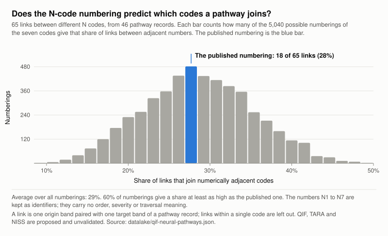
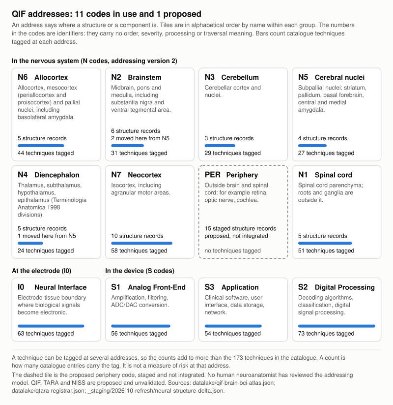
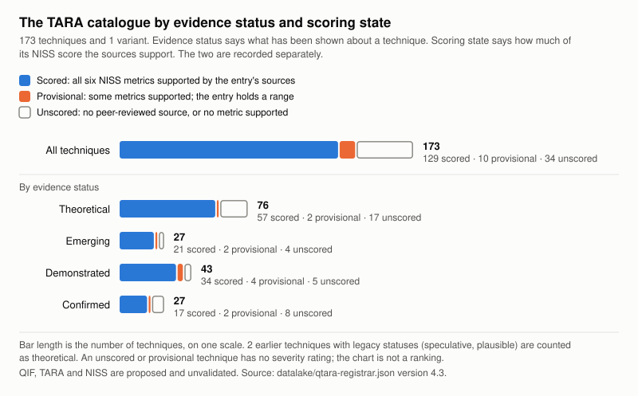
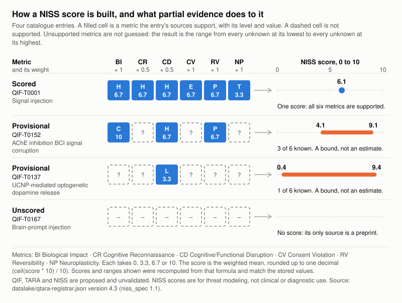
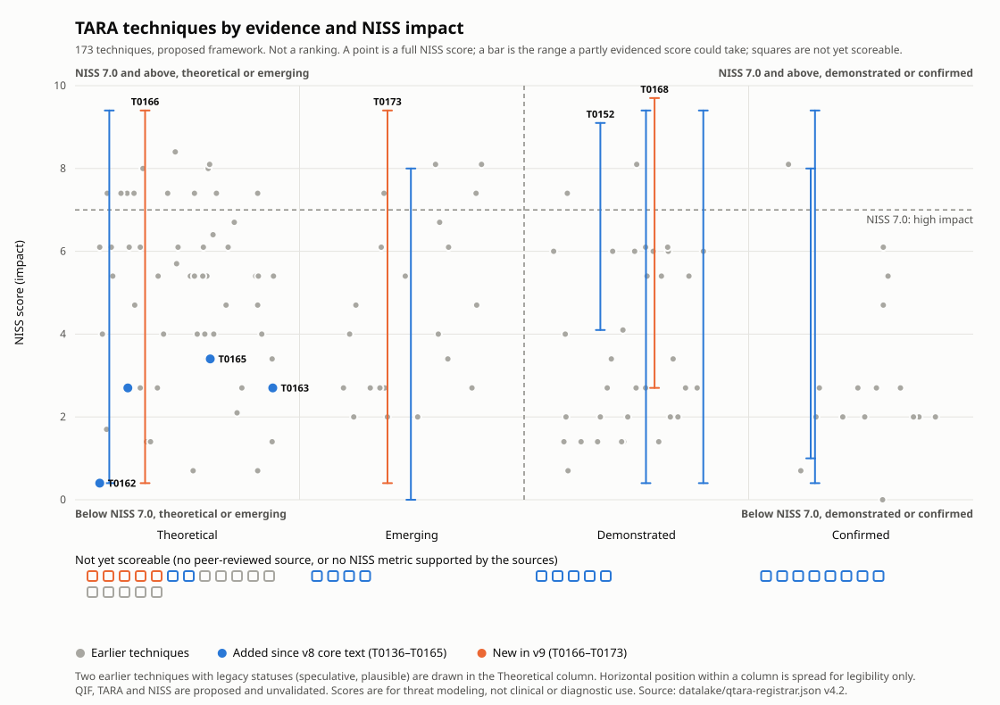
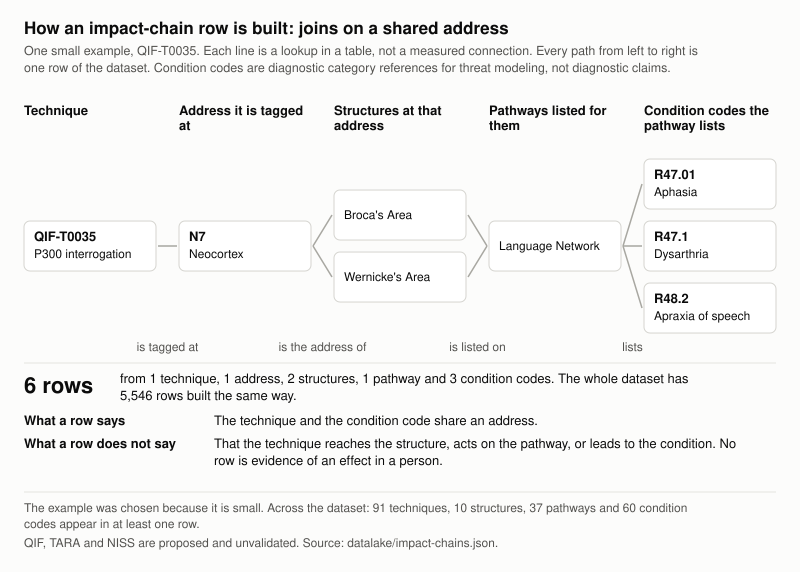
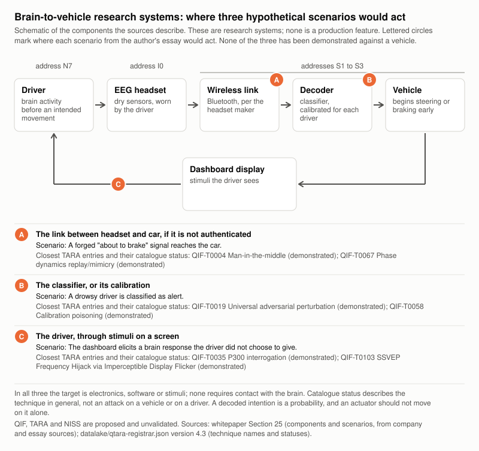
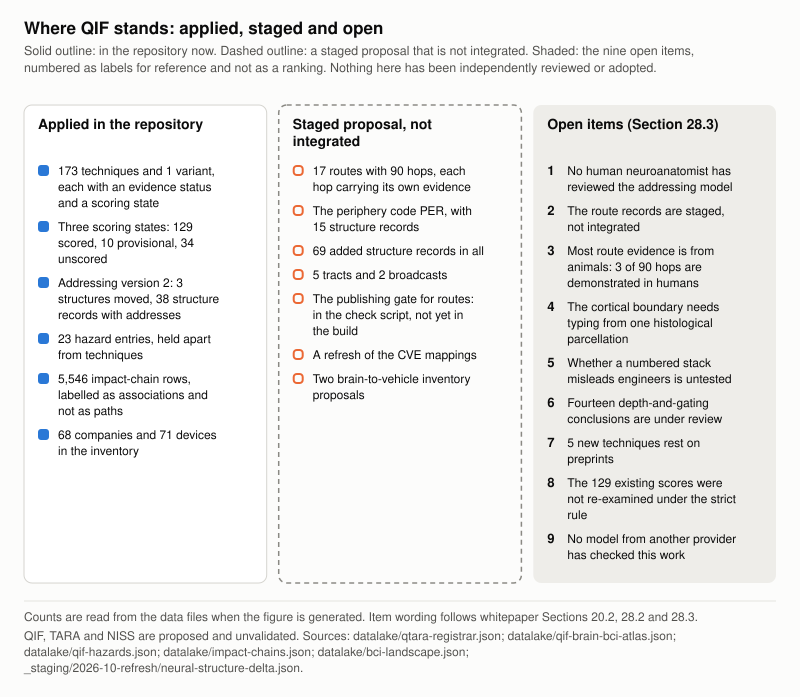

# QIF Whitepaper v9.0

## Securing Neural Interfaces: Architecture, Threat Taxonomy, Neural Impact Scoring, and Governance for Brain-Computer Interfaces

> *"The brain doesn't run on ones and zeros. Its security shouldn't either."*
> — Qinnovate LLC

**Version:** 9.0 (draft) · **Date:** 2026-10-07 · **Author:** Qinnovate LLC · **Predecessor:** QIF Whitepaper v8.0 · **Academic Preprint:** [DOI: 10.5281/zenodo.18640105](https://doi.org/10.5281/zenodo.18640105)

---

## Executive Summary

Brain-computer interfaces are in clinical trials, in clinical use and on sale as consumer EEG headsets. A security team assessing one has no shared reference for how it could be misused or how well each possibility is evidenced. This paper proposes three open tools: QIF, an addressing scheme for where a device acts; TARA, a catalogue of 173 techniques, each labelled with its evidence; and NISS, an impact score that shows its own uncertainty. All three are proposed and unvalidated, and no standards body or outside organisation has adopted them. Use the catalogue as a checklist and read each entry's evidence label. Nine open items, listed in Section 28.3, say what would close the gaps.

## The Problem

A security team assessing a brain-computer interface has no shared reference for what sits on the tissue side of the electrode, how a device could be misused, or how well each possibility is evidenced. This paper proposes one. Implanted devices are in clinical use and in human trials, and consumer EEG headsets are on sale. Security engineers have no checkable account of what lies on the other side of the electrode. Neuroscientists have no catalogue of how a device can be turned against its user. The literature rarely makes clear what has been shown and what has only been proposed.

## Why Neurosecurity?

Three things are true at the same time, and the gap between them is the subject of this paper.

**Devices are deployed now.** Implanted neural interfaces are in clinical use and in human trials, and consumer EEG headsets are on sale to anyone. This is the present tense, not a forecast.

**The science that makes neural circuits legible is advancing, and it is not one technique.** This matters for a threat catalogue, because a catalogue that reasons about one method inherits that method's limits as if they were the field's. Six families of technique do different jobs, and no single one yields a map:

| Family | What it establishes | What it cannot establish |
|---|---|---|
| Structural connectomics (volume electron microscopy) | Anatomy: what is physically wired to what | Function or activity |
| Projection tracing (monosynaptic rabies, AAV, barcoded sequencing) | Connectivity between populations | Causality, or which connections matter |
| Functional readout (calcium and voltage imaging, high-density electrophysiology) | Activity over time | Cell identity, or direction of influence |
| Molecular identity (single-cell RNA sequencing, spatial transcriptomics, epigenomics) | What kind of cell each one is | How the cells are wired |
| Actuators (optogenetics, chemogenetics) | Causal necessity or sufficiency, **only when paired with a readout above** | Anything on their own: an actuator is not a measurement |
| Integrative methods (for example, rabies tracing combined with single-nucleus sequencing) | Connectivity at cell-type resolution | A human map: the work so far is in animals |

**The governance for all of it sits in a different field from device security.** The rest of the paper develops that argument, and it is why the gap is a security problem rather than only a science problem.

### What is demonstrated today

Stated conservatively, and labelled by species.

- **Optogenetics is an actuator, not a map.** A gene for a light-gated ion channel is delivered to a chosen cell population, and light then drives or silences those cells. The first such channel, channelrhodopsin, came from a green alga. Tracing what is connected to what needs a separate readout, because the perturbation alone shows nothing about wiring. Section 24.1 gives the 2026 Nobel Prize in Physiology or Medicine for this work, with its citation. Almost all of it is in animals. The human results this paper cites are in the eye: partial restoration of vision in one patient, and two small retinal trials with mixed results (Sections 24.1 and 24.11).
- **Cell-type-resolved circuit mapping does not need optogenetics.** Single transcriptome assisted rabies tracing (START) combines monosynaptic rabies tracing with single-nucleus RNA sequencing. Applied to inputs onto five layer-specific excitatory populations in mouse primary visual cortex, it showed that inhibitory inputs are specific at the level of transcriptomic subtype (Patiño et al., 2024, *Neuron* 112(23):3851–3866, DOI:10.1016/j.neuron.2024.09.003). **Mouse. Not shown in humans.**
- **Molecular tooling is improving independently of circuit mapping, and is easy to confuse with it.** Dye-cycling origami-rotor-based imaging and tracking (dcORBIT) extended single-molecule tracking of DNA rotation to more than ten minutes at 20 Hz with single-base-pair precision, and was demonstrated on transcription by a bacterial RNA polymerase (Wacker et al., 2026, *Cell Reports Methods* 6(10):101550, DOI:10.1016/j.crmeth.2026.101550). This is transcription biophysics. It is not a brain-mapping result, and this paper does not present it as one.

### Where this is heading: a projection, not a finding

**This subsection is a projection.** Nothing in it is demonstrated, none of it is required for the rest of the paper to stand, and a reader who rejects all of it should still find Sections 20–28 usable.

The direction of travel is from population-level description toward cell-type-level description, and from animal preparations toward human tissue. If that continues, the objects a security framework has to reason about become more specific: not "a region was stimulated" but "an identified cell population was engaged". A framework whose addressing scheme only describes regions will not be able to express that finding. That is the reason to build the addressing scheme before it is needed, and to publish its open items as open items.

### Why now, rather than later

Not because an attack is imminent. We are unaware of a documented attack on a clinical neural device, and this paper does not claim one. The case for now is narrower:

1. **The device population is growing while the shared vocabulary does not exist.** A security team assessing a neural interface today has no checkable account of what sits on the tissue side of the electrode, and risk registers are being written now.
2. **The binding control for the most consequential techniques is not a device control.** For any technique that requires gene delivery, custody of the delivery step decides whether the capability exists at all, and that custody sits inside gene-therapy regulation. We are unaware of a framework that covers the handoff. Naming where a control already lives tells a reader which regulator to ask.
3. **Architecture decided now is expensive to revisit.** Consent gates, data tiering and provenance are cheap while a device is designed and costly afterwards.
4. **Separating the demonstrated from the speculated is itself a safety contribution.** Every catalogue entry carries its evidence, so a reader can discount what deserves discounting, including entries in this paper.

### What this section does not say

- It does not say the brain can be read. Decoded outputs are selected from known alternatives and need the user's cooperation and trained models.
- It does not say any technique described here has been used against a person.
- It does not claim QIF, TARA or NISS are validated, adopted or standard. They are proposed and unvalidated, and no outside organisation has adopted or independently reviewed them.
- It does not claim completeness. The six families are the ones that bear on neural addressing, and corrections to the list are welcome.

## Purpose and Goal

Brain-computer interfaces are in clinical use, in human trials and on sale as consumer EEG headsets. The security discipline that would assess them does not yet share a vocabulary with the neuroscience that explains what sits on the tissue side of the electrode. A security engineer can describe a firmware flaw precisely and has no standard way to say which neural structure a stimulation parameter acts on. A neuroscientist can describe that structure precisely and has no catalogue of how a device could be turned against the person carrying it. This project exists to close that gap, and its method is translation rather than discovery.

**How the model was built.** The framework began from two established hierarchies and the observation that they share a scale. Kandel's nervous-system hierarchy spans seven levels, from molecular signal transduction at roughly 10⁻⁹ m to the whole brain at roughly 10⁰ m. Campbell's levels of biological organization span eight, from the atom at roughly 10⁻¹⁰ m to the organism. Side by side, each advances by about one order of magnitude in spatial extent, with a matching step in timescale. QIF's addressing scheme is built on that shared scale: seven neural addresses, **adapted from those hierarchies by functional grouping rather than reproducing either**, alongside the interface and device addresses (Section 20.2). The adaptation is recorded in the project's derivation log, so a reader can see where the published hierarchies end and this project's judgement begins.

**What the model is.** A shared reference for where a device acts, so that a security finding and a neuroanatomical structure can be discussed in the same sentence. It is a baseline for comparison, not a representation of the nervous system.

**What the model is not, and how we know.** Earlier versions borrowed the OSI model's numbered-layer form, and readers reasonably read the numbered bands as layers a signal traverses in turn. We tested that reading against the framework's own pathway data by comparing the published numbering with all 5,040 possible numberings of the seven addresses (Section 20.1). The published order was indistinguishable from an arbitrary one: it carried no traversal information. It was retired. The addresses are now labels with no order, severity or sequence meaning. Signal flow is to be carried by explicit route records that can be checked against anatomy one at a time, and those are proposed and staged, not yet integrated (Section 20.4). A construct that cannot survive a measurement against its own data does not stay in the model because it is useful or because it is ours.

**Why mapping should begin now, and in which order.**

1. **Start from what is demonstrated.** Every TARA technique carries an evidence label, and the catalogue reads as a checklist in descending order of evidential strength. The evidence tiers do not yet record species, so a reader should check whether a demonstrated result is human or animal (Section 21.2).
2. **Then the theoretical, labelled as theoretical.** A threat model that excludes untested mechanisms is incomplete, and one that presents them as findings is worse. Labelling is what lets the catalogue carry both.
3. **Then the controls that are not device controls.** For techniques that require gene delivery, custody of the delivery step sits inside gene-therapy regulation, and naming that tells a reader which regulator to ask.
4. **Then architecture, while it is still cheap.** Consent gates, data tiering and provenance cost little during design and a great deal afterwards.

**The constraint the work operates under.** Patients depend on these devices today. Deep brain stimulators, cochlear implants and responsive neurostimulators improve and sometimes save lives. A security framework that makes them harder to build, approve or obtain has done net harm however rigorous it is. That is why the catalogue is published as a checklist with its evidence exposed, not as a conformance requirement.

**Status, limits and what is being asked for.** QIF, TARA and NISS are proposed and unvalidated, and no standards body or outside organisation has adopted or independently reviewed them. The work is one researcher's: more than thirteen years in cybersecurity, a seat on the FIRST.org CVSS Special Interest Group, and no formal training in neuroscience. No human neuroanatomist has reviewed the anatomy, and that bounds how much weight the anatomical claims can carry. The most useful response to this paper is a correction with evidence attached, especially from reviewers able to falsify the proposed NISS extension to CVSS. Section 28.3 lists the work that remains, and Section 28.7 says what would help from each kind of reader.

## What Qinnovate Offers

Qinnovate, currently a solo research effort by the author, Qinnovate LLC, works on that gap. It offers three things, each proposed and unvalidated:

- **QIF** (the Quantified Interconnection Framework for Neural Security), a security framework for these devices with an addressing scheme for where a device acts.
- **TARA** (Therapeutic Applications and Risk Assessment), a catalogue of 173 techniques by which a device could be attacked or misused, each labelled with the evidence behind it.
- **NISS** (the Neural Impact Scoring System), an impact score that shows its own uncertainty.

The datasets behind all three are open, with a device inventory of 68 companies and 71 devices, an SDK and data exports, including a STIX export. The repository is licensed under Apache 2.0 and the preprint under CC BY 4.0.

## Status of This Paper

> - **In active development, not yet a standard.** Use it today as a structured checklist of what to consider and how well each item is evidenced; it is not a certification or a clinical tool. No outside organisation has yet adopted or independently reviewed it.
> - **Proposed and unvalidated.** QIF is a proposed framework, not a standard. It has not been independently peer-reviewed or validated in clinical deployment, and no standards body (IEEE, ISO, NIST or otherwise) or outside organisation has adopted it.
> - **Checked so far.** AI-assisted review (AI agents with specialist briefs) checked the framework's claims, and this version reports which held and which did not. Every DOI, arXiv identifier and regulatory record cited in Sections 20–28 was resolved through Crossref, the arXiv API or a regulator database. Company, news, legal and reference-work sources are cited by link and were not resolved that way, and Sections 24.14 and 27.8 state how far the papers themselves were read. Automated consistency checks pass, except one route-evidence check that fails on a route marked for teaching. See Claims and Disclaimers for what "AI-assisted" means here.
> - **Not reviewed.** **No human neuroanatomist has reviewed the anatomy, and the author's own review of Sections 20–28 and Appendix E is pending.** No patient or patient advocate has reviewed the paper, including the part written for them.
> - **AI assistance.** Sections 20–28 and Appendix E were drafted with AI assistance on 2026-10-06 and 2026-10-07. So was this opening, which is also pending the author's review. Earlier AI use is described under Claims and Disclaimers.
> - **Release status.** On 2026-10-20 the draft catalogue described here was reconciled with the published one. The reconciled catalogue holds 178 techniques and no variants: 131 fully scored, 10 provisional and 37 unscored under the citation gate. QIF-T0177 and QIF-T0178 were added (renumbered on 2026-10-17 because QIF-T0172 and QIF-T0173 are published for different techniques), and the draft's variant QIF-T0024-V01 duplicated published QIF-T0174 and was withdrawn in its favour. The PyPI package `qtara` reached 0.4.0 on 2026-10-17 and is deprecated. **Counts in the body of this paper describe the draft as dated 2026-10-07 (173 techniques and 1 variant; 129 scored, 10 provisional, 34 unscored) unless a passage gives a later date.**
> - **How to read it.** Sections are numbered 20 to 28 because the numbering continues from v8.0. Sections 12 to 19 are in the companion document. The NISS scoring method is set out in full in Section 27.3.
> - **How to respond.** Send corrections, evidence and reviews through [GitHub Issues](https://github.com/qinnovates/neurosecurity/issues). Section 28.7 lists what would help from each kind of reader. Tell us where an entry in your device's risk file is wrong or missing.

## Terms Used in This Paper

| Term | Meaning |
|---|---|
| Address (also "code"; "band" in the data files and in earlier versions) | A label for where a structure or component is. The numbers carry no order, severity or traversal meaning (Section 20.2) |
| N1 to N7 | Addresses in the nervous system (addressing version 1): N1 spinal cord, N2 brainstem, N3 cerebellum, N4 diencephalon, N5 basal ganglia, N6 limbic system, N7 neocortex. A proposed version 2 regroups N5 and N6 (Section 20.2) |
| I0 | The neural interface: the boundary between electrode and tissue |
| S1 to S3 | Addresses in the device: S1 analog front-end, S2 digital processing, S3 application |
| PER | A proposed address for structures outside the brain and spinal cord. Staged, not integrated |
| Route and hop | A route is an ordered chain of connections between structures. Each connection is a hop, with its own evidence (Section 20.4). Staged, not integrated |
| Technique | One entry in the TARA catalogue, with an id such as QIF-T0166 |
| Tactic | The purpose a technique serves. The catalogue has 17, with ids such as QIF-D.HV (Data Harvest) |
| Evidence status | How far a technique has been shown: theoretical, emerging, demonstrated, plausible or speculative (Section 21.2) |
| Scoring state | Whether a technique's NISS score is complete (scored), bounded by a range (provisional) or withheld (unscored) (Section 21.3) |
| NISS vector | The six metric levels behind a score, written as `NISS:1.1/BI:H/CR:H/...` (Section 27.3) |
| PINS | A safety flag set when biological impact is High or Critical, or the effect is irreversible (Section 27.3) |
| Variant | A technique that differs from its parent in one stated respect (Section 21.4) |
| Hazard | A condition that can cause harm with no adversary, recorded separately from techniques (Section 21.5) |

## Mission and Vision

**Mission.** Put security and ethics into brain-computer interface architecture at the design phase, before devices are deployed at scale. The work starts with the patient, aims to make neurosecurity and neuroengineering more accessible to engineers, students, patients and researchers, and publishes its working, including the project's own corrections.

**Vision.** A person implanted at 30 can trust the device for the 70 years they may carry it, because its security architecture outlasts the company that built it.

## In Plain Language

Some medical devices now connect directly to the brain, to help people who are blind, paralysed or living with conditions that have no other treatment. A person may carry one for decades. One maker, Second Sight, laid off most of its staff in 2020 and announced it would wind down, leaving patients without support for their implants.

This paper proposes ways to build safety into these devices from the start. It says the person carrying the device should be able to see every signal going into their nervous system, disconnect without asking permission, and move to another maker's hardware. These are proposed requirements on how devices should be built. They are not advice to switch off or change a device you have, and decisions about your own device belong with your clinical team. The paper also lists 173 techniques by which such a device could be attacked or misused, each marked with how much evidence supports it, so that builders know what to defend against.

This is one researcher's proposal. No outside organisation has checked or adopted it, and it does not diagnose anything. Parts were drafted with AI help. The author has not finished reviewing those parts, and no human specialist in brain anatomy has reviewed them.

## Key Findings

Usable now: the catalogue as a labelled checklist of techniques to consider. Not yet usable: the routes, the unscored entries and any claim about reach into a person. Each finding below sets the limit.

1. **The catalogue grew and the evidence rule became stricter.** TARA holds 173 techniques and 1 variant, up from 165. Of these, 129 are fully scored, 10 are provisional and 34 are unscored, against 139 scored in v8.0. The evidence rule tightened, and no technique was removed (Section 21).
2. **The address numbers are labels, not a ranking.** The share of pathway links joining numerically adjacent addresses was no different from chance. The seven codes N1–N7 stay as addresses (Section 20).
3. **A central analogy was corrected.** An earlier version described the thalamus as a gate; that was wrong (Section 20.3), and design rationale that treats implant depth as protection should not rely on it. Fourteen conclusions that rested on the analogy are marked under review. The NISS formula has no term for implant depth: all 139 scores that existed before this version reproduce from their six metric values. Whether depth reasoning influenced the choice of a metric level was not checked.
4. **Route evidence comes mostly from animals.** A source check of all 90 hops in the 17 proposed routes found 47 supported, 42 partly supported and 1 contradicted for primates. Three hops are demonstrated in humans. The routes suit tagging, listing canonical pathways and teaching, and are not yet a basis for claims about what an attack can reach in a person (Section 20.4).
5. **Impact chains are associations, not paths.** Each of the 5,546 rows in the impact-chains dataset says that a technique and a condition code share an address, not that the technique reaches the structure. Condition codes are diagnostic category references for threat modeling, not diagnostic claims (Section 22.3).
6. **None of the eight new techniques is fully scored.** Three carry provisional ranges, and five are unscored because their only support is a preprint. Of the 23 entries in the separate hazards dataset, one describes loss of maker support for an implant. The other 22 point to therapy and mechanism records and are not warnings about those therapies (Sections 21.5 and 21.6).

## Recommendations

**Device makers and their security teams**

- If earlier design notes used the numbered-stack model, treat its numbers as labels, not as depth or severity (finding 2).
- Read a provisional NISS range as a bound, and do not rank techniques on unscored or provisional entries (findings 1 and 6).
- Withdraw any design rationale that relies on a thalamic gate, or on implant depth as protection, until the statements under review are resolved (finding 3).
- Keep the 23 hazards separate from adversarial techniques in risk files (finding 6).

**Hospital and clinical security leads**

- Ask each device maker what happens to an implant if the maker withdraws support (finding 6). When anyone cites a catalogue technique to you, ask for its evidence status and scoring state (findings 1 and 6).
- Put the maker-support question in your next procurement or vendor review.

**Researchers**

- Review the addressing model as a neuroanatomist. A brief with six questions is prepared (Section 28.3).
- Supply the evidence that findings 1, 4 and 6 show is missing. Section 28.7 lists each request.

**Regulators and standards bodies**

- Require evidence status and scoring state with any technique cited from the catalogue (findings 1 and 6). Review the evidence-status and scoring-state fields as a model for what a cited technique should carry.
- Use the impact-chains dataset only as associations, never as evidence of clinical outcome or as diagnoses (finding 5).
- Take up the governance questions the paper raises, including who sets the amplitude ceiling for cortical stimulation (Section 18, in the companion document).

**Clinicians and patients' advocates**

- Ask device makers what happens to an implant if the maker withdraws support (finding 6).
- Treat the patient-control requirements (inspect, disconnect, switch hardware) as proposals that have not been validated in clinical use.

**Funders and investors**

- This is a framework in active development. The nine open items in Section 28.3 are the diligence list, each with a stated closing condition.
- Each open item in 28.3 has a closing condition; funding or time against one of them is the most direct way to move the project.

---

## Worked Example: a Deep Brain Stimulator, from Device to Risk Register

A worked example takes one device, a subthalamic deep brain stimulator, from address to risk register with the catalogue as it stands.

1. **Find the address.** The atlas places the subthalamic nucleus at N4. That says where the lead sits, with no depth, severity or traversal meaning.
2. **Choose the device's addresses.** N4 for the target, I0 for the electrode interface, and S2 and S3 for telemetry. The last two are the engineer's judgement, because the atlas tags no device with a device-side code.
3. **Query the catalogue.** 141 of the 173 techniques are tagged with the device's tissue location or its electronics. A match means a shared address. It does not mean the technique reaches the device.
4. **Cut to a register.** Keeping the techniques that are fully scored and rated high leaves 14 rows, each with its evidence status and its controls. None of the 14 has a linked hazard or a mapped CVE.

Step 4 leans on the NISS severity word, an open question in Section 28.3, and sets aside every unscored and provisional technique (set-aside techniques are not cleared). The full example, including how the result fits beside CVSS, ATT&CK and the medical-device standards a security team already files against, is in the companion document, [QIF-WHITEPAPER-V9-COMPANION.md](QIF-WHITEPAPER-V9-COMPANION.md).

**Run these four steps on a device you assess and report where the address or the shortlist is wrong.**

## Planning Assumptions

These are the author's assumptions. They are not forecasts, and they carry no probabilities.

| # | Author's assumption | Evidence it rests on | What would falsify it |
|---|---------------------|----------------------|-----------------------|
| 1 | The window to embed security and ethics in BCI architecture before deployment scale is finite and narrowing. | The internet precedent set out in The Proposal. Commercial devices are shipping. | Evidence that architectural decisions in neural devices deployed at scale can be changed at a cost comparable to designing them in. |
| 2 | The scored count will fall further when the 129 existing scores are re-examined under the strict evidence rule. | Applying the rule to 34 techniques left 24 sourced and 10 without a score. | A completed catalogue-wide pass in which all 129 scores are retained. |
| 3 | An implant can outlast the company that built it. | Second Sight laid off most of its staff in March 2020 and announced its intention to wind down, leaving Argus II patients without support ([IEEE Spectrum, 15 February 2022](https://spectrum.ieee.org/bionic-eye-obsolete)). The company did not close. | Evidence that support obligations for implanted devices survive the bankruptcy, pivot or acquisition of the maker. |
| 4 | Neural interfaces using AI for stimulation decisions would be classified as high-risk under the EU AI Act. | The Act classifies AI systems by risk. Under Article 6(1), an AI system that is a safety component of a medical device, or is itself one, is high-risk where the device requires third-party conformity assessment under the EU medical device regulation. Annex III also lists safety components of critical infrastructure (Regulation (EU) 2024/1689). | A classification decision or guidance placing such systems outside the high-risk tier. |

---

## Author's Note

This paper proposes a secure BCI architecture derived from security engineering and ethics.

It started with a question: what would threat modeling for the human mind look like? That question led me into the world of brain-computer interfaces — and quickly made clear that you cannot build for the brain the way you build for a screen. The technical architecture alone is not enough. To do this right from the design phase, I applied two decades of security instincts and went deep into the disciplines that should inform every decision at this layer: neuroethics, AI ethics, and the emerging fields of neurorights and neuroprivacy.

I believe it is vital for the adoption of BCIs — and in the best interest of every company building them — that we embed ethics and security by design. In working toward treatments for people who are ill or disabled, we should take care not to add security weaknesses to the devices those people rely on. It is our duty as engineers and architects to understand the full scope in which a clinical remedy may introduce more risk than reward, and to design systems that make that calculus transparent.

That is the mission behind this paper.

The concepts here span neuroscience, security architecture, ethics, law, and clinical medicine. Some are well-established; many are proposed and unvalidated. I have worked to distill them into a single coherent framework, and to be explicit about where the evidence is strong and where the work is still theoretical. Where claims are speculative or unverified, the text says so. Where I do not know the answer, the paper raises the question rather than fabricating a response.

— Qinnovate LLC

---

## Claims and Disclaimers

Every QIF component named in this paper (TARA, NISS, NSP, Runemate, the Coherence Metric) is a proposal, not an established specification. The last part of this section is written for patients and families.

### What This Paper Claims

1. **BCI security is an under-addressed problem.** The threat surface of neural interfaces has not received the same architectural rigour as enterprise IT, mobile, or IoT security. The techniques catalogued in TARA are derived from published neuroscience, signal processing, and cybersecurity literature.
2. **Security and ethics are inseparable at this layer.** A security architecture that ignores neuroethics will fail its patients, and a neuroethics framework that ignores security engineering will remain aspirational.
3. **Designing from a blank slate is possible now, and the author's view is that it will not be later** (Planning Assumption 1).

### What This Paper Does Not Claim

1. **QIF is not a standard.** Its status is set out in Status of This Paper.
2. **NISS does not measure cognitive harm.** It scores physical signal-level disruption corresponding to specific techniques. It does not diagnose psychiatric conditions, predict clinical outcomes, or quantify "thought harm." DSM-5-TR category mappings are diagnostic category references for threat modeling purposes only, not diagnostic claims.
3. **TARA is a defensive catalogue.** It exists to inform defence architecture, not to enable attacks. Every technique is paired with governance constraints and defensive controls, and offensive use is out of scope.
4. **This paper does not read minds.** Current BCI technology cannot "read thoughts" in any general sense. Decoded outputs are selected from constrained vocabularies, require user cooperation, and depend on individually trained algorithms. Capability claims here reflect published research, some of it in preprints or company reports and labelled as such, and distinguish current from projected capabilities.
5. **AI-derived content is flagged.** Portions of this paper were drafted with AI assistance (Claude). All technical claims have been reviewed by the author, except the v9.0 additions, where that review is pending. AI-generated citations were independently verified through Crossref, publisher pages, or institutional records. The preprint history includes a correction for 3 fabricated citations in v1.0 that were AI-generated and not caught before publication. Full AI disclosure is in Section 9.7 of `QIF-WHITEPAPER.md` v6.3.
6. **Engineering benchmarks are unverified.** Any quantitative claims about NSP compression ratios, power overhead, latency, or throughput, which appear in the companion document and not in this paper, are AI-derived estimates, not empirical measurements. They require independent engineering validation before informing design decisions.

### Epistemic Framework

The paper classifies evidence on five levels, and the framework's own components sit at the fourth, Theoretical. Where a claim's classification is not obvious from context, it is flagged inline.

| Level | Meaning | Example in This Paper |
|-------|---------|----------------------|
| **Verified** | Peer-reviewed, resolved DOI, reproduced | Published attack techniques, cited neuroscience |
| **Established** | Strong consensus, official documentation | NIST AI RMF, EU AI Act provisions, CVSS methodology |
| **Inferred** | Logical deduction from verified premises | Threat chain mappings, architectural implications |
| **Theoretical** | Author's proposed framework, unvalidated | QIF addressing model, NISS scoring, Coherence Metric (Cs), NSP, Runemate |
| **Unknown** | Insufficient evidence | Explicitly stated as open questions throughout |

### What This Cannot Do for You

This part is for people who have a neural device, are thinking about one, or care for someone who does.

**QIF is not a product, and it is not in your device.** No device implements QIF today. The project's own data policy says there is no QIF software running on patient devices, and the framework has not been tested in clinical use.

- **It does not lower the clinical risk of a device or a procedure.** This paper is about security design. It is not a clinical or diagnostic instrument, and nothing in it is medical advice. Questions about your own care belong with your clinical team.
- **It does not protect you if a device maker closes or stops support.** It proposes ways to plan for that (Sections 13.1, 16.3 and 18.3). None of them is in force, and no maker is bound by them.
- **It does not stop a court or an agency from demanding your data.** The paper has no answer to that question. Its own governance table gives the deciding role in a law-enforcement request to the regulator, not to you (Section 13.0, question 2).
- **It does not tell you what will happen to you.** It lists ways a device could in principle be misused, so that designers can plan against them. None of its evidence statuses means that an attack has been carried out on a person with a device (Section 21.2), and its condition codes are not diagnoses or predictions.

It offers two things now. The first is questions to ask: Section 13.0 sets out five questions patients ask, what the paper proposes for each, and what is still open, and you can put the same questions to a device maker or a clinical team. The second is a public record: each entry in the open catalogue carries an evidence status, and all but eight list at least one source (Section 28.2). The version described in this paper, and its hazards list, are not yet merged (see Release status).

---

## The Proposal

Every transformative technology gets one chance to build its foundation right. The internet did not take that chance.

TCP/IP shipped without authentication. HTTP shipped without encryption. DNS shipped without integrity verification. We spent the next four decades bolting on security after the fact: TLS, DNSSEC, OAuth, zero-trust architectures. Each one is a patch on a foundation that was never designed to be secure. The cost has been enormous: a global industry built substantially to compensate for a foundation that shipped without security in the first place.

Brain-computer interfaces are at that same inflection point. The first cortical implants are in people. The first commercial devices are shipping. And the security architecture is, once again, an afterthought.

The difference this time is that the attack surface is not a credit card number or a social security record. It is the human nervous system. There are no rollbacks for neural tissue damage. There is no "change your password" for a compromised sensory cortex.

This is not a warning. It is a proposal.

**The analogy that broke**

This project began with an analogy from network security. I was studying a diagram of the thalamus when I recognized an architecture I had built before: a chokepoint, all signals in, one classification out. Earlier versions of this paper called the thalamus the brain's firewall and said that all sensory signals pass through it except smell.

It was an analogy, and analogies break. Reviews carried out by AI agents with specialist briefs showed that both statements were wrong, and v9.0 retracts them. The thalamus is the principal relay to neocortex. Its transmission is state-dependent. It is not a security control (Section 20.3). Fourteen conclusions that rested on the analogy are marked under review: not deleted, not asserted. No human neuroanatomist has yet reviewed the correction.

The analogy did one job. It gave a security engineer a way into the question of what his own field had to say about devices wired into those pathways. It then did a second job it had not earned: it stood in for the anatomy. Readers trained on protocol stacks read a numbered list of bands as a protocol stack, and the brain does not work that way (Section 20.1).

That is the difference between making a field accessible and flattening it. Accessible means a newcomer gets a way in, and is then shown where the familiar picture stops matching the evidence. Flattened means the picture is left standing in place of the evidence. This version keeps the way in and removes the shortcut. Each address has a membership rule. Each technique carries its evidence status. The correction is on the record.

The author's words, from an earlier version:

> "The people whose brains will be connected deserve to understand exactly how they are protected."
> — Qinnovate LLC

### The Direction

The starting point is the patient. Not the manufacturer, not the regulator, not the research institution.

The patient is the one whose nervous system is on the line. Starting anywhere else creates the same power asymmetries that have defined previous technology platforms. The author's words, from an earlier version, on what the architecture protects:

> "Not the data. Not the device. The person."
> — Qinnovate LLC

This is an equity decision. The people who need BCIs most urgently (those with severe motor impairment, blindness, locked-in syndrome) are also the most vulnerable to exploitation by closed systems they cannot inspect, modify, or leave. Building patient sovereignty into the architecture from the start is not a feature. It is a prerequisite for equitable access.

**What to do**

Three architectural requirements. They are requirements, not aspirational goals.

- The patient can inspect every signal entering their nervous system.
- The patient can disconnect without asking a cloud service for permission.
- The patient can switch hardware without being locked into a vendor's ecosystem.

**Limits**

- This does not mean ignoring manufacturers, regulators, or clinicians. It means patient control is the default.

### What This Paper Does

The paper delivers three things: an attack-surface map, a proposed architecture, and a set of governance questions.

**1. It maps the attack surface of brain-computer interfaces in technical terms.**

- 165 attack techniques across 8 domains. This is the v8.0 count; Section 21 gives the current count of 173 techniques and 1 variant.
- Techniques are scored with a neural-specific severity system (NISS) and cataloged in a dual-use registry (TARA) that bridges security and medicine.
- Every technique that can harm can also heal. The boundary between the two is consent, dosage and oversight. The author's framing principle, from an earlier version: "Therapeutic use is the default. Adversarial use is the deviation."
- The Neural Impact Chain associates each technique, by the neural band it shares with a clinical outcome, with DSM-5-TR diagnostic categories for threat modeling purposes. These are associations by shared band, not demonstrated neural paths.

**2. It proposes the architecture.** The components are an address model, a wire protocol (NSP), a rendering pipeline (Runemate), passwordless authentication, a five-tier guardrail model, a neural operating system and a patient terminal. They are described in Sections 12 to 17 of the companion document.

**3. It raises the questions that society must answer before millions of people carry these devices.**

- Who sets the amplitude ceiling for cortical stimulation: the manufacturer who profits, the regulator who lags, or the patient who bears the risk.
- At what point a BCI assisting with motor recovery crosses the line into autonomous control of the body.
- Where the guardrail sits, and who installed it, if a patient asks their AI to help them quit painkillers, then quit alcohol, then run faster than their body allows.

Supporting material:

- A RACI matrix maps 30+ scenarios to six stakeholder categories.
- Neurorights are operationalized as access control flags.
- The Open Source Neural Atlas proposes hardware interoperability, with the aim that a device could still be supported if its maker closes. This is a proposal, not a guarantee.

*The rest of The Proposal (The Defense Paradox, Design Principles, and the survey of AI ethics regulation) is in the companion document, [QIF-WHITEPAPER-V9-COMPANION.md](QIF-WHITEPAPER-V9-COMPANION.md).*

---

## What Changed in v9.0

v8.0 asked who decides, who controls and who is accountable. v9.0 asks **which of the framework's claims hold up when AI agents with specialist briefs check them, and which do not**, and it reports the parts that did not hold.

| v8.0 | v9.0 |
|------|------|
| Seven neural bands presented as a stack | Seven codes kept as **addresses** with no order, plus a periphery code; signal flow moves to route records (Section 20) |
| Thalamus described as a gate or firewall | Corrected: the principal relay to neocortex, with state-dependent transmission, and not a security control (Section 20.3) |
| 165 techniques, 139 with a NISS score | **173 techniques, 1 variant**; 129 scored, 10 provisional, 34 unscored under a stricter evidence rule (Section 21) |
| A technique is scored or it is not | Three scoring states, with a range shown where the evidence is partial (Section 21.3) |
| No way to record a variant | Variant ids modelled on ATT&CK sub-techniques, in a distinct format (Section 21.4) |
| Attacks and non-adversarial conditions in one list | A separate hazards dataset, 23 entries (Section 21.5) |
| Impact chains described as threat-to-outcome paths | Described as associations by shared address (Section 22.3) |
| No account of circuits beyond the address | Circuits, optogenetic evidence, drift and daily baselining, and how routes record them (Section 24) |
| Neural interfaces treated as medical and consumer devices | Interfaces in machines, with brain-to-vehicle research as the case (Section 25) |
| NISS method and its ethical basis spread across sections | Neuroethics defined, the full NISS method with a worked example, the rights and consent labels, and eight guardrails, in one place (Section 27) |
| No stated view of the future | Seven labelled projections, each with evidence, confidence and what would refute it (Section 26) |
| Priority claims ("first", "no other") in several documents | Removed from living documents; 20 instances |

**How to read this version**

- This paper holds the front matter and Sections 20–28, which are current. Sections 20–28 and Appendix E are new in v9.0. Section 23, which has no row above, covers related research.
- Sections 12–19, 6.8 and 6.9 carry over from v8.0 of 2026-07-27 with targeted corrections and are in the companion document, [QIF-WHITEPAPER-V9-COMPANION.md](QIF-WHITEPAPER-V9-COMPANION.md). Counts and wording there may still reflect v8.0.
- Appendix E lists every change.

---

## Contents

**Front matter:** Executive Summary · The Problem · Why Neurosecurity? · Purpose and Goal · What Qinnovate Offers · Status of This Paper · Terms Used in This Paper · Mission and Vision · In Plain Language · Key Findings · Recommendations · Worked Example: a Deep Brain Stimulator, from Device to Risk Register · Planning Assumptions · Author's Note · Claims and Disclaimers · The Proposal · What Changed in v9.0

- [20. The Neural Addressing Model](#20-the-neural-addressing-model)
- [21. TARA 4.3: New Techniques, Variants and Evidence Rules](#21-tara-43-new-techniques-variants-and-evidence-rules)
- [22. Mappings, Inventory and Associations](#22-mappings-inventory-and-associations)
- [23. Related Work: Cognitive Neurosecurity and the Cerberus Review](#23-related-work-cognitive-neurosecurity-and-the-cerberus-review)
- [24. Brain Circuits: What Optogenetics Shows, and How QIF Maps It](#24-brain-circuits-what-optogenetics-shows-and-how-qif-maps-it)
- [25. Neural Interfaces in Machines: The Brain-to-Vehicle Case](#25-neural-interfaces-in-machines-the-brain-to-vehicle-case)
- [26. The Future of Neurosecurity: Projections](#26-the-future-of-neurosecurity-projections)
- [27. Neuroethics: What It Is, and How It Shapes QIF and NISS](#27-neuroethics-what-it-is-and-how-it-shapes-qif-and-niss)
- [28. Where QIF Stands, and Where It Is Going](#28-where-qif-stands-and-where-it-is-going)
- [Appendix E: Version History (v8.0 → v9.0)](#appendix-e-version-history-v80--v90)

**In the companion document** ([QIF-WHITEPAPER-V9-COMPANION.md](QIF-WHITEPAPER-V9-COMPANION.md)): the worked example; the rest of The Proposal; Sections 12–19, 6.8 and 6.9, carried over from v8.0 with corrections; the full technique write-ups of Section 21.7; the document map; Appendices A to D. Section numbers are shared, so a reference in this paper to Section 15.6 or Section 18.2 points there.

---

## 20. The Neural Addressing Model

**Key takeaway.** N1–N7 are now addresses and no longer layers. Signal flow moves to a separate, proposed route view, and the thalamus is no longer described as a security control.

### 20.1 Why the stack had to go

QIF began as an extension of the OSI model, and readers trained on protocol stacks read its numbered bands as layers that a signal traverses in turn. The framework's own data does not support that reading. When the bands on every pathway were recomputed from the structure table, the share of pathway links joining numerically adjacent bands was no different from chance.

*Figure 20.1. The share of cross-code pathway links that join numerically adjacent N codes, for the published numbering (21 of 63 links, 33.3%) against all 5,040 possible numberings of the seven codes (average 28.6%). 27.6% of numberings place at least as many links on adjacent codes as the published one, so the published order carries no traversal information. Addressing version 1, the version in use. Generated from origin and target bands in datalake/qif-neural-pathways.json by datalake/scripts/render-band-adjacency-figure.py, which CI checks for staleness.*

Three review rounds, the last by five AI reviewers with neuroanatomy briefs, reached the same verdict: keep the seven codes, drop the order, and carry signal flow somewhere else.

### 20.2 Addresses

N1–N7 are retained as identifiers, and one unnumbered code, PER, is proposed for everything outside the brain and spinal cord. With the interface code I0 and the device codes S1 to S3 (Section 25.5), that makes eleven codes in use and one proposed. **The number carries no severity, processing or traversal meaning.**

*Figure 20.2. The eleven address codes in use and the proposed periphery code, shown as unordered tiles with each code's membership rule as proposed for addressing version 2 (the data uses version 1; see the table below), structure records and the number of catalogue techniques tagged at it. Counts are tags, not a measure of risk. Sources: datalake/qif-brain-bci-atlas.json, datalake/qtara-registrar.json and the staged proposal in _staging/2026-10-refresh/neural-structure-delta.json.*

The data uses addressing version 1, in which each code is a functional grouping adapted from Kandel's hierarchy. A proposed version 2 would give every structure the address of the adult territory that holds its principal neurons, and treat circuits such as the basal ganglia and the limbic system as functional tags rather than addresses. Version 2 is not applied.

| Code | Name in use (version 1) | Proposed membership rule (version 2) |
|---|---|---|
| N7 | Neocortex | Isocortex, including agranular motor areas |
| N6 | Limbic System | Allocortex, mesocortex (periallocortex and proisocortex) and pallial nuclei |
| N5 | Basal Ganglia | Subpallial nuclei: striatum, pallidum, basal forebrain, central and medial amygdala |
| N4 | Diencephalon | Diencephalon: thalamus, subthalamus, hypothalamus, epithalamus |
| N3 | Cerebellum | Cerebellum |
| N2 | Brainstem | Brainstem: midbrain, pons, medulla |
| N1 | Spinal Cord | Spinal cord parenchyma |
| PER | (proposed code) | Nerves, roots, ganglia, sense organs |

Version 2 would change three addresses. The substantia nigra and ventral tegmental area would move from N5 to N2, because they are in the midbrain, and the subthalamic nucleus from N5 to N4. All three would keep the basal ganglia or reward tag, so the functional tags would still find them together. Under version 1, the version in use, subthalamic deep brain stimulation, a target of four of the 24 devices mapped to brain regions in the atlas (a separate dataset from the 71-device inventory of Section 22.4), is an N5 example. Applying version 2 broke dependent tests across the atlas and site, so it was deferred on 2026-10-20 and the site keeps the version 1 names.

Because codes would keep their identifiers while membership changes, any band reference should say which addressing version it uses. Pathway bands are now computed from the structure table by a script whose check mode (`npm run check:bands`) exits with an error on any mismatch, but the check is not yet run by the build or by CI.

| State | Items |
|---|---|
| Applied in the repository | Codes as addresses with no order, the derived bands and the corrected thalamus text |
| Staged proposal, not integrated | Addressing version 2 (the three moves and the N5 and N6 names), the periphery code, the route records described in 20.4, and 69 further structure records |

### 20.3 The thalamus, corrected

Earlier versions described the thalamus as the brain's firewall and stated that all sensory signals pass through it except smell. Both statements are replaced by:

> The thalamus is the principal route by which sensory input (except the first cortical stage of olfaction), cerebellar output and basal ganglia output reach neocortex. Transmission through it is state-dependent, set by cortical layer-6 feedback, brainstem neuromodulators and inhibition from the thalamic reticular nucleus.

The thalamus is not a security control. Brainstem neuromodulatory projections reach cortex by extra-thalamic pathways as well as through the thalamus (Edlow et al., 2012, DOI:10.1097/nen.0b013e3182588293). Earlier wording in this paper, that motor output and cortico-cortical traffic also bypass it, was too general: motor thalamus lies on the route from the basal ganglia and cerebellum to motor cortex, and cortical areas also communicate through thalamic nuclei (Bosch-Bouju, Hyland and Parr-Brownlie, 2013, DOI:10.3389/fncom.2013.00163; Sherman, 2016, DOI:10.1038/nn.4269). The point is on the list for the neuroanatomy review. Olfaction is not thalamus-free either, since piriform cortex projects to the mediodorsal thalamus (Courtiol and Wilson, 2015, DOI:10.3389/fncir.2015.00049).

**Conclusions now under review.** Several statements in QIF documents drew security conclusions from the gate analogy, chiefly that cortical implants are the most security-critical because they sit above a thalamic gate, and that a deeper implant bypasses fewer protective layers and so carries less direct cognitive risk. Fourteen such statements are marked "under review" in the repository. They have not been deleted and are not asserted, and they should not be relied on.

A check of the registrar found that **the NISS formula has no term for implant depth**: all 139 scores that existed before this version reproduce exactly from their six metric values. The check does not show whether depth reasoning influenced the choice of any metric level.

### 20.4 Routes (proposed)

The route view, proposed and not integrated, carries what the stack could not. A pathway record is one of four kinds:

| Kind | What it records |
|---|---|
| **Route** | An ordered list of synaptic hops with a direction |
| **Tract** | A physical fibre bundle, which says where fibres run and not which way signals go |
| **Network** | A set of structures that are active together |
| **Broadcast** | One small source releasing a modulator across many regions |

Each hop in a route records its sign, its transmitter, where it crosses the midline and its own evidence: the species, the method, the source, whether that source was checked, and whether the projection is demonstrated in humans or inferred from animals.

A source check covered all 90 hops in the 17 proposed routes:

| Result of source check | Hops |
|---|---|
| Supported by a source a checker read | 47 |
| Partly supported | 42 |
| Contradicted for primates | 1 |

Three hops are recorded as demonstrated in humans, 85 as inferred by homology from other species, and two have no stated human status.

*Figure 20.3. Every hop of the 17 staged routes: 47 supported by a source a checker read, 42 partly supported and 1 contradicted for primates, with the species of each cited finding and the three hops recorded as demonstrated in humans. Staged proposal, not integrated. Source: routes_v2 in _staging/2026-10-refresh/neural-structure-delta.json.*

**The routes are suitable for tagging what a device touches, for listing canonical pathways and for teaching. They are not yet a basis for claims about what an attack can reach in a person.** A publishing gate in the check script (`--gate`) is written to enforce that distinction but is not yet wired into the build.

### 20.5 Determinacy and QI as hypotheses

Earlier versions gave each band a determinacy class and a QI range. Three AI reviewers with separate briefs flagged these as having no defined estimator. Both are retained, recorded as untested hypotheses in `datalake/qif-hypotheses.json`, with a note that they were proposed for the earlier band memberships.

---

## 21. TARA 4.3: New Techniques, Variants and Evidence Rules

**Key takeaway.** The catalogue grew from 165 to 173 techniques and gained 1 variant, while the fully scored count fell from 139 to 129 because the evidence rule tightened, not because techniques were removed. None of the eight new techniques holds a full score: three carry provisional ranges and five are unscored.

### 21.1 The catalogue now

| | v8.0 | v9.0 |
|---|---|---|
| Techniques | 165 | 173 |
| Variants | none | 1 |
| Fully scored | 139 | 129 |
| Provisional (score range) | none | 10 |
| Unscored | 26 | 34 |
| Non-adversarial hazards, held separately | none | 23 |

*Figure 21.1. The 173 techniques by evidence status, split by scoring state: 129 scored, 10 provisional and 34 unscored. Unscored and provisional entries appear at each of the three statuses shown; the 3 techniques with the statuses plausible and speculative are counted as theoretical, and the status confirmed was retired on 2026-10-16. Source: datalake/qtara-registrar.json.*

### 21.2 Evidence rules

Every technique now carries a `peer_review_status` of peer-reviewed, preprint or none. Defence papers have their own field, `defensive_sources`, so a paper testing a control can no longer satisfy the citation requirement for a technique.

The rule is that **a technique with no peer-reviewed source may not hold an evidence status above theoretical and does not carry a NISS score.**

The registrar uses five status values: theoretical (95 techniques), demonstrated (48), emerging (27), plausible (2) and speculative (1). A sixth, confirmed, was retired on 2026-10-16 after an audit found it spanned four unrelated kinds of evidence, and its 27 entries were redistributed. None of the values means that an attack has been carried out on a person with a device. The values are defined in `tara_spec.status_definitions` in the registrar; written inclusion criteria for techniques remain an open item.

When the rule was applied, 34 existing techniques broke it, and each was searched for a peer-reviewed source supporting its premise.

| Outcome | Techniques |
|---|---|
| Sourced, kept their scores | 24 |
| Could not be sourced, lost their scores | 10 |

One technique also lost its "demonstrated" status. The prior values are preserved. All ten are now unscored. The ten provisional techniques of Section 21.1 are a different set: seven that were already unscored in v8.0 and three of the new techniques.

A technique is classed as preprint only when it carries an explicit preprint identifier, and many older techniques cite sources as free text. "Peer-reviewed" in this field therefore means that no preprint identifier was found, which is weaker than verified.

### 21.3 Three scoring states

A NISS score is six judgements about impact (the method is in Section 27.3). Scoring a technique whose sources support one of the six means inventing the other five. v9.0 therefore distinguishes three scoring states:

- **Scored:** all six metrics are supported by the technique's sources. The 129 techniques in this state were scored before this version and have not yet been re-examined against that test (Planning Assumption 2).
- **Provisional:** some are. The record stores the supported values, the source for each, and the lowest and highest score the formula could return.
- **Unscored:** no peer-reviewed source, or no metric supported.

A provisional range is a bound, not an estimate, and cannot be used as a severity rating. A range of 0.4 to 9.4 says that one metric is known and five are not. Read the scoring state before the score.

*Figure 21.2. How six metrics become one NISS score, shown for four catalogue entries: all six supported gives a score, three or one supported gives a range that is a bound and not an estimate, and none gives no score. Values are recomputed from the formula in niss_spec and match those stored in datalake/qtara-registrar.json.*

### 21.4 Variants

Some findings are a known technique reached by a different route. Giving each its own number inflates the count and duplicates the parent's score, while folding it into the parent makes it impossible to cite. v9.0 therefore adopts variants, modelled on MITRE ATT&CK sub-techniques and written differently because the registrar's cross-references already hold ATT&CK identifiers such as T1565.001.

- **Identifier:** the parent's id with a variant suffix, for example `QIF-T0024-V01`. The one variant filed in the draft was withdrawn on 2026-10-20 as a duplicate of published QIF-T0174, so the reconciled catalogue holds none.
- **One parent only.** Other relationships are cross-references.
- **Membership test:** the same signal-level mechanism, tactic and harm as the parent, differing in exactly one of five dimensions: access path, delivery, target model, training setup or sensing site. Anything else is a technique.
- **No inherited score.** A variant takes its parent's vector only if it passes the citation rule itself.
- **Counted separately,** as ATT&CK reports techniques and sub-techniques.

One variant is filed (federated update poisoning, under QIF-T0024). A second candidate failed the test against both possible parents and remains a note.

### 21.5 Hazards

Some conditions harm a device user with no attacker involved, such as a manufacturer withdrawing support for an implant. They do not fit a catalogue whose tactics all describe adversary actions. `datalake/qif-hazards.json` holds 23 such entries with their own identifiers, each pointing to related techniques. No technique was removed from the registrar.

One entry, QIF-H0001, is a support-loss hazard. The other 22 are pointers to catalogue records that describe a therapy, a stimulation method or a physical mechanism with no attacker involved. They were filed here because they did not belong in a list of attacks, and they are not warnings about those therapies. None of the 22 has a source attached in this dataset, and each says it asserts nothing about incidence or outcome in people. An entry that names a treatment you use or are considering says nothing about whether that treatment is safe or right for you, which is a question for your clinical team. Whether "hazard" is the right label for these entries remains an open question.

#### When support ends

**QIF-H0001** is "loss of manufacturer or sponsor support for an implanted neural device". A person still has an implant after the party that maintained it has withdrawn, while no one acts on the device and the neural signal is untouched. The dataset pairs it with a **continuity plan agreed before implantation**, which would name who maintains, funds, secures and, if needed, removes the device when the sponsor leaves. This is a proposal, and the paper cannot require any maker or sponsor to offer one.

The entry rests on two peer-reviewed papers. Higgins et al. (2026, *BMC Medical Ethics*, DOI:10.1186/s12910-026-01475-7) is a modified Delphi consensus study with a panel of 24 experts in an Australian context, of whom the 14 who completed the final survey agreed that responsibility for implanted neural devices after a trial needs explicit rules. Zhao and Lin (2026, *BMC Medical Ethics*, DOI:10.1186/s12910-026-01540-1) argue that living with a device over a long period complicates consent to its removal. Neither paper shows how often support is lost, or what harm follows. The entry marks two ideas as projections that do not come from these sources: that weaknesses on an unsupported device stay unfixed, and that someone could exploit the gap. It was written from summaries of the two papers, not their full text, and the experts' specific recommendations were not read. Its evidence status is theoretical.

### 21.6 The risk view

*Figure 21.3. All 173 techniques by evidence status and NISS score. A point is a fully scored technique, a vertical bar is a provisional range, and a square below the plot is a technique that cannot yet be scored. Orange marks the eight techniques new in this version; blue marks those added since the v8.0 core text.*

None of the eight new techniques appears as a point: three are ranges, and five are unscored because their only support is a preprint. The four platform techniques added in July (QIF-T0162 to QIF-T0165) are the only recent ones with full scores, and all four are low and theoretical. The figure is a map of where evidence is needed more than a ranking of the new work.

### 21.7 The new techniques

**Summary of the techniques added in this version.** Every cell is taken from the full write-ups.

| Id | Name | Tactic | Evidence status | Scoring state | Source type | Defensive control |
|---|---|---|---|---|---|---|
| QIF-T0166 | Harvest-now-decode-later | QIF-D.HV | THEORETICAL | Provisional, 0.4 to 9.4 (one metric: CR:L) | Peer-reviewed, through one indirect source; named by a preprint review | Retention limits fixed at collection, purpose limitation and access logging at the data holder |
| QIF-T0167 | Brain-prompt injection | QIF-M.SV | THEORETICAL (capped; staged rubric level EMERGING) | Unscored: its only support is a preprint | Preprint | Confirmation of consequential actions on an independent channel, with provenance logging |
| QIF-T0168 | VR headset motion-sensor inference of EEG-correlated responses | QIF-S.HV | DEMONSTRATED (device level, one group, abstract-level reading) | Provisional, 2.7 to 9.7 (two metrics: CR:H, CV:I) | Peer-reviewed | Permission gating, rate limiting and auditing of motion sensors |
| QIF-T0169 | Epoch desynchronisation | QIF-M.SV | THEORETICAL (capped; staged rubric level EMERGING) | Unscored: its only support is a preprint | Preprint | Authenticated timestamps and sequence numbers on the acquisition stream; synchronisation checks at the decoder input |
| QIF-T0170 | Decoder model stealing | QIF-M.SV | THEORETICAL | Unscored: its only support is a preprint review | Preprint (review) | Rate and precision limits on query interfaces; query monitoring; watermarking for provenance |
| QIF-T0171 | ML pipeline compromise | QIF-M.SV | THEORETICAL | Unscored: its only support is a preprint review | Preprint (review) | Signed and attested model artefacts verified at load; registry access control and provenance |
| QIF-T0177 | Air-gap covert channel exfiltration | QIF-D.HV | THEORETICAL | Unscored: its only support is a preprint review | Preprint (review) | Firmware integrity verification; shielding and zoning of isolated components |
| QIF-T0178 | Peripheral silent-speech readout | QIF-S.HV | EMERGING | Provisional, 0.4 to 9.4 (one metric: CR:L) | Peer-reviewed poster; a preprint as corroborating context only | Bind decoding to an enrolled, consenting wearer; gate inward-facing sensors behind a permission with a visible indicator |

The full write-ups are in the companion document, [QIF-WHITEPAPER-V9-COMPANION.md](QIF-WHITEPAPER-V9-COMPANION.md), under "21.7 The new techniques: full write-ups", with the scoring changes to QIF-T0136 to QIF-T0165 and the alias assignments. Each write-up states the limit of what was demonstrated and lists under "Open questions" the evidence that would change its status or score.

---

## 22. Mappings, Inventory and Associations

**Key takeaway.** Of 77 proposed technique-to-paper links from the 2025–2026 crawl, 39 were dropped as keyword matches, and the impact-chains dataset is now described as associations, not as evidence that a technique reaches a structure. The CVE mapping refresh is staged and not yet integrated.

### 22.1 Technique-to-paper links

A crawl of the 2025–2026 literature produced 39 verified papers, now in the research registry and bibliography. The table below counts links between techniques and papers, so the 39 links it reports as dropped are a different count from these 39 papers.

| Review of proposed links to techniques | Count |
|---|---|
| Proposed links reviewed | 77 |
| Kept | 38 |
| Dropped as keyword matches | 39 |
| Links added by the review, beyond those the crawl proposed | 9 |

In one dropped match, seven papers about consent had been linked to a technique about permission-prompt flooding.

Separately, and unrelated to the nine added links, nine existing techniques were updated from the new papers (QIF-T0019, T0021, T0032, T0036, T0038, T0062, T0066, T0071 and T0107) and should be checked against those papers before they are cited. Most of the added citations are defence-side and sit in `defensive_sources`.

### 22.2 CVE mappings

A refresh of the CVE-to-technique mapping is staged and not yet integrated. None of the new papers strengthens or contradicts an existing CVE mapping.

### 22.3 Impact chains are associations

The impact-chains dataset, 5,546 rows, joins each technique to every structure sharing one of its addresses, then to every pathway touching that structure, then to that pathway's condition codes. A row therefore says that a technique and a condition share an address. It does not say that the technique reaches the structure. In the current file the join yields rows for 91 of the 173 techniques and 10 of the 38 structure records. A technique with no row has no association recorded, which is not evidence that it has no effect.

The dataset is described as associations for threat modeling. Condition codes are diagnostic category references, not diagnostic claims.

*Figure 22.1. How impact-chain rows are built, for one small example (QIF-T0035): joins on a shared address yield six of the 5,546 rows. A row says a technique and a condition code share an address; it does not say the technique reaches the structure. Condition codes are diagnostic category references for threat modeling, not diagnostic claims. Source: datalake/impact-chains.json.*

### 22.4 Device inventory

The inventory holds 68 companies and 71 devices. One device was added in this version: an implanted sub-scalp EEG monitor with an FDA De Novo grant dated 2025-04-17. Several entries were tightened to say exactly what a trial showed, and an entry now says so where its trial has no posted results. The single-arm, open-label wording drafted for one device is staged and not applied, because that device entry is absent from this copy of the file.

---

## 23. Related Work: Cognitive Neurosecurity and the Cerberus Review

**Key takeaway.** Two recent preprints from one research group approach the same problem from the other side. One gives the problem a mathematical form and the other surveys its attack surfaces. Neither is a catalogue, and QIF is not a mathematical framework. Both were mapped against TARA, and this section states what TARA does and does not contribute to the problems they name.

### 23.1 A mathematical framework for the security of cognition

Bagley and Petritsch, "A Mathematical Framework for the Problem of Security for Cognition in Neurotechnology", [arXiv:2403.07945](https://arxiv.org/abs/2403.07945) (version 4, January 2025), is a preprint by two authors in the Department of Neurosurgery at Stanford University. They observe that calls to address security in neurotechnology have grown while applied work has stayed limited, and they attribute this to the lack of a clear way to describe and analyse the problems precisely. QIF starts from the same diagnosis.

Their framework, Cognitive Neurosecurity, describes what an attacker or defender is doing to a person's cognitive state, where most earlier work describes signals and hardware. Its basic units are cogits, cognitive state variables (beliefs, preferences and the like) treated as analogues of qubits and combined into one high-dimensional vector. The authors state that this statistical formalism "in no way suggests or supports claims of a physically quantum basis for cognition."

It defines two attack classes: Readout Attacks, which attempt to identify cognitive states against a person's will, and Alteration Attacks, which attempt to modify them. An attacker's model can be learned from a broad population, from a group of similar people or from one individual, with learning transferring between the three levels.

Defence is treated as optimisation. Against readout, the defender adds noise that degrades the attacker's model as much as possible while changing cognition as little as possible. The paper says alteration may prove the harder case and expects defence against it to depend on detection.

Four of the paper's findings matter here. High-dimensional descriptions of cognitive state are statistically robust to noise. The paper says this is likely to make models that link neural activity to cognition more robust, and QIF's reading is that this serves an attacker's model as much as a defender's. Attackers cannot be prevented from collecting population data and building models, so the paper argues that defence has to be strategic and centred on the individual. The authors argue that the hardware-level protections proposed so far depend on manufacturers and remain exposed to air-gap attacks. They also conjecture that there may be no physiological guarantee against readout without some alteration, and none against alteration without some readout, and they say they see no route to verifying this yet.

The authors conclude that open release of a mathematical description of attack structures is the most ethical option, because secrecy could not be limited to those with benevolent aims and would mainly hold those people back. QIF publishes its catalogue openly, with defensive framing, on the same reasoning.

The paper notes that an attacker could induce smaller changes across many people to stay below individual-level detection, and that hardware-level security alone may not catch this. TARA records techniques one device and one person at a time, so this is a gap in the catalogue's model as well as in its contents.

The two projects word one result differently. The paper states that it is already possible to read out thoughts into speech and text with high accuracy, citing speech-neuroprosthesis studies. QIF describes the same studies more narrowly, as decoding of attempted speech by models trained on a cooperating user.

### 23.2 Hyperdimensional computing: what it is

Hyperdimensional computing holds information in very long vectors, of roughly a thousand dimensions or more. Meaning lies in how close two vectors are, and no single element carries it (Bagley and Petritsch, Section 1). Distances between random long vectors concentrate tightly around one half, so closeness by chance is rare and a vector can have many elements flipped and still be recognised. The preprint builds its "cogit" vectors on this mathematics and states two hypotheses about cognition that it does not test. It reports no experiments, and it is agnostic about how the brain encodes information. Section 26 starts from the robustness this gives a decoder and an adversary's model alike. The full explainer, with the preprint's numbers, is in the companion document.

### 23.3 A survey of threat vectors and defences

Bagley, Rose, Kilbourn and Canham, "Threat Vectors and the State of the Art in Defense Methods for Security in Neurotechnology", arXiv:2607.10451 (July 2026), is a 25-page review with 175 references. Three of the four authors are affiliated with the [Cerberus Neurosecurity Research Institute](https://www.cerberus.institute/). It is a preprint and reports no new experiments.

The review lays out the loop between brain, device and application as a line (brain, readout or stimulation device, linked devices, applications and servers) and treats every element and every link as an attack surface. It then surveys defences from other fields that can be applied now, such as differential privacy for neural data.

The authors say they know of no published reconstruction attack on neural data, and they describe defence frameworks built specifically for brain-computer interfaces as research prototypes.

### 23.4 How the two were mapped to TARA

Each threat vector in the review was compared with the TARA catalogue. Most had a closest existing technique. Four did not and were added, and one further finding was filed as a variant:

| From the review | TARA entry | Evidence status | Scoring state |
|---|---|---|---|
| Later re-analysis of retained recordings | QIF-T0166 | Theoretical | Provisional |
| Model stealing against a decoder | QIF-T0170 | Theoretical | Unscored: preprint only |
| Compromise of the machine-learning pipeline | QIF-T0171 | Theoretical | Unscored: preprint only |
| Air-gap covert channels | QIF-T0177 | Theoretical | Unscored: preprint only |
| Poisoning through federated training | QIF-T0174 (sub-technique of QIF-T0024; filed in the draft as variant QIF-T0024-V01) | Theoretical | Unscored: preprint only |

The mathematical framework is not a list of techniques, so it was mapped at the level of its two attack classes. Readout and alteration correspond to a split NISS has made since NISS v1.1, introduced in whitepaper v7.1, which scores unauthorised read access (Cognitive Reconnaissance) and unauthorised write access (Cognitive Disruption) as separate metrics. Among the 129 fully scored techniques, 86 carry a non-zero read score and 101 a non-zero write score.

The three model levels correspond to a distinction TARA records case by case, which is whether a result was shown on group-level data or on one person. QIF-T0166 is the clearest example. Its one peer-reviewed source shows later-trained models decoding from archived group-level maps, and nothing about an individual's retained recordings, which is why the technique is provisional.

The paper's emphasis on detection for alteration corresponds to a field TARA already carries, detection guidance, which 147 of the 173 techniques have.

### 23.5 What TARA contributes, and what it does not

| Challenge the papers name | What TARA offers | What it does not offer |
|---|---|---|
| No precise way to describe the problems | A shared identifier, tactic, address, evidence status and scoring state for each technique | A mathematical model of cognition; QIF does not adopt the cogit formalism |
| Hard to tell what is shown from what is supposed | Evidence status and a three-state score on every entry, with preprint-only entries held unscored | Independent replication of any technique |
| Defences are scattered across fields | Controls and detection guidance attached to techniques, and defence papers held in their own field | A measured trade-off between protection and effect on the person, which is the question the mathematical framework poses |
| Attack surfaces span hardware, links, software and models | One catalogue across all of them, with CVE mappings where they exist | Coverage guarantees; the mapping above found four gaps in one pass |

Bagley and Petritsch treat the mathematics they borrow from quantum theory as a statistical tool and not a physical claim about the brain. This version of QIF applies the same discipline to itself. The per-band determinacy and QI labels, which used similar vocabulary, are now recorded as untested hypotheses (Section 20.5).

The mappings in this section were made by AI-assisted review and have not been checked by the papers' authors. No collaboration or endorsement is implied.

---

## 24. Brain Circuits: What Optogenetics Shows, and How QIF Maps It

**Key takeaway.** A device sits at a place, and its effects travel along connections. Optogenetics showed, in animals, which connections carry which effects. For a security engineer that evidence means three things: the structure a device sits in does not name the chain of neurons it acts on; changing one node changes the nodes after it; and tissue beside the target can be affected as well as tissue downstream. QIF records the place as an address and the chain as a route, with the evidence for each link. The map can be started today from published anatomy, but not yet for an individual person.

### 24.1 The 2026 Nobel Prize, and what optogenetics is

On 5 October 2026 the Nobel Prize in Physiology or Medicine was awarded to Karl Deisseroth, Peter Hegemann and Georg Nagel "for their discoveries concerning light-gated ion channels and optogenetics" ([NobelPrize.org](https://www.nobelprize.org/prizes/medicine/2026/popular-information/); [STAT, 5 October 2026](https://www.statnews.com/2026/10/05/nobel-prize-medicine-2026-winner-deisseroth-hegemann-nagel/)).

Optogenetics delivers the gene for a light-gated ion channel to chosen neurons, so that light drives the cells that make the channel on a millisecond timescale. The channel was characterised in frog oocytes and mammalian cells (Nagel et al., 2003, *PNAS*, DOI:10.1073/pnas.1936192100), and millisecond control of spiking was shown in cultured rat hippocampal neurons (Boyden, Zhang, Bamberg, Nagel and Deisseroth, 2005, *Nature Neuroscience*, DOI:10.1038/nn1525). Selectivity depends on the targeting method, and light also heats tissue (Section 24.3). Switching a defined population on or off and observing what changes elsewhere made it a main tool for testing which chain of neurons produces which effect.

Almost all of this work is in animals. In people, one blind patient with retinitis pigmentosa regained partial visual function after a light-sensitive protein was delivered to the retina and paired with light-projecting goggles (Sahel et al., 2021, *Nature Medicine*, DOI:10.1038/s41591-021-01351-4). A 2025 roadmap separates such direct use from the indirect use of circuit findings to guide other therapies (Lüscher et al., 2025, *Nature Neuroscience*, DOI:10.1038/s41593-025-02097-9).

### 24.2 How brain circuits work

Mapping a circuit draws on six families of technique. Optogenetics belongs to the actuator family, with chemogenetics: it perturbs cells rather than measuring them. The section Why Neurosecurity? sets out what each family can and cannot establish.

A nucleus a few millimetres across holds several cell types that project to different places, and fibres from other regions pass through it. A circuit is therefore defined by cell type and by where those cells project, not by location alone.

### 24.3 Four findings that bear on device security

| Finding | Source and conditions | What it means for a threat model |
|---|---|---|
| The therapeutic effect of stimulating in the subthalamic nucleus was accounted for by fibres arriving there from elsewhere | Gradinaru et al., 2009, *Science*, DOI:10.1126/science.1167093. Rodent model of Parkinson's disease | The structure an electrode sits in does not name the chain it acts on |
| Briefly silencing one region disrupted behaviour that survives permanent loss of the same region, because the silencing acutely disturbed a region downstream | Otchy et al., 2015, *Nature*, DOI:10.1038/nature16442. Rats and songbirds; the downstream disturbance was shown in the songbirds | A sudden change at one node has downstream effects that are separate from that node's own function |
| A deep brain stimulation protocol, combined with a drug that blocks dopamine D1 receptors, reproduced an effect first found with light | Creed, Pascoli and Lüscher, 2015, *Science*, DOI:10.1126/science.1260776. Mice | Circuit knowledge from optogenetics can guide electrical stimulation. This was shown in mice and needed a drug; it is not a result in an implanted clinical device |
| The connections of the stimulated site, taken from human connectome data, predicted clinical outcome in a second group of patients | Horn et al., 2017, *Annals of Neurology*, DOI:10.1002/ana.24974. 51 patients for training, 44 from another centre for testing | Downstream connectivity can be estimated in people, at group level |

The method has its own side effect. Light heats tissue: in mice, common illumination protocols raised temperature by 0.2 to 2 °C, suppressed firing in several brain regions and biased rotational behaviour with no opsin present (Owen, Liu and Kreitzer, 2019, *Nature Neuroscience*, DOI:10.1038/s41593-019-0422-3).

### 24.4 If a device is tampered with, what else is at risk?

Two kinds of spread need to be kept apart.

The first is spread in space, to tissue beside the target. The clinical literature on programming deep brain stimulators treats this as routine: choice of contact, amplitude and pulse width decides which nearby elements are affected, and programming matters most when a lead sits at the border of its target or when side effects become hard to manage (Koeglsperger et al., 2019, *Frontiers in Neurology*, DOI:10.3389/fneur.2019.00410). A change to those parameters changes the volume of tissue affected.

The second is spread along connections. Structures that receive input from the target can change their activity even when they are far away, as Section 24.3 shows in animals. In patients the evidence is indirect: the connections of the stimulated site predicted clinical outcome at group level.

We found no published study of a deliberately tampered implant in a person. The statements above are inferences from clinical programming and animal experiments. Which downstream effect would follow from which change in which patient cannot be predicted today.

### 24.5 How QIF records this

| Question | QIF record | Status |
|---|---|---|
| Where is the device? | Address: one of seven neural codes, the interface code or three device codes (Section 20.2) | Applied |
| Which chain does it sit on? | Route: an ordered list of hops, each with its sign, transmitter and crossing point (Section 20.4) | Staged: 17 routes, 90 hops |
| How good is the evidence for each link? | Per-hop evidence: species, method, source, and whether the link is demonstrated in humans | Staged: 47 hops supported, 42 partly, 1 contradicted; three demonstrated in humans, two with no stated human status |
| What else shares that address? | Impact-chain associations (Section 22.3) | Applied: 5,546 rows, labelled as associations and not as paths |
| Which techniques act there? | TARA entries carry addresses | Applied: 173 techniques |
| Which changes are not attacks? | Hazards dataset (Section 21.5) | Applied: 23 entries |

The staged routes already include the three cortico-basal ganglia loops (direct, indirect and hyperdirect), which are the chains relevant to the subthalamic example in "Worked Example: a Deep Brain Stimulator, from Device to Risk Register". TARA holds one optogenetic technique, QIF-T0137 (demonstrated in animals, provisional score).

Each new causal finding becomes a hop or raises the evidence on an existing one, from inferred to shown in rodents, in primates and in humans. A publishing gate in the check script (`--gate`) fails when a taught route has a hop that is unchecked, contradicted or has no stated human status. It does not require a hop to be demonstrated in humans, and it is not yet wired into the build. The map can be extended without changing its structure, and it is not claimed to be complete.

### 24.6 Does it differ between people, and does it drift?

Circuits differ between people, and they differ unevenly. Individual differences in functional connectivity are largest in association cortex and smallest in unimodal sensory and motor cortex (Mueller et al., 2013, *Neuron*, DOI:10.1016/j.neuron.2012.12.028). Ten adults scanned for many hours each showed network features that group averages hide (Gordon et al., 2017, *Neuron*, DOI:10.1016/j.neuron.2017.07.011). Connectivity profiles identified individuals across scanning sessions (Finn et al., 2015, *Nature Neuroscience*, DOI:10.1038/nn.4135).

Over time, three different things change, at different rates.

| What changes | Evidence | Timescale |
|---|---|---|
| Large-scale functional connectivity | Individual profiles were reproducible across scanning sessions in the studies above. These are fMRI measures of correlated activity, not of anatomical wiring, and the studies did not follow people over years | Stable across sessions; longer spans not measured here |
| The activity pattern that carries a given piece of information | In mice, the neurons informative about a task changed over weeks while population-level information stayed stable for more than a week (Driscoll et al., 2017, *Cell*, DOI:10.1016/j.cell.2017.07.021). Odour responses in mouse olfactory cortex drifted over days to weeks (Schoonover et al., 2021, *Nature*, DOI:10.1038/s41586-021-03628-7) | Days to weeks |
| The recording itself | Electrode movement, device degradation and changes in single neurons | Days |

Intracortical interfaces "require frequent recalibration to maintain robust performance due to changes in neural activity that accumulate over time" (Wilson et al., 2025, *Nature Biomedical Engineering*, DOI:10.1038/s41551-025-01536-z). Instability can be measured from neural data alone, and in two participants it tracked cursor performance (Pun et al., 2024, *Communications Biology*, DOI:10.1038/s42003-024-06784-4). Neuralink reported in a company update on 1 October 2026 that calibration for some users fell from 10 minutes a day to 10 minutes a week after it pretrained participant-specific encoders, each on thousands of hours of that participant's own recordings. The 50,000 hours in the update's title is the total its participants have streamed, not the amount any one model was trained on. That update is a company report and is not peer-reviewed ([Neuralink, 1 October 2026](https://neuralink.com/updates/pretraining-on-50000-hours/)).

A device that must be re-baselined has a moving definition of normal, which creates two security problems. A slow malicious change can hide inside ordinary drift (QIF-T0062, theoretical). Every recalibration is also a moment when the baseline can be set wrongly (QIF-T0071, emerging, and QIF-T0058, demonstrated on decoders). The hazards dataset exists so that ordinary drift, such as electrode micromotion (QIF-H0002), is not reported as an attack.

### 24.7 Can mapping start today?

Mapping can start today for canonical circuits at group level. It cannot start for one person's chain of neurons.

Three kinds of source already exist:

- Textbook and primary-literature anatomy for the major pathways, which is what the 17 staged routes encode.
- In mice, a reconstruction of visual cortex containing more than 200,000 cells and 0.5 billion synapses, registered to activity recorded from about 75,000 neurons (The MICrONS Consortium, 2025, *Nature*, DOI:10.1038/s41586-025-08790-w). It is a cubic millimetre of mouse cortex and not a human map.
- In patients, direct measurement of how stimulation at one cortical site propagates to others, from electrodes placed for epilepsy monitoring (Keller et al., 2014, *Philosophical Transactions of the Royal Society B*, DOI:10.1098/rstb.2013.0528), and the connectivity-based outcome prediction described in Section 24.3.

Qinnovate proposes four steps that build on these sources. None of this is built yet.

1. Integrate the staged routes, with their per-hop evidence, into the data lake.
2. Add an evidence class for causal manipulation, so that a hop established by optogenetics is distinguishable from one inferred from tracing.
3. For each device in the inventory, record its address, the routes through that address, the structures beside it and the hops downstream.
4. Draw that record as one figure per device, with every link coloured by evidence (human, primate, rodent, inferred).

The figure would show a security engineer what a compromised device could plausibly affect, and how well each step is supported. It would be a map of where to look and not a prediction of harm.

*Figure 24.1. An example of the per-device figure proposed in step 4, drawn schematically from the staged data for a lead at the subthalamic nucleus: the hyperdirect loop, the first hops to and from the target in other staged routes, the tract recorded beside it, and the evidence for each hop. One hop is demonstrated in humans; the rest are inferred by homology from animal findings. No attack path in a person has been demonstrated. Sources: _staging/2026-10-refresh/neural-structure-delta.json and datalake/qif-brain-bci-atlas.json.*

### 24.8 Other security uses of optogenetic findings

| Use | Basis | Status |
|---|---|---|
| Treat cell-type selectivity as least privilege for stimulation | Optogenetic stimulation acts on a chosen population, where an electrode acts on the mixed cells and fibres within its reach | Our projection; no security study found |
| Catalogue optical interfaces as attack surface | The human trial paired a delivered gene with external goggles that project light onto the retina (Sahel et al., 2021). The goggles are a device at the interface, with the same integrity requirements as any stimulator | QIF-T0137 covers one optical technique; no entry for the light-delivery hardware |
| Record what cannot be undone | A delivered gene is not removed by a software update | Our observation; relevant to the reversibility metric in NISS |
| Separate heating from intended effect | Heating from light changed firing and behaviour in mice (Owen, Liu and Kreitzer, 2019) | Candidate for the hazards dataset |

### 24.10 Memory engrams: the method, and the two requirements that bound it

An **engram** is the physical trace a memory leaves: the particular cells that were active when something happened, which can be made active again later. Optogenetics is the main tool for testing whether those cells matter causally, and it works in two steps. First a gene is delivered into chosen neurons so those cells build a light-gated ion channel (Section 24.1). Then light is brought to the tissue. The light opens the channel and the cells fire.

Both steps are requirements, and neither is optional. They are what bound every claim in this section.

| Requirement | What it costs in a mouse | What it costs in a vinegar fly | What it costs in a person |
|---|---|---|---|
| **Expression**: the target cells must carry a light-gated channel | A transgenic line, or a virus injected into the brain under a stereotaxic frame, usually both | A genetic cross; the animals are bred to express it | Not available for any nervous-system target. The only route demonstrated in people is a viral injection into the eye (Section 24.11) |
| **Delivery**: light must reach those cells | An optical fibre implanted through the skull, or a chronic cranial window for holographic work | External illumination of the whole animal; the cuticle is transparent, so no implant is needed | Not available for any brain target. In the eye, ambient or projected light suffices because the retina is exposed to light by anatomy |

Three consequences follow directly, and they matter more than any individual result.

The fly is easy and the mammal is hard **for an anatomical reason**, not a methodological one. A result obtained by shining light on a whole insect says nothing about the feasibility of the same manipulation in a skull.

The expression step is a **genetic** intervention, and it is not undone by turning the light off, removing a device or shipping a software update. Reversibility of the stimulus and reversibility of the access are different questions, and the registrar's reversibility metric measures the first.

The two requirements are independent. Removing one does not remove the other, which is why every "non-invasive optogenetics" claim has to be read for which half it relaxes (Section 24.12).

### 24.11 What has been demonstrated, and in which species

**The popular framing is wrong in a specific, correctable way.** The headline is that scientists write false memories into animals with light. What the foundational mouse work demonstrates is the artificial formation, or re-valuing, of an **association** between things the animal had already stored. Ramirez et al.'s own operational definition of their "false memory" is freezing in a box where no shock was ever delivered. Ohkawa et al. are more explicit: the information they linked was already stored, and the manipulation joined two existing populations by making them fire together. No paper in the sources below claims that a scene, an episode or any specified experience was inserted.

The two 2025–2026 papers that fit a "false or synthetic memory made with light" description are both in *Drosophila melanogaster*. Searches of PubMed, Europe PMC and a Semantic Scholar citation expansion from Liu et al. 2012 surfaced no 2025–2026 mouse false-memory optogenetics paper; that is the scope of the search, not a claim that none exists.

| Finding | Species and preparation | What the authors claim | What it does not claim |
|---|---|---|---|
| Reactivating a tagged dentate-gyrus population was sufficient to induce freezing | **Mouse.** Transgenic line plus viral delivery plus implanted fibre (Liu et al., 2012, *Nature*, DOI:10.1038/nature11028) | Sufficiency for recall of a memory that already existed | Nothing about creating a memory or inspecting its content |
| Freezing appeared in a context where no shock had occurred | **Mouse.** Same preparation (Ramirez et al., 2013, *Science*, DOI:10.1126/science.1239073) | An artificially formed association, behaviourally expressed | No episodic content; the title is not a content-level claim |
| The value attached to a context could be reversed at the dentate gyrus and **not** at the basolateral amygdala | **Mouse.** Same preparation, with the second site as an internal control (Redondo et al., 2014, *Nature*, DOI:10.1038/nature13725) | Site-specific plasticity of valence | No general rewrite capability. Recording only the positive half inverts half the finding |
| Two separately stored populations were linked by synchronous activation with no sensory input, dependent on ordinary NMDA-receptor and protein-synthesis plasticity | **Mouse.** Dual activity-dependent labelling plus implanted light delivery (Ohkawa et al., 2015, *Cell Reports*, DOI:10.1016/j.celrep.2015.03.017) | The actual primitive: coincidence between ensembles already carrying content | Nothing is written. The content pre-existed |
| A false memory was produced by manipulating **reminder cues**, with circuit activation gating whether the distortion took hold | ***Drosophila*** (vinegar fly). Genetic cross plus whole-animal illumination, and for several key experiments whole-animal heating rather than light (Yang et al., 2026, *Nature Neuroscience*, DOI:10.1038/s41593-026-02381-2) | Memory recovery and distortion are context-dependent and gated by separable dopaminergic pathways | **Stimulation alone created nothing.** Their control: activating recovery neurons during reminders in mock-trained flies did not induce avoidance. The conclusion is about reconstruction, not injection |
| An association was built entirely out of stimulation, with both the cue and the reinforcement replaced by light | ***Drosophila***. Genetic cross plus external illumination (Tumkaya et al., 2025, *iScience*, DOI:10.1016/j.isci.2025.113540) | Coincident activation of a sensory and a reinforcement channel is enough to instruct associative learning | The content is a two-element odour-valence association in an invertebrate, not episodic content, and there is no mammalian analogue |
| Distinct, non-overlapping sub-ensembles were resolved within one engram, some sufficient alone to drive memory expression | **Mouse.** Sub-second tagging plus viral delivery plus optical access (Pouget et al., 2026, *Nature Neuroscience*, DOI:10.1038/s41593-026-02230-2) | The addressable unit is smaller than "the engram" | A decomposition, not a falsification |
| A second population drives **forgetting** while the first drives retrieval | **Mouse.** Dual-promoter tagging plus implanted light delivery (Hu et al., 2026, *Neuron*, DOI:10.1016/j.neuron.2025.12.031) | Recall outcomes range from full expression to complete forgetting, while "learned information remains unperturbed" | Not erasure. This is availability, not integrity |
| Re-valuing extended from context to social identity, with the circuit named | **Mouse.** Engram labelling plus circuit manipulation (Suto et al., 2026, *Science*, DOI:10.1126/science.adx8231) | Valence updating depends on strengthened connectivity in a named circuit | The update was driven by an actual experience, not by stimulation alone |
| Gene therapy on engram cells restored learning and memory **capacity** in aged and disease-model animals | **Mouse.** Partial-reprogramming gene therapy (Berdugo-Vega et al., 2026, *Neuron*, DOI:10.1016/j.neuron.2025.11.028) | Cognitive rejuvenation, measured as recovered capacity | No content was created, falsified or re-valued. This is further from device capability, not closer |
| Selected individual cells were activated and read simultaneously, gating a dormant remote memory in both directions | **Mouse.** Chronic cranial window, viral delivery, head fixation (Wang et al., 2025, *Cell Reports*, DOI:10.1016/j.celrep.2025.116360) | Retrieval gating of an existing memory with cellular selectivity | No creation and no falsification, and the access requirement went **up** relative to a fibre |
| About twenty specifically chosen neurons could trigger a learned forelimb movement | **Mouse.** Cranial window, viral delivery, head fixation (Chen et al., 2026, *Nature*, DOI:10.1038/s41586-026-11174-3) | A precise write into a prepared circuit can produce a learned output | It failed in task-disengaged animals and failed for neurons whose activity followed rather than preceded movement. A trigger into a prepared system, not a command |
| Electrical stimulation strengthened cell assemblies, and the effect mapped onto cell-type-specific gene regulatory networks | **Human**, and **not optogenetics**: resected temporal cortex on a microelectrode array, plus in vivo stimulation. No opsin, no light, no genetic modification of the patient (Moore et al., 2026, *Nature*, DOI:10.1038/s41586-026-10879-9) | Stimulation measurably changes human cortical assembly structure and gene expression | Not memory content and not falsification. The honest human anchor, and it required tissue removed in clinically indicated surgery |
| A first-in-human optogenetic therapy was safe over five years with **no** demonstrated benefit | **Human** (n=14). Single intravitreal viral injection; no implant, no craniotomy (Bunnell et al., 2026, *Ophthalmology Science*, DOI:10.1016/j.xops.2026.101323) | "There was no evidence of AGN-151597 efficacy in slowing vision decline" | Citing this as a success inverts the result |
| A smaller open-label optogenetic therapy reported modest gains, including light perception regained | **Human** (n=9). Single intravitreal viral injection (Han et al., 2026, *American Journal of Ophthalmology*, DOI:10.1016/j.ajo.2026.03.042) | A positive efficacy signal in a small, unrandomised trial | One organ, one indication. Not a nervous-system result and not about memory |
| Misinformation increased the rate at which people formed shared false memories of event details | **Human** (n=100). Non-invasive fMRI across four stages; nothing was done to the brain (Shao, Chen, Loftus and Zhu, 2026, *PLOS Biology*, DOI:10.1371/journal.pbio.3003886) | A behavioural effect of misinformation on memory for details | The neural component is correlational pattern similarity. Under this paper's guardrails it supports association, not a causal neural claim |

Read together, the sources say something narrower and more useful than the headline. In animals, under laboratory access conditions no deployed interface has, a simple association between things already encoded can be formed, re-valued or made inaccessible. In people, no engram-falsification result was found in the indexes searched; the one working optogenetic application is in the eye and its flagship trial reported no benefit; and the demonstrated route to a false memory is misinformation delivered through ordinary perception.

**That last point is the calibration this section exists to record.** The channel that generates headlines does not work on people. The channel that does work on people requires nothing but wrong information. A framework that spent its attention on the optical path and none on the informational one would be looking the wrong way.

### 24.12 Does the trajectory compress the timeline? An argument, not an adjective

Claims that this work will change the field rapidly need a mechanism and evidence. Five candidate capability changes are usually named. Each is assessed below against what the sources actually show, with the label it earns.

| Capability change | Label | Evidence | What it would change | What it does not change |
|---|---|---|---|---|
| **Holographic and two-photon targeting** | Demonstrated in mice — and it moved translation in the **wrong** direction | Wang et al. 2025; Abdeladim et al. 2026 (DOI:10.1038/s41593-026-02350-9); Chen et al. 2026 | Targeting moved from "a labelled population under a fibre" to "selected cells under a hologram", with simultaneous readout | Every one of these needs optical access through a chronic cranial window and, in each result here, a head-fixed animal. **More** invasive than the 2012 fibre implant, not less |
| **Closed-loop control** | Demonstrated in mice as instrumentation; speculative for memory content | The imaging-plus-targeted-stimulation pairing in Wang et al. 2025 and its published companion protocol | Circuit interrogation synchronised with behaviour | No source found demonstrates closed-loop control of memory **content** in any species |
| **Less invasive delivery: ultrasound with genetically conferred sensitivity** | Demonstrated in mice, at regional resolution | Nanobubble-enhanced ultrasound modulated a deep region with a behavioural endpoint and "minimal disturbance in adjacent areas" (Hou et al., 2026, *Advanced Science*, DOI:10.1002/advs.78177) | Removes the implanted fibre for deep targets | Still requires the genetic step **and** an injected contrast agent. Regional, not cellular, resolution. Biosafety claimed only "under the tested conditions". No memory or engram application |
| **Less invasive delivery: magnetic control** | Speculative as a general capability, by its own reviewers' words | "The efficacy of these methods has been met with skepticism", mechanisms "have been unclear", and "improvements are still needed for magnetogenetics to become a routine technique" (Tran et al., 2026, *Journal of Neuroscience*, DOI:10.1523/JNEUROSCI.0315-25.2026) | Would remove the light-delivery requirement entirely | "Non-invasive" here refers to the **stimulation** only. The gene-delivery requirement is untouched |
| **Non-viral delivery of the expression step** | Speculative — **no evidence found in this pass** | None. Every mammalian engram result in these sources required a transgenic background, viral delivery, or both | This is the one change that would remove the foundational requirement rather than add a new one | Nothing. It has not been shown |
| **Two-photon optogenetics as a route to brain-machine interfaces** | Proposed, by the authors who review it | The review discusses "both their transformative potential and the technical challenges that must be addressed" (Hira and Isomura, 2026, *Neurophotonics*, DOI:10.1117/1.NPh.13.1.010601) | Would connect this optics literature to interface engineering | The optics are demonstrated; the interface application is prospective. The demonstrated technique must not lend its evidence tier to the proposed application |

The argument that follows is short. **Invasiveness is not monotonic in precision.** Four of the six rows above improve aiming, reading or throughput, and three of them do so by *adding* an access requirement. The honest one-line summary of 2015 to 2026 is that the field became much better at aiming, reading and decomposing memories, and no better at reaching a brain without surgery. A timeline narrative that treats precision gains as translation gains has the direction of the effect backwards.

The highest-leverage thing to watch is therefore the least discussed: **non-viral transduction**. It is the only candidate that would remove a requirement rather than relax a cost, and no evidence for it was found in this pass. If that ever changed, it would compress timelines more than any advance in optics. Until it does, the expression requirement is the binding constraint, and it is a constraint on gene delivery rather than on devices — which is where Section 24.13 picks up.

One further asymmetry is worth recording. Circuit **characterisation** got much cheaper: holographic stimulation with compressed sensing raised the throughput of synaptic connectivity mapping sharply (Chen et al., 2025, *Nature Neuroscience*, DOI:10.1038/s41593-025-02024-y; Triplett et al., 2025, *Nature Neuroscience*, DOI:10.1038/s41593-025-02053-7). In threat-modelling terms the reconnaissance step is getting cheaper while the access step is not. Those are separate curves and should not be read as one.

### 24.13 Governance, consent, and what QIF and TARA can and cannot say

**There is no equivalence claim here.** A false memory is not a brain-computer interface attack. Reconsolidation, misinformation, therapeutic memory work and the animal manipulations above share mechanism at some level of description; they are separated by consent, invasiveness, dose and oversight. Those four are the governable variables, and they are what a framework should be written in terms of. Collapsing them because a mechanism is shared is the error this subsection exists to refuse.

**Consent does not fit the episodic model.** The expression requirement is a genetic intervention. A person who received it for a therapeutic reason carries the substrate afterwards, and no later withdrawal of consent removes it. That breaks the usual pattern in which a subject consents to a session, a procedure or a data use, and it is why `tara.governance.consent_tier` on the relevant entries is IRB rather than enhanced. It is also why the reversibility metric in NISS has to be read carefully: it measures whether the **signal effect** reverses, and the delivery does not.

**The binding control sits outside device security, and no framework covers the handoff.** For any optogenetic technique, custody of the gene-delivery step decides whether the capability exists at all. That custody belongs to gene-therapy regulation and institutional biosafety review. QIF does not govern it, asserts no coverage of it, and is now explicit about that on the relevant entry (`tara.governance.governance_gap` on QIF-T0137). Naming the gap is the contribution available here; closing it is not within a security framework's reach.

**What QIF and TARA record now.** Three existing catalogue entries carry this literature, and no new entry was created for it, because a demonstrated mechanism without an entry was not found.

| Entry | What it covers | Evidence tier | Species now recorded |
|---|---|---|---|
| QIF-T0054, memory extraction | Reading memory-related activity | `theoretical_modeled` (unchanged) | Mouse, and *Drosophila* for the 2025–2026 results. No read-out of memory content is demonstrated in any species |
| QIF-T0060, memory implant across sessions | Persistent modification that survives a session | `theoretical_proposed` (unchanged) | Mouse, and *Drosophila*, with the three result directions that invert if dropped |
| QIF-T0137, upconversion-mediated optical dopamine release | One optical delivery technique | `demonstrated_lab` (unchanged) | Mouse. No human application of this technique is established |

**What QIF and TARA cannot say.** Three limits are worth stating plainly rather than leaving to be inferred.

The evidence tiers grade strength, not species. `demonstrated_lab` displays as "Demonstrated" and names no organism, so before this revision a result obtained in a vinegar fly and a result obtained in a person were indistinguishable once tagged. Rather than move a tier to encode species — which would have changed what every other entry's tier means, since there is no rung for "demonstrated, in a fly" — the species and the preparation are recorded in their own fields and the tiers are left as derived. Whether the tier vocabulary should gain a species dimension is an open question for the framework, not a field edit, and it is recorded as such in the intake ledger. The related question is sharper: QIF-T0054 carries the registrar's two highest cognitive metric values on evidence that is entirely animal. That is a scoring-policy question this revision deliberately did not answer by changing the score.

The atlas models no hippocampal subfield. Every mouse engram result above targets the dentate gyrus or a named subfield, and `qif-brain-bci-atlas.json` holds the hippocampus, the basolateral amygdala and the central amygdala with no subdivision. The only join available through the existing alias scheme would attribute a subfield result to the whole structure, and Redondo et al. 2014 is the direct argument against doing that: the valence switch obtained at the dentate gyrus did **not** occur at the basolateral amygdala. Collapsing subfields is how this literature's findings get inverted, so no region, alias or pathway was added, and the gap is reported instead. Resolving it needs an anatomist's review.

Nothing here is a procedure. The preparations are described because an evidence assessment requires knowing what a result cost to obtain. No stimulation parameter, delivery method or sequence of steps appears in this section, none of the animal work is close to a procedure for a person, and the catalogue exists to inform defence. QIF, TARA, NISS and NSP remain proposed and unvalidated: not standards, not adopted by any standards body, and not independently replicated.

### 24.14 Limits

- The circuit findings in Sections 24.1 to 24.7 are mostly from rodents and birds. Among the published sources, only the Sahel, Horn, Koeglsperger, Mueller, Gordon, Finn, Wilson, Pun and Keller results are from people; Koeglsperger and Keller are reviews.
- No source reviewed here studies an attack on a neural device through its circuit effects.
- The routes are staged and unreviewed by a human neuroanatomist. Only three of 90 hops are recorded as demonstrated in humans.
- The Neuralink calibration figures are a company report.
- Sections 24.10 to 24.13 were added on 2026-10-18 from intake batch `datalake/intake/2026-10-18/`. Every DOI there was resolved through Crossref with the returned title, first-author family name, year, venue and pages compared against the claim, and the direction of each finding confirmed. One full text was read (Yang et al. 2026, open access); the rest were read at abstract level. Five of those sources were confirmed at title level only and are flagged as such in the catalogue: Oishi et al. 2019, Nomoto et al. 2023 (which carries a published correction, DOI:10.1186/s13041-023-01016-y), Chen et al. 2025, Triplett et al. 2025, and a cardiac paper recorded for completeness and used nowhere.
- Sections 24.10 to 24.13 report a search result, not a universal negative. No human engram-falsification result, and no 2025–2026 mouse false-memory optogenetics paper, was found in PubMed, Europe PMC or a Semantic Scholar citation expansion from Liu et al. 2012. Citation expansion from three of the four foundational seeds was rate-limited and substituted with database searches, and no direct preprint-server sweep was completed, so that search is incomplete by a known amount.
- The 2025–2026 papers that fit a "false memory made with light" description are in a vinegar fly. The translation gap from an invertebrate with a transparent cuticle to a mammal in a skull is total, and no result in this section bridges it.
- The species and preparation now recorded on QIF-T0054, QIF-T0060 and QIF-T0137 are descriptive fields and are not scored. They do not change any evidence tier, NISS vector or severity label, and the open questions they expose — whether the tier vocabulary needs a species dimension, and whether animal-only evidence can support the registrar's highest cognitive metric values — are unresolved.
- No region, pathway or impact chain was added for this literature. The atlas models no hippocampal subfield, which is where every mouse engram result here acts (Section 24.13).

---

## 25. Neural Interfaces in Machines: The Brain-to-Vehicle Case

**Key takeaway.** Neural interfaces are being tested as inputs to machines, and the car is the clearest example. Several carmakers have shown research systems that read the driver's EEG. None is a production feature of a car, although Hyundai Mobis reports a pilot of its wearable M.Brain monitor with public bus drivers. They matter to this paper because they move a brain signal out of the clinic and into a consumer product with a radio link, a classifier and an actuator, which is the full attack surface TARA describes.

### 25.1 What Nissan showed

In January 2018 Nissan announced Brain-to-Vehicle (B2V) research: a driver-worn EEG headset, software that detects the brain activity that precedes a voluntary movement, and a car that begins the steering or braking early. Nissan's stated figure is that the systems act 0.2 to 0.5 seconds faster than the driver ([Nissan, 3 January 2018](https://global.nissannews.com/en/releases/180103-01-e)).

The headset was developed with Bitbrain. By Bitbrain's account it uses dry sensors, is fitted in under two minutes, runs for up to eight hours and "transmits brain activity data wirelessly via Bluetooth to the vehicle's onboard systems" ([Bitbrain, 9 June 2025](https://www.bitbrain.com/blog/nissan-brain-to-vehicle-technology)).

| Question | What the sources state |
|---|---|
| What is decoded | Movement-related cortical potentials and motor rhythm changes before an intended movement (Bitbrain). Nissan's release adds detection of driver discomfort and does not name the signal; error-related potentials are an inference from the EPFL work below |
| Conditions | A driving simulator, with calibration for each driver |
| Accuracy | No figure in any company source |
| Channel count, Bluetooth version, pairing and encryption | Not stated |
| Status | Research. We found no production or on-road deployment announcement |

Peer-reviewed figures for the same signals come from two EPFL studies co-authored by the Nissan researcher the company names as leading B2V. The papers do not use the B2V name. Both list a Nissan research affiliation for that author, and the second acknowledges Nissan funding under "Research on Brain Machine Interface for Drivers", so the link to the programme is an inference from authorship, funding and topic.

- Error-related potentials while driving were classified offline with accuracy 0.698 in a simulator (22 people) and 0.682 in a real car (8 people) (Zhang et al., 2015, *Journal of Neural Engineering*, DOI:10.1088/1741-2560/12/6/066028).
- Anticipatory potentials were detected as early as 320 ± 200 ms before the action in a simulator, with single-trial area under the curve of 0.83 and 0.79 (18 people) (Khaliliardali et al., 2015, *Journal of Neural Engineering*, DOI:10.1088/1741-2560/12/6/066006).

A classifier that is right about 70% of the time is estimating an intention, not reading a decision.

### 25.2 Other carmakers

Bitbrain's article names five further programmes. The descriptions below are Bitbrain's unless another source is given.

| Carmaker | Programme | What it does |
|---|---|---|
| Hyundai Mobis | M.Brain; Smart Cabin Controller | Driver monitoring from EEG with a wearable about the size of an earphone, piloted with public bus drivers; a later system adds heart rate and posture ([Hyundai Motor Group, 2022](https://www.hyundaimotorgroup.com/en/story/CONT0000000000035429)) |
| Mercedes-Benz | VISION AVTR concept car | Electrodes on the back of the head; the user selects functions by attending to lights |
| Ford | Study with King's College London | EEG on racing drivers and everyday motorists in virtual reality, to study concentration |
| Audi | "25th Hour" project | EEG to assess the experience of passengers in autonomous vehicles |
| SEAT | "Neuroconfigurator" | EEG headsets to capture reactions to vehicle features |

Jaguar Land Rover's June 2015 release on its "Mind Sense" research describes sensors in the steering wheel intended to pick up brain activity through the driver's hands, with the aim of sensing attention. The research is discussed in the author's essay cited in Section 25.3.

These are different kinds of system. One predicts movement, three monitor or study the driver's state, one is a selection interface and two are market research. None drives the car on a brain signal alone.

### 25.3 The security reading

The author's essay, ["Your Car Wants a Half-Second of Your Brain"](https://medium.com/@qikevinl/your-car-wants-a-half-second-of-your-brain-61076b1d23d2), works through three scenarios. Each maps to existing TARA techniques. The catalogue status refers to the technique in general. None has been demonstrated against a vehicle.

| Scenario | What would be attacked | TARA entries | Catalogue status |
|---|---|---|---|
| A forged "about to brake" signal reaches the car | The link between headset and car, if it is not authenticated | QIF-T0004 Man-in-the-middle; QIF-T0067 Phase dynamics replay | Demonstrated |
| A drowsy driver is classified as alert | The classifier, or its calibration | QIF-T0019 Universal adversarial perturbation; QIF-T0058 Calibration poisoning | Demonstrated |
| The dashboard elicits a brain response the driver did not choose to give | The driver, through stimuli on a screen | QIF-T0035 P300 interrogation; QIF-T0103 SSVEP frequency hijack | Demonstrated |

In all three the attack is on electronics, software or stimuli, and none requires contact with the brain. What is forged or elicited is the signal the machine trusts.

*Figure 25.1. The components of the brain-to-vehicle research systems the sources describe, with the three hypothetical scenarios placed where each would act. None has been demonstrated against a vehicle; the catalogue status shown describes each technique in general. Components and scenarios are from Section 25; technique names and statuses are from datalake/qtara-registrar.json.*

Anticipation raises a further question. A system that acts before the driver moves can act on a movement the driver would have cancelled. The essay sets out the neuroscience of that window and its consequences for agency, responsibility and mental privacy. The engineering consequence is enough for this paper: a decoded intention is a probability, and an actuator should not move on it alone.

### 25.4 Controls that apply now

1. Pair and encrypt the headset link, and authenticate both ends.
2. Require agreement between the decoded signal and at least one conventional input (pedal, wheel, camera) before the car acts.
3. Sign calibration data, and check it for drift against the driver's baseline.
4. Monitor for anomalies on the device, with a local model where possible, and keep only the telemetry needed for safety.
5. Prepare detection and response procedures for drift beyond the baseline.
6. Treat recorded brain data as biometric and health data under the applicable regulations.

### 25.5 Where this sits in QIF

A scalp EEG headset reads neocortex (N7) through the interface (I0), and the link and the vehicle systems are S1 to S3.

The B2V headset and M.Brain are staged as inventory proposals and are not yet in the published dataset. The schema assumes a device belongs to a neurotechnology company, which does not fit a carmaker's research programme.

Company sources give no accuracy, channel count or link-security details, and the table in Section 25.2 relies on a vendor article.

---

## 26. The Future of Neurosecurity: Projections

**Key takeaway.** These are Qinnovate's projections, not findings. Each names the evidence it rests on, a confidence level and what would show it wrong. None is rated high. The evidence lists, with every source and its conditions, are in the companion document. The projections start from the Bagley and Petritsch preprint (Section 23.1), called the preprint below. The TARA mappings in the table are AI-assisted and have not been reviewed by its authors.

*Figure 26.1. The seven projections and the confidence the author gives each. These are projections, not findings, and none is rated high. Projection text and confidence are from this section; the status after each TARA entry is from datalake/qtara-registrar.json.*

| # | We expect | Rests on | Confidence | What would refute it | Closest TARA technique |
|---|---|---|---|---|---|
| P1 | Hyperdimensional classifiers to spread in low-power biosignal decoding | Research prototypes on EMG, intracranial and scalp EEG (for example Moin et al., 2020, *Nature Electronics*, DOI:10.1038/s41928-020-00510-8). No source describes a marketed neural device using the method | Medium | Continued absence over several device generations | None; a design trend |
| P2 | An adversary's readout model to gain as much from noise tolerance as decoders do | The preprint's statistics, which are symmetric. No source tests an adversary's decoder on neural data under added noise | Low to medium | Protective noise shown to degrade the intended decoder and a third-party decoder to different degrees | QIF-T0166, QIF-T0036 |
| P3 | Models to be refined from population to group to individual, and back | The preprint's three levels of model; a benign demonstration of transfer in seizure detection (Pale et al., 2024, *Artificial Intelligence in Medicine*, DOI:10.1016/j.artmed.2023.102754) | Low for adversarial use; medium that transfer works | A readout model shown to fail on a person who did not supply calibration data | QIF-T0041, QIF-T0038 |
| P4 | Weaknesses shown in hyperdimensional classifiers to carry over to neural decoders built on them | Adversarial inputs, poisoning, reconstruction of training inputs, model recovery and targeted bit flips, in sources whose abstracts report no biosignal data | Medium as a property of the method; low for a fielded device | The same tests failing on an EEG, EMG or intracranial decoder | QIF-T0019, QIF-T0024, QIF-T0021, QIF-T0170, QIF-T0050 |
| P5 | Small alterations spread across a group to be harder to see than one large alteration in one person | The preprint alone; no empirical source found | Low | Any study of group-level detection thresholds | QIF-T0062 and QIF-T0047 are adjacent |
| P6 | High-dimensional representations to be useful for detecting abnormal inputs and abnormal device behaviour | Offline detection of adversarial EEG inputs on three datasets (Chen et al., 2024, *Journal of Neural Engineering*, DOI:10.1088/1741-2552/ad8964); drift measured from neural data alone in two participants (Pun et al., 2024, DOI:10.1038/s42003-024-06784-4). Neither study uses hyperdimensional computing: Chen et al. apply distance-based detectors to neural-network classifiers, and Pun et al. compare distributions of neural features | Medium for input and drift anomalies; low for alteration of cognitive state | A detector failing against adversarial inputs in a closed-loop device with a person in the loop | None; a control |
| P7 | Brain signals to keep being proposed as a login factor, with security turning on drift, enrolment and replay | Equal error rates as low as 7.2% on consumer headsets (Arias-Cabarcos et al., 2023, DOI:10.1145/3579356); recognition followed over three years in 45 people (Maiorana and Campisi, 2018, DOI:10.1109/TIFS.2017.2778010) | Medium that proposals continue; low that it becomes a mainstream login | Continued confinement to research | QIF-T0032, QIF-T0038, QIF-T0071 |

### Can the same mathematics detect attacks?

In part. The preprint expects defence against alteration to depend on detection, and the verified work under P6 detects abnormal signals, abnormal model inputs and drift. No verified source detects an attack on a person's cognitive state, and none predicts an attack before it occurs, so the projection is limited to detection. The cost is the one the preprint's closing conjecture points at: a model good enough to detect alteration of a person's state is a model that reads that state. The monitor holds sensitive data and is itself an attack surface.

### What to do now

These are engineering precautions that hold whichever projections come true. They are not proven defences.

1. Scope the threat model with TARA ids and their evidence status, and treat theoretical techniques as open questions.
2. Read the NISS read metric (CR) and the write metrics (CD, BI) separately.
3. Record whether a decoder uses hyperdimensional encoding and where its item memory and encodings are stored. Keep both secret, device-bound and integrity-checked.
4. Baseline device and decoder behaviour so that drift is visible, and use the hazards dataset to separate ordinary change (QIF-H0002, electrode micromotion) from QIF-T0062.
5. Treat retained recordings as a future readout risk (QIF-T0166): minimise them and set retention limits.
6. Authenticate model, calibration and federated updates (QIF-T0171, QIF-T0058, QIF-T0174), and limit query access to decoders (QIF-T0170).

### What we do not know

- We found no demonstrated attack on a deployed neural device that uses hyperdimensional computing, and no attack on a hyperdimensional classifier evaluated on neural data.
- The preprint's closing statement, that there may be no physiological guarantee against readout without some alteration, nor against alteration without some readout, is a conjecture. Its authors say they see no path to verifying it.
- Whether the preprint's two hypotheses hold in people is untested.

Three candidate techniques for the catalogue came out of this work. They are listed in the companion document and have not been added.

---

## 27. Neuroethics: What It Is, and How It Shapes QIF and NISS

**Key takeaway.** Neuroethics asks what may rightly be done to and with a human brain. QIF uses it in three places that can be checked in the data. It decides what NISS counts as harm: consent, reversibility and lasting change are scored at full weight beside physical injury. It labels each technique with the rights and level of consent at stake. It limits what the framework may claim, through eight guardrails taken from the literature. No ethicist or review board has examined any of this, and the rights it uses are disputed.

### 27.1 What neuroethics is

Sustained attention to neuroethics dates to 2002, when the Dana Foundation convened a meeting titled *Neuroethics: Mapping the Field*. William Safire defined the subject there as "the examination of what is right and wrong, good and bad about the treatment of, perfection of, or unwelcome invasion of and worrisome manipulation of the human brain" (quoted in the [Stanford Encyclopedia of Philosophy entry on neuroethics](https://plato.stanford.edu/entries/neuroethics/), revised September 2025). In the same year Adina Roskies divided the field into the ethics of neuroscience, which asks how brain research and brain technology should be conducted and used, and the neuroscience of ethics, which studies how brains produce moral judgement (Roskies, 2002, *Neuron*, DOI:10.1016/S0896-6273(02)00763-8). QIF is concerned only with the first.

The field draws on the principles of biomedical ethics: respect for autonomy, beneficence, non-maleficence and justice (Beauchamp and Childress, *Principles of Biomedical Ethics*, 8th edition, 2019). It adds questions those principles did not have to face, because neuroscience bears on privacy of thought, on identity and on agency (Farah, 2012, *Annual Review of Psychology*, DOI:10.1146/annurev.psych.093008.100438).

### 27.2 Why a security framework needs it

Conventional security scoring measures harm to systems and data. A neural device adds harms to a person that those measures do not express. Consent to a medical device can be partial, and it can be withdrawn. Some effects on tissue or on neural function cannot be undone. A recording of brain activity cannot be reissued the way a password can.

Neuroethics supplies the vocabulary for those harms. Ienca and Andorno proposed four rights: cognitive liberty, mental privacy, mental integrity and psychological continuity (2017, *Life Sciences, Society and Policy*, DOI:10.1186/s40504-017-0050-1). In the same year a group of researchers set out four ethical priorities for neurotechnology and artificial intelligence (Yuste et al., 2017, *Nature*, DOI:10.1038/551159a). Lawmakers have begun to act on these ideas. Chile amended Article 19 of its constitution in October 2021 to require the law to safeguard brain activity and the information derived from it ([Law 21.383](https://www.carey.cl/en/law-no-21383-constitutional-reform-to-establish-the-scientific-and-technological-development-at-the-service-of-the-people-is-published)), and UNESCO adopted its Recommendation on the Ethics of Neurotechnology on 12 November 2025.

The rights are contested. Bublitz argues that the neurorights promoted by the Neurorights Initiative, a separate proposal of five rights, should not be adopted, on the grounds that they inflate the catalogue of rights and lack grounding in existing scholarship. He describes Ienca and Andorno's four as more specific and better embedded in that scholarship (2022, *Neuroethics*, DOI:10.1007/s12152-022-09481-3). Ienca's own later review warns against the same inflation (2021, *Frontiers in Human Neuroscience*, DOI:10.3389/fnhum.2021.701258). QIF therefore uses the four rights as labels for what a technique puts at stake. It does not argue that new law is needed.

### 27.3 How neuroethics enters the NISS score

NISS scores a technique on six metrics. Each takes one of four levels, worth 0, 3.3, 6.7 or 10.

| Metric | Question it answers | Levels, lowest to highest | Weight |
|---|---|---|---|
| BI, Biological Impact | How severe is the tissue damage? | None, Low, High, Critical | 1.0 |
| CR, Cognitive Reconnaissance | How much is read without authorisation? | None, Low, High, Critical | 0.5 |
| CD, Cognitive/Functional Disruption | How much is disrupted without authorisation? | None, Low, High, Critical | 0.5 |
| CV, Consent Violation | Does it violate consent to the use of neural data? | None, Partial, Extensive, Involuntary | 1.0 |
| RV, Reversibility | Can the damage be reversed? | Fully reversible, Treatable, Partially reversible, Irreversible | 1.0 |
| NP, Neuroplasticity | Does it cause lasting change to neural pathways? | None, Temporary, Partial, Structural | 1.0 |

The score is the weighted mean of the six values, rounded up to one decimal place. Severity is read from the score: none at 0.0, low from 0.1 to 3.9, medium from 4.0 to 6.9, high from 7.0 to 8.9 and critical from 9.0. One scored technique, QIF-T0057, scores 0.0 and is rated none. A separate safety flag, PINS, is set whenever Biological Impact is High or Critical, or Reversibility is Irreversible.

**A worked example.** QIF-T0001, Signal injection, carries the vector `NISS:1.1/BI:H/CR:H/CD:H/CV:E/RV:P/NP:T`. Its values are 6.7, 6.7, 6.7, 6.7, 6.7 and 3.3. The weighted sum is 6.7 + 3.35 + 3.35 + 6.7 + 6.7 + 3.3 = 30.1, and the weights sum to 5.0, giving 6.02. Rounded up, the score is 6.1, which is medium. PINS is set because Biological Impact is High. All 129 stored scores reproduce from their vectors in this way.

Three ethical commitments are fixed in that arithmetic.

1. **Consent is a scored metric with a weight of 1.0.** A technique that changes nothing physically still scores if it overrides consent, although it cannot score high (see below). Of the 129 scored techniques, 68 are rated Extensive on this metric, 49 Involuntary, 5 Partial and 7 None.
2. **Harm that cannot be undone counts for more.** Reversibility and Neuroplasticity each carry full weight, which expresses the principle of non-maleficence as a number. The safety flag applies to any irreversible technique whatever its total. It is set on 37 of the 129.
3. **Reading and writing are scored separately.** Unauthorised reading (CR) and unauthorised disruption (CD) correspond to mental privacy and mental integrity. Each carries half weight, so that together they weigh as much as one of the other metrics.

**What the score does not do.** Four limits follow from the arithmetic and the data.

- NISS scores impact only. It has no term for likelihood or ease of attack, so a technique with several disclosed CVEs can score low. It is meant to sit beside an exploitability score such as CVSS, not to replace one.
- A technique that only reads cannot score above 3.0. With unauthorised reading at Critical and consent violation at Involuntary, and nothing physical, the score is 15 divided by 5. NISS therefore rates every pure privacy and consent harm as low, whatever its scale.
- No inter-rater or calibration study exists. The levels were assigned by one author with AI assistance.
- The draft catalogue also carries an older `severity` field that was filed by hand. It agrees with the NISS severity on 30 of the 129 scored techniques. Do not read that field as a NISS result. The published catalogue's `severity` field was changed on 2026-10-17 to be derived from NISS directly (critical 3, high 29, medium 75, low 68, none 1); it no longer disagrees with NISS by construction.

Whether NISS should be reported as a single number or as its six-metric vector with the safety flag is an open question raised in review (Section 28.3).

The specification also defines four alternative weight sets, for clinical, research, consumer and military settings. The stored scores use the default weights. The military set halves the weight of consent, a choice with ethical content that has not been reviewed.

### 27.4 From score to rights and consent

A script assigns rights to each technique by rule. High or Critical unauthorised reading earns the labels mental privacy and cognitive liberty. High or Critical disruption or biological impact earns mental integrity. Further labels come from the technique's category, from its diagnostic category references and from short hand-made lists, some of them drafted by an AI model.

| Label | Techniques carrying it |
|---|---|
| Mental privacy | 111 |
| Mental integrity | 102 |
| Cognitive liberty | 87 |
| Psychological continuity | 79 |
| Dynamical integrity (a QIF sub-label of mental integrity) | 76 |
| Informational disassociation (a QIF sub-label of mental privacy) | 6 |

In all, 142 of the 173 techniques carry at least one label. The labels do not feed back into the score, and 17 of the 142 labelled techniques carry labels without a full score.

Each technique's governance record also names a consent tier: standard consent for 42, enhanced consent for 70, review by an ethics board for 52, and "prohibited", which the specification defines as prohibited outside controlled research, for 9. A consent complexity index combines that level with the number of rights at stake and the filed severity.

### 27.5 Eight guardrails on what QIF may claim

Each guardrail pairs a caution from the literature with a limit on a QIF component. They are held as data in `datalake/qif-guardrails.json`.

| # | Caution from the literature | Source | The limit it places on QIF |
|---|---|---|---|
| G1 | Neural correlates do not prove causation | Morse, 2006, *Ohio State Journal of Criminal Law* | NISS scores signal-level interference, not mental states |
| G2 | Activity in a brain region does not identify a cognitive process | Poldrack, 2006, *Trends in Cognitive Sciences*, DOI:10.1016/j.tics.2005.12.004 | TARA catalogues physical interference patterns, not cognitive content |
| G3 | Brain data is given more credibility than it has earned | Racine, Bar-Ilan and Illes, 2005, *Nature Reviews Neuroscience*, DOI:10.1038/nrn1609 | Neural signals are described as partial and noisy, never as a readout of a person |
| G4 | New rights should not be invented where existing ones suffice | Ienca, 2021; Bublitz, 2022 | QIF adds technical detail to existing rights and proposes no new ones |
| G5 | "Mental privacy" and "mental integrity" have no agreed operational definition | Kellmeyer, 2022, in *The Cambridge Handbook of Responsible Artificial Intelligence*, DOI:10.1017/9781009207898.032 | QIF defines measurable signal properties and does not treat the rights as settled |
| G6 | Present devices do not read thoughts | Ienca, Haselager and Emanuel, 2018, *Nature Biotechnology*, DOI:10.1038/nbt.4240; Wexler, 2019, *Nature Biotechnology*, DOI:10.1038/s41587-019-0230-z | Every technique separates what is possible now from what is projected |
| G7 | Neuroscience is dual-use, and national security agencies pursue it for warfighter enhancement, deception detection and interrogation | Tennison and Moreno, 2012, *PLoS Biology*, DOI:10.1371/journal.pbio.1001289 | Threat descriptions are defensive and are paired with a control |
| G8 | Neuroimaging studies have inflated correlations and false-positive rates | Vul et al., 2009, *Perspectives on Psychological Science*, DOI:10.1111/j.1745-6924.2009.01125.x; Eklund, Nichols and Knutsson, 2016, *PNAS*, DOI:10.1073/pnas.1602413113 | Neuroimaging findings are not cited as ground truth |

The evidence rules of Section 21.2, the removal of "first" and "only" claims, the labelling of diagnostic codes as category references and the three scoring states apply these guardrails in practice.

### 27.6 Where else it is built in

| Part of the framework | What neuroethics contributes | Section |
|---|---|---|
| Autonomy guardrails | Limits the device enforces on its own behaviour, with the patient's consent as the reference | 14 |
| Access control | Rights expressed as flags on what software may read or write | 15.6 |
| Governance | Each governance question mapped to a right | 18.2 |
| Hazards and therapies | The same mechanism can be a therapy or an attack; consent, dosage and oversight mark the difference | 21.5 |
| Catalogue wording | Diagnostic codes are category references for threat modeling, not diagnostic claims | 22.3 |

### 27.7 How a funded programme institutionalises neuroethics, and what QIF lacks

The guardrails in Section 27.5 are self-imposed: the framework holds itself to them, and no one outside it checks that it does. A funded research programme can do more than that, and the neuroethics programme of the NIH BRAIN Initiative is the clearest published example of what more looks like.

Its stated approach is to treat neuroethics as concurrent with tool development rather than as review applied after the fact (Ramos, Rommelfanger, Greely and Koroshetz, 2017, *Journal of Responsible Innovation*, DOI:10.1080/23299460.2017.1319035), and it rests on four standing activities: a Neuroethics Working Group of neuroethics and neuroscience experts that advises the programme; funded neuroethics research projects; scanning of the research portfolio to identify the ethical questions the funded work raises; and workshops on neuroethics topics the programme judges important for its own direction (Bianchi et al., 2018, *The Journal of Neuroscience*, DOI:10.1523/JNEUROSCI.2091-18.2018). A later account describes the same arrangement as integrating neuroethics into neuroscience rather than appending it (Ramos et al., 2019, *Neuron*, DOI:10.1016/j.neuron.2019.01.024). The programme states that it has funded neuroethics research since 2017, and routes it through a bioethics funding topic rather than a neuroethics mechanism of its own ([NIH BRAIN Initiative, Neuroethics](https://www.nih.gov/brain/research/neuroethics)).

The reason given for the arrangement is that brain research raises ethical questions beyond those common to the rest of biomedical science, because the organ under study is the one that gives rise to consciousness and to a person's own thoughts — the position set out in the programme's strategic plan, *BRAIN 2025: A Scientific Vision*, and quoted on the programme page.

Set beside that, QIF's position is thin, and naming the contrast is the point of this subsection:

| Activity in the BRAIN programme | What QIF has today |
|---|---|
| A standing advisory group of neuroethics and neuroscience experts | None. The guardrails, rights labels and consent levels were assigned by the author with AI assistance (Section 27.8) |
| Funded neuroethics research projects | None. No funding of any kind |
| Portfolio scanning to surface ethical questions in the funded work | The eight guardrails in Section 27.5 and the governance questions in Section 18.2, applied by the author to the author's own work |
| Workshops on neuroethics topics that steer the programme | None |

This is a gap statement, not a plan. A single researcher cannot convene a working group, and QIF does not claim the oversight that the comparison describes. What the comparison is good for is keeping the four activities visible as the standard the framework falls short of, so that any claim QIF makes about being ethically constrained is read against it.

Nothing here implies that the NIH, the BRAIN Initiative or its Neuroethics Working Group has reviewed, endorsed or has any connection to QIF, NISS or TARA. The programme is cited as published prior art on how neuroethics can be built into a research effort's structure.

### 27.8 Limits

- No ethicist, clinician or review board has examined the metric levels, the weights, the rights labels or the consent levels. They were assigned by the author with AI assistance. Section 27.7 sets out what an institutionally supported alternative looks like.
- NISS does not measure mental states, and a score is not a clinical or legal finding.
- The rights are contested, and two of the terms lack agreed operational definitions (Section 27.2; guardrails G4 and G5).
- The set of rights is not yet consistent across the project. This section follows the registrar: four rights and two sub-labels. Sections 15.6 and 18.2 use five, including equal access, and the wording of guardrail G4 also says five.
- The code holds three inconsistencies. The consent levels are named differently in two files. A rule assigns the dynamical integrity label on a Neuroplasticity level of Temporary, with a comment that describes it as therapeutic potential. The stored consent complexity value for QIF-T0001 does not match the formula applied to its current labels.
- The counts in this section come from the working-tree registrar (see Release status).
- The sources for Sections 27.1 and 27.2 were checked at the level of metadata and abstract. The guardrail sources are cited as the project records them, and the short commentaries among them were not re-read.
- The three BRAIN Initiative papers in Section 27.7 were verified through Crossref on 16 October 2026 for DOI, author list, title and venue; their abstracts were not re-read. The programme page itself refused automated retrieval (HTTP 403) on the same date, so its wording is recorded as supplied rather than as independently fetched. The *BRAIN 2025* strategic plan is cited as quoted on that page and was not read directly.

---

## 28. Where QIF Stands, and Where It Is Going

**Key takeaway.** QIF offers an open, checkable catalogue, a scoring system that shows its uncertainty and an anatomical reference built for engineers, each backed by a count or a check script. The build and CI do not yet run those checks. It remains a proposed framework: unvalidated, not peer-reviewed as a whole, not adopted by any standards body or by any device maker, and with nine open items, each naming what closes it and who can help.

*Figure 28.1. What is applied in the repository, what is staged as a proposal, and the nine open items. Every count is read from the data files when the figure is generated; item wording follows Sections 20.2, 28.2 and 28.3. Sources: the datalake files and _staging/2026-10-refresh/neural-structure-delta.json.*

### 28.1 The problem

The person wearing a neural device depends on the people who secure it, the people who know the biology and the published research, and those three do not share a reference. The device can also outlast the company that built it, as Argus II patients learned after Second Sight laid off most of its staff in 2020 and left them without support. QIF is proposed as a reference for the people building, securing and reviewing the device, who can close that gap where the person with the implant cannot.

### 28.2 What QIF offers today

Read the limit before relying on the capability.

| Capability | What backs it | Limit |
|---|---|---|
| **An open catalogue.** Look up a technique and see what is known about it | 173 techniques and 1 variant, each with a tactic, an address, an evidence status and a scoring state, and all but eight with at least one listed source, published as data with an SDK and a STIX export | 34 techniques are unscored and 10 carry a provisional range. "Peer-reviewed" in the status field means no preprint identifier was found, which is weaker than verified |
| **A scoring system that shows its uncertainty.** | NISS scores impact on six metrics, and from this version says so when the evidence supports only some of them. 129 techniques are fully scored. All 139 scores that existed before this version reproduce exactly from the six-metric formula | A provisional range is a bound, not an estimate. The 129 existing scores were not re-examined under the strict rule |
| **An anatomical reference built for engineers.** | Structures with addresses and functional tags, checked against a public ontology where an exact term exists. Each address has a membership rule | No human neuroanatomist has reviewed the addressing model. The periphery code, the route records and 69 further structure records are staged, not integrated |
| **A route view with per-hop evidence (proposed).** | A source check of all 90 hops in the 17 proposed routes: 47 supported by a source a checker read, 42 partly supported, 1 contradicted for primates | Three hops are demonstrated in humans. The routes are not yet a basis for claims about what an attack can reach in a person |
| **An inventory.** Who makes what, and what a trial showed | 68 companies and 71 devices with regulatory status and security-relevant properties | Entries say what a trial showed, including where no results are posted. The single-arm, open-label wording for one device is staged, not applied |
| **Associations for threat modeling.** | 5,546 impact-chain rows joining techniques, structures, pathways and condition codes by shared address | A row does not say that the technique reaches the structure. Condition codes are diagnostic category references, not diagnostic claims |
| **Checks that can be run.** | Bands are derived, not typed, and `npm run check:bands` exits with an error on a mismatch. All 129 stored scores reproduce from the formula when recomputed. SDK tests pass | None of these is run by the build or by CI, and no test recomputes scores. The publishing gate for routes is in the check script and is likewise not wired into the build |
| **A record of its own corrections.** | This version removed a central analogy, moved three structures, withdrew ten scores and deleted twenty priority claims, and says so | Fourteen depth-and-gating conclusions remain under review; they are not deleted and not asserted |

### 28.3 What comes next

Two kinds of work remain. The first is the author's own and gates release:

1. Reconcile this catalogue with the published one and freeze identifiers so that none is reused.
2. Complete the author's review of Sections 20–28, Appendix E and the opening.
3. Issue a new version of the Zenodo preprint: the abstract of every existing version says that no security framework exists, which this paper's own rules do not allow.
4. Correct remaining known data errors, including cochlear implants addressed to neocortex in the atlas. (The QIF-T0137 source misattribution is fixed: it now cites Chen et al. 2018.)
5. Run the band check, the route gate and a score recomputation in continuous integration.
6. Decide whether NISS is reported as a single number or as a vector with the safety flag.

The second kind needs other people. Nine items are open, each with a stated closing condition. The numbers are labels for reference in 28.7 and do not rank the items.

| # | Open item | What closes it |
|---|---|---|
| 1 | No human neuroanatomist has reviewed the addressing model | An expert review; a brief with six specific questions is prepared |
| 2 | The route records are staged, not integrated | Integration after that review, with the publishing gate wired into the build |
| 3 | Most route evidence is from animals | Human evidence per hop, or the claim stays at tagging and teaching |
| 4 | The cortical boundary is defined under a microscope | Typing each cortical record by named areas from one histological parcellation |
| 5 | Whether a numbered stack misleads engineers is untested | A ten-minute, two-arm test with device-security engineers; the items are written |
| 6 | Fourteen depth-and-gating conclusions are under review | A new justification, or withdrawal |
| 7 | Five new techniques rest on preprints | Peer-reviewed evidence, at which point they are scored |
| 8 | The 129 existing scores were not re-examined under the strict rule | A catalogue-wide pass, which would lower the scored count further |
| 9 | No model from another provider has checked this work | A cross-model review |

### 28.4 How this changes things (theory of change)

The plan has four steps.

| Step | What is intended | Where it stands |
|---|---|---|
| **1. An open catalogue** | Anyone can read the data, run it and dispute an entry | **Happened in part.** A catalogue is published as data with an SDK and a STIX export (registrar 4.0, 176 techniques; the STIX export holds 167 of them). The 173 techniques and 1 variant described in this paper are in a working tree and not yet merged with it. The repository is licensed under Apache 2.0 |
| **2. Checks that run in the build** | A claim the data does not support cannot ship | **Happened in part.** The checks listed in 28.2 exist, but neither the build nor CI runs any of them, including the publishing gate for routes (open item 2) |
| **3. Outside review** | People who do not work on QIF test it and correct it | **Not happened.** The framework has not been independently peer-reviewed, and open items 1 and 9 remain. NISS has not been independently reviewed, replicated or stress-tested |
| **4. Input to standards work** | Reviewed material is offered to the bodies that write standards | **Not happened.** The maturity page lists six standards and policy proposals as documented but not yet submitted or adopted. QIF has not been adopted by any standards body |

Step 4 waits on step 3, because offering unreviewed material to a standards body would lend it authority it has not earned. The six proposals on the maturity page name their targets: the FIRST.org CVSS SIG, MITRE, NIST CSF 2.0, the IEEE Brain Initiative, FDA/CDRH and UNESCO. The author was invited to contribute NISS to the CVSS Resources repository and declined for now (Section 19.1, in the companion document). The invitation is not a review or endorsement, and the author will contribute after at least one independent researcher has reviewed the scoring method.

### 28.5 Making the field accessible

The mission includes making neurosecurity and neuroengineering more accessible. Four things in the repository serve that aim today.

- **Open data.** The published catalogue is served at [`/api/tara.json`](https://qinnovate.com/api/tara.json) with no authentication, and as a STIX 2.1 bundle at [`/api/stix.json`](https://qinnovate.com/api/stix.json). The PyPI package, `qtara`, reached 0.4.0 on 2026-10-17 and is now deprecated with no further releases planned; its README points readers to the STIX endpoint instead. The catalogue endpoint and the final PyPI release carry registrar 4.0 with 176 techniques. The STIX bundle, as fetched on 2026-10-09, held 167 techniques and omitted QIF-T0166 to QIF-T0174; it has not been re-fetched since. None of these is the version this paper describes, which exists as machine-readable JSON in the working tree.
- **A learning module on the site.** The site describes learning modules a newcomer can walk through, with separate modules for TARA and NISS.
- **The addressing model as a way in for engineers.** With seven codes, N1–N7, and a proposed periphery code (PER), each with a membership rule, an engineer can tag what a device touches without first learning neuroanatomy. The number carries no severity, processing or traversal meaning.
- **Plain-language material.** The About page tells the origin of the work in the author's own voice. Each section of this paper opens with a key takeaway and states what each type of reader should do.

The following remain hard to access.

- **The anatomy is unreviewed** (open item 1), so a newcomer learns from a reference that an expert has not yet checked.
- **The paper is in two documents.** Sections 12–19 are in the companion document, and merging them into one canonical whitepaper is an open integration item.
- **Some pages carry older counts.** The maturity page, last updated 2026-03-06, reports 109 techniques. This paper reports 173.
- **Older sources are free text.** Many older catalogue entries cite sources as free text, so a reader cannot always resolve them.
- **Accessibility requirements are partly met.** The maturity page lists them as partially implemented.
- **Testing needs a laboratory.** The maturity page names BCI hardware, a controlled lab, and IRB and ethics approval as what is missing (28.6).

### 28.6 Risks to the mission

Five risks could stop the open items from closing.

| Risk | Evidence | What it puts at stake |
|---|---|---|
| **A single author** | The About page states that Qinnovate is currently a solo research effort. NISS is a single-author derivation | One person's errors go uncaught, and the work stops if that person stops |
| **AI-drafted content awaiting review** | Sections 20–28 and Appendix E were drafted with AI assistance and are pending the author's review. v1.0 of the preprint shipped with 3 fabricated citations that were AI-generated; they were corrected in v1.1 | A reader may take a draft statement as a reviewed one |
| **Existing scores not re-examined under the strict rule** | Applying the rule to 34 techniques left 24 sourced and 10 without a score. The 129 existing scores have not had the same pass | The scored count is expected to fall further (open item 8) |
| **An inventory last fully verified in April 2026** | The inventory holds 68 companies and 71 devices. One device was added in this version | Regulatory status and trial results may have changed since |
| **No laboratory or clinical access** | The maturity page lists real adversarial attacks and NISS clinical appropriateness as not tested. The README lists peer review and empirical validation as blocked, requiring collaborators, IRB and BCI hardware | Claims stay analytical or simulated until someone with a laboratory tests them |

Each risk closes when another person reviews, tests or checks the work.

### 28.7 How to help

Each request maps to an open item in 28.3. Send findings through [GitHub Issues](https://github.com/qinnovates/neurosecurity/issues). A finding that an entry is wrong is as useful as a finding that it holds. Most requests below take under an hour; item 5 is a ten-minute test.

| Who | What would help | Item |
|---|---|---|
| Device makers and security teams | Take the ten-minute, two-arm test of whether a numbered stack misleads engineers | 5 |
| | Report any internal design rationale that relies on a thalamic gate or on implant depth as protection | 6 |
| | Pick a technique you know, check whether its sources support all six metrics, and report any that they do not | 8 |
| Researchers | Answer the six-question brief on the addressing model as a neuroanatomist; integration of the routes waits on it | 1, 2 |
| | Supply human evidence for a hop, or type the cortical records from one histological parcellation | 3, 4 |
| | Publish or point to peer-reviewed evidence for the five techniques that rest on preprints | 7 |
| | Check this work with a model from another provider, and try to break NISS | 9 |
| Clinicians | Say which depth-and-gating conclusions can be justified, and review the magnitude of the scores | 6, 8 |
| Patients and advocates | Report wording that reads as a statement about what will happen to a person, and ask for the scoring state of any technique someone cites | 3, 7, 8 |
| Students | Check one route hop by hop against its sources, or reproduce the stored scores from their vectors with the formula in Section 27.3 | 3, 8 |

### 28.8 What success looks like

The author set the measure in an earlier version of this paper:

> "If the framework in this paper succeeds, it will not be measured by citation count or adoption metrics. It will be measured by whether a patient with treatment-resistant depression can trust the device implanted in their brain."
> — Qinnovate LLC, QIF Whitepaper (earlier version), Section 10

QIF cannot meet that measure today. It is proposed and unvalidated, and no device maker has adopted it. Closing the nine open items would not by itself earn that trust, but it is the part of the path that can be checked now.

Progress on each item can be counted against the closing conditions in 28.3. A lower scored count after item 8 would count as progress, as would a withdrawn conclusion after item 6.

---

## Appendix E: Version History (v8.0 → v9.0)

Changes made on 2026-10-06 and 2026-10-07, with the neuroethics block added on 2026-10-16 and the optogenetics and memory-engram block on 2026-10-18.

**Addressing**
- Band codes redefined as addresses with no order.
- Addressing version 2 proposed: substantia nigra and VTA from N5 to N2, subthalamic nucleus from N5 to N4, N5 renamed "Cerebral nuclei" and N6 "Allocortex", each band given a membership rule. Deferred on 2026-10-20; the data and site stay on version 1.
- Pathway bands derived from the structure table by script; three pathways corrected.
- Thalamus text corrected in the atlas, the pathways file, the truth document and the site; "firewall" and "default-deny" removed.
- Determinacy and QI range recorded as hypotheses.
- Fourteen conclusions that rested on the gating analogy marked under review.

**Registrar (4.0 → 4.3)**
- Eight techniques added: QIF-T0166 to T0171, and QIF-T0177 and T0178 (renumbered from T0172 and T0173 on 2026-10-17, since those ids are published for different techniques).
- Variants introduced; QIF-T0024-V01 filed, then withdrawn on 2026-10-20 as a duplicate of QIF-T0174.
- New fields added: `peer_review_status`, `defensive_sources`, `niss.scoring_state`.
- Ten techniques lost their score and one lost its status under the evidence rule; 24 gained a verified source.
- Nine existing techniques updated from new papers; QIF-T0066's cross-reference corrected; QIF-T0116 gained N2.
- Aliases assigned to QIF-T0162 to T0165.
- Hazards dataset created, with 23 entries.

**Neuroethics (added 2026-10-16)**
- Section 27.7 added: the NIH BRAIN Initiative's four standing neuroethics activities set against what QIF has, with a no-affiliation statement. Former Section 27.7 (Limits) renumbered to 27.8.
- Three BRAIN Initiative papers added to the bibliography and the research catalogue, verified through Crossref.
- Catalogue entry I8 corrected: it carried the title "Neuroethics, Brain Science, and Society" attributed to Greely alone against a DOI that resolves to Ramos et al. (2019).

**Data and site**
- Impact chains relabelled as associations and recomputed.
- One device added to the inventory; several entries tightened.
- 39 papers added to the research registry and bibliography.
- Band names read from one source in the site code.
- Twenty priority claims removed from living documents.

**Optogenetics and memory engrams (added 2026-10-18)**
- Sections 24.10 to 24.13 added inside Section 24; former Section 24.9 (Limits) renumbered to 24.14 and extended. No top-level section number moved.
- 27 sources added to the research catalogue, the research registry and the bibliography as entries N77 to N103, each with species and preparation stated and the direction of its finding recorded.
- The "scientists wrote a false memory into an animal with light" framing corrected: the mouse work demonstrates artificial formation or re-valuing of an **association** between things already stored, and the two 2025–2026 papers that fit the description are in a vinegar fly, where the false memory came from manipulating reminder cues and the authors' own control found stimulation alone induced nothing.
- Species and preparation recorded on QIF-T0054, QIF-T0060 and QIF-T0137 through a new documented schema extension (`tara.clinical.species_of_evidence` and `tara.clinical.preparation`). No evidence tier, NISS vector or severity label changed, and no technique was added or removed.
- QIF-T0137's first source corrected from "Gong 2018" to Chen et al. 2018 for DOI:10.1126/science.aaq1144, which carries no author of that name. The two verified sources were attached to the hazard entry QIF-H0004.
- A gap recorded rather than papered over: the evidence tiers grade strength and name no species, so an animal-only result rendered identically to a human one.

**Staged, not integrated**
- The periphery code, route records with per-hop evidence, and 69 further structure records.
- A species dimension for the evidence tier vocabulary, and a ruling on whether animal-only evidence can support the registrar's highest cognitive metric values.
- Any hippocampal subfield in the atlas, which the engram literature would need before it could be mapped to a region.
- The CVE mapping refresh.
- Two candidate techniques with unresolved evidence questions.
